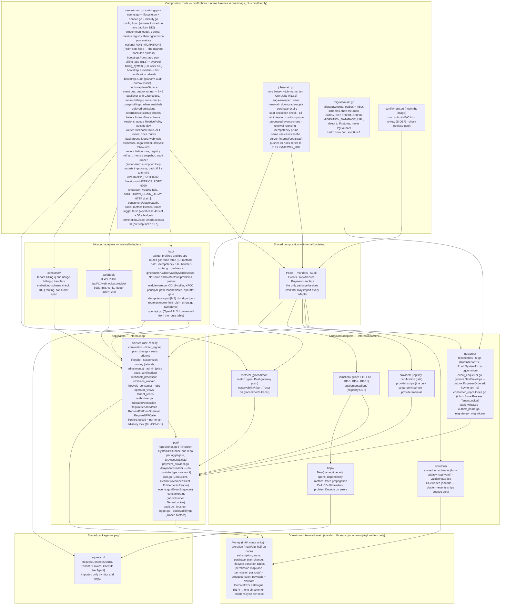
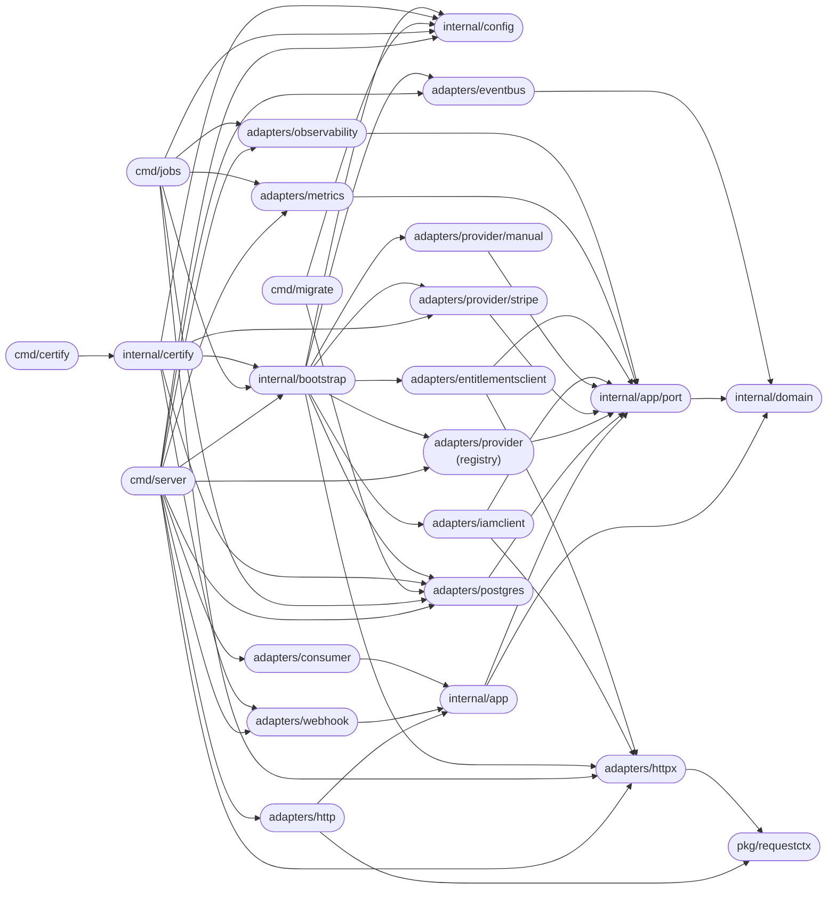
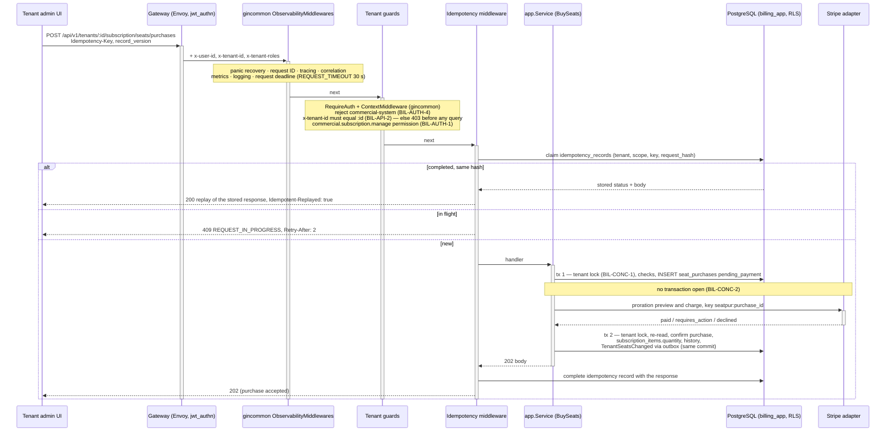
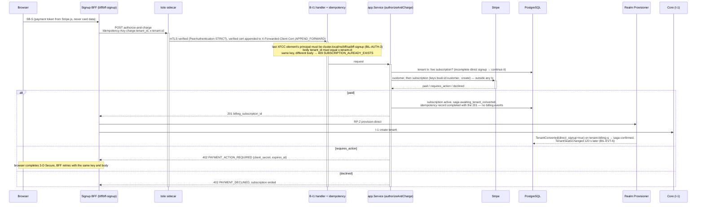
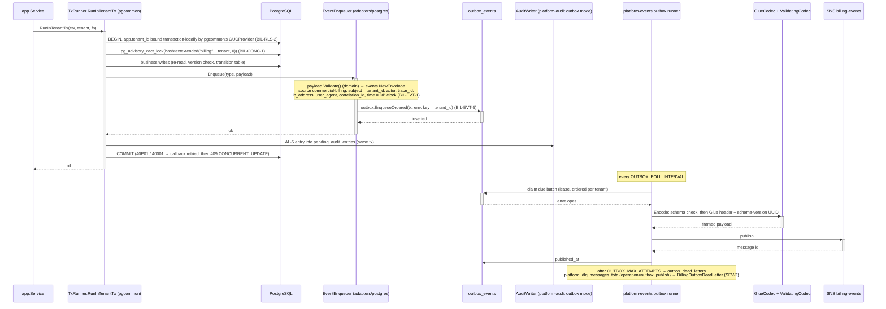
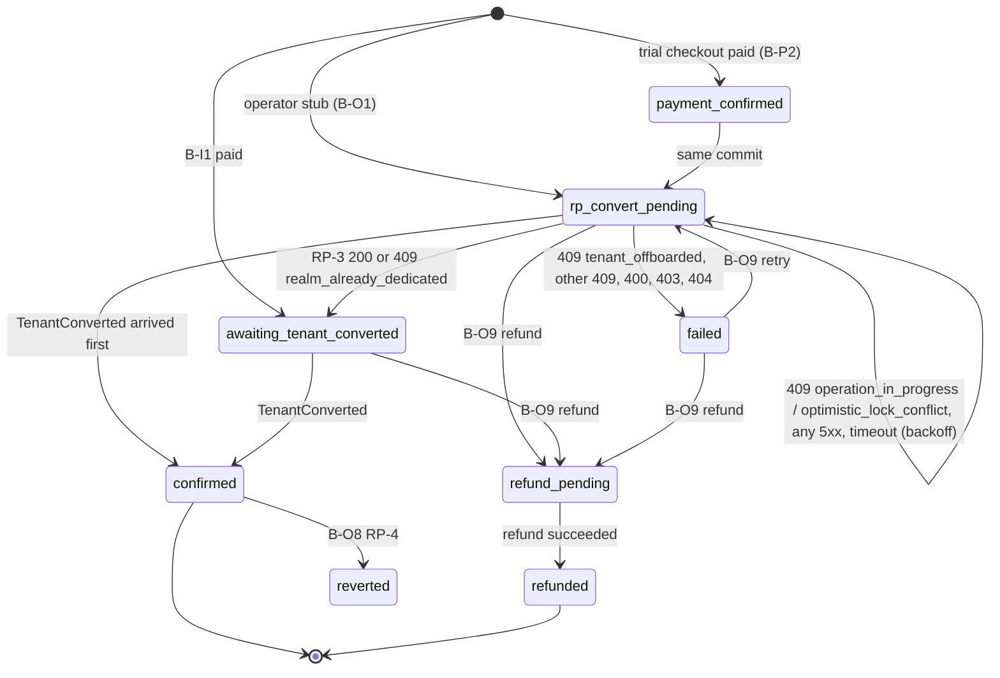
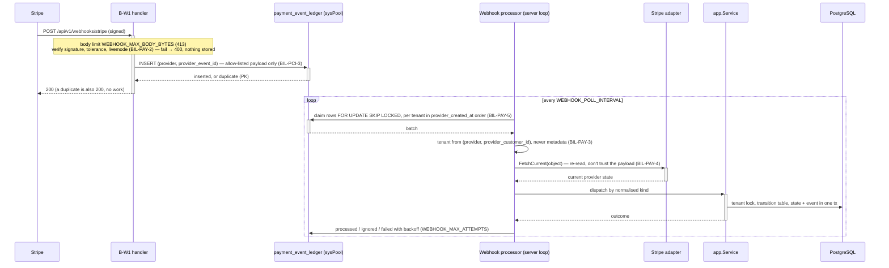
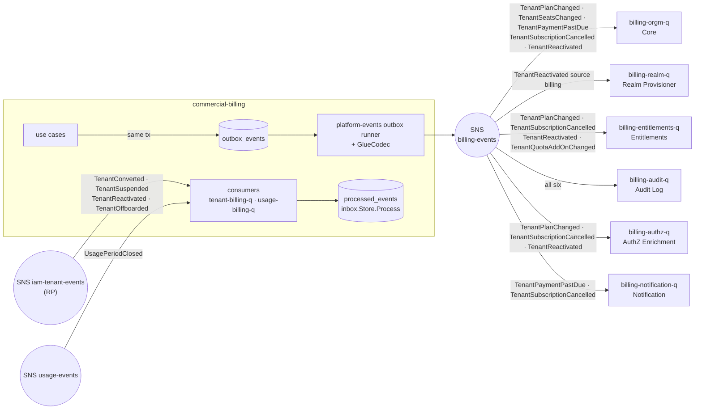

# Architecture

This document describes the internal structure, dependency rules and runtime data flows of `commercial-billing-service`.

`commercial-billing` is a **private Go service** (`github.com/BCBP-SOLUTIONS-FZC-LLC/commercial-billing-service`, Go 1.26.11), deployed as a containerised microservice in namespace `billing` (HPA 2–4 replicas). It refines the **Commercial Domain HLD v0.65** and is specified by its LLD, [`docs/lld/commercial-lld-billing-service.md`](docs/lld/commercial-lld-billing-service.md) (rev 0.69). The LLD is the source of truth: where this document and the LLD disagree, the LLD wins, and this document should be fixed.

**What Billing owns:**
- subscriptions, renewals and seat licensing;
- token add-ons;
- the payment-provider integration (Stripe, plus a `manual` stub provider);
- invoices, refunds, adjustments and disputes as the platform sees them;
- the billing lifecycle events on `billing.events`.

**Scale and money:** it is not on any per-request hot path; IAM and Entitlements never call it synchronously. It does move money, so its central rules are:
- never charge twice;
- never lose an event;
- never store card data (PCI SAQ A).

**Three binaries ship from one image:**
- `cmd/server` (`/commercial-billing`), which runs:
  - the HTTP surface: tenant, internal, webhook and operator routes;
  - the `tenant-billing-q` consumer, plus the `usage-billing-q` consumer only when `USAGE_BILLING_CONSUMER_ENABLED=true` (default `false`, BL-OQ-24);
  - the platform-events outbox runner and the platform-audit outbox runner;
  - the webhook processor, the saga worker, the lifecycle follow-up worker and the reconciliation worker;
  - the delayed-emission worker, the provider-registry refresh and a metrics snapshot exporter.

  Every in-pod loop runs under the supervisor in `cmd/server/lifecycle.go`, which restarts a stopped loop in-process (the platform-audit runner, single-use, is the one exception and fails liveness instead).
- `cmd/jobs` (`/jobs`): one binary dispatched by `--job=<name>`, covering 10 CronJobs.
- `cmd/migrate` (`/migrate`): applies the schema once per release as a Helm pre-install/pre-upgrade hook Job, then exits.

A fourth binary, `cmd/certify`, is the provider certification suite. It is an operator and CI tool and is not in the runtime image.

**Does not own:**
- tenant data and lifecycle (IAM Core / Org & Membership);
- realms and Keycloak (Realm Provisioner, which Billing reaches only through RP-3, RP-4 and RP-11);
- quotas, entitlements and eligibility truth (Entitlements);
- usage counting (Usage & Metering);
- audit records (Audit Log, through platform-audit);
- notifications (Notification);
- card data, which stays with the provider: the browser tokenises it, and no PAN, CVV or expiry ever reaches Billing.

**State:** Phases 0–8 are implemented. Phases 0–5 are on the stacked branches `feat/billing-phase-0-scaffolding` … `feat/billing-phase-5-api`; phases 6–8 and all later work, including the fixes from two production-readiness review rounds (LLD rev 0.59 and 0.60), are on `feat/billing-phase-6-flows`. `main` holds only the LLD. Nothing is deployed to any environment.

---

## Layer model

The service is organised in concentric hexagonal layers, and dependencies point inward:
- `internal/domain` knows nothing else in the project;
- `internal/app` (use cases) knows the domain and the ports;
- adapters implement the ports;
- only the composition roots wire adapters into use cases.



**Rule:** `domain` ← `port` ← `app` ← adapters ← `bootstrap` / `cmd`. CI enforces it with `go-arch-lint` (`.go-arch-lint.yml`, run by `make arch-lint`). Lint and guard scripts enforce the vendor rules that an import-level component check can't see:

| Rule | Enforced by |
|---|---|
| Only `adapters/provider/stripe` imports `github.com/stripe/*` (`BIL-PCI-1`) | `check-stripe-imports.sh` |
| Database drivers are denied everywhere; `platform-pgcommon` only in `adapters/postgres`, `bootstrap`, `certify`, `cmd/*` (`BIL-OPS-1`, `BIL-OPS-11`) | depguard `database`, `database-boundary`; `check-pgcommon.sh` (SQLSTATE literals, hand-written session settings) |
| SNS / SQS SDKs denied everywhere; Glue SDK only in `adapters/eventbus`; `platform-events` only in `eventbus`, `postgres`, `consumer`, `bootstrap`, `certify`, `cmd/*` (`BIL-OPS-2`) | depguard `events`, `events-glue`, `events-boundary`; `check-outbox-access.sh` |
| Logs, metrics, traces only through `platform-gincommon`; Prometheus denied in production code; OpenTelemetry only in `adapters/observability` (`BIL-OPS-10`) | depguard `observability`, `metrics`; forbidigo (`fmt.Print*`, `println`, `gin.Default` / `gin.Logger`) |
| Every error response produced by gincommon; no service-owned problem model, DTO, parser or recovery (`BIL-API-6`) | `check-problem-details.sh` |

`make guards` runs the four scripts. `make lint` runs golangci-lint (version pinned through the `go.mod` `tool` directive) with the default build and every test build tag (`integration`, `helm`).

---

## Package dependency graph

Arrows are Go `import` relationships between project packages, as `go list` reports them for production code. Edges from the composition roots (`cmd/*`, `internal/bootstrap`, `internal/certify`) to `app`, `port` and `domain` are left out for legibility. `.go-arch-lint.yml` is the enforced rule set; it also allows a few edges the code doesn't use today (inbound adapters → `metrics`, provider registry → `stripe` / `manual`, `stripe` → `httpx`, `eventbus` → `port`). Vendor imports are governed by depguard, not shown.



`config` and `pkg/requestctx` depend on no other project component, and `requestctx` is imported only by `http` (the router) and `httpx` (forwards `X-Request-ID`). Every adapter except `observability`, `httpx` and the registry also imports `domain`, and the inbound adapters import `port` (not drawn). Inbound adapters may import `metrics` to count outcomes where they happen; today `cmd/server` passes the metrics in instead. The app layer reports through `port.Metrics` and `port.Tracer`, not through adapters.

---

## Request flow

Routes fall into four groups with different callers and guards (LLD §5.3).

| Group | Paths | Caller | Guards (in order, after the global chain) |
|---|---|---|---|
| Tenant B-P1…B-P26 | `/api/v1/tenants/:id/…` | Tenant admin UI through the gateway (CD-19 headers `x-user-id`, `x-tenant-id`, `x-tenant-roles`) | `gincommon.ProtectedMiddlewares` (RequireAuth, ContextMiddleware) → `rejectSystemCaller` (`BIL-AUTH-4`) → body limit → JSON content type → `requirePathTenant` (`x-tenant-id` = `:id`, `BIL-API-2`) → per-route `requirePermission` (`BIL-AUTH-1`, `BIL-AUTH-7`) → idempotency |
| Internal B-I1 | `POST /api/v1/internal/subscriptions/authorize-and-charge` | Signup BFF over the mesh | `requireBFFCaller` (SPIFFE principal from `X-Forwarded-Client-Cert` = `BFF_CALLER_PRINCIPAL`, `BIL-AUTH-3`) → `rejectSystemCaller` → idempotency |
| Webhook B-W1 | `POST /api/v1/webhooks/:provider` | Payment provider | No identity middleware. The provider signature is the only trust (`BIL-AUTH-5`) |
| Operator B-O1…B-O17 | `/api/v1/operator/…` | Platform operator through the operator gateway | Operator-action counter → `ProtectedMiddlewares` → `rejectSystemCaller` → `requireOperator` (`platform_operator`, `403` until `OPERATOR_PATH_LIVE`, `BIL-AUTH-2`, `BIL-AUTH-6`) → body limit → JSON content type. B-O17 additionally requires `pci_owner_reviewer`, not held by the submitter (`BIL-PROV-4`) |

The sequence below follows a seat purchase (B-P7). It is a typical charging tenant route: idempotent, locked per tenant, calls the provider outside any transaction, and commits the state change and its event together.



**Middleware execution model.** `internal/adapters/http/router.go` (`NewRouter`) builds the engine with `gin.New()`, never `gin.Default()`:

```
http.MaxBytesReader (engine-wide body cap)
  gincommon.ObservabilityMiddlewares (PanicRecovery · RequestID · Tracing · Correlation · Metrics · Logging · Timeout, innermost)
    /healthz, /readyz                                — probes, no auth
    /openapi.json, /asyncapi, /asyncapi.yaml          — API documents, no tenant data
    /api/v1/webhooks/:provider                       — B-W1, no identity middleware
    /api/v1/internal/subscriptions/authorize-and-charge — requireBFFCaller · rejectSystemCaller · idempotency
    [/api/v1/tenants/:id group]  ProtectedMiddlewares · rejectSystemCaller · bodyLimit · requireJSONContentType · requirePathTenant
        per route: requirePermission · idempotency (required | optional | none) · handler
    [/api/v1/operator group]     countOperatorAction · ProtectedMiddlewares · rejectSystemCaller · requireOperator · bodyLimit · requireJSONContentType
        per route: idempotency · handler
  NoRoute → gincommon 404 problem · NoMethod → gincommon 405 problem
```

Every error on every path is an RFC 9457 problem produced by platform-gincommon (`BIL-API-6`):
- domain errors convert themselves to gincommon's `*problem.Error`;
- handlers call `writeError`, which calls `gincommon.AbortWithProblem`;
- binding errors are `gincommon.BindingError`;
- a recovered panic is gincommon's 500.

Billing adds only the `Retry-After` header (on `409 REQUEST_IN_PROGRESS` and `503`) and the idempotency replay. The replay re-sends the stored response, which is the same JSON document; it is not the same bytes, because `idempotency_records.response_body` is `jsonb` and Postgres normalises key order and spacing.

**Probes:**
- **`/healthz`** (liveness) never checks a dependency. It fails only when the platform-audit runner's `Alive()` fails; a background loop that stops is restarted in-process with backoff (1 s → 5 min) and alerted (`BillingBackgroundLoopStopped`), not a liveness failure (LLD rev 0.60).
- **`/readyz`** (readiness) checks the app pool and the sysPool. They are separate physical connections, so a credential rotation on `billing_system` alone is caught.

---

## Direct paid signup (B-I1)

B-I1 is the only internal route, and the only one whose caller is a service rather than a user. The Signup BFF calls it before the tenant exists in IAM, so there is no tenant to authorise against. The caller is identified by its mesh certificate.



**Rules:**
- **Flag:** B-I1 is behind `FEATURE_DIRECT_SIGNUP`, which defaults to `false`.
- **3-D Secure abandoned:** if 3-D Secure isn't completed within `SCA_ABANDON_AFTER` (30 min), the retry answers `410 CHARGE_EXPIRED` and `purchase-expiry` cancels the provider subscription.
- **Paid but never provisioned:** `saga-sweeper` pages `BillingConversionSagaOverdue` 30 minutes after payment (`BIL-OPS-5`), and runbook §20.1 refunds through B-O9.
- **Contract:** LLD §5.4.2; status of the BFF alignment in `docs/lld/billing-open-items.md` (BL-OQ-8).

---

## Write flow and transactional outbox

Every state change and its event commit in **one** transaction (`BIL-EVT-2`): no event without state, no committed state without its event. Provider, IAM and Entitlements calls never run inside a transaction (`BIL-CONC-2`). The pattern:
1. Commit the intent (`pending_payment`, a saga step, `applying`).
2. Call outside the transaction.
3. Commit the outcome under the per-tenant lock, re-reading state first.

A crash between steps leaves a row that a worker, a provider callback or `purchase-expiry` completes.



The outbox always stores plain JSON. The Glue framing happens at publish time in the SNS publisher (`events.WithCodec`). At startup the server resolves the Glue schema version of every produced schema by definition, so a deploy that outruns schema registration fails to start instead of publishing unregistered payloads.

**Delayed emissions.** The seat event after a conversion is held for `SEATS_AFTER_CONVERSION_DELAY` (120 s, `BIL-EVT-6`). This lets Core apply `TenantConverted` first. The event waits as a row in `scheduled_emissions`; the emission worker enqueues it through the same outbox when it is due.

---

## Conversion saga

Trial-to-paid conversion spans Billing, the provider and the Realm Provisioner. It runs as a saga persisted in `conversion_sagas`, one per `billing_subscription_id` (`BIL-SAGA-2`).



**How the saga runs:**
- **RP-3 only after server-side payment confirmation** (`BIL-SAGA-1`): either a verified, re-read callback or a provider API response, never a client submission. It always sends the key `convert:<tenant_id>:<billing_subscription_id>`.
- **The saga worker** (`SagaPollInterval`) claims due sagas with a lease, calls RP-3 outside any transaction, and applies the answer under the tenant lock after a re-read.
- **`saga-sweeper`** raises `BillingConversionSagaOverdue` (SEV-2) once per saga when it is unconfirmed 30 minutes after payment (`BIL-OPS-5`).
- **Reversal** (B-O8, RP-4 within 7 days) is operator-approved only (`AUTO_REVERT_ON_EFW=false`).

---

## Webhook pipeline

Provider callbacks are not bus events. They arrive on B-W1 and are made durable before anything else happens.



Every `failed` ledger row has one of three endings (`BIL-OPS-6`):
- it is retried until it succeeds;
- an operator sets it `ignored` with a reason (B-O13 replay);
- the next reconciliation run (B-O5) lists it.

**Parked outcomes and purchase settlement** (LLD rev 0.59, 0.60; `internal/app/webhook_processor.go`, `purchase_invoice.go`):
- Some payments cannot be applied safely and are parked instead of retried, with a SEV-2 log line `BillingPaymentParked` for an operator (runbook `operator-review.md`): `failed:checkout_superseded` (a checkout Billing expired was completed anyway), `failed:paid_after_end` (the first invoice was paid for an ended subscription) and `failed:invoice_amount_mismatch`.
- A purchase's invoice (seats, upgrade, add-on) is re-read outside any transaction when a purchase is declined or expires: `open` is voided, `draft` deleted, and `paid` settles the purchase only when the amount paid (or total) and the currency equal the purchase's (`BIL-PAY-7`); otherwise nothing is granted and the payment is parked.
- An invoice Billing has not recorded is looked up with `FindInvoice` (add-ons by metadata `purchase_id`, proration invoices by subscription, amount, currency and lines, never from before the purchase). An invoice already recorded on another purchase or plan change is never used, re-checked under the tenant lock (`BIL-PAY-6`).
- An unlinked `invoice.paid` is resolved through the `billing_subscription_id` metadata of the provider subscription on the re-read invoice; a Billing subscription linked to a different provider subscription is `ignored:superseded_provider_subscription`.

---

## Cache strategy

Billing has **no shared cache**. Money, seat and status state is always read from Postgres or the provider.

| Cache | Where | TTL | Used by | Failure mode | State |
|---|---|---|---|---|---|
| Entitlements display | `app.quotaCache`, per pod | 60 s | B-P19 pack list `eligible` | Miss → Entitlements; failure → `eligible: false` | Implemented |
| Price book | — | (300 s in LLD §6) | Pricing reads | — | **Not implemented**: pricing reads Postgres every time |
| I-11 display | — | (30 s in LLD §6) | B-P1 `renewal_estimate`, B-P10 | — | **Not implemented**: I-11 is called each time |

**Never cached, by rule:**
- I-11 for any seat floor or renewal count (`BIL-SEAT-3`);
- I-18 (checked at request and again at effect);
- Entitlements on a purchase (B-P20, `BIL-ADD-1`, fail closed);
- payment methods (B-P15, never stored, `BIL-PCI-2`).

---

## Data model

**Database:**
- one Postgres 17 database, with PgBouncer in transaction mode for the app pool; migrations go direct;
- **25 Billing tables**, plus platform-events' `outbox_events`, `outbox_dead_letters` and `processed_events`, and platform-audit's `pending_audit_entries`;
- migrations `000001`–`000007` (`internal/adapters/postgres/migrations`), applied after the library schemas (LLD §4.4); `000007` narrows `EXECUTE` on the RLS helpers (`rls_check_tenant` for `billing_app`, `admin_readonly` and `billing_audit_drainer` only).

**RLS:** **18 Billing tables** are tenant-scoped, as is `pending_audit_entries`. Each has `ENABLE` + `FORCE ROW LEVEL SECURITY` and the `tenant_isolation` policy (`rls_check_tenant(tenant_id, '<table>')`, `BIL-RLS-1`).

**Global tables** (no RLS, written through `billing_system` only, `BIL-RLS-3`):
- `plan_prices`, `token_packs`;
- `payment_event_ledger`;
- `reconciliation_runs`, `reconciliation_findings`;
- `provider_certifications`;
- `rls_violation_log`.

```mermaid
erDiagram
    billing_accounts {
        uuid tenant_id PK
        text provider
        text provider_customer_id "chk_ba_customer"
        char currency "fixed while a live subscription exists (BIL-SUB-6)"
        iam_lifecycle iam_lifecycle "projection of IAM lifecycle events"
        timestamptz iam_last_event_at "recency guard (BIL-EVT-3)"
        timestamptz pii_minimised_at "pii-minimisation, never deletes (BIL-OPS-9)"
        bigint record_version
    }
    subscriptions {
        uuid billing_subscription_id PK
        uuid tenant_id FK
        subscription_origin origin "trial_conversion, direct_signup, operator_stub"
        plan_code plan
        billing_interval interval
        subscription_status status "incomplete, active, past_due, cancelled, ended"
        boolean collection_paused "CD-24, BIL-SUB-7"
        timestamptz payment_confirmed_at
        timestamptz converted_at
        bigint record_version
    }
    subscription_items {
        uuid item_id PK
        uuid billing_subscription_id FK
        text kind "seats"
        uuid price_id FK
        int quantity "changes only on confirmed payment or renewal (BIL-SUB-5)"
        uuid scheduled_price_id "renewal repricing (BIL-SUB-8)"
    }
    conversion_sagas {
        uuid saga_id PK
        uuid billing_subscription_id UK
        saga_state state
        text rp_idempotency_key "convert:tenant:sub"
        timestamptz next_attempt_at
        timestamptz alerted_at "BIL-OPS-5, once"
    }
    seat_purchases {
        uuid purchase_id PK
        uuid billing_subscription_id FK
        int seats_added
        bigint amount_minor
        numeric amount_unrounded_minor "fallback calculator inputs (BIL-SEAT-5)"
        bigint deferred_amount_minor
        purchase_status status "uq_sp_one_open (BIL-SEAT-1)"
        text idempotency_key
    }
    seat_change_schedules {
        uuid schedule_id PK
        int target_seats "uq_scs_one_open (BIL-SEAT-2)"
    }
    quota_addon_purchases {
        uuid purchase_id PK
        text pack_code
        bigint tokens_total
        purchase_status status
        uuid event_id "TenantQuotaAddOnChanged (BIL-ADD-2)"
    }
    invoices {
        uuid invoice_id PK
        text provider_invoice_id
        invoice_kind kind
        invoice_status status
        bigint amount_due_minor
        boolean held_for_review "collection pause drafts"
        text disposition "B-O16"
    }
    refunds {
        uuid refund_id PK
        uuid invoice_id FK
    }
    plan_prices {
        uuid price_id PK
        plan_code plan
        billing_interval interval
        char currency
        bigint unit_amount_minor
        tstzrange effective "excl_pp_overlap"
    }
    payment_event_ledger {
        text provider PK
        text provider_event_id PK
        text normalised_kind
        uuid tenant_id "resolved from the customer mapping"
        jsonb payload "allow-listed fields only (BIL-PCI-3)"
        ledger_status status
    }
    idempotency_records {
        uuid tenant_id PK
        text scope PK
        text key PK
        bytea request_hash
        text state "in_flight, completed"
        jsonb response_body
        timestamptz expires_at "72 h (BIL-IDEM-3)"
    }
    scheduled_emissions {
        uuid emission_id PK
        text event_type
        timestamptz due_at "BIL-EVT-6"
    }
    provider_certifications {
        uuid id PK
        text provider
        text adapter_version
        text status "pending_review, passed, exempt, … (trg_pc_guard, chk_pc_two_people)"
    }

    billing_accounts ||--o{ subscriptions : "has (one non-ended, BIL-SUB-3)"
    subscriptions ||--o{ subscription_items : has
    subscriptions ||--o| conversion_sagas : "converted by"
    subscriptions ||--o{ seat_purchases : "bought on"
    subscriptions ||--o{ seat_change_schedules : "reduced by"
    billing_accounts ||--o{ quota_addon_purchases : buys
    billing_accounts ||--o{ invoices : billed
    invoices ||--o{ refunds : "refunded by"
    plan_prices ||--o{ subscription_items : prices
```



Other tables:
- `subscription_status_history`, `checkout_sessions`, `plan_change_requests`;
- `invoice_links`, `adjustments`, `disputes`;
- `usage_period_records` (reference only; nothing is priced from it);
- `token_packs`.

Constraints and triggers that carry invariants (`uq_sub_one_live`, `uq_sp_one_open`, `uq_scs_one_open`, `excl_pp_overlap`, `trg_pc_guard`) are each covered by a test in `test/postgres/constraints_test.go`.

**Roles (§4.1):**
- `billing_migrator` owns the schema;
- `billing_app` is RLS-bound and used by tenant work;
- `billing_system` is BYPASSRLS and used only for webhook pre-resolution, cron tenant listing, reconciliation and global writes;
- `billing_audit_drainer` runs the platform-audit runner;
- `admin_readonly` is for operators.

---

## Event and outbox flow



**Produced events (§7.3):**
- **Delivery:** the CloudEvents-style envelope comes from platform-events, with `source: commercial-billing`, `subject = tenant_id` and `time` taken from Billing's clock at commit.
- **Payloads are snapshots** (absolute plan and seats, `BIL-EVT-4`), so redelivery and reordering converge. The exception is `TenantQuotaAddOnChanged.delta`, made idempotent at Entitlements by `billing_ref`.
- **Status events only on a real transition** (`BIL-EVT-7`), and never for an `incomplete` subscription (`BIL-EVT-8`).

**Consumed events (§7.1):**
- **Pipeline:** platform-events SQS consumers with `GlueDecodeCodec`, a check against Billing's embedded consumed schemas, and `inbox.Store.Process`. The inbox claims the envelope id as the first statement of the handler's own tenant transaction, so the handler's writes happen exactly once.
- **Recency:** IAM lifecycle events apply last-writer-wins on envelope `time` against `billing_accounts.iam_last_event_at`, with a 300 s future clamp (`BIL-EVT-3`).
- **Dead letters:** decode failures, schema violations and future-time poison pills go straight to the DLQ; other failures go there after 4 receives.

**Contracts:**
- `api/asyncapi.yaml` is the source; `make schema-extract` derives `internal/adapters/eventbus/schemas/*.json` (schema-gov 0.4).
- `test/contract` validates every produced sample against Billing's schema and each consumer's vendored schema: Core, Realm Provisioner, Audit Log and Entitlements, the last also decoded into Entitlements' structs.
- `.github/workflows/contract-live.yml` runs the Entitlements check daily against Entitlements' `main`.

---

## Observability stack

Everything goes through platform-gincommon (`BIL-OPS-10`):
- **Logs:** gincommon's structured logger, with trace and span correlation from `port.Tracer`. No PII or card data appears in them.
- **Traces:** OTel through gincommon:
  - `ObservabilityMiddlewares` for server spans;
  - `httpx` client spans with W3C propagation via `InjectTraceContext`;
  - pgcommon query spans through `gincommon.NewSpanTracer`;
  - consumer spans linked to the producer's trace (span links).
- **Metrics** follow the Enterprise Platform Observability Standard (LLD §11.2), on gincommon's registry, served on `METRICS_PORT`. CronJobs push their run's series to the Pushgateway.

| Tier | Namespace | What | How |
|---|---|---|---|
| 1 | `platform_*` | HTTP, messaging, outbox, DB pool, audit, `platform_dependency_request_seconds` | Registry entries only, through gincommon's shared constructors and the platform libraries |
| 2 | `commercial_*` | None — nothing is ratified | Candidates in [`docs/observability/registry-proposals.md`](docs/observability/registry-proposals.md) |
| 3 | `commercial_billing_*` | Webhooks, sagas, purchases, seats, dunning, reconciliation, certification, operator actions, events emitted, job runs | gincommon's validated constructors (prefix, `_total` / `_seconds`, label names) |

**Labels and inventory:**
- `domain="commercial"`, `service="commercial-billing"` and `environment` are injected centrally, so instrumentation can't omit them.
- The registry's high-cardinality labels (`tenant_id`, `user_id`, `request_id`, …) are refused.
- The inventory is generated into [`docs/observability/metric-registry.md`](docs/observability/metric-registry.md) by `make metrics-inventory`.

**Rules and dashboards** (`deploy/monitoring/`, with chart copies under `deploy/helm/files/`):
- `app-alerts.yml`: 27 rules for 20 Billing alerts (`BillingWebhookBacklog` has two thresholds, `BillingCronJobNotSucceeding` one rule per job cadence, `BillingCronJobNeverSucceeded` a SEV-2 rule for `saga-sweeper` and a SEV-3 rule for the others), each with a `runbook_url` into [`docs/runbooks/`](docs/runbooks/). Log-based alerts (`BillingReversalDecisionNeeded`, `BillingReviewTrigger`, the SEV-2 `BillingPaymentParked`) are Loki rules owned by the observability team;
- `recording-rules.yml` and `slo-rules.yml`: availability and latency SLOs with burn-rate alerts;
- the vendored `platform-audit.rules.yml`;
- the "Commercial / Billing" Grafana dashboard, and the shared "Platform audit delivery" dashboard;
- `schema-registry-alerts.yml`: four alerts on the Glue registration pipeline (`schema-gov metrics` via the Pushgateway), with the runbook [`schema-registration.md`](docs/runbooks/schema-registration.md);
- `prometheus-adapter-rule.yaml`: the External Metrics API rule behind the HPA's webhook-backlog metric.

**AWS access** ([`deploy/iam/`](deploy/iam/README.md)): the pod's IRSA role may publish to SNS `billing-events`, consume `tenant-billing-q` / `usage-billing-q`, forward to their DLQs, and read Glue `billing-events`. Nothing else: no S3, KMS, Secrets Manager or CloudWatch, and no Glue writes, which are CI-only.

**CI** (`make metrics-lint`, also part of `make test`):
- `metricslint` on the scrape;
- `metricslint refs` on every rule, dashboard, HPA value and runbook;
- `TestReferencedPlatformMetricsAreRegistered`, which checks registry membership for referenced gauges too;
- inventory drift;
- `promtool` (in `helm-check`).

---

## Row-Level Security (RLS) and GUC injection

**How tenant isolation is enforced:**
1. **App pool.** Every tenant transaction runs on the app pool (`billing_app`) through `TxRunner.RunInTenantTx`. It calls `pgcommon.WithGUCSet(ctx, GUCSet{TenantID})`, and the pool's `GUCProvider` (`pgcommon.GUCSetFromContext`) binds `app.tenant_id` with `set_config(…, true)`, transaction-local, on every checkout (`BIL-RLS-2`). It is never session-wide, so a PgBouncer-pooled backend can't leak one tenant's GUC to the next transaction.
2. **Policy.** `tenant_isolation` on each tenant table calls `rls_check_tenant(tenant_id, '<table>')`. A missing or malformed GUC matches no rows, and a 1% sample of violations is recorded in `rls_violation_log` (which has RLS disabled on itself). `FORCE` applies the policy to the table owner too.
3. **sysPool.** The `billing_system` pool (BYPASSRLS) is used only where no tenant is known yet or work is deliberately cross-tenant:
   - webhook pre-resolution and ledger claims;
   - cron tenant listing;
   - reconciliation;
   - global price-book and certification writes with their AL-5 entry in one transaction (`BIL-AUD-1`).

   Tenant handlers get no sysPool: constructor injection keeps it out (`BIL-RLS-3`).
4. **Hand-written session settings are forbidden.** `check-pgcommon.sh` fails on `set_config(`, `SET LOCAL` / `SET SESSION`, and statement or lock timeouts in Go code. Those belong to pgcommon's `Config`, `GUCProvider` and `WithGUCSet`.

`test/postgres` lists `pg_class` and fails on any tenant table without `FORCE` RLS (`BIL-RLS-1`). It also covers the §14.5 cases: cross-tenant reads and writes, a missing GUC and an invalid GUC.

---

## Concurrency and optimistic locking

| Mechanism | Where | Purpose |
|---|---|---|
| Per-tenant advisory lock `pg_advisory_xact_lock(hashtextextended('billing:' \|\| tenant_id, 0))` | `Service.locked`, `TenantLocker` | Serialises every write to a subscription, item, schedule, purchase or saga, from requests, webhooks, consumers, workers and jobs alike (`BIL-CONC-1`) |
| No HTTP in a transaction | All use cases | Commit intent, call, commit outcome with a re-read (`BIL-CONC-2`) |
| `record_version` | Client mutations of versioned rows | A zero-row update is diagnosed: not found → `404`, version moved → `409 OPTIMISTIC_LOCK_CONFLICT` (`BIL-CONC-3`) |
| `pgcommon.RunInTxWithRetryOpts` | `TxRunner` | Retries `40P01` / `40001` up to 3 times, then `409 CONCURRENT_UPDATE` (`BIL-CONC-4`) |
| Partial unique indexes | `uq_sub_one_live`, `uq_sp_one_open`, `uq_scs_one_open` | One live subscription, one open seat purchase and one open reduction per subscription, enforced even if a code path forgets the lock |
| Idempotency records | `idempotency_records`, `locked_until` 30 s | One charge per key; a concurrent duplicate gets `409 REQUEST_IN_PROGRESS` |
| Leases | Saga worker, webhook processor (`claimed_until`), outbox runner | Several pods share background work without double-processing |

**Error mapping.** Database errors are classified only with pgcommon's helpers (`IsUniqueViolation`, `IsCheckViolation`, …, `ConstraintName`) and mapped to domain codes or port errors inside `adapters/postgres`. One example is `port.ErrAccountExists`; the app layer never sees a SQLSTATE. The mapping:
- connection and resource classes → `503 DB_UNAVAILABLE`;
- statement and lock timeouts → `503 REQUEST_TIMEOUT`.

---

## Failure domains

| Failure | Detection | Behaviour |
|---|---|---|
| Billing down | Readiness, availability SLO | Provider retries webhooks for up to 3 days; tenant purchase routes unavailable; IAM, Entitlements and enforcement are unaffected (Billing is on no hot path) |
| Provider down | `platform_dependency_request_seconds{dependency="stripe",outcome="error"}`, `BillingProviderUnavailable` | New charges `503 PROVIDER_UNAVAILABLE` with `Retry-After`; existing subscriptions and access unaffected; callbacks queue at the provider |
| Core down (I-11, I-18) | Client `503`, `BillingI18Unavailable` | Downgrade blocked (fail closed); seat-floor operations `503`; display fields `null` |
| Realm Provisioner down | Saga errors | Saga backs off with the same key; pages at 30 min; never a second charge |
| Entitlements down | Client error | Add-on purchase `503 ENTITLEMENTS_UNAVAILABLE` (fail closed); pack list `eligible: false` |
| Audit Log down | platform-audit runner | Entries wait in `pending_audit_entries`; business writes unaffected |
| SNS down | Outbox publish errors | Outbox retries; after `OUTBOX_MAX_ATTEMPTS` → dead letters → `BillingOutboxDeadLetter` (SEV-2); state is committed, publication catches up |
| Consumer failures | `platform_messages_failed_total` | Redelivery; DLQ at receive 4 → `BillingDLQNotEmpty` |
| Glue schema not registered | Startup | Server refuses to start until the schema is registered |
| No certified provider | `BillingProviderNotCertified` | No new accounts on that provider (`BIL-PROV-1`); running work continues |
| Signature failure spike | `commercial_billing_webhook_signature_failures_total` | SEV-2 (possible spoofing); nothing stored |
| Paid, saga not confirmed | `saga-sweeper` | `BillingConversionSagaOverdue` (SEV-2) at 30 min; runbook: retry or refund (B-O9) |
| Seat projection drift | `seat-projection-check` | Re-emits the seat snapshot with a fresh `time` |

Full table: LLD §9.5. Runbooks: [`docs/runbooks/`](docs/runbooks/) (27 files: a README index and 26 runbooks, one per alert family plus operator review, reversal decision, dependency degradation, disaster recovery, key rotation, certification and the Test Clock rehearsal).

---

## Key invariants

76 `BIL-*` invariants are defined in the LLD. Each is referenced by ID at its enforcement point and tested by a test whose name contains the ID. [`docs/invariants-coverage.md`](docs/invariants-coverage.md) maps every one to its enforcement location, test and status. The ones that shape the architecture:

| Invariant | Rule |
|---|---|
| `BIL-PCI-1..3`, `BIL-API-4` | No card data, provider key or webhook secret anywhere; `client_secret` only in the 3-D Secure action returned to the payer; stripe-go only in the Stripe adapter |
| `BIL-CONC-1`, `BIL-CONC-2` | Per-tenant lock on every write; no HTTP inside a transaction |
| `BIL-EVT-2`, `BIL-EVT-5` | State and event in one transaction, ordered per tenant through the outbox |
| `BIL-PAY-1..7` | Ledger first, verify, resolve tenant from Billing's mapping, re-read, per-tenant order; one invoice settles at most one purchase; a purchase is granted only for an invoice paid in its amount and currency |
| `BIL-IDEM-1..3`, `BIL-API-3` | A charging route stores its outcome before returning; provider keys from Billing ids only |
| `BIL-SAGA-1`, `BIL-OPS-5` | RP-3 only after server-side payment confirmation; an unconfirmed saga pages once at 30 min |
| `BIL-SUB-3`, `BIL-SUB-4`, `BIL-SUB-5` | One live subscription; transitions only through the domain table; seats change only on confirmed payment or renewal |
| `BIL-RLS-1..3` | `FORCE` RLS on every tenant table; transaction-local GUC; sysPool only on listed paths |
| `BIL-PROV-1..4` | A provider takes new accounts only when certified for its adapter version; `passed` only by a second person |
| `BIL-AUTH-1..7` | Identity from headers or XFCC only; one permission per route; operator routes gated until the operator path is live |
| `BIL-OPS-1`, `-2`, `-10`, `-11`, `BIL-API-6` | Database, events, observability and errors only through the platform libraries |
| Money | `int64` minor units; the fallback proration calculator uses `math/big` and rounds half-up once (`BIL-SEAT-5`) |

---

## Deployment

### Container image — three binaries

`Dockerfile`: a two-stage build on `golang:1.26.11-alpine`, then `gcr.io/distroless/static-debian13:nonroot`, running as a non-root user. The image contains:
- `/commercial-billing`, the server and the entrypoint;
- `/jobs`, used by the CronJobs (`--job=<name>`);
- `/migrate`, used by the migrate hook Job.

`cmd/certify` is built by `make build` but is not shipped in the image.

### Helm chart

`deploy/helm` (chart 0.7.0, `kubeVersion >=1.30`): namespace `billing`, with ServiceAccount and `app.kubernetes.io/name` both `commercial-billing` (`BIL-OPS-4`).

- **Workload:**
  - Deployment: 2 replicas, `terminationGracePeriodSeconds: 60` with a native `preStop` sleep of 10 s (Kubernetes ≥ 1.30), leaving the app a 50 s shutdown budget (worst case 48 s, `cmd/server/lifecycle.go`); probes time out after 6 s; liveness covers only the audit runner's `Alive()` (stopped loops restart in-process);
  - HPA 2–4 on CPU 70%, plus an optional external metric on the webhook backlog;
  - PDB;
  - ten CronJobs (`concurrencyPolicy: Forbid`) with schedules matching `cmd/jobs`, and pools of `PG_MAX_CONNS` 3, `PG_MIN_CONNS` 0, `PG_SYSTEM_MAX_CONNS` 2;
  - the migrate pre-install / pre-upgrade hook Job (weight -5, no sidecar, `activeDeadlineSeconds` 480, `MIGRATE_TIMEOUT` 7m, both under `release.yml`'s Helm `--timeout=10m`), with its own hook ServiceAccount `commercial-billing-migrate` (no IRSA) and hook Secret holding only `MIGRATION_DATABASE_URL` (hook weight -10, deleted on success or failure; needs Helm ≥ 3.19);
  - pods labelled `app.kubernetes.io/component` `server` / `cronjob` / `migrate`; server selectors select `component=server` only;
  - one secret set per workload; `automountServiceAccountToken: false`.
- **Mesh and network:**
  - Istio native sidecars for the server and the CronJobs (Istio ≥ 1.24, Kubernetes ≥ 1.30); the migrate Job runs without one;
  - the sidecar's inbound listener appends the verified client certificate to `X-Forwarded-Client-Cert` (`APPEND_FORWARD`, the sidecar default; `forwardClientCertDetails` in ProxyConfig applies to gateways only); B-I1 reads its caller from the last element. `PeerAuthentication` `STRICT` on Billing's workloads stops a plaintext caller from writing that element itself;
  - metrics scrape (`metrics.scrapeMode`): `plaintext` (default; Prometheus outside the mesh) leaves the metrics port `PERMISSIVE`, serving `/metrics` only, authorised by `metrics.monitoringCIDRs` when set or by the NetworkPolicy (monitoring namespace) alone; `mesh` keeps `STRICT` on every port and authorises by namespace;
  - NetworkPolicy and Istio AuthorizationPolicy admit only `bff/bff-signup` on B-I1;
  - egress to Entitlements is allowed only on the eligibility `GET` (W-10); istiod on 15012; HTTPS to public addresses, plus `networkPolicy.awsEndpointCIDRs` (server only) for VPC interface endpoints and an optional `networkPolicy.egressGateway`;
  - CronJob and migrate pods have their own NetworkPolicies (CronJobs: DNS, istiod, Postgres, Core and RP, 443, Pushgateway, OTel; migrate: DNS and 5432);
  - the monitoring namespace may reach `/metrics`.
- **Gateway:** tenant and operator `HTTPRoute`s; the operator route lists B-O1…B-O17; tenant routes are limited to 20 rps per tenant; B-W1 is rate-limited to 50 rps per client IP (one bucket per IPv4 and per IPv6 client; needs the gateway's `numTrustedHops` to see the real client), with an optional source-CIDR allow-list (`gateway.webhook.allowedSourceCIDRs`).
- **Render-time guards:** staging and prod refuse to render with `PeerAuthentication`, `AuthorizationPolicy` or `NetworkPolicy` disabled, the placeholder account `000000000000`, a missing IRSA role ARN, empty SNS topic or tenant queue values, or empty `networkPolicy.postgresCIDRs`; every environment needs `metrics.scrapeMode` `plaintext` or `mesh`. `release.yml` sets the account values for the production deploy only, from the `production` environment's `BILLING_*` variables; a staging deploy must supply them itself.
- **Monitoring and secrets:** `ServiceMonitor`; `PrometheusRule`; a dashboard ConfigMap; `ExternalSecret`s per workload.
- **Defaults:** `OPERATOR_PATH_LIVE: "false"`, `FEATURE_DIRECT_SIGNUP: "false"`, `FEATURE_TOKEN_ADDONS: "false"`.
- **Values:** `values.yaml`, plus `values-dev.yaml`, `values-staging.yaml` and `values-prod.yaml`.

`make helm-check` runs:
- `helm lint --strict`;
- `helm template` + kubeconform for every values file;
- `promtool` on the rules;
- the chart contract tests (`test/helm`): names, `PeerAuthentication` STRICT, operator gate default, CronJobs = `cmd/jobs`, operator routes, NetworkPolicies per workload, component labels and selectors, native sidecars, secrets per workload, migrate hook prerequisites, placeholder guards, shutdown and probes, no service-account token, webhook rate limit and sources, CronJob pools, HPA/PDB/migrate, and alert → runbook links.

### Migration safety

- **One runner:** migrations run once per release in the hook Job, so replicas run with `RUN_MIGRATIONS=false` and never race for the lock.
- **Direct connection:** the lock is a session-scoped advisory lock, so `MIGRATION_DATABASE_URL` goes direct to Postgres, never through PgBouncer.
- **Each schema has its own tracking table:** platform-events, platform-audit and Billing (`billing_schema_migrations`).
- **Failure messages:** a dirty migration or a schema newer than the image fails with an explicit message (LLD §19.5).
- **First deployment:** the LLD §19.1 order is checked read-only by `make check-first-deploy ENV=<env>`.

### Release gate

A change under `internal/adapters/provider/<name>/`, or of the pinned provider API version, bumps `AdapterVersion()`. The release then fails until a certification record for that version exists in staging (`certify check`, `BIL-PROV-2`). Production changes need a reviewer from the PCI owner group (HLD §15.4).

---

## Testing strategy

| Suite | Location | Needs | Covers |
|---|---|---|---|
| Unit | `internal/**/_test.go` | — | Domain transition tables, proration golden tests (§14.1), permission matrix, error catalogue, use cases with fakes, adapters with `httptest` |
| HTTP | `internal/adapters/http` | — | Every route's path, method, permission, idempotency and error codes; RFC 9457 on every error path; `TestOpenAPIGolden` keeps `docs/swagger/openapi.json` in sync |
| Contract | `test/contract` | — | Produced payloads vs Billing's and every consumer's schema; Entitlements decode and producer guards |
| Postgres | `test/postgres` (tag `integration`) | Docker | RLS (§14.5), constraints and triggers, repositories, ledger claims, outbox enqueue, inbox |
| Flows | `test/flows` (tag `integration`) | Docker | Each §8 flow including failure branches: conversion, direct signup, plan change, seats, add-ons, lifecycle, suspension, money, jobs |
| Bus | `test/bus` (tag `integration`) | Docker (floci) | Framed publish, ordered delivery, consumption with dedup and DLQ, Glue codec |
| Stripe | `test/stripemock` (tag `integration`) | Docker (stripe-mock) | The Stripe adapter against the mock |
| Certification | `test/certify` (tag `integration`) | Docker | The `cert-1.0` suite end to end |
| Scenarios | `test/scenarios/{commerce,jobs,lifecycle}` (tag `integration`) | Docker | Less-travelled use-case paths on Postgres 17 with the production roles (`test/testkit`): scripted provider outcomes and errors, IAM and Entitlements answers, storage faults injected at the ports; each refusal, rollback and retry asserted against the database, outbox and provider calls |
| End to end | `test/e2e` (tag `integration`) | Docker | The production router and middleware over HTTP on the real `Service` and Postgres 17 (production roles, RLS); only the outbound world is faked (`test/testkit`). Error shape, tenant isolation, role matrix, operator gate, B-I1 caller and key, B-W1 signature and ledger, idempotent replay and concurrent duplicates, the route catalogue |
| Helm | `test/helm` (tag `helm`) | helm | Chart contract |
| Staging | `scripts/testclock` | Staging + Stripe test mode | Test Clock scenarios: renewals, dunning, suspension across renewal, repricing |

**How to run them:**
- `make test` runs unit, HTTP, contract and observability tests with `-race`.
- `make test-integration` runs `./test/...`, `./internal/...` and `./cmd/...` with the `integration` tag.
- `make cover-all` runs every suite in one coverage profile; CI's gate (`coverage-gate.sh`) is ≥ 96% over `internal/` + `pkg/`, currently 98.4% (97.8% over every package).
- `make ci` is the full local gate.
- The `/ci-local` skill reproduces every CI job.

---

## Consumer conformance checklist

A service consuming `billing.events` must:

1. **Decode** with platform-events' `GlueDecodeCodec` (the payload is Glue-framed) and validate against its own consumed schema. Schemas are open, so ignore unknown fields.
2. **Deduplicate** on the envelope `id` (or `billing_ref` for `TenantQuotaAddOnChanged`), inside the transaction that applies the event.
3. **Apply snapshots:** `licensed_seats` and `plan` are absolute. Use recency on envelope `time` (Billing's clock at commit), not arrival order. SNS and SQS are standard, so per-tenant publish order does not survive delivery.
4. **Accept a seat event before the tenant exists.** It can arrive 120 s after `TenantConverted`; park it, as Core does (EVT-18).
5. **Never expect an event for an `incomplete` subscription,** and never expect `suspended`, `trial_expired` or `offboarded` from Billing: those are IAM's.
6. **Vendor your consumed schema into Billing's contract suite** (`test/contract/testdata/consumers/<service>/`) and record the commit in its README, so Billing's CI fails on a breaking change from either side.

---

## Schema lifecycle

1. Edit `api/asyncapi.yaml`, the single source.
2. Run `make schema-extract` to regenerate `internal/adapters/eventbus/schemas/*.json`. Never edit them by hand; a hook blocks it.
3. Update the payload type and `Validate()` in `internal/domain/events.go`, and add a sample to `test/contract`.
4. Make additive changes only: schemas are open, and consumers tolerate unknown fields.
5. Register the new schema version in Glue `billing-events` per environment **before** the deploy. The server resolves versions at start and refuses to run ahead of the registry.
6. CI: `validate-test.yml` runs `schema-gov extract --check` and `validate`; `schema-registry.yml` diffs against the registry (a breaking change fails) and registers (staging on `main`, production on release).

---

## Threat model

| Threat | Control |
|---|---|
| Card data entering Billing | SAQ A: the browser tokenises with the provider's JS; only `pm_…` tokens and provider ids reach Billing; no PAN, CVV or expiry in any table, log, event or error (`BIL-PCI-2`); ledger payloads allow-listed (`BIL-PCI-3`) |
| Forged webhook | Signature, tolerance and `livemode` verified before anything is stored (`BIL-PAY-2`); signature-failure spike pages |
| Trusting webhook content | Tenant from Billing's customer mapping, never metadata; state re-read with `FetchCurrent` (`BIL-PAY-3`, `BIL-PAY-4`) |
| Spoofed B-I1 caller | mTLS principal from the sidecar-set XFCC; NetworkPolicy and AuthorizationPolicy admit only `bff-signup` (`BIL-AUTH-3`) |
| Cross-tenant access | Identity from headers only, never the body (`BIL-API-1`); `x-tenant-id` = path tenant before any query (`BIL-API-2`); `FORCE` RLS (`BIL-RLS-1`) |
| Privilege escalation | One permission per tenant route, no implied permissions (`BIL-AUTH-7`); `platform_operator` only on operator routes (`BIL-AUTH-2`); `commercial-system` rejected inbound (`BIL-AUTH-4`) |
| Operator path not ready | Operator routes `403` until `OPERATOR_PATH_LIVE` (`BIL-AUTH-6`) |
| Double charge | Idempotency records, provider idempotency keys from Billing ids, per-tenant lock (`BIL-IDEM-*`, `BIL-CONC-1`) |
| Uncertified or self-approved provider | Certification gate; `passed` only via B-O17 by a second `pci_owner_reviewer` (`chk_pc_two_people`, `BIL-PROV-4`); `trg_pc_guard` makes records immutable |
| Live/test key mix-up | `livemode` check and startup key-prefix check (`BIL-OPS-7`) |
| Secret exposure | All secrets from `ExternalSecret`; `.env` never committed; no secret in logs (gincommon logger, `LOG_HASH_SALT` for identifiers) |
| PII retention | `pii-minimisation` nulls contact fields after the retention window, never deletes a financial record (`BIL-OPS-9`) |

---

## Developer tools

**Make targets:**

| Command | What |
|---|---|
| `make docker-up` | Postgres 17 `:5634`, PgBouncer `:5633`, floci (SNS/SQS/Glue) `:4667`, stripe-mock `:12111` |
| `make migrate`, `make run` | Migrate and run against `.env` (copy from `.env-example`) |
| `make ci` | fmt-check, vet, lint, arch-lint, guards, race tests, build |
| `make metrics-lint`, `make metrics-inventory` | Observability standard checks; regenerate the metric inventory |
| `make schema-extract` / `schema-check` / `schema-validate` | schema-gov (Docker) |
| `make helm-check` | Chart, rules and chart contract tests |
| `make certify-rehearsal`, `make testclock`, `make check-first-deploy ENV=…` | Certification suite on stripe-mock; Test Clock rehearsal in staging; first-deploy order check |

**Git hooks (`.githooks/`, installed by `make setup` / `make install-hooks`):** `pre-commit` refuses a staged `.env` and runs tidy, fmt-check, lint, guards and openapi-check; `pre-push` runs `make trivy`.

**Claude Code project setup (`.claude/`):**
- topic notes;
- a hook that blocks edits to generated files and `.env`;
- `/ci-local`;
- three read-only reviewer agents: `contract-checker`, `invariant-reviewer` and `docs-consistency-reviewer`.

---

## Open items and gaps

**Cross-team items:** tracked in [`docs/lld/billing-open-items.md`](docs/lld/billing-open-items.md). Examples:
- BL-OQ-8, Signup BFF (code merged; Pact and the staging E2E pending);
- OP-G2 and OP-G3, the operator path;
- BL-OQ-24, the `UsagePeriodClosed` contract;
- BL-OQ-12, Notification messages;
- BL-OQ-28, Entitlements' findings: Glue decode on its consumer (F-5, critical), access to the eligibility route (F-1, F-2), the plan-change race (F-6) and B-4 to B-8. All are fixed on Entitlements' `main` (PR #4, `52d7ac6`) and re-checked by Billing; they wait on Entitlements' deploy;
- BL-OQ-29, the outbox retry window (an HLD §9.3 change).

**Before go-live:** certification of Stripe adapter 1.1.0 in staging (the release gate fails until then), the Loki rules for the log-based alerts (`BillingReversalDecisionNeeded`, `BillingReviewTrigger`, `BillingPaymentParked`), and the LLD §20.10 checks (Pushgateway `honorLabels`, kube-state-metrics CronJob families, AWS endpoint CIDRs, client IP trust, scrape mode, `production` deployment-branch rules).

**Gaps known in this repository:**
- **Caches:** the price-book and I-11 display caches of LLD §6 are not implemented (see Cache strategy).
- **Glue encoder:** it is Billing's own (`adapters/eventbus/glue_codec.go`), because platform-events v2.3.0 ships only a decoder.
- **Tracing exception:** `adapters/observability` still names OpenTelemetry types for span attributes, links and the log span id, because gincommon has no helper for them yet.
- **`Retry-After`** is set by Billing because gincommon has no header hook.

---

## Documentation assets

| Document | What |
|---|---|
| [`docs/lld/commercial-lld-billing-service.md`](docs/lld/commercial-lld-billing-service.md) | The LLD — source of truth (revision history at the top) |
| [`docs/lld/billing-open-items.md`](docs/lld/billing-open-items.md) | What other teams still owe, by team |
| [`docs/invariants-coverage.md`](docs/invariants-coverage.md) | Every `BIL-*` invariant → enforcement → test |
| [`docs/runbooks/`](docs/runbooks/) | 26 runbooks and a README index: one per alert family, plus operator review, reversal decision, dependency degradation, DR, key rotation, certification, Test Clock |
| [`docs/observability/metric-registry.md`](docs/observability/metric-registry.md) | Generated metric inventory |
| [`docs/observability/registry-proposals.md`](docs/observability/registry-proposals.md) | Tier 2 candidates and the proposed platform entries Billing relies on |
| [`docs/swagger/openapi.json`](docs/swagger/openapi.json) | OpenAPI 3.1, generated from the route table (also `GET /openapi.json`) |
| [`api/asyncapi.yaml`](api/asyncapi.yaml) | AsyncAPI 3.0 — produced and consumed events (also `GET /asyncapi`) |
| [`.claude/`](.claude/) | Claude Code notes, hooks, skill and reviewer agents |

The full repository layout is in [`README.md`](README.md#repository-layout).
