# Billing Service — Low-Level Design

## Tender Management SaaS Platform — Commercial Domain

| Field | Value |
|---|---|
| Document type | Low-Level Design (LLD) |
| Service | `commercial-billing` (Billing) |
| Go module | `github.com/BCBP-SOLUTIONS-FZC-LLC/commercial-billing-service` (the repository name, as in the IAM services). Service name, ServiceAccount, pod label, envelope `source` and metric prefix stay `commercial-billing` (CD-17, CD-19) |
| Status | **Submitted for sign-off** (rev 0.40) — design stage; no code yet. **All nine partner-team design decisions approved (S-1 to S-9, 2026-11-23)**, and the Commercial Team's additions to S-2, S-3, S-5 and S-6 acknowledged by Finance, Product and Legal; awaiting final sign-off (HLD v0.65 merge; PCI re-confirmation of §4 and §5.4.4). Approvers: Commercial Team (CD-4, whole document); PCI owner group (§4, §5.4.4, §10). Partner-team approvals needed for Proposed items are listed in §16.1; go-live gates do not block design sign-off |
| Base HLD | Commercial Domain HLD **v0.65** (`hld-commercial-domain-v0.65.md`), the only HLD for the domain. Rebased from v0.51 in rev 0.14 (to v0.64) and to v0.65 in rev 0.23: v0.52 to v0.65 checked for Billing impact (§1.1, "HLD v0.52 to v0.65"); v0.64 (`platform-audit`) changes Billing, already applied in rev 0.5; v0.65 is text-only and adopts this LLD's D-1, D-5, D-8 and D-9. Parent: IAM HLD **v1.59** |
| Supersedes | `hld-billing-service.md` v0.2 (draft Billing HLD, dropped in Commercial HLD v0.28). Its open items B-1 to B-13 are dispositioned in §16.3 and are never a source of requirements |
| Sibling LLDs | Commercial: `commercial-lld-entitlements-service.md`, `commercial-lld-usage-metering-service.md` (to be written; until it exists the consumed `UsagePeriodClosed` contract is unverified, BL-OQ-24). IAM (contracts verified against these): Core `iam-lld-org-membership-service.md` rev 2.49 (I-11, I-18, `billing-orgm-q`, EVT-14/15/18, SEAT-2), Realm Provisioner `iam-lld-realm-provisioner-service.md` rev 1.46+ (RP-3, RP-4, RP-11, `billing-realm-q`, `iam.tenant.events` payloads), Audit Log `iam-lld-audit-log-service.md` rev 0.37 (AL-5, entry taxonomy, Billing admission since rev 0.34, `billing.token_addon.refunded` since rev 0.37), `platform-audit` `docs/lld/platform-lld-audit.md` rev 1.5 (§4, §11, §18.6, §19.2), AuthZ Enrichment `iam-lld-authz-enrichment.md` v1.50 (operator path, CD-52; §8.9.1 OP-G4 lists Billing B-O1 to B-O15). Edge: `signup-bff-lld.md` (Signup BFF, `BillingClient.AuthorizeAndCharge`) |
| Repository | Interim home `BCBP-SOLUTIONS-FZC-LLC/commercial-hld-docs` (`commercial-lld-billing-service.md`); moves to `commercial-billing/docs/lld/` when the service repo exists (CD-3a) |
| Owner | Commercial Team. Production changes to Billing need a second reviewer from the PCI owner group (HLD §15.4) |
| Deployment stage | Not built; nothing deployed to any environment. Phase 1 (MVP) scope per HLD §16 |

### Revision history

| Rev | Date | Change |
|---|---|---|
| 0.40 | 2026-11-24 | **Shared-library-only rules (Commercial Team).** (1) **New `BIL-OPS-10` (§3.2): logs, metrics and traces go through `platform-gincommon` only.** The app layer uses `port.Tracer`, implemented by `adapters/observability` on `gincommon.NewTracer`, `RecordSpanError` and `SpanTraceID`. Every metric is registered on `gincommon.MetricsRegisterer`, and every scrape and CronJob push reads `gincommon.MetricsGatherer`, so Billing keeps no registry of its own. Outbound HTTP (`adapters/httpx`) creates client spans with `gincommon.NewSpanTracer`, propagates context with `gincommon.InjectTraceContext`, and no longer uses `otelhttp`; call timings go to the shared `platform_dependency_request_seconds`. Logs use gincommon's logger, with `trace_id` and `span_id` from the tracer. Only `adapters/observability` and `adapters/metrics` may name OpenTelemetry or Prometheus types, for what gincommon has no helper for yet: span attributes and links, the span id, an already-registered collector, the Pushgateway, and Tier 2 metrics awaiting ratification. CI enforces this with depguard. (2) **New `BIL-OPS-11` (§3.2): every database connection, setting and statement goes through `platform-pgcommon`.** Pools come only from `pgcommon.NewPool`, in one place (`pgadapter.OpenPools`). Every pool starts from `pgcommon.ConfigFromEnv` (DSN, TLS, sizing, PgBouncer mode, `PG_STATEMENT_TIMEOUT`, `PG_LOCK_TIMEOUT`). The system and audit-drainer pools are that configuration with their own role (`PG_SYSTEM_*`, `PG_AUDIT_DRAINER_*`); there is no separate system DSN. Statements run in pgcommon transactions on pgcommon's types (`Tx`, `Row`, `Rows`, `TxOptions`, `ErrNoRows`), with its SQLSTATE helpers. CI denies `pgx`, `pgconn`, `puddle`, `database/sql` and `lib/pq` imports everywhere, tests included (depguard). `BIL-OPS-1` is kept and now enforced by the same rule. (3) **§12:** outside developer environments, `PG_SYSTEM_PASSWORD` and `PG_AUDIT_DRAINER_PASSWORD` are required. Startup refuses rather than running the system pool as `billing_app`. (4) **§12 correction:** `PG_STATEMENT_TIMEOUT` and `PG_LOCK_TIMEOUT` are read by `pgcommon.ConfigFromEnv`. The rev 0.38 "not yet wired" note was wrong and is removed; the chart sets 5 s and 2 s. (5) **§2, §3.2:** new package `adapters/observability`; `httpx` described accordingly; arch rules updated. |
| 0.39 | 2026-11-24 | **Phase 8 decisions (Commercial Team): how the certification suite runs.** (1) **§14.7 method:** `cmd/certify` runs the adapter through Billing's real app layer (use cases, B-W1, the processor and the CronJob use cases). IAM (Core, Realm Provisioner) and Entitlements are stubbed: the suite certifies the provider and Billing's mapping of it. The throwaway database is `certify_<run>`, created on a scratch Postgres server (`CERTIFY_SERVER_DSN`), migrated, used through the service's roles, and dropped at the end. In test mode, every customer is created on a Stripe Test Clock. Events are read raw from the account's event list, signed with the run's own webhook secret, and posted to B-W1 in process, so no public endpoint is needed. The `webhook_delivery` cases therefore prove Billing's side; that the provider retries after a `503` is its documented behaviour. (2) **stripe-mock rehearsal:** `make certify-rehearsal` runs the suite against stripe-mock. Requests go through the real adapter. Where Billing needs provider state, the suite substitutes it and lists each substitution in the case's evidence (`mock_substitutions`). The record carries `provider_account_ref: "stripe-mock"`, and `certify submit` refuses it. (3) **§3.4 / §12:** the Stripe adapter's config gains `TestClock`, which attaches new customers to a Test Clock. It is used for certification only; the adapter refuses it with livemode and the server never sets it. (4) **§14.7 counts:** 30 required cases (the 29 `cert-1.0` cases and the proration case of the declared mode). The recorded optional case is `collection_pause/pause_and_resume`; the optional disputes group has no case in `cert-1.0`. (5) **§19.6:** the example record's case ids are corrected to `cert-1.0` (`increase_quantity`, `redelivered`, `exhausted_past_due_cancelled`). (6) **Process (§14.6, §19.6):** `certify run` writes evidence to a local directory, which is uploaded with `aws s3 sync` before `certify submit` (B-O14); `certify review` is B-O17. The release gate is `certify check <provider> <adapter_version>` on a read-only DSN (`CERTIFY_CHECK_DSN`); `certify adapter-version` prints the build's version. (7) **§19.1 step 2:** five roles and migrations `000001`–`000006`, not four roles and `000000`–`000003`; `scripts/check-first-deploy.sh` checks the §19.1 order, read-only, and stops at the first incomplete step. |
| 0.38 | 2026-11-24 | **Phase 7b–7d decisions (Commercial Team).** (1) **§11.2 label vocabulary:** the platform fixes `outcome` to `success`, `failure` and `error`, and reserves `state` for connection pools, so `metricslint` refused five labels. They are renamed, with the values unchanged: `result` on `commercial_billing_webhooks_total`, `_rp_convert_attempts_total`, `_seat_changes_total` and `_addon_purchases_total`, and `saga_state` on `commercial_billing_sagas_in_flight`. (2) **§11.5 approximations:** the metrics carry no tenant or age labels (§11.2). `BillingWebhookBacklog` (received branch) fires when received rows stay non-zero for 5 min. `BillingSeatProjectionDrift` fires on two mismatches in 24 h, and the SEV-3 log line names the tenant. `BillingSuspensionDraftsAwaitingDecision` fires when held drafts remain for 24 h with no subscription still paused. `BillingReviewTrigger` and `BillingReversalDecisionNeeded` come from log lines, as Loki rules. (3) **§11.3 trace links:** the envelope carries `trace_id` only, so a consumer span links to the producer's trace, not its span. The ledger stores no trace context, so a webhook's receive and processing spans are tied only by `billing.provider_event_id`. (4) **§11.2, §13.2:** CronJobs push with grouping key `job=<cronjob name>` (the Pushgateway reserves `job`). Scraped with `honor_labels`, the series keep `{job, outcome}`. Dependency names on `platform_dependency_request_seconds` are `stripe`, `core`, `realm_provisioner` and `entitlements`; operation names are bounded (method and path without ids). `commercial_events_emitted_total` counts at enqueue. The `conversion_seats` timing includes `SEATS_AFTER_CONVERSION_DELAY`. (5) **§14.4:** the Test Clock rehearsal (`scripts/testclock`) links a stub tenant to a clock-bound Stripe customer through the §19.3 stub → Stripe switch, with `trial_end` = the stub's period end; its evidence file is the go-live record. (6) **§13.3:** `helm-check` runs as its own CI job (chart lint and kubeconform on four value sets, promtool, chart contract tests). (7) **§12:** `PG_STATEMENT_TIMEOUT` and `PG_LOCK_TIMEOUT` are not read by the service or by `platform-pgcommon`. They are marked "not yet wired"; the chart does not set them. Still open: ratification of the four Tier 2 `commercial_*` metrics in the platform registry, and the `partial` value of `commercial_cross_tenant_job_runs_total{outcome}` (rev 0.37), which is outside the platform vocabulary and goes with that ratification. |
| 0.37 | 2026-11-24 | **Phase 7a decisions (Commercial Team).** (1) **§12, §13.2:** new key `PUSHGATEWAY_URL`. Each CronJob pushes `commercial_cross_tenant_job_runs_total{job, outcome}` there; when the key is empty the job logs the outcome instead. (2) **§8.16 step 3:** the renewal price notice waits for BL-OQ-12 (NTF-3). No event is defined, so none is emitted; B-P1's `scheduled_unit_price` is the notice until then. (3) **§8.13:** auto-repair applies from Phase 7 and replaces the rev 0.36 report-only note. A `status_mismatch` where the provider has ended the subscription is repaired by a ledger row `recon:<run_id>:<provider_object_id>` (`event_type = reconciliation.reread`); the normal processor re-reads that object (`BIL-PAY-4`). Other status mismatches stay reported. A missing event is ledgered from the provider's event listing, normalised as a delivery would be. (4) **§3.4:** `QuantityChange.KeepIfUnpaid` applies the quantity even when the invoice is unpaid (Stripe `payment_behavior = allow_incomplete`); it is used only for the renewal top-up (§8.6.3, BL-OQ-6). **§2:** new package `internal/bootstrap` holds the composition shared by `cmd/server` and `cmd/jobs`. **§13.2:** `idempotency-prune` also removes stored previews (scope `preview`), and the CronJobs select across tenants as `billing_system` (read-only) and write in tenant transactions on the app pool. |
| 0.36 | 2026-11-24 | **Commercial Team decisions on eight items raised at the end of Phase 6.** (1) **§8.13:** reconciliation is report-only (non-mutating) until Phase 7. `auto_repair` is accepted and recorded, but no repair runs before then. (2) **§8.16:** until `renewal-repricing` ships in Phase 7, a renewal uses the committed (current) price. (3) **§14.7:** the `cert-1.0` case ids are now listed. (4) **New invariant `BIL-AUD-1`:** a global change (price book, token packs, provider certification, reconciliation run) and its AL-5 entry under `platform_tenant` commit in one `billing_system` transaction. Migration `000006` grants `billing_system` `SELECT, INSERT` on `pending_audit_entries` (§4.2, §4.4). (5) **B-P16:** the `checkout.session.completed` (setup) handler only completes the session. The lifecycle follow-up worker then reads the new payment method from the provider, makes it the default (key `pmdefault:<session_id>`, outside any transaction, `BIL-CONC-2`), sets `default_pm_set` and stamps the new column `checkout_sessions.default_applied_at` (§4.2.7). (6) **B-O11/B-O12:** new port method `VerifyPrice` (§3.4). The provider price must exist, be active, and match amount, currency and interval, else `422 PROVIDER_PRICE_MISMATCH`; `manual` is exempt. (7) **B-P24:** offset paging is accepted; keyset paging is planned if history volume grows. (8) **§14.4:** Stripe Test Clock scenarios run in test mode in Phase 7 and are go-live evidence. |
| 0.35 | 2026-11-24 | **Three ordering corrections found during implementation (Phase 6); no design change.** (1) B-P2 and B-I1: `chk_ba_customer` requires the provider customer id when a Stripe account row is inserted, so on a tenant's first checkout or signup `EnsureCustomer` (`bsub:<id>:customer`) runs **before** transaction 1, still outside any transaction (`BIL-CONC-2`); a later request reuses the account's customer. (2) B-P2 and B-P14: `checkout_sessions.provider_session_id` is `NOT NULL` and unique, so transaction 1 stores the placeholder `pending:<session_id>`, which transaction 2 replaces with the provider's session id (§4.2.7 note). (3) §8.6.3: the renewal's fresh I-11 read and any top-up are HTTP calls and cannot run inside the cycle `invoice.paid` handler's transaction (`BIL-CONC-2`); the handler rolls the period and leaves the schedule `applying`, and the next `seat-renewal` run (≤ 15 min) reads I-11, charges any top-up and commits the result. |
| 0.34 | 2026-11-24 | **Three implementation clarifications approved (Phase 5); no design change.** (1) §12: new setting `OPERATOR_PATH_LIVE` (default `false`), the explicit rollout control for `BIL-AUTH-6`: it models whether IAM's operator path (CD-52, OP-G1 to OP-G4) is available; until it is `true`, every operator route answers `403 INSUFFICIENT_ROLE` outside dev and test. (2) §5.1: `validationErrors[]` entries are the platform-standard `gincommon/v2` shape `{field, message}`; the `code` member previously documented is removed (neither emitted nor supported by gincommon; the platform standard is the source of truth). (3) §5.4.2, §13.1, §5.2 `BIL-AUTH-3`: the B-I1 caller principal is read from the Istio-generated `X-Forwarded-Client-Cert` header (SPIFFE URI of the nearest hop); the deployment must keep the sidecar's client-certificate forwarding enabled (`forwardClientCertDetails: SANITIZE_SET`), stated as a Helm/deployment requirement. |
| 0.33 | 2026-11-23 | **§3.1: stripe-go pinned at v87.2.0** (the latest stable at first build), which pins Stripe API version `2026-11-18.endive`; the Stripe adapter version is therefore `1.0.0+stripeapi.2026-11-18.endive`. The `2026-10-28.acacia` values in §5.4.4 and §19.6 are format examples. No design change. |
| 0.32 | 2026-11-23 | **§14.2: integration tests run on Postgres 17**, matching the IAM services (`postgres:17-alpine`), instead of 16. No design change. |
| 0.31 | 2026-11-23 | **Implementation baseline corrected (Phase 0).** Go module path is `commercial-billing-service`, the repository name (service identity unchanged). §3.1 pins the current platform releases: Go 1.26.11, `platform-gincommon/v2` v2.7.0 (first release with the `commercial` observability domain; v2.6.1 panicked on it), `platform-events/v2` v2.3.0, `platform-pgcommon/v2` v2.0.2, `platform-audit` v0.1.2. The note that IAM "still runs v1.6.0" is removed: IAM services run `gincommon/v2`. §3 layout root renamed. No design change. |
| 0.30 | 2026-11-23 | **BL-OQ-9 closed.** Billing's operator `HTTPRoute` now lists the complete operator surface, B-O1 to B-O17, as specified in §13.1 (Commercial Team, 2026-11-23). Gateway reachability is proven by the OP-G4 joint run once OP-G2 and OP-G3 are live (BL-OQ-14). IAM's part was already merged (#43). No design change. |
| 0.29 | 2026-11-23 | **Partner acknowledgements received.** Finance, Product and Legal acknowledged the Commercial Team's additions and interpretations without correction: S-2 (B-O16; retries stopped on already-open invoices while paused) by Finance; S-3 ("new contractual commitment" = B-P2, B-P4, B-P5, B-P14) by Finance; S-5 (`pii-minimisation` for contact data only) by Finance and Legal; S-6 (`renewal-repricing`; no minimum notice) by Product and Finance. §5.2, §8.10, §8.16 and §15.3 now stand as acknowledged. No design change. |
| 0.28 | 2026-11-23 | **Product decision memos approved.** Product approved PD-LLM-1 (model tiers) and Entitlements approved ENT-D6 (trial profiles) on 2026-11-23. Billing continues to send plan selections only; no design or implementation change. The approvals validate the assumptions behind pricing and entitlement configuration. §1.1 and §1.2 now show the memos as approved instead of proposed. |
| 0.27 | 2026-11-23 | **BL-OQ-18 closed (Product + Finance): Phase 1 token-pack catalogue final.** Product and Finance finalised the Phase 1 token-pack catalogue (pack sizes, prices and any caps); the pack records are loaded into the commercial catalogue (`token_packs`, B-O12). Billing's existing add-on purchase design supports it without code or design change. Token add-ons still stay behind `FEATURE_TOKEN_ADDONS=false` until BL-OQ-19 and the Entitlements build items (BL-OQ-3, 4, 20) close; §20 go-live step 7 updated. |
| 0.26 | 2026-11-23 | **BL-OQ-22 closed (Product): Phase 1 commercial pricing final.** Product completed the token-budget validation against PD-LLM-1 R-3 and ENT-D6 and finalised the Phase 1 commercial pricing; prices are loaded into `plan_prices`. Resolved through configuration/data only; no code or design change. Token-pack prices (`token_packs`) are not part of this closure and stay with BL-OQ-18. §4.2.2 notes that the seed rows are the stub/dev seed and production prices are the loaded `plan_prices` rows; §1.1 row updated. |
| 0.25 | 2026-11-23 | **BL-OQ-17 closed (Legal): Stripe UAE data location and processor terms accepted without amendments.** Billing may proceed with the planned Stripe UAE account configuration. §10 data-residency note updated; no design or code change. |
| 0.24 | 2026-11-23 | **BL-OQ-5 closed (Finance): launch currency.** USD remains the default currency. Market-specific currencies are configured through `plan_prices`; AED pricing can be introduced via B-O11 without application changes. No further design or implementation work is required. §4.2.2 seed note and the `DEFAULT_CURRENCY` row updated; no schema, route or code change. The provider capability bar (AED support in `Currencies`, §3.4) is unchanged. |
| 0.23 | 2026-11-23 | **D-1, D-5, D-8 and D-9 closed — the Commercial HLD owner accepted all four HLD notes** (sign-off item S-9) and they are applied in **Commercial HLD v0.65** (new HLD §17.8): `data.tenant_id` allowed alongside the envelope; `platform-gincommon/v2` supersedes v1.6.0 with the RFC 9457 contract unchanged; `TenantQuotaAddOnChanged` limited to `purchase` \| `refund`, corrections owned and audited by Entitlements; OP-G numbering follows the AuthZ Enrichment LLD. Base HLD moved to v0.65 (§1.1 impact row: none). No LLD design change. **All nine partner-team design decisions (S-1 to S-9) are now approved**; the LLD awaits final sign-off by the Commercial Team (whole document) and the PCI owner group (§4, §5.4.4, §10). Also: §16.1 BL-OQ-9 (a) now says Billing's `HTTPRoute` lists B-O1 to B-O17 (it still said B-O15 after B-O16 and B-O17 were added). |
| 0.22 | 2026-11-23 | **BL-OQ-23 (c) closed — Commercial TL and Entitlements approved option 1** (sign-off item S-8): Entitlements publishes no add-on balance event (`TenantAddOnBalanceChanged` or equivalent) on `entitlement-events`; AL-5 is the only audit path for goodwill grants, corrections, expiry and similar balance changes. Approved statement added to §7.3.6 and §8.11; §8.11's earlier wording ("published on Entitlements' own event") corrected. No event, Audit Log or consumer change. BL-OQ-23 is now fully closed. |
| 0.21 | 2026-11-23 | **BL-OQ-21 closed — PCI owner group approved the submitter/reviewer rule and completed the PCI review of §4, §5.4.4 and §10 with no blocking findings** (sign-off item S-7). PCI recommended (1) immutability of submitter, reviewer, timestamps, status transitions and evidence references after approval, and (2) restricting approval to the PCI owner group. Commercial Team change to meet (2): in the reviewed design the submitter typed the reviewer's id into B-O14 and the reviewer never acted. Now B-O14 records the run as `pending_review` (no `reviewed_by` in the body) and **new operator route B-O17** lets a different person holding the new platform-realm role `pci_owner_reviewer` approve or reject it (45 endpoint IDs). For (1): trigger `trg_pc_guard` allows only the review decision and revocation; rows are never deleted. `certification_status` gains `pending_review` and `rejected`; columns `reviewed_at`, `review_reason`; constraints `chk_pc_unreviewed`, `chk_pc_two_people`; `uq_pc_run` becomes a partial unique index. New invariant `BIL-PROV-4`; errors `CERTIFICATION_NOT_PENDING`, `SELF_REVIEW_NOT_ALLOWED`. New BL-OQ-26 (IAM action A-10: the role, OP-G4 coverage of B-O17, Audit entry type). |
| 0.20 | 2026-11-23 | **BL-OQ-16 closed — Product and Finance approved "new price at next renewal", no grandfathering period** (sign-off item S-6). Product requires notice before a renewal uses a higher price. New §8.16 records the decision. Commercial Team additions: (1) Stripe keeps a subscription on its old Price unless changed, so a new hourly CronJob `renewal-repricing` schedules the move at the first renewal on or after the new row's effective date, reusing `ScheduleAtPeriodEnd` (no new port method, no grandfathering field); (2) no minimum notice period; changes inside `REPRICE_CUTOFF` (1 h) of renewal move at the following renewal. New columns `subscription_items.scheduled_price_id` and `scheduled_price_at`; B-P1 `scheduled_unit_price`; invariant `BIL-SUB-8`; metric `commercial_billing_repricing_scheduled_total`; setting `REPRICE_CUTOFF`; renewal price-change message added to BL-OQ-12. |
| 0.19 | 2026-11-23 | **BL-OQ-11 (CD-14) closed — Finance and Legal approved indefinite retention of all financial records and of workflow history supporting financial actions** (sign-off item S-5). No financial deletion or minimisation job; tenant purge never removes financial records; `FINANCIAL_RECORD_RETENTION_YEARS` reserved and unused in Phase 1; governance note added (a future jurisdiction-specific destruction or anonymisation requirement gets its own workflow). §15.3 rewritten. Commercial Team interpretation: the ruling covers financial records, so GDPR minimisation of personal contact data stays, as a new `pii-minimisation` CronJob that only nulls contact fields and never deletes a row: offboarded accounts after 90 days (unchanged); abandoned-checkout accounts now have their contact data nulled after 30 days instead of being deleted; `payment_event_ledger` payloads are no longer emptied after 18 months. New invariant `BIL-OPS-9`; new settings `PII_MINIMISE_OFFBOARDED_DAYS` and `PII_MINIMISE_ABANDONED_DAYS`. §1.1, §13.2, §15.1, §15.2, §16.1 and §16.4 updated. |
| 0.18 | 2026-11-23 | **BL-OQ-7 (CD-10) closed — Finance and Security approved the conversion-reversal proposal unchanged** (sign-off item S-4). Finance: trigger (dispute reason `fraudulent` or Stripe early fraud warning), conversion payment only, 7-day window, refund unless the dispute already returned the funds. Security: SEV-2 `BillingReversalDecisionNeeded`, operator-only approval through B-O8, `AUTO_REVERT_ON_EFW=false` in Phase 1. §8.2 heading and text record the approval and the reasons; §1.1, §16.1 and §16.4 updated. No flow, route, schema or config change. |
| 0.17 | 2026-11-23 | **BL-OQ-13 (BIZ-6) closed — Finance approved the six permissions and role mapping unchanged** (sign-off item S-3): owner all six; tenant admin `subscription.manage`, `billing.view`, `billing.download_invoice`; tender roles none. §5.2: approval recorded; Finance's overlap rule added, with "new contractual commitment" defined by route (B-P2, B-P4, B-P5, B-P14) so seat and add-on purchases stay under `subscription.manage`; new invariant `BIL-AUTH-7`. No route or permission change. |
| 0.16 | 2026-11-23 | **BL-OQ-1 (CD-24) closed — Finance approved rules 1 to 4, `AUTO_PAUSE_ON_OPERATOR_SUSPENSION=true`** (sign-off item S-2). §8.10 rewritten: scope sentence (a pause does not terminate the subscription, change entitlements, cancel the contract or waive amounts already due); retries on invoices already open at suspension are stopped and the dunning clock frozen (`PauseCollection` contract, Stripe `auto_advance = false`), restarted on resume; `409 COLLECTION_PAUSED` extended to seat reduction schedules and downgrades. **New operator route B-O16** (finalise or void a held draft, mandatory reason; 44 endpoint IDs), port `FinalizeInvoice`, `invoices.held_for_review` and disposition columns, invariant `BIL-SUB-7`, metrics, alert `BillingSuspensionDraftsAwaitingDecision`, error `INVOICE_NOT_HELD`. B-O10 reason mandatory. New BL-OQ-25 (IAM: OP-G4 coverage and Audit entry type for B-O16). |
| 0.15 | 2026-11-23 | **BL-OQ-6 closed — Finance approved proration rules 1 to 3 unchanged** (sign-off item S-1). (1) §8.5.3: fallback calculator used only for providers certified `Proration = fallback`; providers with their own engine (Stripe) stay the system of record. (2) Finance requirements added: `seat_purchases` stores calculator inputs, `amount_unrounded_minor` and the rounded amount (§4.2.10, new `BIL-SEAT-5`); a purchase below the provider minimum is confirmed free with `deferred_amount_minor` and `deferral_reason = below_provider_minimum`, replacing the earlier "`adjustments` row" wording, and carried in `TenantSeatsChanged` (additive fields, §7.3.4) and two new metrics (§11.2). (3) §8.6.3: renewal top-up failure sequence stated; seats never removed automatically. B-P6 response, §12, §14.1 golden table and §16.4 updated. |
| 0.14 | 2026-11-23 | **Sign-off housekeeping.** Status set to "Submitted for sign-off" with named approvers. Base HLD rebased v0.51 → **v0.64**; v0.52 to v0.64 checked, none changes Billing beyond v0.64's `platform-audit` (already in rev 0.5) (§1.1 impact table, §1.2). Sibling revisions updated: AuthZ Enrichment v1.50 (OP-G4 covers B-O1–B-O15), Audit Log rev 0.37 (`billing.token_addon.refunded`). §16.4 corrected to B-O6–B-O15; Appendix A reserved-reasons row aligned with D-8. New BL-OQ-24: `UsagePeriodClosed` contract unverified until the Usage & Metering LLD exists. §1.2 lists the 19 Nov action and reply documents; two cited source files are not yet in the repository. No design change. |
| 0.13 | 2026-11-19 | **IAM PRs merged.** [iam-authz-enrichment#43](https://github.com/BCBP-SOLUTIONS-FZC-LLC/iam-authz-enrichment/pull/43) (OP-G4 AuthZ tests for B-O1–B-O15), [iam-audit-log#24](https://github.com/BCBP-SOLUTIONS-FZC-LLC/iam-audit-log/pull/24) (`billing.token_addon.refunded`), [iam-realm-provisioner#60](https://github.com/BCBP-SOLUTIONS-FZC-LLC/iam-realm-provisioner/pull/60) (OP-G1 platform realm `bcbp-platform`). BL-OQ-9: IAM part done, Billing's `HTTPRoute` remains. BL-OQ-23 (b) merged. BL-OQ-14: OP-G1 merged; OP-G2 (platform edge) is the remaining external blocker. |
| 0.12 | 2026-11-19 | **IAM reply to the action list applied** (`billing-iam-actions-reply.md`). BL-OQ-9: IAM part done, [iam-authz-enrichment#43](https://github.com/BCBP-SOLUTIONS-FZC-LLC/iam-authz-enrichment/pull/43) in review. BL-OQ-23 (a) and SRE-8 closed (Audit queues are catch-all); (b) [iam-audit-log#24](https://github.com/BCBP-SOLUTIONS-FZC-LLC/iam-audit-log/pull/24) in review; (c) open, needs TL confirmation that Entitlements publishes no add-on event. CD-19 admission on I-11, I-18, RP-3, RP-4, RP-11 confirmed in dev, staging and prod charts. SRE-3 confirmed in Core's repo. BL-OQ-14 unchanged; OP-G6 date not set. |
| 0.11 | 2026-11-19 | **BL-OQ-9 reframed; OP-G numbering corrected.** Envoy Gateway is the only ingress; there is no IAM gateway route list. The platform-realm `jwt_authn` provider and AuthZ Enrichment admit the whole `/api/v1/operator/` prefix. So B-O6 to B-O15 are exposed by Billing's own operator `HTTPRoute` (§13.1), and IAM's part is extending the end-to-end operator test OP-G4 to them. Today's `403` is the operator path being off (OP-G1 to OP-G3), not a missing route. OP-G references renumbered to the AuthZ Enrichment LLD §8.9.1 (OP-G2 gateway provider, OP-G3 issuer, OP-G4 end-to-end test); D-9 records the HLD's different numbering. |
| 0.10 | 2026-11-19 | **BL-OQ-9 approved.** IAM adds operator routes B-O6 to B-O13 (and, as requested, B-O14 and B-O15) to the operator gateway route list and OP-G5; closes on IAM confirmation and test update. All IAM actions listed in `billing-iam-actions.md`. SRE-3 reworded as a per-environment go-live ordering rule (every service is dev-only). |
| 0.9 | 2026-11-19 | **AI team reply (draft, not signed off) applied.** BL-OQ-19 not proven: per-tenant limit reload and fail-open shown only outside a cluster; no Gateway v1.2.0 run. Gate stays closed (`FEATURE_TOKEN_ADDONS=false`). Go-live evidence confirmed by Billing: AI-1, AI-3 and AI-5 on the pinned Gateway v1.2.0 image on a named cluster (AI-5 required: it is the only test that proves a sold add-on raises the allowance). Recorded (§8.7): the Gateway's monthly allowance window is not the billing period, and Gateway fail-open (CD-57a) leaves outage tokens unmetered at the edge; neither changes Billing. PD-LLM-1 R-1, R-2, R-4 are memo items, not Billing's (open-items file). |
| 0.8 | 2026-11-19 | **Commercial TL decisions on the add-on items** (principle: Billing owns commercial transactions, Entitlements owns quota state; an event originates in the service that owns the business action). (1) **BL-OQ-4:** Billing is the only publisher of `TenantQuotaAddOnChanged` on `billing.events` (HLD v0.64 unchanged). (2) **BL-OQ-20:** Billing owns the `purchase` and **`refund`** reasons; Entitlements owns correction and expiry (its own event, not this one). New: a succeeded refund of an add-on invoice emits `TenantQuotaAddOnChanged {reason: refund, delta < 0}`; Entitlements removes the unused tokens (§4.6 `BIL-ADD-4`, §7.3.6, §8.11, B-O3, `refunds.addon_event_id`). Reserved reasons removed from Billing's schema; HLD note D-8. (3) **BL-OQ-3:** generic `addon_eligible` rejected; Entitlements to expose per-resource eligibility; Billing reads `llm_tokens` eligibility. (4) Billing → Entitlements read-only access approved. (5) **SRE-8:** `billing-audit-q` listens to Billing's `TenantQuotaAddOnChanged`; refund maps to a new Audit type `billing.token_addon.refunded` (requested from IAM, BL-OQ-23). |
| 0.7 | 2026-11-19 | **Team responses to the open-items list applied.** Closed (IAM Core): BL-OQ-2 (separate `seats_last_event_at` watermark), D-3, D-4, SRE-6. Entitlements replies recorded but **not** accepted as written: BL-OQ-3 partly answered (`addon_eligible` mixes token and API-request quotas), BL-OQ-4 and BL-OQ-20 reopened (reply makes Entitlements the producer of the add-on event, which contradicts HLD v0.64 and `BIL-ADD-2`). SRE-3: code in Core's repo; deployed before direct signup in each environment, all services dev-only today (§16.1). |
| 0.6 | 2026-11-19 | **Product decision memos ENT-D3 (PD-LLM-1, model tiers) and ENT-D6 (trial profiles) checked for Billing impact.** Both are proposed, awaiting Product approval, and need no Billing design change: model tiers and trial limits are Catalog / Entitlements / Usage & Metering data, and Billing's plan, price and add-on rules already hold. Recorded: (1) inputs (§1.2); (2) ownership rows for `model_tier` and trial-profile assignment (§2.2); (3) plan-change effect on the model tier, the tier following `TenantPlanChanged` (§8.4.3); (4) trial exhaustion leads to conversion (B-P2), never an add-on, with ENT-D6 named as the reason for `BIL-ADD-1`'s trial rule (§4.6, §8.7); (5) BL-OQ-22: Finance's token-quota validation (PD-LLM-1 R-3, ENT-D6) precedes final `plan_prices` and `token_packs` values. |
| 0.5 | 2026-11-19 | **`platform-audit` v0.1.2 replaces the in-repo AL-5 adapter (HLD v0.64 §3.3, §11.6).** The library is used only for AL-5 direct-write: operator actions and the cross-tenant job entry, which cannot be derived from `billing.events` (those already reach Audit on `billing-audit-q` and are not re-sent). (1) **Outbox mode** (`pkg/auditoutbox`): `Enqueuer.Enqueue` writes into the library's `pending_audit_entries` inside the business transaction; `auditoutbox.Runner` drains to AL-5 asynchronously (§3.3, §10.6). (2) `go.mod` gains `platform-audit v0.1.2` (§3.1); package tree drops `adapters/auditclient` (§2). (3) Config: `AUDIT_SOURCE_SERVICE=commercial-billing`, `AUDIT_LOG_BASE_URL`, `AUDIT_CALLER_DOMAIN=commercial`, `AUDIT_DELIVERY_INTERVAL`; `AUDIT_BASE_URL` and `AUDIT_DRAIN_INTERVAL` removed (library LLD §18.6) (§12). (4) NetworkPolicy egress from namespace `billing` to `iam-audit-log` port 8080; admission confirmed in Audit Log rev 0.34 (§10.2). (5) Table, RLS, grants and drainer role per library LLD §4.3 (§4.2); drainer pool settings `PG_AUDIT_DRAINER_*` (PgBouncer mode, as the other pools) and `MIGRATION_DATABASE_URL` stated as a direct, non-PgBouncer endpoint (§4, §12). (6) Metric `commercial_billing_audit_pending` replaced by the library's `platform_audit_*` (§11.2). (7) BL-OQ-10 closed: admitted and all seven types in the taxonomy (Audit Log rev 0.34). (8) D-7 resolved. |
| 0.4 | 2026-11-14 | **AL-5 client moved in-repo.** `platform-audit` (proposed in Audit Log LLD §18.2) does not exist and no IAM service uses it, so it is removed from `go.mod` (§3.1); `internal/adapters/auditclient` is Billing's own AL-5 adapter, same outbox-relay contract (§2, §3.3). New discrepancy D-7 (§16.2). |
| 0.3 | 2026-11-14 | **Provider capability certification (HLD v0.51, CD-56 follow-up 5).** Applies `billing-lld-changes-for-hld-v0.51.md` to rev 0.2 (the change list was written against rev 0.1; its section numbers are mapped to this layout). (1) `ProviderCapabilities` now declares every certified capability, with `ProrationMode` `native` \| `fallback` replacing the `ProrationPreview` flag (§3.4). (2) **Certification gate** (§3.4, §3.5): an adapter is used for new billing accounts only with a `passed` (or, for `manual`, `exempt`) record for its `provider` and deployed `adapter_version`. (3) New global table `provider_certifications` and enum `certification_status` (§4.2.24), migration `000004_provider_certifications` (§4.4), invariants **BIL-PROV-1 to BIL-PROV-3** (the change list's PROV-1 to PROV-3, renamed to this LLD's `BIL-` scheme) (§4.6). (4) Operator routes **B-O14** (record a certification run) and **B-O15** (revoke) (§5.3, §5.4.4); endpoint count 43. (5) `ENABLED_PAYMENT_PROVIDERS`, `PROVIDER_CERT_SUITE_VERSION`, `PROVIDER_REGISTRY_REFRESH` and the startup check (§12). (6) Metric `commercial_billing_provider_certified` and alert `BillingProviderNotCertified` (§11.2, §11.5). (7) **Certification suite** `cmd/certify` (§14.7) and the CI gate on adapter and pinned-API-version changes (§14.6). (8) Provider onboarding with certification (§19.3), certification record format (§19.6), runbook "certification lapsed" (§20.9). (9) Error codes `PROVIDER_NOT_ENABLED`, `CERTIFICATION_INCOMPLETE`, `SUITE_VERSION_MISMATCH`, `CERTIFICATION_NOT_FOUND` (§17). (10) §1.1, §16.1 (BL-OQ-21 who signs a run; BL-OQ-10 adds `billing.provider.certified` / `billing.provider.certification_revoked`), §16.4, §18.8, Appendix A updated. Base HLD moved to v0.51; no other v0.51 change touches Billing. |
| 0.2 | 2026-11-13 | **Brought to HLD v0.50 and deepened to the Org & Membership LLD's level.** (1) **HLD v0.49/v0.50 applied:** `TenantQuotaAddOnChanged.resource` is the HLD §9.4 enum `llm_tokens` \| `api_requests`; Billing emits only `llm_tokens` in v1 (CD-55 scope). No other v0.49/v0.50 change touches Billing (the rest is the AI team's usage feed). (2) **IAM contracts verified against the IAM LLDs and AsyncAPI files**, which changed four statements of the 0.1 draft: (a) Core's EVT-14 recency guard runs on **every** `billing-orgm-q` and `tenant-orgm-q` handler, `TenantSeatsChanged` included, so a Billing event stamped later than an in-flight `TenantConverted` can make Core skip the conversion. Billing now orders its own events per tenant, delays the post-conversion seat event (`BIL-EVT-6`), self-heals seat drift (`seat-projection-check`, §8.6.4) and raises the root fix with IAM as blocking item **BL-OQ-2**; (b) Realm Provisioner's `billing-realm-q` consumer **requires `data.tenant_id`**, so every Billing payload carries `tenant_id` in `data` as well as the envelope (§7.3, discrepancy D-1 in §16.2); (c) RP-3 runs detached up to `CONVERT_TIMEOUT` (10 min) and answers `409 operation_in_progress` to a caller whose request ended first — the saga treats that as "retry with the same key", and treats `502 conversion_failed`, `409 realm_already_dedicated` and `409 tenant_offboarded` as specified in §9.3.2; (d) AL-5 entry types are Audit's frozen names `billing.adjustment.issued`, `billing.refund.issued`, `commercial.cross_tenant_job.ran` (0.1 invented names); new types Billing needs are requested in BL-OQ-10. (3) **Prompt structure adopted:** package layout `internal/{domain,app,adapters/…}`; invariants renumbered `BIL-<AREA>-n`; tables renamed to the HLD §7.1 names (`seat_change_schedules`, `quota_addon_purchases`) and `subscription_items`, `invoice_links`, `plan_prices`, `token_packs`, `seat_purchases`, `plan_change_requests` specified in full DDL. (4) **Every endpoint fully specified** (§5.4): request and response JSON, headers, validation, status codes, idempotency, side effects and events. (5) **New:** saga state machine with every transition (§9.3); provider-replacement and saved-payment-method migration (§19.3); runbooks for webhook backlog, reconciliation deltas and provider outage (§20); HLD coverage check (Appendix A). (6) Caching changed: I-11 results are cached in-process for display only (30 s), never for a renewal decision (§6). (7) Kept from 0.1: provider interface (CD-56), authorize-and-charge contract with 3-D Secure (SGN-2), period-end downgrades with I-18 re-check, proration calculator for adapters without a proration engine, CD-10 and CD-24 proposals, `BillingPeriodRolled` not emitted. |
| 0.1 | 2026-11-13 | Initial LLD from Commercial HLD v0.48 (≈1,960 lines). Superseded by 0.2. |

> **Scope note.** This LLD specifies the Billing service only. Where the Commercial HLD fixes a fact (a name, route, event, queue, namespace, SLO or decision), this document repeats it and cites the HLD section. Where the HLD leaves a choice to "the Billing LLD", the choice is made here and marked **LLD decision**. Where a choice needs Product, Finance, Legal or another team, it is a numbered item in §16 and the design names the default it runs with until the item closes. Invariants are numbered `BIL-<AREA>-<n>` (areas: `SUB` subscription, `SEAT`, `ADD` add-ons, `SAGA`, `PAY` provider callbacks, `PCI`, `EVT` events, `API`, `AUTH`, `IDEM` idempotency, `CONC` concurrency, `RLS`, `OPS` operations) so other documents can cite them.

### Table of Contents

1. [Document Overview](#1-document-overview)
2. [Service Responsibilities and Boundaries](#2-service-responsibilities-and-boundaries)
3. [Architecture and Package Layout](#3-architecture-and-package-layout)
4. [Data Model](#4-data-model)
5. [API Contract](#5-api-contract)
6. [Caching Design](#6-caching-design)
7. [Event Architecture](#7-event-architecture)
8. [Key Request Flows](#8-key-request-flows)
9. [Concurrency, Consistency, and Failure Handling](#9-concurrency-consistency-and-failure-handling)
10. [Security](#10-security)
11. [Observability](#11-observability)
12. [Configuration](#12-configuration)
13. [Deployment and Scaling](#13-deployment-and-scaling)
14. [Testing Strategy](#14-testing-strategy)
15. [GDPR, Data Lifecycle, and Compliance](#15-gdpr-data-lifecycle-and-compliance)
16. [Open Questions and Sign-off Register](#16-open-questions-and-sign-off-register)
17. [Appendix — Error Taxonomy](#17-appendix--error-taxonomy)
18. [Integration Details](#18-integration-details)
19. [Migration Strategy](#19-migration-strategy)
20. [Operational Considerations](#20-operational-considerations)
21. [Performance Considerations](#21-performance-considerations)
- [Appendix A — HLD coverage check](#appendix-a--hld-coverage-check)

---

## 1. Document Overview

This document is the low-level design for the **Billing Service** (`commercial-billing`), one of the three services of the Commercial domain (HLD §5). Billing is the system of record for **what a tenant has bought and whether it has paid**: the price book, the subscription (plan, seats, interval, status), payments through the provider, invoices, dunning outcomes, token add-on sales, adjustments, refunds and disputes (HLD §5.1, §6.1). Every downstream commercial fact starts from a Billing decision published on `billing.events`: Core projects `tenants.plan`, `status` and `licensed_seats`; AuthZ Enrichment makes a cancelled tenant read-only; Entitlements recomputes the effective set; Realm Provisioner re-enables a reactivated realm; Audit Log records it all.

Billing reaches payment providers only through a **provider abstraction layer** (CD-56). Stripe (UAE account) is the single production adapter in Phase 1; a `manual` adapter backs the Phase 1 operator conversion stub. Card entry and tokenisation happen on provider-hosted pages; Billing stores provider references, never card data (SAQ A, HLD §11.1).

Billing is **off the authentication and request hot path** (HLD §3.1, §4.1). No login, `ext_authz` decision or enforcement point calls it. Its synchronous callers are the tenant admin UI (through the ingress), the Signup BFF (one internal route), platform operators, and the payment provider's webhooks.

Refined into an implementable spec, this document gives the database schema, the API contracts, event payload schemas, the provider adapter interface, request flows with their failure branches, and the operational characteristics needed to build and run the service. Where this document and the HLD disagree, the HLD is authoritative and the discrepancy is listed in §16.2.

### 1.1 Relationship to the HLD

**HLD sections → LLD sections**

| HLD section | What it specifies for Billing | Where this LLD implements it |
|---|---|---|
| §1, §4.1 | Billing's question ("what has the tenant bought, has it paid"); principles: one owner per fact, re-read don't trust, payment confirmed before provisioning, PCI as a deployment boundary, provider abstraction | §1, §2, §7.4 (`BIL-PAY-4`), §8.1 (`BIL-SAGA-1`), §10.1, §3.4 |
| §2.2 | Personas: owner, admin, billing contact, operator, Finance | §5.2, §15.2 |
| §2.3 | Glossary: price, subscription, billing period, dunning, `commercial-system` | §4, §8.8, §18.1 |
| §3.1 | Goals: convert only after confirmed payment; prepaid seats; graduated lapse; PCI in Billing; off the hot path | §8.1, §8.5, §8.8, §10 |
| §3.2 | Non-goals: no overage, no custom payment engine, no tax automation in Phase 1 | §2.2, §3.4, §15.4 |
| §3.3 | Platform baseline: Go 1.26, shared libraries, three route prefixes, RFC 9457 plan, `Idempotency-Key`, `record_version`, `commercial-system`, events, RLS, Envoy Gateway, OpenBao | §3, §4.3, §5.1, §7, §10.5, §13 |
| §3.4 | SLOs: seat purchase → `licensed_seats` ≤ 60 s ("confirmed in the Billing LLD"); 30-minute webhook-to-conversion alert; 5 s event propagation; 99.9% | §11.1 (confirmed), §8.1, §11.5 |
| §4.2–§4.4 | Diagram, subscription path, dependency rules with IAM | §8, §18.10 |
| §5, §5.1 | Namespace `billing`, ServiceAccount `commercial-billing`, responsibilities, Phase 1 stub | §2, §8, §13.1 |
| §6.3 | Price per seat, annual discount, trial, seats, proration, reductions | §4.2.2 (`plan_prices`), §4.2.3 (`token_packs`), §8.5, §8.6 |
| §6.4 | Entitlement states driven by subscription status | §2.3 |
| §6.5 | Error model (CD-31), upgrade-prompt codes | §5.1, §17 |
| §6.6 | Commercial permission matrix and permissions | §5.2 |
| §7.1, §7.2, §7.4 | `billing` database and its tables, RLS, cross-tenant jobs, Billing data rules | §4 |
| §7.5 | Projections held outside the domain (`tenants.plan`, `licensed_seats`, `status`) | §7.3, §18.2 |
| §8.1–§8.3 | Entry points; trial → paid conversion; reversal; direct paid signup and its failure signals | §8.1, §8.2, §8.3 |
| §8.4 | Plan change with I-18 | §8.4 |
| §8.5, §8.5.1, §8.5.2 | Prepaid seats, proration, scheduled reductions, adding a member with no seat | §8.5, §8.6 |
| §8.6.2, §8.6.3 | Token add-on purchase; "activating" during a Usage & Metering outage | §8.7 |
| §8.7 | Billing period vs quota period; `UsagePeriodClosed` for reference | §7.1, §8.12 |
| §8.8 | Lapse, suspension, offboarding (CD-23) | §8.8, §8.10 |
| §8.9 | Reactivation (`source: billing`), never RP-10 | §8.9 |
| §8.10 | Operator adjustment for a custom deal | §8.11 |
| §9.1–§9.5 | Topics, queues, filters, envelope, Glue, `time`, outbox, idempotency, event catalog, consumed events | §7 |
| §10.1 | IAM contracts 1–8, 12, 16, 18; `commercial-system` routes | §18.1–§18.3, §10.2 |
| §10.5 | Notifications from `billing-notification-q` | §18.6 |
| §10.6 | Signup BFF; authorize-and-charge contract (indicative, finalised here) | §5.4.2 (B-I1), §8.3 |
| §10.7, §10.7.1, §10.7.2 | Provider strategy, responsibility split, adapter contract, capability bar, ledger, Stripe adapter | §3.4, §18.8, §19.3 |
| §10.7.1, §17.2 CD-56 (5) | Provider capability certification before enablement | §3.4, §3.5, §4.2.24, §5.4.4 (B-O14, B-O15, B-O17), §12, §14.7, §19.3, §19.6, §20.9 |
| §10.8 | Tenant admin UI calls Billing for plan, seats, payment method | §5.3 |
| §11.1–§11.6 | PCI, network, secrets, operator routes and header contract, data protection, audit and review triggers | §10, §5.4.4 |
| §12 | Tracing, metrics, logging, dashboards, alerts | §11 |
| §13 | RTO 30 min / RPO 5 min, backups, compliance, CD-14 | §15, §20 |
| §14 | Workload and sizing | §21, §13.1 |
| §15 | EKS topology, repo, CI/CD, migrations, environments | §13, §14.6, §19 |
| §16 | Phase 1 scope; action items 1–5, 7, 9, 11–13 | §2.1, §16 |
| §17.1, §17.2 | Decisions and open items touching Billing | §16 |

**HLD decisions (CD-x) → LLD sections**

| Decision | Effect on Billing | LLD |
|---|---|---|
| CD-3 / CD-3a / CD-4 | Namespace `billing`; LLD location; Commercial Team owns Billing | Header, §13 |
| CD-9 | Signup BFF, not Billing, calls RP-2 and I-1 | §8.3 |
| CD-10 | Conversion-reversal trigger is Billing's: fraud dispute or early fraud warning on the conversion payment within 7 days, operator-approved (Finance and Security approved, BL-OQ-7) | §8.2, B-O8 |
| CD-12 | Quota period = UTC month; Billing no longer announces its period; `BillingPeriodRolled` optional | §7.3.2 (not emitted) |
| CD-14 | Financial records and financial workflow history kept indefinitely; no deletion or minimisation job; tenant purge keeps them (Finance and Legal approved, BL-OQ-11) | §15.3, §13.2 |
| CD-17 | Envelope `source = commercial-billing`; metric prefix | §7.3, §11.2 |
| CD-18 | `billing-notification-q` spelling | §7.3.9 |
| CD-19 | `commercial-system` principal; five admitted routes | §10.2, §18.1, §18.2 |
| CD-20 | I-18 before every downgrade, re-run at effect, `503` = retry, `409` on block | §8.4 |
| CD-21 | AL-5 entries; one `platform_tenant` entry per cross-tenant job | §10.6, §8.13 |
| CD-22 | Superseded by CD-54 (no overage) | §2.2 |
| CD-23 | 90-day lapse timeline executed by IAM | §8.8 |
| CD-24 | Billing decides invoicing during an operator suspension: automatic collection pause, operator decision on held drafts (Finance approved, BL-OQ-1) | §8.10, B-O10, B-O16, `BIL-SUB-7` |
| CD-31 | RFC 9457 errors, frozen codes | §5.1, §17 |
| CD-49 | `tenant-billing-q` filter adds `TenantConverted`, `TenantOffboarded` | §7.1 |
| CD-50 | Core parks early events; `IAMParkedTenantEventsStale` routed to Billing on-call | §8.3, §11.5, §20.1 |
| CD-52 | Operator routes depend on the platform realm (AuthZ Enrichment LLD §8.9.1 OP-G1 to OP-G3) | §5.2, §16 BL-OQ-14 |
| CD-54 | Prepaid seats, provider proration, scheduled advisory reductions, `max(target, in use)` | §8.5, §8.6 |
| CD-55 | Token add-ons: prepaid, non-refundable, `TenantQuotaAddOnChanged`, 12-month expiry in Entitlements | §8.7, §7.3.6 |
| CD-56 | Provider abstraction; Stripe primary; capability bar; `payment_event_ledger`; follow-up (5) certification before enablement | §3.4, §3.5, §4.2.15, §4.2.24, §14.7, §19.3, §19.6 |

**HLD v0.52 to v0.65 → Billing impact (rebase check, rev 0.14; v0.65 added in rev 0.23)**

| HLD rev | Change | Effect on Billing |
|---|---|---|
| v0.52, v0.53 | ENT-D1 / ENT-D4: `PlanCatalogChanged` fan-out and override expiry as Temporal workflows | None (Entitlements internals) |
| v0.54 | ENT-D7: trial assignment and trial overrides deleted at conversion | None; Billing's conversion saga (§8.1.2) is unchanged |
| v0.55, v0.61, v0.62 | ENT-D6 trial-profile values; ENT-D3 / PD-LLM-1 model tiers (approved 2026-11-23) | No design change; recorded in rev 0.6 (§1.2, §2.2, §8.4.3); final Phase 1 prices set after Product's validation and loaded into `plan_prices` (BL-OQ-22, closed) |
| v0.56 to v0.59 | ENT-D9 / D11 / D12 / D8: add-on drawdown shortfalls, resolution policy, tolerances, deferred pack expiry | None to Billing's data, routes or events. Shortfalls are Entitlements records; the "billing escalation" disposition is a Commercial Team process, actioned with existing operator routes (B-O2 adjustment) if it results in a charge or credit |
| v0.60 | B-2: `entitlement_override_history` kept on tenant purge | None |
| v0.63 | Entitlements adopts `platform-audit` v0.1.2 | None |
| v0.64 | `platform-audit` v0.1.2 for all Commercial services; Billing audit settings renamed per library LLD §18.6 | Applied in rev 0.5 (§3.1, §3.3, §10.6, §12) |
| v0.65 | Text-only: accepts this LLD's D-1 (`data.tenant_id`), D-5 (`platform-gincommon/v2`), D-8 (`reason` `purchase` \| `refund`) and D-9 (OP-G numbering); new HLD §17.8 | None; closes §16.2 D-1, D-5, D-8, D-9 |

### 1.2 Inputs used

| Source | Used for |
|---|---|
| Commercial HLD v0.65 (v0.64 until rev 0.22; earlier revs v0.50, v0.51 for the original draft) | All requirements and decisions |
| Product decision memos `product-decision-memo-ent-d3-model-tiers.md` (PD-LLM-1, ENT-D3 / CD-41) and `product-decision-memo-ent-d6-trial-profiles.md` (ENT-D6), both 18 Nov 2026; **approved 2026-11-23** (PD-LLM-1 by Product, ENT-D6 by Entitlements) | Plan → `model_tier` mapping (Starter `basic`, Pro `standard`, Enterprise `premium`) and downgrade behaviour; trial profile limits, trial lengths (14 / 30 / 30 days) and "trial tenants cannot buy token add-ons"; Finance validation of the 500K / 5M / 25M token quotas. No Billing design change (rev 0.6) |
| Core LLD rev 2.49 and `iam-org-membership/api/asyncapi.yaml` | I-11 response (`active_users`, `pending_invitations`, `licensed_seats`, optional `over_cap`), I-18 contract and errors, `billing-orgm-q` handlers, EVT-14 / EVT-15 / EVT-18, consumed envelope base (`id`, `type`, `subject`, `source`, `tenant_id`, `time` required), Billing's Istio path rules |
| Realm Provisioner LLD rev 1.46 and `iam-realm-provisioner/api/asyncapi.yaml` | RP-3 / RP-4 / RP-11 routes, bodies, responses and error codes; detached conversion and `CONVERT_TIMEOUT`; published payloads of `TenantConverted`, `TenantSuspended`, `TenantReactivated`, `TenantOffboarded`; the `billing-realm-q` consumed schema (`tenant_id` required in `data`) |
| Audit Log LLD rev 0.33, updated to rev 0.37 (Billing admission rev 0.34; `billing.token_addon.refunded` rev 0.37) | AL-5 request contract and responses; `billing-audit-q` mapping; entry types `tenant.plan_changed`, `tenant.payment_past_due`, `tenant.subscription_cancelled`, `tenant.reactivated`, `tenant.seats_changed`, `billing.token_addon.*`, `billing.adjustment.issued`, `billing.refund.issued`, `commercial.cross_tenant_job.ran` |
| Commercial sibling-team change list (13 Nov 2026) and replies | SGN-1 / SGN-2, IAM-1 to IAM-11, SRE-3, SRE-6 to SRE-8, NTF-3, FE-1, FE-4, FE-10, BIZ-1 / BIZ-5 to BIZ-7 |
| `billing-iam-actions.md`, `billing-iam-actions-reply.md`, `billing-open-items-corrections.md`, `op-g2-platform-edge-request.md` (this folder, 19 Nov 2026) | IAM actions A-1 to A-8 and IAM's reply; TL corrections to the Entitlements and Audit Log responses; OP-G2 request to platform edge |
| AuthZ Enrichment LLD v1.50 | Operator path (CD-52), OP-G1 to OP-G5 numbering (§8.9.1), operator header contract, OP-G4 coverage of B-O1 to B-O15 |
| Team responses of 19 Nov 2026 (`billing-open-items-team-response.md`) and AI team reply (`billing-reply-ai-team.md`, draft, not signed off) | Entitlements and IAM Core answers (rev 0.7); BL-OQ-19 and PD-LLM-1 R-1, R-2, R-4 status (rev 0.9). **Not in this repository**; to be added to `docs/lld/` so the citations resolve |
| Signup BFF LLD and `internal/core/port/billing.go` | `ChargeRequest {TenantID, PaymentToken, Plan, Seats, IdempotencyKey}` and `ChargeResponse {BillingSubscriptionID}` |
| Org & Membership LLD (structure) | Section layout, depth, invariant and error-taxonomy style |
| `hld-billing-service.md` v0.2 | Disposition of B-1 to B-13 only (§16.3) |

---

## 2. Service Responsibilities and Boundaries

### 2.1 In scope

Billing owns and is the sole writer for:

- **Billing accounts** — one per tenant: provider, provider customer reference, account currency, billing contact, company, country, tax id, and Billing's view of IAM-owned lifecycle (from `tenant-billing-q`).
- **Price book** — the price per seat per plan, interval and currency (`plan_prices`), the annual discount expressed as explicit annual prices, and the token-pack catalog with any purchase cap (`token_packs`). Pricing is data, never code (HLD §6.3, §8.6.2).
- **Subscriptions** — the platform's record of what each tenant bought (CD-56): plan, interval, seat item and quantity (`subscription_items`), status (`incomplete`, `active`, `past_due`, `cancelled`, `ended`), auto-renew, current period, collection pause, provider reference. The `billing_subscription_id` is Billing's own provider-neutral identifier; it is sent to RP-3 / RP-2 and matched on `TenantConverted`.
- **Conversion sagas** — the persisted, resumable sequence from confirmed payment to `TenantConverted` for trial conversion, direct signup and the operator stub (HLD §5.1).
- **Plan changes** — upgrades (immediate, prorated, effective on payment) and downgrades (period end, I-18 at request and at effect).
- **Seat purchases and seat change schedules** — the prepaid seat model (CD-54).
- **Token add-on sales** — pack purchase, payment confirmation, `TenantQuotaAddOnChanged` (CD-55). The add-on balance and its expiry are Entitlements'.
- **Invoices** — a mirror of provider invoices and the links from each invoice to the domain object it paid for (`invoice_links`).
- **Payment-event ledger** — every provider callback, keyed on (`provider`, `provider_event_id`), written before any domain change (HLD §7.4, §10.7.1).
- **Adjustments, refunds and disputes** — operator only, reason required, audited through AL-5.
- **Reconciliation** — Billing's records versus the provider, operator-triggered in Phase 1 (HLD §10.7.2).
- **Usage period records** — `UsagePeriodClosed` totals kept for reference; nothing is priced from them (HLD §6.1).
- **The role-to-permission mapping** for commercial actions (HLD §6.6; IAM-10).

### 2.2 Out of scope (owned elsewhere)

| Concern | Owner | Why not here |
|---|---|---|
| Card entry, tokenisation, recurring execution, smart retries and collection, receipts, the proration amount where the provider calculates it | Payment provider (Stripe) | CD-56: no custom payment-execution engine (HLD §3.2, §10.7.1) |
| `tenants.plan`, `status`, `licensed_seats`, `cancelled_at` projection | Org & Membership (Core) | Billing publishes; Core projects (HLD §7.5) |
| Seat-cap enforcement at member creation (SEAT-1, `409 seat_limit_reached`) | Core | Billing only raises `licensed_seats` (HLD §6.3) |
| Realm conversion, direct provisioning, suspension, offboarding, the 90-day clock | Realm Provisioner, Core | Billing triggers (RP-3, RP-4) or reacts; never calls RP-10 or RP-14 (HLD §8.9) |
| Direct-signup orchestration (RP-2, I-1) | Signup BFF | Billing authorizes and charges only (CD-9) |
| Plan grants (`plans` catalog, `plan_trial_profiles`) | Catalog / Admin Config | CD-1; Billing's `plan_prices` holds only the price |
| Trial profile values and assignment (Trial-Specific, Reduced, Full; ENT-D6), trial-length per plan | Catalog (`plan_trial_profiles`, `PATCH /api/v1/operator/plans/:code/trial-profiles/:profile`), Entitlements (assignment, recompute on `PlanCatalogChanged`) | Trial tenants have no billing account; Billing prices nothing during a trial. Sales assigning a larger profile is not a Billing action |
| Model tier per plan (`model_tier`: `basic` / `standard` / `premium`; PD-LLM-1), Model Profiles and the Gateway allow-list | Catalog (seeded tier), Entitlements (serves it), Usage & Metering (renders the allow-list), AI team (profiles) | Billing sells plans, not tiers: no tier price, no tier field in `plan_prices` or events. The tier follows the plan Billing publishes in `TenantPlanChanged` (§8.4.3) |
| Effective entitlements, numeric overrides, token add-on balance, draw-down, 12-month expiry and forfeiture | Entitlements | Billing emits `TenantQuotaAddOnChanged`; never stores a balance (HLD §5.2) |
| Manual add-on balance corrections (add, remove unused, goodwill, reverse duplicate, migration) | Entitlements operator route `POST /api/v1/operator/tenants/:id/quota-addons` | HLD §8.6.2, §11.4. Billing's part is the money side only (§8.11) |
| Consumption, quota events, period close | Usage & Metering | Billing keeps totals for reference only |
| Read-only gate on a cancelled tenant | AuthZ Enrichment (`billing-authz-q`) | HLD §6.4 |
| Notification rendering and delivery | Notification | Billing emits; Notification sends (HLD §10.5) |
| Audit storage and retention tiers | Audit Log | Billing feeds `billing-audit-q` and AL-5 |
| Seat overage clock, `TenantSeatOverage*`, `membership-billing-q` | — | Retired by CD-54 (IAM-1, SRE-7) |
| Tax automation, customer-portal depth, sales-led invoicing | Phase 2 (HLD §16) | Not in Phase 1 |

Billing **never writes another service's database**, never calls Keycloak, and makes outbound IAM calls only on the five routes admitted for `commercial-system` (HLD §10.1, CD-19).

### 2.3 Ownership splits

**Billing status versus IAM status.** Billing's `subscription_status` is a smaller set than Core's. Billing produces three transitions; IAM owns the rest.

| Core `tenants.status` | Set by | Billing `subscriptions.status` at that time | Entitlement state (HLD §6.4) |
|---|---|---|---|
| `trial` | Core / RP | none, or `incomplete` while a conversion checkout is open | `active` (trial profile) |
| `active` | `TenantConverted` (RP) or `TenantReactivated {source: billing}` | `active` | `active` |
| `past_due` | `TenantPaymentPastDue` (Billing) | `past_due` | `active` |
| `cancelled` | `TenantSubscriptionCancelled` (Billing) | `cancelled` | `read_only` |
| `suspended` (`billing_lapse`) | RP-C3 sweep at `cancelled_at` + 30 days | `cancelled`; `billing_accounts.iam_lifecycle = suspended` | `suspended` |
| `suspended` (`operator`) | RP-14 | unchanged; collection paused per §8.10 | `suspended` |
| `trial_expired` | RP | none | `suspended` |
| `offboarded` | RP / Core | `ended`; account closed | — |

| # | Invariant |
|---|---|
| BIL-SUB-1 | Billing never emits an event that sets `suspended`, `trial_expired` or `offboarded`; those are IAM's. |
| BIL-SUB-2 | `offboarded` is terminal (Core PAID-1). Billing closes the account; a returning customer is a new tenant with a new account and a new `billing_subscription_id`. |

**Money versus entitlement.** Billing sells; Entitlements grants. A seat purchase changes `licensed_seats` at Core only (Entitlements does not react, HLD §8.5). A token add-on purchase changes the balance at Entitlements only. A plan change reaches both through `TenantPlanChanged`.

**Billing versus the provider.** Billing is the record of the subscription as the platform sees it; the provider is the record of money movement. When they disagree, Billing re-reads the provider object (`BIL-PAY-4`) and reconciliation reports the delta (§8.13).

---
## 3. Architecture and Package Layout

The service follows the platform hexagonal (ports-and-adapters) layout. Dependencies point inward: `internal/domain` imports nothing outside the standard library; `internal/app` (use cases and ports) imports `domain`; adapters implement the ports. The binaries under `cmd/` are the only composition roots.

```
commercial-billing-service/
├── cmd/
│   ├── server/
│   │   ├── main.go                         # composition root: pools, gincommon v2 middlewares, router, workers, shutdown
│   │   ├── wiring.go                       # provider registry, Glue codec + topic publisher, IAM / Entitlements / Audit clients
│   │   ├── workers.go                      # in-pod workers: outbox runner, webhook processor, saga worker, auditoutbox.Runner,
│   │   │                                   #   2 SQS consumers, delayed-emission worker, metric exporter (§13.1)
│   │   └── identity.go                     # resolveAppEnv / loggerEnv (one resolved environment for metrics, traces, logs)
│   ├── migrate/main.go                     # Helm pre-install / pre-upgrade hook Job (§19.1)
│   └── jobs/
│       ├── main.go                         # one binary, --job=<name>, one CronJob each (§13.2)
│       └── jobs/
│           ├── saga_sweeper.go
│           ├── seat_renewal.go
│           ├── downgrade_apply.go
│           ├── purchase_expiry.go
│           ├── seat_projection_check.go
│           ├── outbox_prune.go
│           ├── processed_events_prune.go
│           └── idempotency_prune.go
├── internal/
│   ├── domain/                             # entities, value objects, state machines; no I/O
│   │   ├── account.go                      # BillingAccount, IAMLifecycle
│   │   ├── money.go                        # Money{AmountMinor int64, Currency string}; ISO 4217 exponents
│   │   ├── price.go                        # PlanPrice, TokenPack
│   │   ├── subscription.go                 # Subscription, SubscriptionItem, Status, transition table (BIL-SUB-*)
│   │   ├── saga.go                         # ConversionSaga, SagaKind, SagaState, transition table (§9.3)
│   │   ├── plan_change.go                  # PlanChangeRequest, PlanRank (starter < pro < enterprise)
│   │   ├── seats.go                        # SeatPurchase, SeatChangeSchedule, RenewalSeatCount (BIL-SEAT-*)
│   │   ├── addon.go                        # QuotaAddOnPurchase, Eligibility (BIL-ADD-*)
│   │   ├── proration.go                    # Billing's calculator for adapters without a proration engine (§8.5.3)
│   │   ├── invoice.go / refund.go / adjustment.go / dispute.go
│   │   ├── payment_event.go                # provider-neutral normalised callback (§7.4)
│   │   ├── permission.go                   # Permission constants + role → permission map (§5.2)
│   │   ├── events.go                       # billing.events payload types (§7.3)
│   │   └── errors.go                       # DomainError catalogue → errorCode (§17)
│   ├── bootstrap/                          # composition shared by cmd/server and cmd/jobs (rev 0.37); no behaviour
│   ├── app/                                # use cases (one file per aggregate) + ports
│   │   ├── port/
│   │   │   ├── payment_provider.go         # PaymentProvider (§3.4) — the CD-56 abstraction
│   │   │   ├── repositories.go             # AccountRepo, SubscriptionRepo, SagaRepo, PurchaseRepo, ScheduleRepo, InvoiceRepo,
│   │   │   │                               #   LedgerRepo, IdempotencyRepo, ReconRepo, UsageRecordRepo
│   │   │   ├── iam.go                      # CoreClient (I-11, I-18), RealmProvisionerClient (RP-3, RP-4, RP-11)
│   │   │   ├── entitlements.go             # EntitlementsReader (add-on eligibility, BL-OQ-3)
│   │   │   ├── audit.go                    # AuditWriter port; implemented by platform-audit auditoutbox.Enqueuer (§3.3)
│   │   │   ├── events.go                   # EventEnqueuer (ordered outbox, BIL-EVT-5)
│   │   │   └── tx.go / clock.go / ids.go / logger.go
│   │   ├── subscription_service.go         # read, cancel, resume, collection pause
│   │   ├── checkout_service.go             # conversion checkout, payment-method setup, reactivation checkout
│   │   ├── conversion_service.go           # saga orchestration (trial, direct, stub), reversal
│   │   ├── signup_charge_service.go        # B-I1 authorize-and-charge
│   │   ├── plan_change_service.go          # upgrade, downgrade, apply at period end
│   │   ├── seat_service.go                 # preview, purchase, schedule, renewal, projection check
│   │   ├── addon_service.go                # catalog, eligibility, purchase
│   │   ├── webhook_service.go              # verify → ledger → normalise → re-read → dispatch
│   │   ├── lifecycle_service.go            # dunning, cancellation, reactivation, IAM lifecycle reactions
│   │   ├── invoice_service.go              # mirror, list, download link
│   │   ├── operator_service.go             # adjustments, refunds, saga actions, reversal, collection pause, price book
│   │   ├── reconciliation_service.go
│   │   └── authorizer.go                   # RequirePermission / RequirePlatformOperator / RequireBFFCaller
│   └── adapters/
│       ├── http/                           # Gin router, tenant / internal / operator handlers, DTOs, middleware, error mapping
│       ├── webhook/                        # B-W1 handler: body limit, signature verify via provider, ledger insert, 200
│       ├── consumer/                       # tenant-billing-q, usage-billing-q (platform-events SQS + pkg/inbox)
│       ├── postgres/                       # repositories, app pool + sysPool, migrations/, RLS logger adapter
│       ├── eventbus/                       # Glue ValidatingCodec, ordered publisher, schemas/*.json (embedded)
│       ├── provider/
│       │   ├── registry.go                 # name → PaymentProvider
│       │   ├── stripe/                     # stripe-go adapter, webhook verifier, normaliser, error mapper (§18.8)
│       │   └── manual/                     # Phase 1 stub adapter; no external calls
│       ├── iamclient/                      # Core (I-11, I-18), Realm Provisioner (RP-3, RP-4, RP-11) as commercial-system
│       ├── entitlementsclient/             # GET /api/v1/internal/tenants/:id/entitlements
│       ├── httpx/                          # outbound HTTP client: gincommon client spans + InjectTraceContext, dependency timing (rev 0.40)
│       ├── observability/                  # port.Tracer on gincommon's tracer; log correlation fields (BIL-OPS-10)
│       └── metrics/                        # Tier 1 / 2 / 3 registration on gincommon's registry; Pushgateway push (§11.2)
├── pkg/requestctx/                         # RequestContext{UserID, TenantID, Roles, ClientIP, UserAgent}; GUC binding
├── api/
│   ├── asyncapi.yaml                       # billing.events produced; tenant-billing-q / usage-billing-q consumed (§7.6)
│   └── embed.go
├── docs/{swagger,lld,observability,runbooks}/
├── deploy/{helm,monitoring,iam}/
├── scripts/                                # init-db.sql, stripe-fixtures.sh, price-book-sync.sh
├── test/{unit,postgres,integration,contract,e2e}/
└── Dockerfile  docker-compose.yml  Makefile  go.mod  .golangci.yml  .go-arch-lint.yml
```

**No Valkey.** Billing's read volume is low (HLD §14.1) and its reads must be fresh (money and seat state). It keeps three in-process caches (§6) and no shared cache; HLD §5.1 lists none for Billing.

### 3.1 Shared library dependencies

```
require (
    github.com/BCBP-SOLUTIONS-FZC-LLC/platform-gincommon/v2  v2.7.0 // RFC 9457 problem (errorCode, validationErrors, traceId), middlewares, metrics; first release with domain "commercial"
    github.com/BCBP-SOLUTIONS-FZC-LLC/platform-events/v2     v2.3.0 // outbox, SQS consumer, inbox, Glue codecs
    github.com/BCBP-SOLUTIONS-FZC-LLC/platform-pgcommon/v2   v2.0.2 // pools, GUC, TxRunner, migrate.Runner, SQLSTATE helpers
    github.com/BCBP-SOLUTIONS-FZC-LLC/platform-audit         v0.1.2 // AL-5 direct-write, outbox mode (pkg/auditoutbox)
    github.com/stripe/stripe-go/v87                          v87.2.0 // pinned at first build (Stripe API 2026-11-18.endive); one major per release
)
```

- `platform-gincommon/v2` is used from the first release, as in the IAM services; errors are RFC 9457 problems (CD-31). v2.7.0 is the minimum: it is the first release whose observability registry accepts `domain="commercial"` (earlier releases panic at startup on it).
- Versions track the latest platform releases at build time (the IAM services' practice); the values above are those of Phase 0 (2026-11-23).
- `platform-audit` v0.1.2 is used **only** for AL-5 direct-write (HLD v0.64 §11.6). Billing builds no AL-5 adapter of its own; the in-repo `auditclient` planned in rev 0.4 is dropped. `pkg/auditoutbox` (outbox mode) is the only delivery mode used; `auditbuffer` is not.
- `platform-schemagov` is a Python CLI used in CI (`schema-gov validate | extract --check | diff | register`), not a Go dependency, exactly as in IAM.
- Go 1.26.11, the patch the IAM services pin (HLD §3.3). Billing never imports `iam-keycloakclient` (HLD §15.2).

### 3.2 Dependency rules (enforced in CI)

`.go-arch-lint.yml`:

```yaml
version: 3
workdir: internal
components:
  domain:        { in: domain/** }
  app:           { in: app/* }
  port:          { in: app/port/** }
  http:          { in: adapters/http/** }
  webhook:       { in: adapters/webhook/** }
  consumer:      { in: adapters/consumer/** }
  postgres:      { in: adapters/postgres/** }
  eventbus:      { in: adapters/eventbus/** }
  stripe:        { in: adapters/provider/stripe/** }
  manual:        { in: adapters/provider/manual/** }
  registry:      { in: adapters/provider/registry.go }
  iamclient:     { in: adapters/iamclient/** }
  entclient:     { in: adapters/entitlementsclient/** }
  httpx:         { in: adapters/httpx/** }
  metrics:       { in: adapters/metrics/** }
  observability: { in: adapters/observability/** }
  bootstrap:     { in: bootstrap/** }
vendors:
  stripe-go:     { in: github.com/stripe/stripe-go/** }
deps:
  domain:      { mayDependOn: [] }
  port:        { mayDependOn: [domain] }
  app:         { mayDependOn: [domain, port] }
  http:        { mayDependOn: [domain, port, app, metrics] }
  webhook:     { mayDependOn: [domain, port, app, metrics] }
  consumer:    { mayDependOn: [domain, port, app, metrics] }
  postgres:    { mayDependOn: [domain, port] }
  eventbus:    { mayDependOn: [domain, port] }
  stripe:      { mayDependOn: [domain, port, httpx], canUse: [stripe-go] }
  manual:      { mayDependOn: [domain, port] }
  registry:    { mayDependOn: [port, stripe, manual] }
  iamclient:   { mayDependOn: [domain, port, httpx] }
  entclient:   { mayDependOn: [domain, port, httpx] }
  metrics:     { mayDependOn: [domain, port] }
  observability: { mayDependOn: [port] }
  bootstrap:   { mayDependOn: [domain, port, app, config, postgres, eventbus, registry, stripe, manual, iamclient, entclient, httpx, metrics, observability] }
```

| # | Rule | Enforcement |
|---|---|---|
| BIL-PCI-1 | Only `adapters/provider/stripe` imports `github.com/stripe/*`; no provider type crosses a port; the domain and events are provider-neutral (CD-56) | `go-arch-lint` |
| BIL-OPS-1 | Every DB pool is created by `pgcommon.NewPool` | `golangci-lint` `forbidigo` bans `pgxpool.New`, `pgxpool.NewWithConfig`, `pgxpool.Connect`, `pgx.Connect`, `sql.Open`; `BIL-OPS-11`'s depguard rule |
| BIL-OPS-2 | Every `outbox_events` mutation goes through `platform-events` | `.github/scripts/check-outbox-access.sh` (same script as IAM) |
| BIL-OPS-3 | No HTTP call inside an open transaction (`BIL-CONC-2`) | `forbidigo` bans `*http.Client` method calls in `adapters/postgres`; code review checklist for `app/` |
| BIL-OPS-4 | Namespace `billing`, ServiceAccount and `app.kubernetes.io/name` exactly `commercial-billing` (CD-19) | `helm-check` job renders the chart and asserts the names |
| BIL-OPS-10 | Every log line, metric and span goes through `platform-gincommon`: its logger, its registry (`MetricsRegisterer` / `MetricsGatherer`, no private registry) and its tracer (`NewTracer`, `NewSpanTracer`, `RecordSpanError`, `SpanTraceID`, `InjectTraceContext`). Only `adapters/observability` and `adapters/metrics` name OpenTelemetry or Prometheus types, for what gincommon has no helper for yet (rev 0.40) | `golangci-lint` `depguard` (rule `observability`) denies `go.opentelemetry.io`, `github.com/prometheus`, `log`, `log/slog`, `go.uber.org/zap` elsewhere |
| BIL-OPS-11 | Every database connection, setting and statement goes through `platform-pgcommon`: pools from `pgcommon.NewPool` in `pgadapter.OpenPools`; settings from `pgcommon.ConfigFromEnv` (other roles differ only by credentials and size); statements in `pgcommon.RunInTx*` on pgcommon's types and SQLSTATE helpers (rev 0.40) | `golangci-lint` `depguard` (rule `database`) denies `github.com/jackc/pgx`, `pgconn`, `puddle`, `database/sql`, `github.com/lib/pq` everywhere, tests included |

### 3.3 Shared library integration

| Library | How Billing uses it |
|---|---|
| `platform-gincommon/v2` | `ObservabilityMiddlewares(cfg)` (panic recovery → request ID → tracing → correlation → metrics → logging → 30 s request deadline, innermost); `ProtectedMiddlewares` (RequireAuth → ContextMiddleware) on tenant and operator groups; `AbortWithProblem` for every error (§17); `NewShared*Vec` for Tier 1/2 metrics and `NewCounterVec`/`NewHistogramVec`/`NewGauge` for Tier 3; `MetricsHandler` on port 9090. `Config{ServiceName: "commercial-billing", Domain: "commercial", Environment, BuildVersion}` | **Only path for logs, metrics and traces (`BIL-OPS-10`, rev 0.40).**
| `platform-pgcommon/v2` | App pool (`billing_app`, `GUCProvider = GUCSetFromContext`, transaction-local `app.tenant_id` on every checkout); `sysPool` (`billing_system`, BYPASSRLS) for the webhook pre-resolution, cron tenant listing and reconciliation; `RunInTxWithRetryOpts` (retries 40P01 / 40001) for writes, `RunInTx` for reads; SQLSTATE helpers for error mapping (§9.4); `migrate.Runner` in `cmd/migrate`; `Pool.Health` in `/readyz`; `Pool.DrainAndClose` at shutdown | **Only path to the database (`BIL-OPS-11`, rev 0.40):** `pgadapter.OpenPools` builds the app and system pools from `pgcommon.ConfigFromEnv`, and the audit-drainer config the same way (`AuditDrainerConfig`), each differing only by role and size. Repositories use `pgcommon.Tx`, `Row`, `Rows`, `ErrNoRows` and `SQLState`.
| `platform-events/v2` | `outbox.EnqueueOrdered(tx, rec, orderingKey=tenant_id)` in the state-change transaction (`BIL-EVT-5`); `outbox.Runner` (500 ms poll, batch 50, max attempts 5, `PrunePublished` 8 days); SQS consumer with `eventcfg` env loading, `GlueDecodeCodec`, `WithDLQForwarding` (receive 4); `pkg/inbox` `Store.Process` / `Prune` for `processed_events`; Glue `ValidatingCodec` against registry `billing-events` |
| `platform-audit` v0.1.2 (`pkg/audit`, `pkg/auditoutbox`, `pkg/config`) | AL-5 direct-write in **outbox mode** (library LLD §7.1). `cmd/migrate`: `auditoutbox.ApplySchema` before Billing's RLS migration (§4.4). `main`: `auditconfig.FromEnv("")` (fails fast on a malformed `AUDIT_*`); `audit.InitMetrics(MetricsIdentity{Domain: "commercial", Service: "commercial-billing"}, gincommon.MetricsRegisterer())`; `auditoutbox.CheckEnqueueAccess(ctx, appPool)` fails startup if `billing_app` cannot INSERT; one `Enqueuer` (`NewEnqueuer(cfg.EnqueueConfig(log))`) behind the `AuditWriter` port; `auditoutbox.NewRunner(cfg.RunnerConfig(drainerPool, client, enq, log))` started as an in-pod worker and stopped at shutdown. In the business transaction: `enq.Enqueue(ctx, tx, entry, enq.NewKeyStrict(<source_event_type>, <natural id>))`, `OccurredAt` from the change. The runner claims with `SKIP LOCKED`, posts to AL-5 with `Idempotency-Key`, retries `429`/`5xx`/timeouts with backoff and `Retry-After`, holds `422 UNKNOWN_ENTRY_TYPE` (deploy skew) and `401`/`403` (not admitted) without spending attempts, and parks other `4xx` for operator disposition. Caller identity `AUDIT_CALLER_DOMAIN=commercial`: `x-tenant-roles: commercial-system`, `x-user-id …00c1`, `CommercialSystemActor()` for automated entries. Never blocks the business write (AUDIT-CALLER-1) |

### 3.4 Payment provider abstraction (CD-56)

The HLD §10.7.1 adapter contract — hosted checkout; create, update and cancel a recurring subscription or schedule; preview a quantity change; charge a one-off amount; manual refund; receive, verify and normalise callbacks; report disputes and fraud warnings — is the Go interface below. Every mutating method takes an idempotency key that the adapter passes to the provider. Amounts are `domain.Money`. No provider type crosses the port.

```go
// internal/app/port/payment_provider.go
package port

type PaymentProvider interface {
	Name() string                    // "stripe" | "manual"
	AdapterVersion() string          // "<adapter semver>+<provider api version>"; key of the certification record (§3.5)
	Capabilities() ProviderCapabilities

	// Customers and payment methods
	EnsureCustomer(ctx context.Context, in CustomerInput, idemKey string) (CustomerRef, error)
	UpdateCustomer(ctx context.Context, ref CustomerRef, in CustomerInput, idemKey string) error
	CreateHostedCheckout(ctx context.Context, in CheckoutInput, idemKey string) (HostedSession, error)
	CreatePaymentMethodSetup(ctx context.Context, in SetupInput, idemKey string) (HostedSession, error)
	ListPaymentMethods(ctx context.Context, ref CustomerRef) ([]PaymentMethodView, error)
	AttachDefaultPaymentMethod(ctx context.Context, ref CustomerRef, pmRef string, idemKey string) error

	// Recurring subscription
	CreateSubscription(ctx context.Context, in SubscriptionInput, idemKey string) (SubscriptionResult, error)
	ConfirmInitialPayment(ctx context.Context, ref SubscriptionRef, idemKey string) (PaymentOutcome, error)
	ChangeQuantity(ctx context.Context, in QuantityChange, idemKey string) (ChangeResult, error)       // effective only when paid
	ChangePrice(ctx context.Context, in PriceChange, idemKey string) (ChangeResult, error)            // upgrade now, effective only when paid
	ScheduleAtPeriodEnd(ctx context.Context, in PeriodEndChange, idemKey string) (ScheduleRef, error) // downgrade and/or renewal quantity
	ReleaseSchedule(ctx context.Context, ref ScheduleRef, idemKey string) error
	SetCancelAtPeriodEnd(ctx context.Context, ref SubscriptionRef, cancel bool, idemKey string) error
	CancelNow(ctx context.Context, ref SubscriptionRef, idemKey string) error
	PauseCollection(ctx context.Context, ref SubscriptionRef, pause bool, idemKey string) error       // pause: new invoices held as drafts AND automatic retries stopped on already-open invoices; resume restarts retries only (§8.10)

	// Pricing previews and one-off charges
	PreviewQuantityChange(ctx context.Context, in QuantityChange) (ProrationPreview, error)          // Proration = fallback → never called; §8.5.3 calculator (BIL-PROV-3)
	PreviewPriceChange(ctx context.Context, in PriceChange) (ProrationPreview, error)
	ChargeOneOff(ctx context.Context, in OneOffCharge, idemKey string) (ChargeResult, error)

	// Invoices, refunds
	GetInvoice(ctx context.Context, ref InvoiceRef) (InvoiceView, error)
	InvoicePDFLink(ctx context.Context, ref InvoiceRef) (URLWithExpiry, error)
	PayOpenInvoiceLink(ctx context.Context, ref InvoiceRef) (URLWithExpiry, error)
	VoidInvoice(ctx context.Context, ref InvoiceRef, idemKey string) error
	FinalizeInvoice(ctx context.Context, ref InvoiceRef, idemKey string) error                       // B-O16: finalise a held draft and collect it automatically
	Refund(ctx context.Context, in RefundInput, idemKey string) (RefundResult, error)
	CreditBalance(ctx context.Context, in BalanceAdjustment, idemKey string) (string, error)        // operator adjustments

	// Price book
	VerifyPrice(ctx context.Context, priceRef string, want PriceExpectation) error                   // B-O11/B-O12: exists, active, amount, currency, interval; ErrPriceMismatch → 422 PROVIDER_PRICE_MISMATCH (rev 0.36)

	// Callbacks and re-read
	VerifyAndNormalise(ctx context.Context, h http.Header, body []byte) (domain.PaymentEvent, error) // ErrInvalidSignature
	FetchCurrent(ctx context.Context, obj domain.ProviderObjectRef) (domain.ProviderObjectState, error)

	// Reconciliation
	ListSince(ctx context.Context, kind ReconKind, since time.Time, cursor string) (ReconPage, error)
}

type ProrationMode string

const (
	ProrationNative   ProrationMode = "native"   // provider returns the preview and charges that amount
	ProrationFallback ProrationMode = "fallback" // Billing's calculator (§8.5.3); must be named in the certification record
)

// ProviderCapabilities is declared by each adapter and verified by the certification suite (§14.7).
// Every field marked "certified" is a capability group of the suite; a required one that fails blocks enablement.
type ProviderCapabilities struct {
	RecurringSubscriptions    bool          // certified: create, change quantity, change plan, renew, cancel
	WebhookRedelivery         bool          // certified: signed callbacks, redelivered on failure
	StableEventIDs            bool          // certified: idempotent ids usable as payment_event_ledger.provider_event_id
	Proration                 ProrationMode // certified: native, or a declared fallback
	InvoiceRetrieval          bool          // certified: GetInvoice, InvoicePDFLink and ListSince over a period
	HostedPaymentMethodUpdate bool          // certified: provider-hosted page; keeps SAQ A
	Refunds                   bool          // certified: full and partial
	RecurringRetries          bool          // certified: provider retries failed renewals; mapped to past_due / cancelled (§8.8)
	OffSessionCharges         bool          // certified: direct signup, token add-ons, incl. 3-D Secure
	Disputes                  bool          // dispute and early-fraud signals (CD-10)
	PendingUpdates            bool          // quantity / price change applied only when paid; false → "charge first, change after" (§19.3)
	Schedules                 bool          // period-end plan and quantity changes
	CollectionPause           bool          // CD-24 (§8.10); false → operator handles suspension billing manually
	HostedCardEntry           bool          // capability bar (HLD §10.7.1)
	Currencies                []string      // must include AED for any production provider (BL-OQ-5)
}

// Required for certification (HLD §10.7.1): RecurringSubscriptions, WebhookRedelivery, StableEventIDs,
// Proration (either mode), InvoiceRetrieval, HostedPaymentMethodUpdate, Refunds, RecurringRetries,
// OffSessionCharges, HostedCardEntry. The others change behaviour but do not block enablement.

type CustomerInput struct {
	TenantID uuid.UUID; Currency string; Name, Email, Company, Country, TaxID string
}
type CheckoutInput struct {
	Customer CustomerRef; Purpose CheckoutPurpose // conversion | reactivation | addon_payment
	PriceRef string; Quantity int; Currency string
	Metadata map[string]string                     // tenant_id, billing_subscription_id, purpose, purchase_id
	SuccessURL, CancelURL string; ExpiresAt time.Time
}
type SetupInput struct{ Customer CustomerRef; SuccessURL, CancelURL string; ExpiresAt time.Time }
type HostedSession struct{ ProviderSessionID, URL string; ExpiresAt time.Time }
type PaymentMethodView struct{ ProviderRef, Brand, Last4 string; ExpMonth, ExpYear int; IsDefault bool }

type SubscriptionInput struct {
	Customer CustomerRef; PriceRef string; Quantity int; Currency string
	DefaultPaymentMethod string; Metadata map[string]string
}
type SubscriptionRef struct{ ProviderSubscriptionID string }
type SubscriptionResult struct {
	Ref SubscriptionRef; LatestInvoice InvoiceRef; Outcome PaymentOutcome
	PeriodStart, PeriodEnd time.Time
}
type PaymentOutcome struct {
	Status      PaymentStatus // paid | requires_action | declined | pending
	ClientSecret string       // only for requires_action; never logged
	DeclineCode  string       // mapped, non-sensitive (§17)
}

type QuantityChange struct {
	Sub SubscriptionRef; From, To int; ProrationInstant time.Time; InvoiceNow bool
	KeepIfUnpaid bool // renewal top-up only: quantity applied even if unpaid; the invoice follows dunning (§8.6.3, rev 0.37)
}
type PriceChange struct{ Sub SubscriptionRef; ToPriceRef string; ProrationInstant time.Time }
type PeriodEndChange struct{ Sub SubscriptionRef; ToPriceRef string; ToQuantity int; At time.Time }
type ChangeResult struct{ Invoice InvoiceRef; Outcome PaymentOutcome; Pending bool }
type ScheduleRef struct{ ProviderScheduleID string }
type ProrationPreview struct{ Amount domain.Money; ProrationInstant, PeriodEnd time.Time; RenewalAmount domain.Money }

type OneOffCharge struct {
	Customer CustomerRef; PriceRef string; Quantity int; Amount domain.Money
	Description string; Metadata map[string]string
}
type ChargeResult struct{ Invoice InvoiceRef; Outcome PaymentOutcome }
type RefundInput struct{ Invoice InvoiceRef; Amount domain.Money; Reason RefundReason }
type BalanceAdjustment struct{ Customer CustomerRef; Amount domain.Money; Description string }
type InvoiceRef struct{ ProviderInvoiceID string }
type InvoiceView struct {
	Ref InvoiceRef; Number, Status string; Kind domain.InvoiceKind
	AmountDue, AmountPaid domain.Money; PeriodStart, PeriodEnd, IssuedAt, PaidAt *time.Time
	HostedURL string; Metadata map[string]string
}
type URLWithExpiry struct{ URL string; ExpiresAt time.Time }
```

**Adapter errors** are mapped to domain errors in the adapter (`port.ErrProviderUnavailable`, `ErrDeclined{Code}`, `ErrActionRequired{ClientSecret}`, `ErrInvalidSignature`, `ErrUnsupported`, `ErrIdempotencyMismatch`, `ErrNotFound`); the app layer never inspects provider error types.

| Adapter | Phase | Capability notes |
|---|---|---|
| `stripe` | 1 | Meets the full capability bar (HLD §10.7.1), `Proration = native`. **Certified before Phase 1 go-live** (§3.5). Mapping in §18.8 |
| `manual` | 1 | Backs the operator conversion stub (§8.1.4). Records the subscription with `provider = 'manual'`; `CreateSubscription` returns `paid` immediately; every other mutating method returns `ErrUnsupported` (→ `409 PROVIDER_OPERATION_UNSUPPORTED`). Invoices are raised outside the product in Phase 1. Moving a manual tenant to Stripe: §19.2 |
| `checkout_com`, `adyen` | 3 | **Enabled only after certification** (§3.5, §14.7, §19.3). A provider without a proration engine is certified with `Proration = fallback` and uses Billing's calculator (§8.5.3); `PendingUpdates = false` is handled by charging first and changing quantity second (§19.3) |

**Provider selection (LLD decision).** `billing_accounts.provider` is set at account creation from `DEFAULT_PAYMENT_PROVIDER` (`stripe`), which must be an enabled, certified provider (`BIL-PROV-1`), and does not change while a subscription is live. Per-tenant selection once a second provider exists, and migration between providers, are §19.3 and CD-56 follow-ups (BL-OQ-15).

### 3.5 Certification gate (HLD §10.7.1, CD-56 follow-up 5)

An adapter is usable for **new** billing accounts only when `provider_certifications` (§4.2.24) holds a `passed` record for its `provider` and the deployed `adapter_version` under the current `PROVIDER_CERT_SUITE_VERSION` (`BIL-PROV-1`). The suite (§14.7) runs in the provider's test mode and checks every certified capability of `ProviderCapabilities`; a `fallback` proration mode must be named in the record. Failing any required capability blocks enablement. The `manual` adapter makes no external call and is **exempt (LLD decision)**; its record has `status = exempt` and is written by migration `000004`.

**Provider registry** (`internal/adapters/provider/registry.go`):

| Set | Contents | Used for |
|---|---|---|
| **Loaded** | Every adapter compiled in and listed in `ENABLED_PAYMENT_PROVIDERS` | Existing accounts on that provider: webhooks (B-W1), renewals, purchases, refunds, reconciliation. Running work never stops because a certification lapsed (HLD §4.1 "fail open for running work"; `BIL-PROV-2`) |
| **Enabled for new accounts** | Loaded providers with a valid record (`passed` or `exempt`) for `(provider, AdapterVersion())` and the current suite version | `billing_accounts.provider` on account creation (B-P2, B-I1, B-O1) |

- **At startup** the registry reads `provider_certifications` on the sysPool. A listed provider without a valid record is kept **loaded** but not **enabled**, logged at ERROR, and `commercial_billing_provider_certified{provider, adapter_version} = 0` raises `BillingProviderNotCertified` (§11.5). If `DEFAULT_PAYMENT_PROVIDER` is not enabled, account creation answers `503 PROVIDER_NOT_ENABLED`; the service still starts so existing tenants are served.
- **At runtime** the registry re-reads the table every `PROVIDER_REGISTRY_REFRESH` (60 s), so an approved record (B-O17) or a B-O15 revocation takes effect without a restart. A `pending_review` record enables nothing.
- `AdapterVersion()` returns `<adapter semver>+stripeapi.<pinned version>` (for Stripe), so a pinned provider API version change is a new adapter version (`BIL-PROV-2`).

---

## 4. Data Model

Database: `billing`, a separate logical database on the platform RDS PostgreSQL Multi-AZ pattern (HLD §7.1), the only Commercial database in PCI-adjacent scope. Fronted by PgBouncer in transaction-pooling mode. App pool `pgcommon.NewPool(… PGBouncerMode: true, GUCProvider: pgcommon.GUCSetFromContext, MinConns: 0, MaxConns: 10 …)` (HLD §7.1 starting point); sysPool `MaxConns: 4`; audit drainer pool (`billing_audit_drainer`, `PGBouncerMode: true`, `MaxConns: 2`) used only by `platform-audit`'s `auditoutbox.Runner` (§3.3). Migrations (`cmd/migrate`, including `auditoutbox.ApplySchema`) connect directly to RDS, never through PgBouncer: golang-migrate's advisory lock is session-scoped and does not survive transaction pooling.

| # | Invariant |
|---|---|
| BIL-PCI-2 | No table holds a PAN, CVV, full expiry date, bank account number, provider API key or webhook secret. Payment-method display data (brand, last four, expiry month/year) is **read from the provider at request time** and never stored (HLD §11.1, §7.4). Provider identifiers are stored as opaque `text`. |
| BIL-PCI-3 | `payment_event_ledger.payload` holds only allow-listed fields (§4.2.15); billing details, addresses, card fingerprints and `client_secret` values are dropped before insert. |

**Entity-relationship overview.**

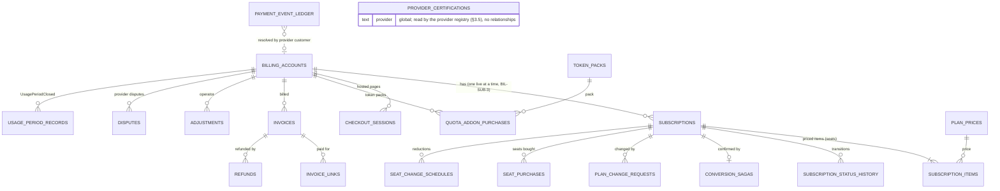

### 4.1 Roles, extensions and enums

```sql
-- Roles (created by the platform DB bootstrap; grants in 000001)
--   billing_migrator  owns the schema; used only by cmd/migrate
--   billing_app       NOBYPASSRLS; HTTP handlers, consumers, workers once the tenant is bound
--   billing_system    BYPASSRLS; webhook pre-resolution, cron tenant listing, reconciliation, price-book writes
--   admin_readonly    NOBYPASSRLS; support queries

CREATE EXTENSION IF NOT EXISTS pgcrypto;
CREATE EXTENSION IF NOT EXISTS btree_gist;

CREATE TYPE plan_code            AS ENUM ('starter','pro','enterprise');   -- Catalog plan codes (HLD §2.3)
CREATE TYPE billing_interval     AS ENUM ('month','year');
CREATE TYPE subscription_status  AS ENUM ('incomplete','active','past_due','cancelled','ended');
CREATE TYPE subscription_origin  AS ENUM ('trial_conversion','direct_signup','operator_stub');
CREATE TYPE iam_lifecycle        AS ENUM ('trial','active','suspended','offboarded');
CREATE TYPE saga_kind            AS ENUM ('trial_conversion','direct_signup','operator_stub');
CREATE TYPE saga_state           AS ENUM ('payment_confirmed','rp_convert_pending','awaiting_tenant_converted',
                                          'confirmed','failed','refund_pending','refunded','reverted');
CREATE TYPE purchase_status      AS ENUM ('pending_payment','requires_action','confirmed','failed','expired','cancelled');
CREATE TYPE schedule_status      AS ENUM ('scheduled','applying','applied','skipped','cancelled');
CREATE TYPE change_status        AS ENUM ('pending_payment','scheduled','applied','blocked','failed','cancelled');
CREATE TYPE invoice_kind         AS ENUM ('subscription_create','subscription_cycle','proration','token_addon','manual');
CREATE TYPE invoice_status       AS ENUM ('draft','open','paid','void','uncollectible');
CREATE TYPE ledger_status        AS ENUM ('received','processing','processed','ignored','failed');
CREATE TYPE cancel_reason        AS ENUM ('dunning_exhausted','customer','auto_renew_off','operator_reversal','offboarded','signup_failed');
```

Billing's `subscription_status` values: `incomplete` (checkout or first charge not yet confirmed; never projected to IAM, `BIL-EVT-8`), `active`, `past_due`, `cancelled` (the three Billing projects), `ended` (closed: offboarding, reversal, abandoned checkout or failed signup; terminal).

### 4.2 Tables

#### 4.2.1 `billing_accounts`

```sql
CREATE TABLE billing_accounts (
  tenant_id              uuid PRIMARY KEY,                          -- IAM tenant id (no FK: other database)
  provider               text NOT NULL CHECK (provider IN ('stripe','manual')),
  provider_customer_id   text,                                      -- NULL only for 'manual'
  currency               char(3) NOT NULL CHECK (currency ~ '^[A-Z]{3}$'), -- fixed once a subscription exists (BIL-SUB-6)
  billing_contact_name   text CHECK (length(billing_contact_name) <= 200),
  billing_contact_email  text CHECK (length(billing_contact_email) <= 254),   -- PII (§15.2)
  company_name           text CHECK (length(company_name) <= 200),
  country                char(2) CHECK (country ~ '^[A-Z]{2}$'),
  tax_id                 text CHECK (length(tax_id) <= 64),          -- Phase 2 tax invoices
  default_pm_set         boolean NOT NULL DEFAULT false,            -- provider reports a default payment method (no PM data stored)
  iam_lifecycle          iam_lifecycle NOT NULL DEFAULT 'trial',    -- from tenant-billing-q (§7.1)
  iam_suspension_source  text CHECK (iam_suspension_source IN ('billing_lapse','operator')),
  iam_last_event_at      timestamptz,                               -- BIL-EVT-3 recency mark for IAM lifecycle events
  closed_at              timestamptz,                               -- TenantOffboarded
  pii_minimised_at       timestamptz,                               -- §15.3
  record_version         bigint NOT NULL DEFAULT 1 CHECK (record_version > 0),
  created_at             timestamptz NOT NULL DEFAULT now(),
  updated_at             timestamptz NOT NULL DEFAULT now(),
  CONSTRAINT uq_ba_provider_customer UNIQUE (provider, provider_customer_id),
  CONSTRAINT chk_ba_customer CHECK (provider = 'manual' OR provider_customer_id IS NOT NULL),
  CONSTRAINT chk_ba_suspension CHECK ((iam_lifecycle = 'suspended') = (iam_suspension_source IS NOT NULL)),
  CONSTRAINT chk_ba_closed CHECK ((iam_lifecycle = 'offboarded') = (closed_at IS NOT NULL))
);
```

#### 4.2.2 `plan_prices` (global, no RLS)

```sql
CREATE TABLE plan_prices (
  price_id           uuid PRIMARY KEY DEFAULT gen_random_uuid(),
  plan               plan_code NOT NULL,
  interval           billing_interval NOT NULL,
  currency           char(3) NOT NULL,
  unit_amount_minor  bigint NOT NULL CHECK (unit_amount_minor > 0),   -- per seat per interval
  provider           text NOT NULL CHECK (provider IN ('stripe','manual')),
  provider_price_id  text,                                            -- Stripe Price id; NULL for 'manual'
  effective_from     timestamptz NOT NULL,
  effective_to       timestamptz,                                     -- NULL = current
  created_by         uuid NOT NULL,                                   -- operator sub
  reason             text NOT NULL CHECK (length(reason) BETWEEN 10 AND 1000),
  created_at         timestamptz NOT NULL DEFAULT now(),
  CONSTRAINT chk_pp_provider_ref CHECK (provider = 'manual' OR provider_price_id IS NOT NULL),
  CONSTRAINT chk_pp_range CHECK (effective_to IS NULL OR effective_to > effective_from),
  CONSTRAINT excl_pp_overlap EXCLUDE USING gist (
    plan WITH =, interval WITH =, currency WITH =, provider WITH =,
    tstzrange(effective_from, effective_to) WITH &&)
);
```

**Seed (`000002_seed_price_book`, HLD §6.3).** Per seat, tax-exclusive, in USD, the default currency (Finance, BL-OQ-5 closed). Market-specific currencies, AED included, are added as `plan_prices` rows through B-O11 (or `price-book-sync`) when needed, with no application change. The amounts below are the seed for the `manual` stub and dev; the **final Phase 1 commercial prices** were set by Product after the token-budget validation and loaded into `plan_prices` (BL-OQ-22, closed 2026-11-23). The loaded rows, not this table, are the price book of record.

| Plan | Monthly (minor units) | Annual = 12 × monthly × 0.85 (minor units) |
|---|---|---|
| `starter` | 3500 | 35700 |
| `pro` | 6900 | 70380 |
| `enterprise` | 17900 | 182580 |

Provider price ids are filled per environment by `scripts/price-book-sync.sh` (creates the Stripe Product per plan and Price per row, then writes `provider_price_id` through the operator price-book route B-O11). A price change inserts a new row and closes the old one; live subscriptions keep their price until their next renewal on or after the new row's `effective_from`, then move to it (`renewal-repricing`, §8.16; Product and Finance approved, BL-OQ-16).

#### 4.2.3 `token_packs` (global, no RLS)

```sql
CREATE TABLE token_packs (
  pack_code           text NOT NULL CHECK (pack_code ~ '^[a-z0-9_]{3,40}$'),   -- e.g. 'tokens_1m', 'tokens_5m'
  resource            text NOT NULL DEFAULT 'llm_tokens' CHECK (resource = 'llm_tokens'),  -- CD-55 scope: tokens only in v1
  tokens              bigint NOT NULL CHECK (tokens > 0),
  currency            char(3) NOT NULL,
  amount_minor        bigint NOT NULL CHECK (amount_minor > 0),
  provider            text NOT NULL,
  provider_price_id   text,
  monthly_cap_tokens  bigint CHECK (monthly_cap_tokens IS NULL OR monthly_cap_tokens > 0),  -- per tenant per UTC month; NULL = no cap (CD-55)
  active              boolean NOT NULL DEFAULT true,
  effective_from      timestamptz NOT NULL,
  effective_to        timestamptz,
  created_by          uuid NOT NULL,
  reason              text NOT NULL,
  PRIMARY KEY (pack_code, currency, effective_from)
);
```

Seeded **empty**: pack sizes, prices and any cap are commercial policy (BIZ-1). Until a pack is active, B-P17 returns an empty list and B-P18 answers `409 ADDON_NOT_AVAILABLE`.

#### 4.2.4 `subscriptions`

```sql
CREATE TABLE subscriptions (
  billing_subscription_id   uuid PRIMARY KEY,                       -- UUID v7, Billing-owned, provider-neutral
  tenant_id                 uuid NOT NULL REFERENCES billing_accounts(tenant_id),
  provider                  text NOT NULL,
  provider_subscription_id  text,                                   -- replaced on reactivation after cancellation (§8.9)
  origin                    subscription_origin NOT NULL,
  plan                      plan_code NOT NULL,
  interval                  billing_interval NOT NULL,
  status                    subscription_status NOT NULL DEFAULT 'incomplete',
  auto_renew                boolean NOT NULL DEFAULT true,          -- false ⇔ provider cancel_at_period_end
  current_period_start      timestamptz,
  current_period_end        timestamptz,
  collection_paused         boolean NOT NULL DEFAULT false,         -- CD-24 (§8.10)
  collection_paused_by      text CHECK (collection_paused_by IN ('auto','operator')),
  payment_confirmed_at      timestamptz,                            -- first payment confirmed (incomplete → active)
  converted_at              timestamptz,                            -- TenantConverted applied; RP-4 window starts here
  past_due_since            timestamptz,
  cancelled_at              timestamptz,
  cancel_reason             cancel_reason,
  ended_at                  timestamptz,
  record_version            bigint NOT NULL DEFAULT 1 CHECK (record_version > 0),
  created_at                timestamptz NOT NULL DEFAULT now(),
  updated_at                timestamptz NOT NULL DEFAULT now(),
  CONSTRAINT uq_sub_provider UNIQUE (provider, provider_subscription_id),
  CONSTRAINT chk_sub_past_due  CHECK ((status = 'past_due') = (past_due_since IS NOT NULL)),
  CONSTRAINT chk_sub_cancelled CHECK (status NOT IN ('cancelled') OR cancelled_at IS NOT NULL),
  CONSTRAINT chk_sub_ended     CHECK ((status = 'ended') = (ended_at IS NOT NULL)),
  CONSTRAINT chk_sub_active_period CHECK (status NOT IN ('active','past_due') OR current_period_end IS NOT NULL),
  CONSTRAINT chk_sub_pause     CHECK (collection_paused = (collection_paused_by IS NOT NULL))
);
CREATE UNIQUE INDEX uq_sub_one_live   ON subscriptions (tenant_id) WHERE status <> 'ended';           -- BIL-SUB-3
CREATE INDEX idx_sub_period_end       ON subscriptions (current_period_end) WHERE status IN ('active','past_due');
CREATE INDEX idx_sub_tenant_created   ON subscriptions (tenant_id, created_at DESC);
```

#### 4.2.5 `subscription_items`

One row per priced item. Phase 1 has exactly one item per subscription, `kind = 'seats'`, whose `quantity` **is** the licensed seat count (the value last sent in `TenantSeatsChanged`). The table exists so a later recurring add-on line needs no schema change.

```sql
CREATE TABLE subscription_items (
  item_id                   uuid PRIMARY KEY DEFAULT gen_random_uuid(),
  tenant_id                 uuid NOT NULL,
  billing_subscription_id   uuid NOT NULL REFERENCES subscriptions(billing_subscription_id),
  kind                      text NOT NULL CHECK (kind IN ('seats')),
  price_id                  uuid NOT NULL REFERENCES plan_prices(price_id),
  quantity                  int  NOT NULL CHECK (quantity BETWEEN 1 AND 100000),
  provider_item_id          text,
  scheduled_price_id        uuid REFERENCES plan_prices(price_id),  -- §8.16 renewal repricing
  scheduled_price_at        timestamptz,                            -- renewal instant R
  record_version            bigint NOT NULL DEFAULT 1,
  updated_at                timestamptz NOT NULL DEFAULT now(),
  CONSTRAINT uq_si_kind UNIQUE (billing_subscription_id, kind),
  CONSTRAINT chk_si_scheduled CHECK ((scheduled_price_id IS NULL) = (scheduled_price_at IS NULL))
);

CREATE VIEW v_subscription_summary AS
SELECT s.*, i.quantity AS licensed_seats, i.price_id, p.unit_amount_minor, p.currency
FROM subscriptions s
JOIN subscription_items i ON i.billing_subscription_id = s.billing_subscription_id AND i.kind = 'seats'
JOIN plan_prices p ON p.price_id = i.price_id;          -- security_invoker = true (RLS applies)
```

#### 4.2.6 `subscription_status_history` (append-only)

```sql
CREATE TABLE subscription_status_history (
  id                        bigserial PRIMARY KEY,
  tenant_id                 uuid NOT NULL,
  billing_subscription_id   uuid NOT NULL,
  from_status               subscription_status,
  to_status                 subscription_status NOT NULL,
  from_plan                 plan_code,
  to_plan                   plan_code,
  from_seats                int,
  to_seats                  int,
  cause                     text NOT NULL,   -- 'webhook:<provider type>' | 'api:<route id>' | 'operator:<route id>' | 'iam:<event type>' | 'job:<name>'
  payment_event_ref         text,            -- '<provider>:<provider_event_id>' when caused by a callback
  actor_id                  uuid NOT NULL,   -- tenant user, operator sub, or commercial-system 00000000-0000-0000-0000-0000000000c1
  occurred_at               timestamptz NOT NULL DEFAULT now()
);
CREATE INDEX idx_ssh_tenant ON subscription_status_history (tenant_id, occurred_at DESC);
REVOKE UPDATE, DELETE ON subscription_status_history FROM billing_app;
```

#### 4.2.7 `checkout_sessions`

```sql
CREATE TABLE checkout_sessions (
  session_id               uuid PRIMARY KEY,
  tenant_id                uuid NOT NULL,
  purpose                  text NOT NULL CHECK (purpose IN ('conversion','reactivation','payment_method_setup','addon_payment')),
  provider_session_id      text NOT NULL,                -- 'pending:<session_id>' until the provider session exists (BIL-CONC-2)
  billing_subscription_id  uuid REFERENCES subscriptions(billing_subscription_id),
  addon_purchase_id        uuid,
  requested_plan           plan_code,
  requested_interval       billing_interval,
  requested_seats          int CHECK (requested_seats IS NULL OR requested_seats BETWEEN 1 AND 1000),
  status                   text NOT NULL DEFAULT 'open' CHECK (status IN ('open','completed','expired')),
  requested_by             uuid NOT NULL,
  expires_at               timestamptz NOT NULL,
  created_at               timestamptz NOT NULL DEFAULT now(),
  default_applied_at       timestamptz,                  -- payment_method_setup: new method made default by the lifecycle follow-up (B-P16, 000006)
  CONSTRAINT uq_cs_provider UNIQUE (provider_session_id)
);
CREATE UNIQUE INDEX uq_cs_one_open ON checkout_sessions (tenant_id, purpose)
  WHERE status = 'open' AND purpose IN ('conversion','reactivation');
CREATE INDEX idx_cs_expiry ON checkout_sessions (expires_at) WHERE status = 'open';
CREATE INDEX idx_cs_pm_pending ON checkout_sessions (tenant_id)
  WHERE purpose = 'payment_method_setup' AND status = 'completed' AND default_applied_at IS NULL;
```

#### 4.2.8 `conversion_sagas`

```sql
CREATE TABLE conversion_sagas (
  saga_id                  uuid PRIMARY KEY,
  tenant_id                uuid NOT NULL,
  billing_subscription_id  uuid NOT NULL UNIQUE REFERENCES subscriptions(billing_subscription_id),  -- BIL-SAGA-2
  kind                     saga_kind NOT NULL,
  state                    saga_state NOT NULL,
  payment_confirmed_at     timestamptz NOT NULL,          -- clock for the 30-minute alert (HLD §8.2 step 6)
  rp_idempotency_key       text,                          -- 'convert:<tenant_id>:<billing_subscription_id>' (trial, stub)
  attempts                 int NOT NULL DEFAULT 0 CHECK (attempts >= 0),
  next_attempt_at          timestamptz,
  last_error_code          text,                          -- e.g. 'operation_in_progress', 'conversion_failed', 'timeout'
  last_error_at            timestamptz,
  rp_accepted_at           timestamptz,
  tenant_converted_event   uuid,                          -- envelope id of the matching TenantConverted
  confirmed_at             timestamptz,
  alerted_at               timestamptz,
  resolution               text CHECK (resolution IN ('retry','refund','resolved_manually','reverted')),
  resolution_reason        text,
  resolved_by              uuid,
  record_version           bigint NOT NULL DEFAULT 1,
  created_at               timestamptz NOT NULL DEFAULT now(),
  updated_at               timestamptz NOT NULL DEFAULT now(),
  CONSTRAINT chk_saga_confirmed CHECK ((state = 'confirmed') <= (confirmed_at IS NOT NULL)),
  CONSTRAINT chk_saga_key CHECK (kind = 'direct_signup' OR rp_idempotency_key IS NOT NULL)
);
CREATE INDEX idx_saga_due     ON conversion_sagas (next_attempt_at) WHERE state = 'rp_convert_pending';
CREATE INDEX idx_saga_waiting ON conversion_sagas (payment_confirmed_at)
  WHERE state IN ('payment_confirmed','rp_convert_pending','awaiting_tenant_converted');
```

#### 4.2.9 `plan_change_requests`

```sql
CREATE TABLE plan_change_requests (
  change_id                uuid PRIMARY KEY,
  tenant_id                uuid NOT NULL,
  billing_subscription_id  uuid NOT NULL REFERENCES subscriptions(billing_subscription_id),
  from_plan                plan_code NOT NULL,
  to_plan                  plan_code NOT NULL,
  direction                text NOT NULL CHECK (direction IN ('upgrade','downgrade')),
  status                   change_status NOT NULL,
  effective_at             timestamptz,                 -- upgrade: payment confirmation; downgrade: current_period_end
  amount_minor             bigint,                      -- upgrade proration amount
  currency                 char(3),
  i18_checked_at           timestamptz,                 -- last I-18 call (downgrade)
  blocker_codes            text[],                      -- I-18 blockers when status = 'blocked' (e.g. {sso_idp_configured})
  provider_invoice_id      text,                        -- upgrade
  provider_schedule_id     text,                        -- downgrade
  client_action            jsonb,                       -- {"type":"3ds","client_secret":…} until resolved; cleared after
  requested_by             uuid NOT NULL,
  idempotency_key          text NOT NULL,
  created_at               timestamptz NOT NULL DEFAULT now(),
  updated_at               timestamptz NOT NULL DEFAULT now(),
  CHECK (from_plan <> to_plan),
  CONSTRAINT uq_pcr_key UNIQUE (tenant_id, idempotency_key)
);
CREATE UNIQUE INDEX uq_pcr_one_open ON plan_change_requests (tenant_id) WHERE status IN ('pending_payment','scheduled');
CREATE INDEX idx_pcr_due ON plan_change_requests (effective_at) WHERE status = 'scheduled';
```

#### 4.2.10 `seat_purchases`

```sql
CREATE TABLE seat_purchases (
  purchase_id              uuid PRIMARY KEY,
  tenant_id                uuid NOT NULL,
  billing_subscription_id  uuid NOT NULL REFERENCES subscriptions(billing_subscription_id),
  reason                   text NOT NULL DEFAULT 'purchase' CHECK (reason IN ('purchase','renewal_topup')),
  seats_added              int NOT NULL CHECK (seats_added BETWEEN 1 AND 1000),
  seats_before             int NOT NULL,
  seats_after              int NOT NULL,
  proration_instant        timestamptz NOT NULL,        -- instant the preview was priced at; reused for the charge
  amount_minor             bigint NOT NULL CHECK (amount_minor >= 0),
  currency                 char(3) NOT NULL,
  amount_source            text NOT NULL CHECK (amount_source IN ('provider_preview','billing_calculator')),
  -- Fallback calculator inputs and unrounded result (§8.5.3, BL-OQ-6); NULL when the provider prorates
  unit_amount_minor        bigint,
  remaining_seconds        bigint,
  period_seconds           bigint,
  amount_unrounded_minor   numeric(38,12),
  -- Below the provider minimum (free_until_renewal): amount not charged, billed from renewal
  deferred_amount_minor    bigint CHECK (deferred_amount_minor > 0),
  deferral_reason          text CHECK (deferral_reason IN ('below_provider_minimum')),
  status                   purchase_status NOT NULL,
  provider_invoice_id      text,
  client_action            jsonb,
  requested_by             uuid NOT NULL,
  idempotency_key          text NOT NULL,
  confirmed_at             timestamptz,
  created_at               timestamptz NOT NULL DEFAULT now(),
  updated_at               timestamptz NOT NULL DEFAULT now(),
  CHECK (seats_after = seats_before + seats_added),
  CONSTRAINT chk_sp_calc_inputs CHECK (
    (amount_source = 'billing_calculator') =
    (unit_amount_minor IS NOT NULL AND remaining_seconds IS NOT NULL
     AND period_seconds > 0 AND amount_unrounded_minor IS NOT NULL)),               -- BIL-SEAT-5
  CONSTRAINT chk_sp_deferral CHECK (
    (deferral_reason IS NULL AND deferred_amount_minor IS NULL)
    OR (deferral_reason IS NOT NULL AND deferred_amount_minor IS NOT NULL
        AND amount_minor = 0 AND amount_source = 'billing_calculator')),
  CONSTRAINT uq_sp_key UNIQUE (tenant_id, idempotency_key)
);
CREATE UNIQUE INDEX uq_sp_one_open ON seat_purchases (billing_subscription_id)
  WHERE status IN ('pending_payment','requires_action');                                    -- BIL-SEAT-1
CREATE INDEX idx_sp_expiry ON seat_purchases (created_at) WHERE status IN ('pending_payment','requires_action');
```

#### 4.2.11 `seat_change_schedules`

```sql
CREATE TABLE seat_change_schedules (
  schedule_id              uuid PRIMARY KEY,
  tenant_id                uuid NOT NULL,
  billing_subscription_id  uuid NOT NULL REFERENCES subscriptions(billing_subscription_id),
  target_seats             int NOT NULL CHECK (target_seats >= 1),
  effective_at             timestamptz NOT NULL,          -- the renewal it applies at (current_period_end at scheduling)
  status                   schedule_status NOT NULL DEFAULT 'scheduled',
  seats_in_use_at_apply    int,                           -- I-11 active_users + pending_invitations at application
  renewal_seats            int,                           -- max(target_seats, seats_in_use) (BIL-SEAT-3)
  final_seats              int,                           -- after the renewal top-up check (§8.6 step 4)
  provider_schedule_id     text,
  skip_reason              text CHECK (skip_reason IN ('iam_unavailable','subscription_not_active','superseded')),
  requested_by             uuid NOT NULL,
  record_version           bigint NOT NULL DEFAULT 1,
  created_at               timestamptz NOT NULL DEFAULT now(),
  updated_at               timestamptz NOT NULL DEFAULT now()
);
CREATE UNIQUE INDEX uq_scs_one_open ON seat_change_schedules (billing_subscription_id)
  WHERE status IN ('scheduled','applying');
CREATE INDEX idx_scs_due ON seat_change_schedules (effective_at) WHERE status IN ('scheduled','applying');
```

#### 4.2.12 `quota_addon_purchases`

```sql
CREATE TABLE quota_addon_purchases (
  purchase_id              uuid PRIMARY KEY,              -- string form is billing_ref in TenantQuotaAddOnChanged
  tenant_id                uuid NOT NULL,
  resource                 text NOT NULL DEFAULT 'llm_tokens' CHECK (resource = 'llm_tokens'),
  pack_code                text NOT NULL,
  pack_quantity            int  NOT NULL CHECK (pack_quantity BETWEEN 1 AND 100),
  tokens_total             bigint NOT NULL CHECK (tokens_total > 0),
  amount_minor             bigint NOT NULL CHECK (amount_minor > 0),
  currency                 char(3) NOT NULL,
  status                   purchase_status NOT NULL,
  provider_invoice_id      text,
  client_action            jsonb,
  requested_by             uuid NOT NULL,
  idempotency_key          text NOT NULL,
  confirmed_at             timestamptz,                   -- payment confirmation = purchased_at (12-month expiry basis)
  event_id                 uuid,                          -- envelope id of the emitted TenantQuotaAddOnChanged
  created_at               timestamptz NOT NULL DEFAULT now(),
  updated_at               timestamptz NOT NULL DEFAULT now(),
  CONSTRAINT uq_qap_key UNIQUE (tenant_id, idempotency_key),
  CONSTRAINT chk_qap_confirmed CHECK ((status = 'confirmed') = (confirmed_at IS NOT NULL))
);
CREATE INDEX idx_qap_month ON quota_addon_purchases (tenant_id, confirmed_at) WHERE status = 'confirmed';
CREATE INDEX idx_qap_expiry ON quota_addon_purchases (created_at) WHERE status IN ('pending_payment','requires_action');
```

#### 4.2.13 `invoices`

```sql
CREATE TABLE invoices (
  invoice_id           uuid PRIMARY KEY,
  tenant_id            uuid NOT NULL,
  provider             text NOT NULL,
  provider_invoice_id  text NOT NULL,
  number               text,
  kind                 invoice_kind NOT NULL,
  status               invoice_status NOT NULL,
  currency             char(3) NOT NULL,
  amount_due_minor     bigint NOT NULL,
  amount_paid_minor    bigint NOT NULL DEFAULT 0,
  amount_refunded_minor bigint NOT NULL DEFAULT 0,
  period_start         timestamptz,
  period_end           timestamptz,
  hosted_invoice_url   text,                               -- provider-hosted page (no card data)
  issued_at            timestamptz,
  paid_at              timestamptz,
  provider_updated_at  timestamptz NOT NULL,               -- ordering guard for the mirror (BIL-PAY-4)
  -- CD-24 (§8.10): draft created while collection was paused; needs an operator decision (B-O16)
  held_for_review      boolean NOT NULL DEFAULT false,
  disposition          text CHECK (disposition IN ('finalize','void')),
  disposition_reason   text CHECK (length(disposition_reason) BETWEEN 10 AND 1000),
  disposed_by          uuid,                                -- operator sub
  disposed_at          timestamptz,
  updated_at           timestamptz NOT NULL DEFAULT now(),
  CONSTRAINT uq_inv_provider UNIQUE (provider, provider_invoice_id),
  CHECK (amount_refunded_minor <= amount_paid_minor),
  CONSTRAINT chk_inv_disposition CHECK (
    (disposition IS NULL AND disposition_reason IS NULL AND disposed_by IS NULL AND disposed_at IS NULL)
    OR (held_for_review AND disposition IS NOT NULL AND disposition_reason IS NOT NULL
        AND disposed_by IS NOT NULL AND disposed_at IS NOT NULL))                         -- BIL-SUB-7
);
CREATE INDEX idx_inv_tenant_issued ON invoices (tenant_id, issued_at DESC, invoice_id);
CREATE INDEX idx_inv_held ON invoices (tenant_id) WHERE held_for_review AND disposition IS NULL;
```

PDFs are never stored; B-P18 resolves a short-lived provider link at request time.

#### 4.2.14 `invoice_links`

```sql
CREATE TABLE invoice_links (
  invoice_id   uuid NOT NULL REFERENCES invoices(invoice_id),
  tenant_id    uuid NOT NULL,
  ref_type     text NOT NULL CHECK (ref_type IN ('subscription','seat_purchase','plan_change','quota_addon_purchase','saga','adjustment')),
  ref_id       uuid NOT NULL,
  PRIMARY KEY (invoice_id, ref_type, ref_id)
);
CREATE INDEX idx_il_ref ON invoice_links (ref_type, ref_id);
```

Written when Billing creates the provider object that will produce the invoice (metadata carries `purpose` and the ref id) and confirmed when the invoice mirror is first upserted.

#### 4.2.15 `payment_event_ledger` (no RLS; sysPool for insert and claim)

```sql
CREATE TABLE payment_event_ledger (
  provider             text NOT NULL,
  provider_event_id    text NOT NULL,
  event_type           text NOT NULL,                     -- provider type, e.g. 'invoice.paid'
  normalised_kind      text NOT NULL,                     -- domain.PaymentEvent kind (§7.4)
  tenant_id            uuid,                              -- NULL until resolved from the provider customer
  provider_object_ref  text,                              -- 'sub_…', 'in_…', 'pi_…', 'cs_…', 'dp_…'
  livemode             boolean NOT NULL,
  provider_created_at  timestamptz NOT NULL,
  received_at          timestamptz NOT NULL DEFAULT now(),
  payload              jsonb NOT NULL,                    -- allow-listed fields only (BIL-PCI-3)
  status               ledger_status NOT NULL DEFAULT 'received',
  attempts             int NOT NULL DEFAULT 0,
  next_attempt_at      timestamptz NOT NULL DEFAULT now(),
  claimed_until        timestamptz,
  processed_at         timestamptz,
  outcome              text,                              -- 'applied:<transition>' | 'ignored:<reason>' | 'failed:<code>'
  PRIMARY KEY (provider, provider_event_id)
);
CREATE INDEX idx_pel_work   ON payment_event_ledger (next_attempt_at) WHERE status IN ('received','failed');
CREATE INDEX idx_pel_tenant ON payment_event_ledger (tenant_id, provider_created_at);
CREATE INDEX idx_pel_recv   ON payment_event_ledger (received_at);
```

The ledger is written **before** the tenant is known (a callback carries provider ids only), so it cannot sit under tenant RLS. `billing_system` inserts and claims rows; the processor then binds the resolved tenant on the app pool for every domain write. Tenant routes never read it; operators see it through B-O7 (ids and types only).

**Payload allow-list (BIL-PCI-3).** Per object type the scrubber keeps: `id`, `object`, `customer`, `subscription`, `invoice`, `payment_intent`, `status`, `billing_reason`, `amount_due`, `amount_paid`, `amount_refunded`, `currency`, `period_start`, `period_end`, `current_period_start`, `current_period_end`, `cancel_at_period_end`, `pending_update` (presence only), `quantity`, `price.id`, `metadata.{tenant_id,billing_subscription_id,purpose,purchase_id,change_id}`, `reason` (dispute), `created`, `livemode`. Everything else, including `billing_details`, `payment_method_details`, `client_secret`, `customer_email`, `address`, `fingerprint`, is dropped.

#### 4.2.16 `adjustments`

```sql
CREATE TABLE adjustments (
  adjustment_id    uuid PRIMARY KEY,
  tenant_id        uuid NOT NULL,
  kind             text NOT NULL CHECK (kind IN ('credit','debit')),
  amount_minor     bigint NOT NULL CHECK (amount_minor > 0),
  currency         char(3) NOT NULL,
  description      text NOT NULL CHECK (length(description) BETWEEN 3 AND 500),   -- shown on the next invoice
  reason           text NOT NULL CHECK (length(reason) BETWEEN 10 AND 1000),      -- internal, audited
  provider_ref     text,                                   -- customer balance transaction id
  actor_id         uuid NOT NULL,
  idempotency_key  text NOT NULL,
  created_at       timestamptz NOT NULL DEFAULT now(),
  CONSTRAINT uq_adj_key UNIQUE (tenant_id, idempotency_key)
);
```

#### 4.2.17 `refunds`

```sql
CREATE TABLE refunds (
  refund_id           uuid PRIMARY KEY,
  tenant_id           uuid NOT NULL,
  invoice_id          uuid NOT NULL REFERENCES invoices(invoice_id),
  amount_minor        bigint NOT NULL CHECK (amount_minor > 0),
  currency            char(3) NOT NULL,
  category            text NOT NULL CHECK (category IN ('billing_error','duplicate_charge','fraud','goodwill','signup_failed','conversion_reversal','other')),
  reason              text NOT NULL CHECK (length(reason) BETWEEN 10 AND 1000),
  status              text NOT NULL CHECK (status IN ('pending','succeeded','failed')),
  provider_refund_id  text,
  addon_purchase_id   uuid REFERENCES quota_addon_purchases(purchase_id), -- set when the invoice is a token add-on invoice
  addon_tokens        bigint CHECK (addon_tokens > 0),                     -- tokens reversed: floor(tokens_total × amount_minor / purchase amount_minor)
  addon_event_id      uuid,                                                -- envelope id of the emitted TenantQuotaAddOnChanged (reason refund)
  actor_id            uuid NOT NULL,
  idempotency_key     text NOT NULL,
  created_at          timestamptz NOT NULL DEFAULT now(),
  updated_at          timestamptz NOT NULL DEFAULT now(),
  CONSTRAINT uq_ref_key UNIQUE (tenant_id, idempotency_key)
);
```

#### 4.2.18 `disputes`

```sql
CREATE TABLE disputes (
  dispute_id            uuid PRIMARY KEY,
  tenant_id             uuid NOT NULL,
  provider              text NOT NULL,
  provider_dispute_id   text NOT NULL,
  kind                  text NOT NULL CHECK (kind IN ('dispute','early_fraud_warning')),
  payment_ref           text NOT NULL,                    -- provider charge / payment id
  invoice_id            uuid REFERENCES invoices(invoice_id),
  is_conversion_payment boolean NOT NULL,                 -- payment of the subscription's first invoice
  within_revert_window  boolean NOT NULL,                 -- opened ≤ 7 days after converted_at (CD-10)
  reason                text,                             -- provider reason (e.g. 'fraudulent')
  provider_status       text NOT NULL,
  revert_decision       text NOT NULL DEFAULT 'none' CHECK (revert_decision IN ('none','pending','reverted','declined')),
  decided_by            uuid,
  opened_at             timestamptz NOT NULL,
  updated_at            timestamptz NOT NULL DEFAULT now(),
  CONSTRAINT uq_disp_provider UNIQUE (provider, provider_dispute_id)
);
```

#### 4.2.19 `idempotency_records`

```sql
CREATE TABLE idempotency_records (
  tenant_id       uuid NOT NULL,
  scope           text NOT NULL,              -- route id ('B-I1', 'B-P6', 'B-O3', …) or 'preview'
  key             text NOT NULL CHECK (length(key) BETWEEN 8 AND 200),
  request_hash    bytea NOT NULL,             -- SHA-256 of the canonical JSON body + route params
  state           text NOT NULL CHECK (state IN ('in_flight','completed')),
  status_code     int,
  response_body   jsonb,
  locked_until    timestamptz,
  created_at      timestamptz NOT NULL DEFAULT now(),
  expires_at      timestamptz NOT NULL,
  PRIMARY KEY (tenant_id, scope, key)
);
CREATE INDEX idx_idem_expiry ON idempotency_records (expires_at);
```

Rules in §9.2 (`BIL-IDEM-*`). Seat-purchase previews (B-P5) are stored here too (`scope = 'preview'`, key = `preview_id`, 10-minute expiry) so any replica can honour them.

#### 4.2.20 `scheduled_emissions`

Holds bus events whose publication must wait (`BIL-EVT-6`); a worker moves due rows into the outbox.

```sql
CREATE TABLE scheduled_emissions (
  emission_id      uuid PRIMARY KEY,
  tenant_id        uuid NOT NULL,
  event_type       text NOT NULL,
  payload_builder  text NOT NULL CHECK (payload_builder IN ('seats_after_conversion','seats_resync')),
  ref_id           uuid NOT NULL,              -- billing_subscription_id
  due_at           timestamptz NOT NULL,
  status           text NOT NULL DEFAULT 'pending' CHECK (status IN ('pending','emitted','cancelled')),
  emitted_event_id uuid,
  created_at       timestamptz NOT NULL DEFAULT now()
);
CREATE UNIQUE INDEX uq_se_one_pending ON scheduled_emissions (tenant_id, payload_builder, ref_id) WHERE status = 'pending';
CREATE INDEX idx_se_due ON scheduled_emissions (due_at) WHERE status = 'pending';
```

The payload is built **at emission time** from the current subscription (a snapshot, `BIL-EVT-4`), and `time` is stamped then.

#### 4.2.21 `usage_period_records`

```sql
CREATE TABLE usage_period_records (
  tenant_id           uuid NOT NULL,
  period_start        timestamptz NOT NULL,
  period_end          timestamptz NOT NULL,
  tokens_total        bigint NOT NULL CHECK (tokens_total >= 0),
  api_requests_total  bigint NOT NULL CHECK (api_requests_total >= 0),
  addon_consumed      bigint NOT NULL DEFAULT 0 CHECK (addon_consumed >= 0),
  limits              jsonb NOT NULL,
  source_event_id     uuid NOT NULL,
  source_event_time   timestamptz NOT NULL,
  received_at         timestamptz NOT NULL DEFAULT now(),
  PRIMARY KEY (tenant_id, period_start)
);
```

Upserted from `UsagePeriodClosed`; a later event for the same period (a re-run close, HLD §8.6.3) replaces the row only if its envelope `time` is newer.

#### 4.2.22 `reconciliation_runs`, `reconciliation_findings` (cross-tenant; sysPool)

```sql
CREATE TABLE reconciliation_runs (
  run_id         uuid PRIMARY KEY,
  provider       text NOT NULL,
  window_start   timestamptz NOT NULL,
  window_end     timestamptz NOT NULL,
  auto_repair    boolean NOT NULL DEFAULT false,
  status         text NOT NULL CHECK (status IN ('queued','running','completed','failed')),
  started_by     uuid NOT NULL,                 -- operator sub
  claimed_by     text,                          -- pod name
  counts         jsonb,                         -- {"subscriptions":…, "invoices":…, "events":…, "findings":…, "repaired":…}
  error          text,
  created_at     timestamptz NOT NULL DEFAULT now(),
  started_at     timestamptz,
  finished_at    timestamptz,
  CHECK (window_end > window_start AND window_end - window_start <= interval '35 days')
);
CREATE UNIQUE INDEX uq_rr_one_running ON reconciliation_runs (provider) WHERE status IN ('queued','running');

CREATE TABLE reconciliation_findings (
  run_id         uuid NOT NULL REFERENCES reconciliation_runs(run_id),
  finding_id     bigserial,
  tenant_id      uuid,
  kind           text NOT NULL CHECK (kind IN ('missing_ledger_event','status_mismatch','seats_mismatch','plan_mismatch',
                                               'invoice_missing','invoice_mismatch','orphan_provider_object','unknown_customer')),
  billing_value  jsonb,
  provider_value jsonb,
  auto_repaired  boolean NOT NULL DEFAULT false,
  repair_note    text,
  PRIMARY KEY (run_id, finding_id)
);
```

#### 4.2.23 Platform tables

| Table | Shape | Notes |
|---|---|---|
| `outbox_events`, `outbox_dead_letters` | `platform-events/v2` schema (`outbox.MigrateSchema`) | Ordered on `ordering_key = tenant_id` (`BIL-EVT-5`); published rows pruned after 8 days |
| `processed_events` | `(event_id uuid, consumer text, processed_at)`; PK `(event_id, consumer)` | `pkg/inbox`; consumers `tenant-billing`, `usage-billing`; 8-day retention > 4-day SQS retention (PE-1) |
| `pending_audit_entries` | Owned by `platform-audit` (migration `000001_pending_audit_entries`, applied by `auditoutbox.ApplySchema`; tracked in `platform_audit_schema_migrations`). Billing does not define or alter its columns | AL-5 outbox (§10.6). Billing adds RLS after `ApplySchema`: `tenant_isolation` on `tenant_id`, with `WITH CHECK` admitting `platform_tenant` (`…00b1`) rows (library LLD §4.3). Grants: `billing_app` `SELECT, INSERT`; `billing_system` `SELECT, INSERT` (global changes, `BIL-AUD-1`, migration `000006`); drainer `billing_audit_drainer` (`NOBYPASSRLS`, policy `audit_drainer_all`) `SELECT, INSERT, UPDATE, DELETE`. Delivered rows deleted; parked rows kept until an operator disposes of them; disposed rows purged after `AUDIT_DISPOSED_RETENTION` |
| `rls_violation_log` | Same as IAM (`table_name, row_tenant_id, app_tenant_id, violation_type, …`) | 1%-sampled; RLS disabled on itself |

#### 4.2.24 `provider_certifications` (global, no RLS)

Provider capability certification records (HLD §10.7.1, CD-56). Global configuration like the price book: `billing_app` has `SELECT`; only `billing_system` writes (B-O14, B-O15, B-O17, migration `000004`). A Billing engineer submits a run (B-O14, `pending_review`); a different PCI owner group member approves or rejects it (B-O17). Approved by the PCI owner group (BL-OQ-21, 2026-11-23).

```sql
CREATE TYPE certification_status AS ENUM ('pending_review', 'passed', 'failed', 'rejected', 'revoked', 'exempt');

CREATE TABLE provider_certifications (
  id                    uuid PRIMARY KEY DEFAULT gen_random_uuid(),
  provider              text NOT NULL CHECK (provider ~ '^[a-z][a-z0-9_]{1,30}$'),   -- 'stripe', 'checkout_com', 'adyen', 'manual'
  adapter_version       text NOT NULL,                 -- AdapterVersion(): '<adapter semver>+<provider api version>'
  provider_api_version  text,                          -- e.g. the Stripe API version pinned by the adapter; NULL for 'manual'
  suite_version         text NOT NULL,                 -- certification suite version (§14.7)
  status                certification_status NOT NULL,
  proration_mode        text NOT NULL CHECK (proration_mode IN ('native', 'fallback', 'n/a')),
  capabilities          jsonb NOT NULL,                -- ProviderCapabilities as declared by the adapter
  results               jsonb NOT NULL,                -- [{capability, case, passed, evidence_ref}] (§19.6)
  provider_account_ref  text,                          -- test-mode account the suite ran against (never a secret)
  run_started_at        timestamptz,
  run_finished_at       timestamptz,
  certified_by          uuid NOT NULL,                 -- Billing engineer (operator sub) who submitted the run (B-O14)
  certified_at          timestamptz NOT NULL DEFAULT now(),
  reviewed_by           uuid,                          -- PCI owner group member who decided the run (B-O17, BL-OQ-21)
  reviewed_at           timestamptz,
  review_reason         text CHECK (length(review_reason) BETWEEN 10 AND 1000),
  revoked_at            timestamptz,
  revoked_by            uuid,
  revoked_reason        text,
  CONSTRAINT chk_pc_revoked CHECK ((status = 'revoked') = (revoked_at IS NOT NULL)),
  CONSTRAINT chk_pc_passed_reviewed CHECK (status NOT IN ('passed', 'rejected', 'revoked')
        OR (reviewed_by IS NOT NULL AND reviewed_at IS NOT NULL AND review_reason IS NOT NULL)),
  CONSTRAINT chk_pc_unreviewed CHECK (status NOT IN ('pending_review', 'failed', 'exempt') OR reviewed_by IS NULL),
  CONSTRAINT chk_pc_two_people CHECK (reviewed_by IS NULL OR reviewed_by <> certified_by),   -- BIL-PROV-4
  CONSTRAINT chk_pc_exempt CHECK (status <> 'exempt' OR provider = 'manual'),
  CONSTRAINT chk_pc_fallback_named CHECK (status <> 'passed' OR proration_mode IN ('native', 'fallback'))
);
-- One live record per run: a failed, rejected or revoked run can be submitted again
CREATE UNIQUE INDEX uq_pc_run ON provider_certifications (provider, adapter_version, suite_version)
  WHERE status IN ('pending_review', 'passed', 'exempt');
CREATE INDEX idx_provider_cert_current ON provider_certifications (provider, adapter_version)
  WHERE status IN ('passed', 'exempt');

-- BIL-PROV-4: never deleted; after insert only the review decision (B-O17) and revocation (B-O15) may change a row
CREATE FUNCTION provider_certifications_guard() RETURNS trigger AS $$
BEGIN
  IF TG_OP = 'DELETE' THEN
    RAISE EXCEPTION 'provider_certifications rows are never deleted' USING ERRCODE = 'P0001';
  END IF;
  IF (NEW.id, NEW.provider, NEW.adapter_version, NEW.provider_api_version, NEW.suite_version, NEW.proration_mode,
      NEW.capabilities, NEW.results, NEW.provider_account_ref, NEW.run_started_at, NEW.run_finished_at,
      NEW.certified_by, NEW.certified_at)
     IS DISTINCT FROM
     (OLD.id, OLD.provider, OLD.adapter_version, OLD.provider_api_version, OLD.suite_version, OLD.proration_mode,
      OLD.capabilities, OLD.results, OLD.provider_account_ref, OLD.run_started_at, OLD.run_finished_at,
      OLD.certified_by, OLD.certified_at) THEN
    RAISE EXCEPTION 'provider_certifications: run, evidence and submitter are immutable' USING ERRCODE = 'P0001';
  END IF;
  IF OLD.status = 'pending_review' AND NEW.status IN ('passed', 'rejected')
     AND OLD.reviewed_by IS NULL AND NEW.revoked_at IS NULL THEN
    RETURN NEW;                                                  -- B-O17 decision
  END IF;
  IF OLD.status = 'passed' AND NEW.status = 'revoked'
     AND (NEW.reviewed_by, NEW.reviewed_at, NEW.review_reason)
         IS NOT DISTINCT FROM (OLD.reviewed_by, OLD.reviewed_at, OLD.review_reason) THEN
    RETURN NEW;                                                  -- B-O15 revocation
  END IF;
  RAISE EXCEPTION 'provider_certifications: % -> % not allowed', OLD.status, NEW.status USING ERRCODE = 'P0001';
END $$ LANGUAGE plpgsql;
CREATE TRIGGER trg_pc_guard BEFORE UPDATE OR DELETE ON provider_certifications
  FOR EACH ROW EXECUTE FUNCTION provider_certifications_guard();
REVOKE ALL ON provider_certifications FROM PUBLIC;
GRANT SELECT ON provider_certifications TO billing_app, admin_readonly;
GRANT SELECT, INSERT, UPDATE ON provider_certifications TO billing_system;
```

A record is never deleted; a lapsed one is `revoked` (B-O15). A re-run creates a new row; the same `(provider, adapter_version, suite_version)` can be submitted again once the earlier record is `failed`, `rejected` or `revoked`. Submitter, run data, results and evidence references never change after insert (`trg_pc_guard`, `BIL-PROV-4`).

### 4.3 Row-Level Security

Every tenant-scoped table — `billing_accounts`, `subscriptions`, `subscription_items`, `subscription_status_history`, `checkout_sessions`, `conversion_sagas`, `plan_change_requests`, `seat_purchases`, `seat_change_schedules`, `quota_addon_purchases`, `invoices`, `invoice_links`, `adjustments`, `refunds`, `disputes`, `idempotency_records`, `scheduled_emissions`, `usage_period_records`, `pending_audit_entries` — has:

```sql
ALTER TABLE <t> ENABLE ROW LEVEL SECURITY;
ALTER TABLE <t> FORCE  ROW LEVEL SECURITY;
CREATE POLICY tenant_isolation ON <t>
  USING      (rls_check_tenant(tenant_id, '<t>'))
  WITH CHECK (rls_check_tenant(tenant_id, '<t>'));
REVOKE ALL ON <t> FROM PUBLIC;
GRANT SELECT, INSERT, UPDATE, DELETE ON <t> TO billing_app;   -- history: SELECT, INSERT only
GRANT SELECT ON <t> TO admin_readonly;
```

`rls_check_tenant(row_tenant uuid, tbl text)` is the platform `SECURITY DEFINER` function: missing or malformed `app.tenant_id` → false (0 rows) with a sampled `missing_or_invalid_guc` log; cross-tenant → false with `cross_tenant_access`. Global tables (`plan_prices`, `token_packs`) have no RLS: `billing_app` gets `SELECT`, writes only through `billing_system`. `payment_event_ledger`, `reconciliation_runs`, `reconciliation_findings` are `billing_system` only (`billing_app` has no grant).

**GUC binding (HLD §7.2).**

| Path | Source of `app.tenant_id` |
|---|---|
| Tenant routes `/api/v1/tenants/:id/*` | `x-tenant-id`, which must equal `:id` (`RequirePathTenantMatch`) |
| Internal B-I1 | `x-tenant-id` (the pre-allocated tenant), which must equal body `tenant_id` |
| Operator tenant routes `/api/v1/operator/tenants/:id/*` | `:id` (equals AuthZ's `x-tenant-id`, HLD §11.4) |
| Operator non-tenant routes (reconciliation, price book) | none — `billing_system`; the nil UUID is never bound as a tenant |
| Consumers | envelope `tenant_id` |
| Webhook processor | tenant resolved from `billing_accounts (provider, provider_customer_id)` on the sysPool; then re-bound on the app pool. Never from metadata alone (`BIL-PAY-3`) |
| Jobs | `billing_system` lists due tenant ids; each tenant's work then runs on the app pool with that tenant bound |

| # | Invariant |
|---|---|
| BIL-RLS-1 | Every tenant-scoped table has `ENABLE` + `FORCE ROW LEVEL SECURITY` and the `tenant_isolation` policy; a CI test lists `pg_class` and fails on any tenant-scoped table without it. |
| BIL-RLS-2 | `app.tenant_id` is bound transaction-locally on every app-pool checkout (`set_config(…, true)`), never session-wide. |
| BIL-RLS-3 | `billing_system` is used only by the paths listed above; handlers for tenant routes have no access to the sysPool (constructor injection). |

### 4.4 Migrations

| File | Content |
|---|---|
| `000000_outbox_schema` | `platform-events` outbox, dead letters, `processed_events` |
| (library) `platform-audit` `000001_pending_audit_entries` | Applied by `auditoutbox.ApplySchema` after `000000_outbox_schema` and before `000001_initial_schema`; own tracking table `platform_audit_schema_migrations` |
| `000001_initial_schema` | Extensions, enums, all tables in §4.2, indexes, RLS, `rls_check_tenant`, `rls_violation_log`, triggers (§4.5), grants for `billing_app`, `billing_system`, `admin_readonly` (granted explicitly, not assumed through ownership) |
| `000002_seed_price_book` | `plan_prices` seed (§4.2.2) as `provider = 'manual'` rows only (the stub's prices). Stripe rows need a `provider_price_id` (`chk_pp_provider_ref`), so `price-book-sync.sh` creates them per environment through B-O11 |
| `000003_views` | `v_subscription_summary` (`security_invoker = true`) |
| `000004_provider_certifications` | `certification_status` enum, `provider_certifications` table, `trg_pc_guard` and grants (§4.2.24); inserts the `manual` adapter's `exempt` record for its compiled `adapter_version` |
| `000005_audit_outbox_rls` | RLS on `pending_audit_entries` (`tenant_isolation`, `WITH CHECK` admits `platform_tenant`), role `billing_audit_drainer` (`NOBYPASSRLS`) with policy `audit_drainer_all`, grants (library LLD §4.3) |
| `000006_system_audit_and_pm_default` | `billing_system` `SELECT, INSERT` on `pending_audit_entries` (`BIL-AUD-1`); `checkout_sessions.default_applied_at` and `idx_cs_pm_pending` (B-P16 default via the lifecycle follow-up) |

Rules: backward-compatible two-release migrations (HLD §15.5); `cmd/migrate` runs `MigrateSchema` (outbox first, then domain) under `MIGRATE_TIMEOUT`; production runs require the `production-data-migrations` environment approval.

### 4.5 Triggers

```sql
CREATE FUNCTION touch_row() RETURNS trigger AS $$
BEGIN
  NEW.updated_at := now();
  IF TG_TABLE_NAME IN ('billing_accounts','subscriptions','subscription_items','conversion_sagas','seat_change_schedules') THEN
    NEW.record_version := OLD.record_version + 1;
  END IF;
  RETURN NEW;
END $$ LANGUAGE plpgsql;
```

Applied `BEFORE UPDATE … FOR EACH ROW WHEN (OLD.* IS DISTINCT FROM NEW.*)` on every table with `updated_at`. `subscription_status_history` rows are written by the service in the same transaction as the change (they need cause and actor), not by a trigger. A `prevent_currency_change` trigger rejects a `billing_accounts.currency` update when a non-`ended` subscription exists (`BIL-SUB-6`).

### 4.6 Data invariants

| # | Invariant |
|---|---|
| BIL-SUB-3 | At most one non-`ended` subscription per tenant (`uq_sub_one_live`). |
| BIL-SUB-4 | Status moves only along the transition table in §8.14; a callback that would move it any other way is recorded `ignored` (`BIL-PAY-4`). |
| BIL-SUB-5 | The seat item `quantity` changes only on a **confirmed** payment (conversion, purchase, top-up) or at a renewal applying a reduction; never on a request. |
| BIL-SUB-6 | An account's currency is fixed while it has a non-`ended` subscription. |
| BIL-SUB-7 | While collection is paused (CD-24, §8.10) no payment is attempted: new invoices are held as drafts (`held_for_review`), automatic retries on already-open invoices are stopped, and no dunning transition is made. A held draft is charged or voided only by an explicit operator decision with a reason (B-O16, `chk_inv_disposition`); it is never finalised automatically, including on reactivation. Pausing never waives an amount already due, cancels the subscription or changes entitlements. |
| BIL-SUB-8 | A live subscription's price changes only at a renewal or with a plan change the customer makes (BL-OQ-16, §8.16). At renewal `R` the seat item moves to the `plan_prices` row effective at `R` for its plan, interval, currency and provider, unless the change was found less than `REPRICE_CUTOFF` before `R`, in which case it moves at the following renewal. Every `ScheduleAtPeriodEnd` sets `ToPriceRef` by this rule. There is no grandfathering field. |
| BIL-SEAT-1 | One open seat purchase per subscription (`uq_sp_one_open`). |
| BIL-SEAT-2 | One open seat change schedule per subscription (`uq_scs_one_open`). |
| BIL-SEAT-3 | `renewal_seats = max(target_seats, seats_in_use)`; after the renewal top-up check the licensed count is never below I-11's `active_users + pending_invitations` (HLD §8.5.1). |
| BIL-SEAT-4 | A seat change schedule never changes `licensed_seats` before the renewal and never blocks a purchase or a member addition (HLD §8.5.1 step 2). |
| BIL-SEAT-5 | A seat purchase priced by Billing's fallback calculator stores its inputs, the unrounded amount and the rounded `amount_minor` (`chk_sp_calc_inputs`); a purchase below the provider minimum is confirmed with `amount_minor = 0` and records `deferred_amount_minor` and `deferral_reason = 'below_provider_minimum'` (`chk_sp_deferral`). Seats are never removed because a renewal top-up payment failed (§8.5.3, §8.6.3, BL-OQ-6). |
| BIL-ADD-1 | A token add-on is sold only when: the subscription is `active` and not collection-paused; `iam_lifecycle = 'active'`; the tenant is not on trial (ENT-D6: a trial tenant who exhausts its trial token budget is prompted to convert through B-P2, or Sales assigns a larger trial profile in Entitlements; it never buys an add-on); the effective `llm_token_quota_monthly` is finite (§8.7). Read from Entitlements' per-resource eligibility for `llm_tokens` once shipped (BL-OQ-3); until then from `llm_token_quota_monthly`. A generic `addon_eligible` is not used. |
| BIL-ADD-2 | `TenantQuotaAddOnChanged` is emitted exactly once per confirmed purchase, with `billing_ref = purchase_id` (`quota_addon_purchases.event_id`). |
| BIL-ADD-4 | When a refund of an add-on invoice reaches `succeeded`, `TenantQuotaAddOnChanged {reason: "refund", delta: −addon_tokens, billing_ref: refund_id, purchase_ref: purchase_id}` is emitted exactly once in the same transaction (`refunds.addon_event_id`). Billing never computes the remaining balance: Entitlements removes at most the unused tokens of that grant, never below zero (Entitlements owns quota state; TL decision BL-OQ-20). |
| BIL-ADD-3 | Add-on purchases have no customer refund path; a refund of an add-on invoice exists only as an operator action with category `billing_error`, `duplicate_charge` or `fraud` (HLD §8.6.2). |
| BIL-SAGA-2 | One saga per `billing_subscription_id`; RP-3 is always called with `Idempotency-Key: convert:<tenant_id>:<billing_subscription_id>`. |
| BIL-PAY-1 | Every provider callback is in `payment_event_ledger` before any domain write. |
| BIL-PROV-1 | A provider is enabled for new billing accounts only if a `passed` (or, for `manual`, `exempt`) `provider_certifications` row exists for its `provider`, the deployed `adapter_version` and the current `PROVIDER_CERT_SUITE_VERSION`. No billing account is created on a provider that fails this check (`503 PROVIDER_NOT_ENABLED`). |
| BIL-PROV-2 | Changing the adapter version or the pinned provider API version requires a new certification run; until it passes, the provider takes no new accounts and `BillingProviderNotCertified` fires (§11.5). Existing subscriptions, renewals, purchases and webhooks keep running (fail open for running work, HLD §4.1). |
| BIL-PROV-3 | A provider certified with `proration_mode = fallback` always uses Billing's calculator for previews and charges (§8.5.3); one certified `native` never does. |
| BIL-PROV-4 | A certification becomes `passed` only through B-O17, by a caller holding `pci_owner_reviewer` who did not submit the run (`chk_pc_two_people`, `chk_pc_passed_reviewed`). Records are never deleted; after insert only the review decision and the revocation of a `passed` record may change a row, and run data, results, evidence references and the submitter are immutable (`trg_pc_guard`). Approved by the PCI owner group (BL-OQ-21). |

---
## 5. API Contract

**Endpoint count.** 26 tenant routes (`B-P1`–`B-P26`), 1 internal route (`B-I1`), 1 webhook route (`B-W1`), 17 operator routes (`B-O1`–`B-O17`): **45 endpoint IDs**. IDs are stable and never reused; a retired route keeps its ID struck through, as in IAM.

### 5.1 Conventions

- All routes under `/api/v1`. Breaking changes ship under `/api/v2`. Paths are written in full.
- Every route runs behind `gincommon.ObservabilityMiddlewares`. Tenant and operator groups add `gincommon.ProtectedMiddlewares` (RequireAuth → ContextMiddleware), then `GUCBridge` and `RequireJSONContentType` (`415 UNSUPPORTED_MEDIA_TYPE`). Tenant routes add `RequirePathTenantMatch` and `RequirePermission(p)`; operator routes add `RequirePlatformOperator`; the internal route adds `RequireCallerPrincipal(BFF_CALLER_PRINCIPAL)`.
- **Identity** comes only from gateway- or mesh-injected `x-user-id`, `x-tenant-id`, `x-tenant-roles` under mesh mTLS. No JWT parsing. Identity fields in a body are ignored (`BIL-API-1`).
- Content type `application/json; charset=utf-8`. Timestamps RFC 3339 UTC with second precision. **Money** is `{"amount_minor": 6900, "currency": "USD"}` — integer minor units and ISO 4217 code; never floats.
- **Errors** are RFC 9457 problems from `gincommon/v2` (`application/problem+json`): `type`, `title`, `status`, `detail`, `instance`, `errorCode`, `validationErrors[]` (`{field, message}`, the platform-standard `gincommon/v2` entry; the message is a fixed phrase that never echoes the value), `traceId`, `tenantId`, `timestamp`, plus documented extension members. `errorCode` values are `UPPER_SNAKE` and frozen once published (CD-31; §17). `request_id` travels only in the `X-Request-ID` header.
- **Idempotency.** `Idempotency-Key` (8–200 chars, `[A-Za-z0-9:_\-.]`) is **required** on every mutating internal and operator route and on tenant routes that can create a charge or a provider object (B-P2, B-P4, B-P7, B-P10, B-P14, B-P16, B-P20, B-P23); optional on the other tenant mutations. Semantics in §9.2.
- **Optimistic locking.** Mutations that act on a subscription the caller read take `record_version` (body field); mismatch → `409 OPTIMISTIC_LOCK_CONFLICT` with extension `record_version` (current). Every subscription response returns `record_version`.
- **Lists** are cursor-paginated: `?limit=` 1–100 (default 20), `?cursor=` opaque; response `{"items": […], "next_cursor": "…" | null}`.
- **Headers returned:** `X-Request-ID`, `traceparent`; `Retry-After` on `409 REQUEST_IN_PROGRESS`, `429`, `503`; `Idempotent-Replayed: true` on a replayed response.

**Four route prefixes:**

| Prefix | Callers | Auth | Gateway |
|---|---|---|---|
| `/api/v1/tenants/:id/*` | Tenant owner / admin via the tenant admin UI | Gateway-injected identity; Billing permission check (§5.2) | Public Envoy `HTTPRoute`, JWT + `ext_authz` (AuthZ Enrichment) |
| `/api/v1/internal/*` | Signup BFF (`bff` / `bff-signup`) only | Mesh mTLS (Istio AuthorizationPolicy on the SPIFFE principal) + NetworkPolicy (namespace + pod label) + app allow-list | Not routed by the ingress |
| `/api/v1/operator/*` | Platform operators signed in to the platform realm (CD-52) | Gateway accepts only platform-realm tokens; AuthZ injects `x-tenant-roles: platform_operator`; Billing re-checks in the handler before any DB access | Separate operator `HTTPRoute` |
| `/api/v1/webhooks/:provider` | Payment provider | **No gateway auth**; provider signature verified in the handler (`BIL-PAY-2`) | Narrow public route, `ext_authz` bypassed, dedicated rate limit; the domain's only unauthenticated inbound route (HLD §11.2) |

**API invariants:**

| # | Invariant |
|---|---|
| BIL-API-1 | Billing never takes tenant id, user id or role from a request body for authorization, RLS scoping or ownership. The one body `tenant_id` (B-I1) must equal `x-tenant-id` or the request is `400 TENANT_MISMATCH`. |
| BIL-API-2 | On tenant routes, `x-tenant-id` must equal the path `:id`; otherwise `403 INSUFFICIENT_ROLE` before any query. |
| BIL-API-3 | A route that can create a charge never charges twice for one `Idempotency-Key` (§9.2). |
| BIL-API-4 | No response body contains card data, `client_secret` (except the 3-D Secure action object returned to the caller that started the payment), provider API keys or webhook secrets. |
| BIL-API-5 | Provider-hosted URLs returned to the browser (`checkout_url`, `setup_url`, `payment_url`, invoice links) come from the provider adapter only and are never built from request input. Redirect URLs (`success_url`, `cancel_url`) are built from `TENANT_APP_BASE_URL` and the tenant slug-free path `/billing`, never from the request. |

### 5.2 Authorization — permissions and roles

Billing authorizes by **permission**, mapped from the IAM roles in `x-tenant-roles`. `x-tenant-roles` carries roles only and Billing keeps the mapping (IAM-10, IAM HLD v1.59 §6.4). The mapping is a constant table in `internal/domain/permission.go`; a Finance policy change is a pull request to that file, not an HLD change (HLD §6.6).

**Finance approved (BIZ-6 / BL-OQ-13, 2026-11-23), list and role mapping unchanged.** Two permissions are added to the HLD's four so that every row of the HLD §6.6 matrix maps to exactly one permission instead of a hard-coded role. The model separates operational management (owner and tenant admin), commercial commitments and payment authority (owner only), and leaves room for custom roles later without changing Billing's authorization. Tender roles are procurement and workflow roles and get no billing permission.

**Overlap rule (Finance; route definition acknowledged by Finance 2026-11-23).** Changing a payment method used for future invoices, updating billing-contact information, and initiating any action that can create a new contractual commitment require `commercial.payment_method.manage` or `commercial.subscription.change_plan` respectively, regardless of any other billing permissions. A *new contractual commitment* here means starting a paid subscription or converting a trial, changing the plan tier (including scheduling a downgrade), and reactivating a lapsed subscription (B-P2, B-P4, B-P5, B-P14). Buying seats or a token add-on within the current subscription (B-P7, B-P20) and scheduling a seat reduction (B-P10, B-P11) stay under `commercial.subscription.manage`, as the table states (`BIL-AUTH-7`).

| Permission | Covers (HLD §6.6 rows) | `tenant_owner` | `tenant_admin` | `tender_admin`, `member` | Source |
|---|---|---|---|---|---|
| `commercial.subscription.manage` | Purchase additional seats; schedule or cancel a seat reduction; buy a token add-on | ✓ | ✓ | | HLD §6.6 |
| `commercial.subscription.cancel` | Cancel the subscription; resume a pending cancellation | ✓ | | | HLD §6.6 |
| `commercial.billing.view` | View plan, subscription, payment methods, purchases, history | ✓ | ✓ | | HLD §6.6 |
| `commercial.billing.download_invoice` | View and download invoices | ✓ | ✓ | | HLD §6.6 |
| `commercial.subscription.change_plan` **(LLD addition)** | Start a paid subscription / convert a trial; change plan tier; schedule or cancel a downgrade; settle a lapsed subscription (reactivate) | ✓ | | | HLD §6.6 rows "Start a paid subscription / convert trial", "Change plan tier" (owner only) |
| `commercial.payment_method.manage` **(LLD addition)** | Add or update a payment method; edit the billing contact | ✓ | | | HLD §6.6 "Add or update a payment method — owner only (financial governance)" |

The automation principal carries no tenant role (IAM HLD §11.7) and therefore no permission.

**Per-route rules** are in the catalogue (§5.3). Operator routes need `platform_operator` and nothing else; operator handlers never read `x-plan`, `x-feature-flags`, `x-departments` or `x-residency-mode` (empty on operator calls, HLD §11.4) and record `x-user-id` (operator `sub`) as actor.

**Authorization invariants:**

| # | Invariant |
|---|---|
| BIL-AUTH-1 | Every tenant route checks its permission before any provider call or DB write; missing → `403 INSUFFICIENT_PERMISSION` with extension `required_permission`. |
| BIL-AUTH-2 | `platform_operator` is accepted only on `/api/v1/operator/*`, re-checked in the handler before any DB access (IAM AUTH-6 pattern). A `platform_operator` value on a tenant route grants nothing. |
| BIL-AUTH-3 | B-I1 admits only the mTLS principal `cluster.local/ns/bff/sa/bff-signup`; any other caller is `403 INSUFFICIENT_ROLE`. The principal is the SPIFFE URI (`URI=spiffe://…`) of the last element of the Istio-generated `X-Forwarded-Client-Cert` header; a request without it is refused. |
| BIL-AUTH-4 | `commercial-system` (`00000000-0000-0000-0000-0000000000c1`) is Billing's **outbound** identity only; inbound it is rejected on every route. |
| BIL-AUTH-5 | The webhook route binds no tenant and trusts no header except the provider signature. |
| BIL-AUTH-6 | Until IAM's operator path is live end to end (CD-52; AuthZ Enrichment LLD §8.9.1 OP-G1 platform realm, OP-G2 gateway `jwt_authn` provider, OP-G3 `OPERATOR_REALM_ISSUER` set), every operator route answers `403 INSUFFICIENT_ROLE` outside dev and test; there is no Billing-side bypass. The switch is `OPERATOR_PATH_LIVE` (§12, default `false`), set to `true` per environment only after OP-G4 passes there. |
| BIL-AUTH-7 | Each tenant route requires exactly one permission (§5.3). `commercial.payment_method.manage` and `commercial.subscription.change_plan` are never implied by any other permission: holding `commercial.subscription.manage`, `commercial.billing.view` or both never allows a payment-method change, a billing-contact change or a new contractual commitment. |

### 5.3 Endpoint catalogue

#### Tenant routes (`/api/v1/tenants/:id/…`)

| # | Method & path | Purpose | Permission | Idem. key |
|---|---|---|---|---|
| B-P1 | `GET /api/v1/tenants/:id/subscription` | Subscription summary for the Billing page | `billing.view` | — |
| B-P2 | `POST /api/v1/tenants/:id/subscription/checkout` | Hosted checkout to convert a trial (§8.1) | `subscription.change_plan` | required |
| B-P3 | `POST /api/v1/tenants/:id/subscription/plan-change/preview` | Price of an upgrade now / effect date of a downgrade | `subscription.change_plan` | — |
| B-P4 | `POST /api/v1/tenants/:id/subscription/plan-change` | Upgrade now (prorated) or schedule a downgrade (period end) (§8.4) | `subscription.change_plan` | required |
| B-P5 | `DELETE /api/v1/tenants/:id/subscription/plan-change` | Cancel a scheduled downgrade | `subscription.change_plan` | optional |
| B-P6 | `POST /api/v1/tenants/:id/subscription/seats/preview` | Provider proration preview for added seats | `subscription.manage` | — |
| B-P7 | `POST /api/v1/tenants/:id/subscription/seats/purchases` | Buy seats (§8.5) | `subscription.manage` | required |
| B-P8 | `GET /api/v1/tenants/:id/subscription/seats/purchases/:purchase_id` | Seat purchase status | `billing.view` | — |
| B-P9 | `GET /api/v1/tenants/:id/subscription/seats/purchases` | Seat purchase history | `billing.view` | — |
| B-P10 | `PUT /api/v1/tenants/:id/subscription/seats/scheduled-reduction` | Schedule (or replace) a reduction for the next renewal (§8.6) | `subscription.manage` | required |
| B-P11 | `DELETE /api/v1/tenants/:id/subscription/seats/scheduled-reduction` | Cancel the scheduled reduction | `subscription.manage` | optional |
| B-P12 | `POST /api/v1/tenants/:id/subscription/cancel` | Cancel at period end (auto-renew off) | `subscription.cancel` | optional |
| B-P13 | `POST /api/v1/tenants/:id/subscription/resume` | Undo a pending cancellation | `subscription.cancel` | optional |
| B-P14 | `POST /api/v1/tenants/:id/subscription/reactivate` | Settle a `past_due` or `cancelled` subscription (§8.9) | `subscription.change_plan` | required |
| B-P15 | `GET /api/v1/tenants/:id/payment-methods` | Brand, last four, expiry, default — read live from the provider | `billing.view` | — |
| B-P16 | `POST /api/v1/tenants/:id/payment-methods/setup-session` | Provider-hosted page to add or replace the default payment method | `payment_method.manage` | required |
| B-P17 | `GET /api/v1/tenants/:id/invoices` | Invoice list | `billing.download_invoice` | — |
| B-P18 | `GET /api/v1/tenants/:id/invoices/:invoice_id/download` | `302` to a short-lived provider PDF link | `billing.download_invoice` | — |
| B-P19 | `GET /api/v1/tenants/:id/token-packs` | Active packs and this tenant's eligibility | `billing.view` | — |
| B-P20 | `POST /api/v1/tenants/:id/token-addons/purchases` | Buy token packs (§8.7) | `subscription.manage` | required |
| B-P21 | `GET /api/v1/tenants/:id/token-addons/purchases/:purchase_id` | Add-on purchase status | `billing.view` | — |
| B-P22 | `GET /api/v1/tenants/:id/token-addons/purchases` | Add-on purchase history (no balances; those are Entitlements') | `billing.view` | — |
| B-P23 | `POST /api/v1/tenants/:id/token-addons/purchases/:purchase_id/payment-session` | Hosted payment page when the off-session charge needs the customer | `subscription.manage` | required |
| B-P24 | `GET /api/v1/tenants/:id/subscription/history` | Status, plan and seat history | `billing.view` | — |
| B-P25 | `GET /api/v1/tenants/:id/billing-contact` | Billing contact, company, country, tax id | `billing.view` | — |
| B-P26 | `PUT /api/v1/tenants/:id/billing-contact` | Update the billing contact | `payment_method.manage` | optional |

#### Internal route

| # | Method & path | Caller | Purpose |
|---|---|---|---|
| B-I1 | `POST /api/v1/internal/subscriptions/authorize-and-charge` | Signup BFF (`bff` / `bff-signup`) | Direct paid signup: create account and subscription, charge, return `billing_subscription_id` (HLD §10.6) |

No other service calls Billing synchronously: IAM never calls Commercial (HLD §4.4) and Entitlements never reads Billing (HLD §5.2).

#### Webhook route

| # | Method & path | Caller | Purpose |
|---|---|---|---|
| B-W1 | `POST /api/v1/webhooks/:provider` (`stripe` in Phase 1) | Payment provider | Verify, ledger, acknowledge, process asynchronously (§8.15) |

#### Operator routes (`/api/v1/operator/…`)

B-O1 to B-O5 are the HLD §11.4 catalogue rows for Billing. B-O6 to B-O17 are **LLD additions** (B-O16 added in rev 0.16, its OP-G4 coverage is BL-OQ-25; B-O17 added in rev 0.21, BL-OQ-26), exposed by Billing's own operator `HTTPRoute` (§13.1) and added to IAM's end-to-end operator test (AuthZ Enrichment LLD §8.9.1 OP-G4), whose list today covers only B-O1 to B-O5 (BL-OQ-9). There is no IAM-side route list: the platform-realm `jwt_authn` provider and AuthZ Enrichment admit the whole `/api/v1/operator/` prefix.

| # | Method & path | Purpose | Audit (AL-5 `entry_type`) |
|---|---|---|---|
| B-O1 | `POST /api/v1/operator/tenants/:id/conversions` | Phase 1 conversion stub (run by a person); then RP-3 as `commercial-system` | `billing.conversion.stub` (requested, BL-OQ-10) |
| B-O2 | `POST /api/v1/operator/tenants/:id/adjustments` | Credit or debit on the customer balance | `billing.adjustment.issued` |
| B-O3 | `POST /api/v1/operator/tenants/:id/refunds` | Refund all or part of a paid invoice | `billing.refund.issued` |
| B-O4 | `GET /api/v1/operator/tenants/:id/invoices` | Invoice list including void and uncollectible | — (read) |
| B-O5 | `POST /api/v1/operator/billing/reconciliation-runs` | Start a provider reconciliation run | `commercial.cross_tenant_job.ran` (one per run, `platform_tenant`) |
| B-O6 | `GET /api/v1/operator/billing/reconciliation-runs/:run_id` | Run status and findings | — |
| B-O7 | `GET /api/v1/operator/tenants/:id/subscription` | Full subscription, sagas, purchases, schedules, disputes, ledger excerpt | — |
| B-O8 | `POST /api/v1/operator/tenants/:id/conversion-reversals` | Operator-approved RP-4 reversal (CD-10, §8.2) | `billing.conversion.reverted` (requested) |
| B-O9 | `POST /api/v1/operator/tenants/:id/conversion-sagas/:saga_id/actions` | Stuck saga: `retry`, `refund`, `resolved_manually` | `billing.saga.resolved` (requested) |
| B-O10 | `PUT /api/v1/operator/tenants/:id/collection-pause` | Pause or continue billing (overrides the automatic CD-24 behaviour); mandatory reason | `billing.collection.paused` |
| B-O11 | `POST /api/v1/operator/billing/plan-prices` | Add a price row (closes the current one) | `billing.price_book.changed` (requested), `platform_tenant` |
| B-O12 | `POST /api/v1/operator/billing/token-packs` | Add, change or retire a token pack | `billing.price_book.changed` (requested), `platform_tenant` |
| B-O13 | `POST /api/v1/operator/billing/webhook-events/:provider/:provider_event_id/replay` | Re-process a ledger row (§20.2) | — (ledger row records the replay) |
| B-O14 | `POST /api/v1/operator/billing/provider-certifications` | Record a certification run produced by `cmd/certify` (§14.7) | `billing.provider.certified` (requested), `platform_tenant` |
| B-O15 | `POST /api/v1/operator/billing/provider-certifications/:id/revoke` | Revoke a certification (provider stops taking new accounts) | `billing.provider.certification_revoked` (requested), `platform_tenant` |
| B-O16 | `POST /api/v1/operator/tenants/:id/invoices/:invoice_id/disposition` | Finalise or void a draft held during a collection pause (CD-24, §8.10); mandatory reason | `billing.invoice.suspension_disposition` (requested, BL-OQ-25) |
| B-O17 | `POST /api/v1/operator/billing/provider-certifications/:id/review` | Approve or reject a submitted certification run; caller needs `pci_owner_reviewer` and must not be the submitter (BL-OQ-21) | `billing.provider.certification_reviewed` (requested, BL-OQ-26), `platform_tenant` |

---
### 5.4 Endpoint specifications

Common objects, defined once and reused below:

```jsonc
// Money
{ "amount_minor": 6900, "currency": "USD" }

// SubscriptionView (B-P1, B-P4, B-P12, B-P13, B-O7)
{
  "billing_subscription_id": "0193a7c2-5d1e-7b40-8f2a-1c9e3b7d6a01",
  "tenant_id": "3fa85f64-5717-4562-b3fc-2c963f66afa6",
  "provider": "stripe",
  "origin": "trial_conversion",                       // trial_conversion | direct_signup | operator_stub
  "plan": "pro",
  "interval": "month",
  "licensed_seats": 50,
  "unit_price": { "amount_minor": 6900, "currency": "USD" },
  "scheduled_unit_price": null,                       // or { "amount_minor": 7900, "currency": "USD", "effective_at": "2026-12-01T00:00:00Z" } (§8.16)
  "status": "active",                                  // incomplete | active | past_due | cancelled | ended
  "auto_renew": true,
  "current_period_start": "2026-11-01T00:00:00Z",
  "current_period_end":   "2026-12-01T00:00:00Z",
  "renewal_estimate": { "seats": 50, "amount": { "amount_minor": 345000, "currency": "USD" } },
  "collection_paused": false,
  "past_due_since": null,
  "cancelled_at": null,
  "pending_plan_change": null,                         // or PlanChangeView
  "scheduled_reduction": null,                         // or ScheduleView
  "open_purchases": [],                                // seat / add-on purchases not yet terminal
  "record_version": 7,
  "caller_permissions": ["commercial.billing.view","commercial.subscription.manage","commercial.billing.download_invoice"],
  "actions_available": ["buy_seats","schedule_reduction","buy_token_addon","view_invoices"]
}

// PlanChangeView
{ "change_id": "…", "direction": "downgrade", "from_plan": "pro", "to_plan": "starter",
  "status": "scheduled", "effective_at": "2026-12-01T00:00:00Z", "blockers": [] }

// ScheduleView
{ "schedule_id": "…", "target_seats": 60, "effective_at": "2026-12-01T00:00:00Z",
  "status": "scheduled", "seats_in_use": 55, "renewal_estimate_seats": 60 }

// PurchaseView (seat or add-on)
{ "purchase_id": "…", "kind": "seats",               // seats | token_addon
  "status": "requires_action",                         // pending_payment | requires_action | confirmed | failed | expired | cancelled
  "amount": { "amount_minor": 11500, "currency": "USD" },
  "client_action": { "type": "3ds", "client_secret": "pi_…_secret_…", "expires_at": "…" },  // only when requires_action
  "created_at": "…", "confirmed_at": null }
```

`actions_available` is computed from status, permissions, provider capabilities and IAM lifecycle, so the UI never offers an action that would be refused.

#### 5.4.1 Tenant routes

##### (B-P1) `GET /api/v1/tenants/:id/subscription`

- **Response `200`**: `SubscriptionView`. For a trial tenant with no subscription: `200 {"status": "none", "trial": true, "caller_permissions": […], "actions_available": ["start_subscription"]}`.
- **Reads**: `v_subscription_summary`, open purchases, open change and schedule; `renewal_estimate.seats` = scheduled reduction's estimate if any (I-11 from the 30 s display cache, §6), else current seats; `renewal_estimate.amount` uses `scheduled_unit_price` when a price change is scheduled for the renewal (§8.16).
- **Errors**: `403 INSUFFICIENT_PERMISSION`, `404 SUBSCRIPTION_NOT_FOUND` (ended and no history — never for a tenant that ever had one: an ended subscription is returned with `status: "ended"`).

##### (B-P2) `POST /api/v1/tenants/:id/subscription/checkout`

```jsonc
// Request — Idempotency-Key required
{ "plan": "pro", "interval": "month", "licensed_seats": 25 }
// 201
{ "checkout_session_id": "0193…", "checkout_url": "https://checkout.stripe.com/c/pay/cs_…",
  "expires_at": "2026-11-13T11:05:00Z", "billing_subscription_id": "0193…", "price": { "amount_minor": 172500, "currency": "USD" } }
```

| Validation | Error |
|---|---|
| `plan` ∈ enum with a current `plan_prices` row for (plan, interval, account currency) | `422 PRICE_NOT_AVAILABLE` |
| `interval` ∈ `month`, `year` | `400 VALIDATION_ERROR` |
| `licensed_seats` 1–`MAX_SEATS_PER_PURCHASE` (1000) and ≥ I-11 `active_users + pending_invitations` | `422 SEATS_BELOW_IN_USE` (extension `seats_in_use`) |
| Tenant on trial: no non-`ended` subscription other than an `incomplete` one from an earlier checkout; `iam_lifecycle = 'trial'` | `409 SUBSCRIPTION_ALREADY_EXISTS` |

**Side effects.** On the tenant's first checkout, outside any transaction: `EnsureCustomer` (`bsub:<id>:customer`) — `chk_ba_customer` requires the customer id when the account row is inserted; later checkouts reuse the account's customer. Transaction 1: upsert `billing_accounts` (provider `stripe`, currency `DEFAULT_CURRENCY`); if an open conversion session exists with the same plan/interval/seats → return it (idempotent by content); otherwise expire the old one and its `incomplete` subscription; insert `incomplete` subscription and seat item, `checkout_sessions` (`purpose = conversion`, `provider_session_id = 'pending:<session_id>'` until the provider session exists). Outside the transaction: `CreateHostedCheckout` (`bsub:<id>:checkout`, metadata `tenant_id`, `billing_subscription_id`, `purpose=conversion`, `expires_at = now + CHECKOUT_TTL`). Transaction 2: replace the placeholder with the provider's `provider_session_id`. **No events.** The upgrade screen warns that the workspace URL changes and users sign in once more (HLD §8.2 step 1); that copy is the UI's.

**Status codes**: `201`, `200` (replay), `400`, `403`, `409 SUBSCRIPTION_ALREADY_EXISTS`, `422`, `503 PROVIDER_UNAVAILABLE`, `503 IAM_UNAVAILABLE` (I-11 for the seats-in-use check — fail closed: a checkout below seats in use would create an immediate over-cap tenant).

##### (B-P3) `POST /api/v1/tenants/:id/subscription/plan-change/preview`

```jsonc
// Request
{ "target_plan": "enterprise" }
// 200 — upgrade
{ "direction": "upgrade", "target_plan": "enterprise", "effective": "on_payment",
  "amount_due_now": { "amount_minor": 284000, "currency": "USD" },
  "next_renewal_amount": { "amount_minor": 895000, "currency": "USD" },
  "proration_instant": "2026-11-13T10:05:00Z", "preview_id": "0193…", "expires_at": "2026-11-13T10:15:00Z" }
// 200 — downgrade
{ "direction": "downgrade", "target_plan": "starter", "effective": "period_end",
  "effective_at": "2026-12-01T00:00:00Z", "next_renewal_amount": { "amount_minor": 175000, "currency": "USD" },
  "check": { "allowed": false, "blockers": [ { "code": "sso_idp_configured", "detail": "1 active SAML/OIDC identity provider" } ] } }
```

A downgrade preview calls I-18 so the UI can show the blocker before the user commits. Errors: `409 SAME_PLAN`, `409 SUBSCRIPTION_NOT_ACTIVE`, `409 PROVIDER_OPERATION_UNSUPPORTED`, `503 IAM_UNAVAILABLE` (downgrade, I-18 `503`), `503 PROVIDER_UNAVAILABLE`.

##### (B-P4) `POST /api/v1/tenants/:id/subscription/plan-change`

```jsonc
// Request — Idempotency-Key required
{ "target_plan": "enterprise", "record_version": 7, "preview_id": "0193…" }   // preview_id required for an upgrade
// 202 — upgrade, payment pending or done
{ "change_id": "0193…", "direction": "upgrade", "status": "pending_payment",   // or "applied" when paid synchronously
  "amount": { "amount_minor": 284000, "currency": "USD" }, "client_action": null }
// 200 — downgrade scheduled
{ "change_id": "0193…", "direction": "downgrade", "status": "scheduled", "effective_at": "2026-12-01T00:00:00Z" }
// 409 — downgrade blocked by I-18
{ "type": "https://errors.bcbpsolutions.com/commercial/plan-change-blocked", "status": 409,
  "errorCode": "PLAN_CHANGE_BLOCKED", "detail": "Remove SSO or move users to local accounts before downgrading.",
  "blockers": [ { "code": "sso_idp_configured", "detail": "…" } ], "traceId": "…" }
```

**Upgrade** (rank higher): no I-18 call (HLD §8.4). Under the tenant lock: insert `plan_change_requests` (`pending_payment`); outside: `ChangePrice` with the preview's `proration_instant` and pending-update semantics; paid synchronously → apply (§8.4) and return `status: "applied"`; requires action → `client_action`; declined → `402 PAYMENT_DECLINED`, request `failed`. **Event on apply**: `TenantPlanChanged`.

**Downgrade**: I-18 first (§18.2). `allowed: false` → `409 PLAN_CHANGE_BLOCKED`, request row `blocked` with `blocker_codes`; I-18 `503` → `503 IAM_UNAVAILABLE` (never proceed); `400 invalid_target_plan` → `500 INTERNAL` (Billing bug; plans are enums on both sides); `404 tenant_not_found` → `409 TENANT_NOT_KNOWN_TO_IAM` and SEV-3. Allowed → `ScheduleAtPeriodEnd(to_price, same quantity, at = current_period_end)`, request `scheduled`. **No event now**; `TenantPlanChanged` when it takes effect (§8.4). **LLD decision (B-2):** downgrades always take effect at period end.

Other errors: `409 SAME_PLAN`, `409 PLAN_CHANGE_PENDING`, `409 SUBSCRIPTION_NOT_ACTIVE` (`past_due`, `cancelled`), `409 COLLECTION_PAUSED`, `409 PREVIEW_STALE` / `410 PREVIEW_EXPIRED` (upgrade), `409 OPTIMISTIC_LOCK_CONFLICT`, `409 PROVIDER_OPERATION_UNSUPPORTED` (`manual`).

##### (B-P5) `DELETE /api/v1/tenants/:id/subscription/plan-change`

Cancels a `scheduled` downgrade: `ReleaseSchedule` then request `cancelled`. `204`. `404 PLAN_CHANGE_NOT_FOUND` if none scheduled. An upgrade in `pending_payment` cannot be cancelled here (it expires with the payment, §8.4).

##### (B-P6) `POST /api/v1/tenants/:id/subscription/seats/preview`

```jsonc
// Request
{ "add_seats": 5 }
// 200
{ "preview_id": "0193…", "seats_before": 50, "seats_after": 55,
  "amount_due_now": { "amount_minor": 11500, "currency": "USD" },
  "amount_source": "provider_preview",                 // provider_preview | billing_calculator (§8.5.3)
  // billing_calculator only: "amount_unrounded_minor": "11500.000000000000";
  // below the provider minimum: amount_due_now 0, "deferred_amount": {...}, "deferral_reason": "below_provider_minimum"
  "proration_instant": "2026-11-13T10:05:00Z", "current_period_end": "2026-12-01T00:00:00Z",
  "next_renewal_amount": { "amount_minor": 379500, "currency": "USD" },
  "expires_at": "2026-11-13T10:15:00Z" }
```

Validation: `add_seats` 1–1000 and `licensed_seats + add_seats` ≤ 100000. Preconditions as B-P7. Stored in `idempotency_records` (`scope = 'preview'`, 10 min). Errors: `409 SUBSCRIPTION_REQUIRED` (trial — UI shows the upgrade flow, HLD §8.5.2), `409 SUBSCRIPTION_NOT_ACTIVE`, `409 COLLECTION_PAUSED`, `409 PROVIDER_OPERATION_UNSUPPORTED`, `503 PROVIDER_UNAVAILABLE`.

##### (B-P7) `POST /api/v1/tenants/:id/subscription/seats/purchases`

```jsonc
// Request — Idempotency-Key required
{ "add_seats": 5, "preview_id": "0193…" }
// 202
{ "purchase_id": "0193…", "kind": "seats", "status": "confirmed",       // confirmed | pending_payment | requires_action
  "seats_after": 55, "amount": { "amount_minor": 11500, "currency": "USD" }, "client_action": null }
```

1. Preconditions: subscription `active`; not collection-paused; provider supports `ChangeQuantity`.
2. `preview_id` must be unexpired, for the same `add_seats` and the current `seats_before`; else `409 PREVIEW_STALE` (`410 PREVIEW_EXPIRED` if expired). The amount shown is the amount charged.
3. Under the tenant lock, insert `seat_purchases` (`pending_payment`); `uq_sp_one_open` → `409 SEAT_PURCHASE_IN_PROGRESS` (extension `purchase_id`).
4. Outside the transaction: `ChangeQuantity(from, to, proration_instant, invoice_now)` with key `seatpur:<purchase_id>`; insert `invoice_links`.
5. Outcome `paid` → confirm (§8.5 step 4) in the same request → `status: "confirmed"`. `requires_action` → store `client_action`, `202 requires_action`. `declined` → purchase `failed`, `402 PAYMENT_DECLINED` (`decline_reason`), nothing added.

**Event on confirmation**: `TenantSeatsChanged {licensed_seats: seats_after, reason: "purchase"}`. **Errors** as B-P6 plus `402`, `409 SEAT_PURCHASE_IN_PROGRESS`, `409 REQUEST_IN_PROGRESS`, `422 IDEMPOTENCY_KEY_REUSED`.

##### (B-P8) `GET …/seats/purchases/:purchase_id` and (B-P9) `GET …/seats/purchases`

`PurchaseView` (B-P8) and a paginated list (B-P9). When `status = "confirmed"` B-P8 adds `"seat_update": "in_progress"` until the seat-projection check (or the UI's own read of Core's `GET /api/v1/tenants/:id/seat-usage`) shows the new count; Billing does not poll Core for this route — the UI does (HLD §8.5.2 step 5).

##### (B-P10) `PUT /api/v1/tenants/:id/subscription/seats/scheduled-reduction`

```jsonc
// Request — Idempotency-Key required
{ "target_seats": 60 }
// 200
{ "schedule_id": "0193…", "target_seats": 60, "effective_at": "2026-12-01T00:00:00Z",
  "status": "scheduled", "seats_in_use": 55, "renewal_estimate_seats": 60,
  "note": "Renewal bills the greater of 60 and the seats in use at renewal." }
```

Validation: `1 ≤ target_seats < licensed_seats` (`422 TARGET_NOT_BELOW_CURRENT`). Subscription `active` or `past_due` (`409 SUBSCRIPTION_NOT_ACTIVE` otherwise); not `auto_renew = false` (`409 SUBSCRIPTION_ENDING`). Replaces an existing `scheduled` row (old → `cancelled`); a row already `applying` → `409 SCHEDULE_BEING_APPLIED`. I-11 is read for `seats_in_use`; on I-11 failure the fields are `null` and scheduling still succeeds. **No provider call and no event** (`BIL-SEAT-4`).

##### (B-P11) `DELETE /api/v1/tenants/:id/subscription/seats/scheduled-reduction`

`scheduled` → `cancelled`, `204`. `applying` with a provider schedule already written → `ReleaseSchedule` then `cancelled` (allowed until `effective_at`). After the renewal → `409 SCHEDULE_ALREADY_APPLIED`. None → `404 SCHEDULE_NOT_FOUND`.

##### (B-P12) `POST /api/v1/tenants/:id/subscription/cancel`

```jsonc
// Request
{ "record_version": 7, "reason": "switching_vendor", "comment": "optional, ≤ 500 chars" }
// 200 SubscriptionView with "auto_renew": false
```

`reason` ∈ `too_expensive`, `missing_features`, `switching_vendor`, `no_longer_needed`, `other`. Sets `SetCancelAtPeriodEnd(true)`; cancels a scheduled downgrade and a scheduled reduction (history rows). **No event now**: the tenant stays `active` until the period ends; `TenantSubscriptionCancelled` is emitted when the provider ends the subscription (§8.8.2). Errors: `409 SUBSCRIPTION_NOT_ACTIVE` (already `cancelled`/`ended`), `409 OPTIMISTIC_LOCK_CONFLICT`, `409 PROVIDER_OPERATION_UNSUPPORTED` (`manual` — an operator handles stub tenants).

##### (B-P13) `POST /api/v1/tenants/:id/subscription/resume`

`{ "record_version": 8 }` → `SetCancelAtPeriodEnd(false)`, `auto_renew = true`, `200 SubscriptionView`. Only before `current_period_end`; after it the subscription is `cancelled` and B-P14 applies (`409 SUBSCRIPTION_NOT_ACTIVE`).

##### (B-P14) `POST /api/v1/tenants/:id/subscription/reactivate`

```jsonc
// Request — Idempotency-Key required
{ "licensed_seats": 50, "interval": "month" }      // optional for past_due; for cancelled defaults to the previous values
// 201
{ "payment_url": "https://invoice.stripe.com/i/acct_…/…", "kind": "open_invoice",   // past_due: pay the open invoice
  "expires_at": "…" }
// 201
{ "payment_url": "https://checkout.stripe.com/c/pay/cs_…", "kind": "checkout",        // cancelled: new provider subscription
  "checkout_session_id": "0193…", "expires_at": "…" }
```

`past_due` → `PayOpenInvoiceLink` for the oldest open cycle invoice. `cancelled` (including IAM `suspended`/`billing_lapse`) → hosted checkout for a **new provider subscription on the same `billing_subscription_id`** (§8.9); `licensed_seats` ≥ I-11 seats in use (`422 SEATS_BELOW_IN_USE`). Errors: `409 SUBSCRIPTION_NOT_LAPSED` (`active`), `409 ACCOUNT_CLOSED` (offboarded), `409 COLLECTION_PAUSED` (operator suspension: the operator lifts it), `503`. **Events** on payment: `TenantReactivated {source: "billing"}` (and `TenantSeatsChanged` if seats changed), §8.9.

##### (B-P15) `GET /api/v1/tenants/:id/payment-methods`

```jsonc
// 200
{ "items": [ { "id": "pm_…1234", "brand": "visa", "last4": "4242", "exp_month": 12, "exp_year": 2028, "is_default": true } ],
  "can_manage": false }        // true only for commercial.payment_method.manage
```

Read live from the provider (`ListPaymentMethods`); `id` is the provider ref truncated for display; nothing stored (`BIL-PCI-2`). `503 PROVIDER_UNAVAILABLE` on provider failure. `manual` accounts return an empty list.

##### (B-P16) `POST /api/v1/tenants/:id/payment-methods/setup-session`

`{}` (Idempotency-Key required) → `201 {"setup_url": "https://checkout.stripe.com/c/pay/cs_…", "expires_at": "…"}`. On completion (`checkout.session.completed`, mode `setup`) the handler marks the session `completed`. The lifecycle follow-up worker then reads the session's new payment method from the provider. Outside any transaction (`BIL-CONC-2`), it makes that method the default for the customer and its `active`/`past_due` subscriptions (idempotency key `pmdefault:<session_id>`). Under the tenant lock it then sets `default_pm_set` and `checkout_sessions.default_applied_at`. A provider failure is retried on the next pass. If the subscription is `past_due`, the provider's next retry uses it; the UI also offers B-P14. Owner only (`payment_method.manage`).

##### (B-P17) `GET /api/v1/tenants/:id/invoices`

```jsonc
// 200
{ "items": [ { "invoice_id": "0193…", "number": "BCBP-0042", "kind": "subscription_cycle", "status": "paid",
               "amount_due": { "amount_minor": 345000, "currency": "USD" }, "amount_paid": { "amount_minor": 345000, "currency": "USD" },
               "period_start": "2026-11-01T00:00:00Z", "period_end": "2026-12-01T00:00:00Z",
               "issued_at": "2026-11-01T00:41:12Z", "paid_at": "2026-11-01T00:41:15Z", "hosted_invoice_url": "https://invoice.stripe.com/…" } ],
  "next_cursor": null }
```

Filters: `?status=`, `?kind=`. `draft` invoices are hidden from tenants (visible to operators, B-O4). Keyset pagination on `(issued_at DESC, invoice_id)`.

##### (B-P18) `GET /api/v1/tenants/:id/invoices/:invoice_id/download`

`302 Location: <provider PDF URL>` (short-lived, from `InvoicePDFLink`); `Cache-Control: no-store`. `404 INVOICE_NOT_FOUND`; `409 INVOICE_NOT_FINALISED` for `draft`; `503 PROVIDER_UNAVAILABLE`.

##### (B-P19) `GET /api/v1/tenants/:id/token-packs`

```jsonc
// 200
{ "resource": "llm_tokens", "eligible": true, "ineligible_reason": null,       // trial | not_active | unlimited_quota | collection_paused | not_available
  "monthly_cap_remaining_tokens": null,                                      // null = no cap
  "items": [ { "pack_code": "tokens_1m", "tokens": 1000000, "price": { "amount_minor": 4900, "currency": "USD" } },
             { "pack_code": "tokens_5m", "tokens": 5000000, "price": { "amount_minor": 19900, "currency": "USD" } } ],
  "terms": { "non_refundable": true, "expires_after_months": 12, "usable_after": "payment_confirmed" } }
```

`eligible` uses the cached Entitlements value (60 s, §6); B-P20 re-checks fresh.

##### (B-P20) `POST /api/v1/tenants/:id/token-addons/purchases`

```jsonc
// Request — Idempotency-Key required
{ "pack_code": "tokens_5m", "pack_quantity": 2, "accept_terms": true }
// 202
{ "purchase_id": "0193…", "kind": "token_addon", "status": "confirmed",       // confirmed | pending_payment | requires_action
  "tokens_total": 10000000, "amount": { "amount_minor": 39800, "currency": "USD" },
  "activation": "activating",                                                 // UI shows "activating" until the higher limit is live (HLD §8.6.3)
  "client_action": null }
```

| Check (`BIL-ADD-1`) | Error |
|---|---|
| `accept_terms = true` (non-refundable, 12-month expiry shown on screen) | `422 TERMS_NOT_ACCEPTED` |
| Pack active for the account currency | `409 ADDON_NOT_AVAILABLE` |
| Subscription `active`, not collection-paused; `iam_lifecycle = active`; not trial | `409 ADDON_NOT_ELIGIBLE` (`ineligible_reason`) |
| Effective `llm_token_quota_monthly` finite — **fresh** Entitlements read | `409 ADDON_NOT_ELIGIBLE` (`unlimited_quota`); unreachable → `503 ENTITLEMENTS_UNAVAILABLE` (fail closed) |
| Monthly cap: confirmed tokens since the 1st 00:00 UTC + `tokens_total` ≤ `monthly_cap_tokens` | `409 ADDON_CAP_REACHED` (`cap_remaining_tokens`) |
| No default payment method | `202 requires_action` with `client_action {"type":"payment_session"}` → B-P23 |

Then `ChargeOneOff` (key `addon:<purchase_id>`); outcome handling as B-P7. **Event on confirmation**: `TenantQuotaAddOnChanged {resource: "llm_tokens", delta: tokens_total, reason: "purchase", billing_ref: purchase_id}` (§7.3.6).

##### (B-P21) / (B-P22) Add-on purchase status and history

`PurchaseView` with `tokens_total` and `pack_code`; for `confirmed` it adds `"activation": "activating" | "sent"` — Billing reports only that the event was published (`event_id` set); "active" is the usage API's to show (HLD §8.6.3).

##### (B-P23) `POST …/token-addons/purchases/:purchase_id/payment-session`

For a purchase in `requires_action` with `client_action.type = payment_session`, or a 3-D Secure the browser could not complete inline: `201 {"payment_url": "<provider-hosted invoice payment page>", "expires_at": "…"}`. `409 PURCHASE_NOT_AWAITING_PAYMENT` otherwise.

##### (B-P24) `GET /api/v1/tenants/:id/subscription/history`

Paginated rows of `subscription_status_history` (`occurred_at`, `from_status`, `to_status`, `from_plan`, `to_plan`, `from_seats`, `to_seats`, `cause` with the provider type stripped to a label, `actor` = `"you"` / `"an administrator"` / `"system"` — no operator identity or free text is shown to tenants). The cursor is an opaque offset (limit ≤ 500); keyset paging on (`occurred_at`, id) is planned if history volume grows (rev 0.36).

##### (B-P25) / (B-P26) Billing contact

```jsonc
// GET 200 / PUT request and 200
{ "billing_contact_name": "Asha Rao", "billing_contact_email": "billing@acme.example",
  "company_name": "Acme Bidding Co", "country": "AE", "tax_id": "100123456700003", "record_version": 4 }
```

PUT validation: email RFC 5322 ≤ 254; country ISO 3166-1 alpha-2; `tax_id` ≤ 64 `[A-Z0-9-]`. Side effect: `UpdateCustomer` at the provider (invoices and dunning emails go to this address). No bus event (PII stays off the bus, HLD §11.5).

---
#### 5.4.2 Internal route

##### (B-I1) `POST /api/v1/internal/subscriptions/authorize-and-charge`

This **publishes** the contract HLD §10.6 marked indicative and the Signup BFF built against (SGN-2). Path, idempotency key and response codes are the HLD's. The body is a superset of the BFF's current port (`ChargeRequest {TenantID, PaymentToken, Plan, Seats, IdempotencyKey}`), so the BFF's adapter works with the four required fields: `PaymentToken → payment_method_ref`, `Plan → plan_code`, `Seats → licensed_seats`.

**Headers**

| Header | Rule |
|---|---|
| `Idempotency-Key` | Required; must equal `charge:<tenant_id>` (SB-INV-3) — `400 VALIDATION_ERROR` otherwise |
| `x-tenant-id` | The pre-allocated `tenant_id`; must equal the body (`400 TENANT_MISMATCH`) |
| `X-Forwarded-Client-Cert` | Set by the Istio sidecar from the verified mTLS client certificate (never by the caller: the sidecar sanitises and sets it). Billing reads the SPIFFE URI of the last element and requires `cluster.local/ns/bff/sa/bff-signup` (`BIL-AUTH-3`); missing or other → `403 INSUFFICIENT_ROLE` |

**Request**

```jsonc
{
  "tenant_id": "3fa85f64-5717-4562-b3fc-2c963f66afa6",   // required, UUID
  "plan_code": "pro",                                    // required: starter | pro | enterprise
  "licensed_seats": 10,                                  // required: 1–1000
  "payment_method_ref": "pm_1QAbCdEfGhIjKlMn",           // required: provider token from the browser; never card data
  "interval": "month",                                   // optional: month (default) | year
  "currency": "USD",                                     // optional: defaults to DEFAULT_CURRENCY; must have a plan_prices row
  "billing_contact": { "name": "Dana Owner", "email": "owner@acme.example" },   // optional
  "company_name": "Acme Bidding Co",                     // optional, ≤ 200
  "country": "AE"                                        // optional, ISO 3166-1 alpha-2
}
```

Unknown fields are tolerated (forward compatibility with the BFF).

**Responses**

| Status | Body | Meaning and BFF action |
|---|---|---|
| `201` | `{"billing_subscription_id": "0193…", "status": "active", "plan_code": "pro", "licensed_seats": 10, "interval": "month", "current_period_end": "2026-12-13T10:05:00Z", "provider": "stripe"}` | Charged; payment confirmed server-side by the provider API response (first invoice `paid`). BFF continues to RP-2 with `billing_subscription_id` |
| `200` + `Idempotent-Replayed: true` | Same body as the first `201` | Replay with the same key and body |
| `402 PAYMENT_DECLINED` | `{"errorCode": "PAYMENT_DECLINED", "decline_reason": "insufficient_funds"}` — `decline_reason` ∈ `card_declined`, `insufficient_funds`, `expired_card`, `incorrect_cvc`, `processing_error`, `authentication_failed`, `other` | Nothing payable created; the incomplete provider subscription is cancelled; Billing subscription `ended` (`cancel_reason = signup_failed`). BFF maps to `422 PAYMENT_DECLINED` for the browser |
| `402 PAYMENT_ACTION_REQUIRED` **(adopted)** | `{"errorCode": "PAYMENT_ACTION_REQUIRED", "action": {"type": "3ds", "client_secret": "pi_…_secret_…"}, "billing_subscription_id": "0193…", "expires_at": "2026-11-13T10:35:00Z"}` | The card needs customer authentication. The browser completes it with the provider's JS using `client_secret`; the BFF then **retries with the same `Idempotency-Key` and body**. Billing re-reads the payment and answers `201` (succeeded), `402 PAYMENT_DECLINED` (failed) or `402 PAYMENT_ACTION_REQUIRED` again (still pending) |
| `410 CHARGE_EXPIRED` | — | 3-D Secure not completed within `SCA_ABANDON_AFTER` (30 min); provider subscription cancelled; Billing subscription `ended`. BFF starts over with a fresh signup |
| `409 SUBSCRIPTION_ALREADY_EXISTS` | `{"billing_subscription_id": "0193…"}` | Same `tenant_id` with a different key or body. BFF treats the returned id as the result only if its own record matches (SGN-2 behaviour) |
| `400 VALIDATION_ERROR` / `400 TENANT_MISMATCH` | `validationErrors[]` | Fix the request |
| `422 PRICE_NOT_AVAILABLE` | — | Plan/interval/currency has no price |
| `503 PROVIDER_UNAVAILABLE` / `503 DB_UNAVAILABLE` | `Retry-After` | Safe to retry with the same key |

**Processing**

1. Claim `idempotency_records (tenant_id, 'B-I1', key)`; `completed` with equal hash → replay; different hash → `409 SUBSCRIPTION_ALREADY_EXISTS` (the HLD's code for this case, not `422`); `in_flight` and lock unexpired → `409 REQUEST_IN_PROGRESS`.
2. If the tenant has no account yet: `EnsureCustomer` (`bsub:<id>:customer`) outside any transaction, because `chk_ba_customer` requires the customer id on insert. Transaction 1: insert `billing_accounts` (if absent; a present account for this tenant with a live subscription → `409 SUBSCRIPTION_ALREADY_EXISTS`), `subscriptions` (`incomplete`, `origin = direct_signup`, new UUID v7 `billing_subscription_id`), seat item.
3. Provider calls, each with a deterministic key: `AttachDefaultPaymentMethod` (`bsub:<id>:pm`), `CreateSubscription` (`bsub:<id>:create`, `payment_behavior = default_incomplete`), `ConfirmInitialPayment` (`bsub:<id>:confirm`, off-session).
4. Outcome `paid` → Transaction 2: subscription `active`, `payment_confirmed_at`, period from the provider; saga `direct_signup` in `awaiting_tenant_converted` with `payment_confirmed_at = now()`; `invoice_links`; history row; idempotency record `completed` with the `201` body. **No `billing.events`**: the tenant becomes paid in IAM through `TenantConverted(direct_signup=true)`; seats follow on saga confirmation (§8.3).
5. Outcome `requires_action` → idempotency record stays `in_flight` with `locked_until = now()` (so the retry is processed), purchase data kept; return `402 PAYMENT_ACTION_REQUIRED`.

**Timing.** p95 6 s, p99 12 s (two to four provider calls). The BFF's `BILLING_TIMEOUT_MS` must be ≥ 15000 (BL-OQ-8). A BFF timeout is safe: the retry with the same key returns the stored outcome or continues the in-flight one.

#### 5.4.3 Webhook route

##### (B-W1) `POST /api/v1/webhooks/:provider`

| Aspect | Rule |
|---|---|
| Body | Raw bytes, ≤ 256 KiB (`413` otherwise); read before any JSON parsing (signature is over the raw body) |
| Verification | `VerifyAndNormalise`: Stripe `Stripe-Signature` HMAC-SHA256 against each secret in `STRIPE_WEBHOOK_SECRETS` (two during rotation); timestamp within `WEBHOOK_TOLERANCE` (300 s); `livemode` must equal `APP_ENV == prod` |
| Failure | `400 INVALID_SIGNATURE`; nothing stored; `commercial_billing_webhook_signature_failures_total{provider}` incremented (`BIL-PAY-2`) |
| Success | sysPool `INSERT … ON CONFLICT (provider, provider_event_id) DO NOTHING` with the scrubbed payload and resolved `tenant_id`; respond `200 {}` (new or duplicate). Target < 2 s p99 |
| DB down | `503` (provider retries for up to 3 days) |
| Processing | Asynchronous (§8.15) |
| Unknown `:provider` | `404` |

#### 5.4.4 Operator routes

All operator routes: `platform_operator` required (B-O17 also `pci_owner_reviewer`); mutations require `Idempotency-Key` and a `reason` of 10–1000 characters; actor = `x-user-id`; an AL-5 entry is written in the same transaction (§10.6).

##### (B-O1) `POST /api/v1/operator/tenants/:id/conversions`

```jsonc
// Request
{ "plan": "pro", "interval": "year", "licensed_seats": 40, "reason": "Signed order form ORD-2026-118; invoiced offline" }
// 202
{ "billing_subscription_id": "0193…", "saga_id": "0193…", "state": "rp_convert_pending", "provider": "manual" }
```

Preconditions: no live subscription (`409 SUBSCRIPTION_ALREADY_EXISTS`); `iam_lifecycle = trial` or unknown (no account yet). Creates `billing_accounts` (`provider = manual`, currency `DEFAULT_CURRENCY`), subscription `active` (`origin = operator_stub`), seat item, saga `operator_stub` → `rp_convert_pending`. RP-3 follows (§8.1.4).

##### (B-O2) `POST /api/v1/operator/tenants/:id/adjustments`

```jsonc
// Request
{ "kind": "credit", "amount": { "amount_minor": 50000, "currency": "USD" },
  "description": "Service credit — outage 2026-11-02", "reason": "SLA credit approved by Finance, ticket FIN-381" }
// 201
{ "adjustment_id": "0193…", "kind": "credit", "amount": { "amount_minor": 50000, "currency": "USD" }, "provider_ref": "cbtxn_…" }
```

`CreditBalance` on the provider customer (a credit reduces the next invoice; a debit adds to it). Currency must equal the account's (`422 CURRENCY_MISMATCH`). Above `REVIEW_THRESHOLD_MINOR` → review alert (HLD §11.6). AL-5 `billing.adjustment.issued` (`security_3y`). A price change for a custom deal is a B-O11 price row plus an adjustment, never a code change (HLD §8.10).

##### (B-O3) `POST /api/v1/operator/tenants/:id/refunds`

```jsonc
// Request
{ "invoice_id": "0193…", "amount": { "amount_minor": 39800, "currency": "USD" },
  "category": "duplicate_charge", "reason": "Customer charged twice for tokens_5m ×2 at 10:05 and 10:06" }
// 201
{ "refund_id": "0193…", "status": "pending", "amount": { "amount_minor": 39800, "currency": "USD" } }
```

Validation: invoice `paid`; `amount ≤ amount_paid − amount_refunded` (`422 REFUND_EXCEEDS_PAID`); add-on invoices only with category `billing_error`, `duplicate_charge`, `fraud` (`422 ADDON_REFUND_CATEGORY`, `BIL-ADD-3`). Status becomes `succeeded`/`failed` from `refund.updated`. AL-5 `billing.refund.issued`. **Add-on invoice:** the refund row records `addon_purchase_id` and `addon_tokens` (proportional to the refunded amount, rounded down). When `refund.updated` reports `succeeded`, Billing emits `TenantQuotaAddOnChanged {reason: "refund"}` in the same transaction (`BIL-ADD-4`); Entitlements removes the unused tokens. The operator does not call Entitlements (§8.11).

##### (B-O4) `GET /api/v1/operator/tenants/:id/invoices`

As B-P17 including `draft`, `void`, `uncollectible`, plus `links[]` (ref type and id) and `refunds[]`.

##### (B-O5) `POST /api/v1/operator/billing/reconciliation-runs` and (B-O6) `GET …/:run_id`

```jsonc
// B-O5 request
{ "provider": "stripe", "window_start": "2026-10-01T00:00:00Z", "window_end": "2026-11-01T00:00:00Z",
  "auto_repair": true, "reason": "Monthly reconciliation for October close" }
// 202
{ "run_id": "0193…", "status": "queued" }
// B-O6 200
{ "run_id": "0193…", "status": "completed", "counts": { "subscriptions": 48, "invoices": 61, "events": 410, "findings": 2, "repaired": 1 },
  "findings": [ { "tenant_id": "…", "kind": "seats_mismatch", "billing_value": { "seats": 50 }, "provider_value": { "quantity": 55 },
                  "auto_repaired": false, "repair_note": "pending update unpaid; no action" } ] }
```

Window ≤ 35 days; one queued/running run per provider (`409 RECONCILIATION_RUNNING`). Runs on the `billing_system` role; one AL-5 `commercial.cross_tenant_job.ran` entry under `platform_tenant` per run (CD-21). Procedure §8.13.

##### (B-O7) `GET /api/v1/operator/tenants/:id/subscription`

`SubscriptionView` plus `saga`, `plan_changes[]`, `seat_purchases[]`, `seat_change_schedules[]`, `quota_addon_purchases[]`, `disputes[]`, `ledger[]` (last 50: `provider_event_id`, `event_type`, `status`, `outcome`, `received_at` — never payloads), `account` (contact, `iam_lifecycle`, `iam_suspension_source`).

##### (B-O8) `POST /api/v1/operator/tenants/:id/conversion-reversals`

```jsonc
// Request
{ "dispute_id": "0193…", "refund": true, "reason": "Early fraud warning on conversion payment; card reported stolen" }
// 202
{ "reversal_status": "reverted", "rp_response": { "realm": "trial" }, "refund_id": "0193…" }
```

Preconditions: subscription `active`/`past_due` with `converted_at` ≤ 7 days ago (`409 REVERT_WINDOW_EXPIRED` locally; RP enforces the same rule with `409 revert_window_expired`). Calls RP-4 (§8.2). AL-5 `billing.conversion.reverted` (requested, BL-OQ-10).

##### (B-O9) `POST /api/v1/operator/tenants/:id/conversion-sagas/:saga_id/actions`

`{ "action": "retry" | "refund" | "resolved_manually", "reason": "…" }`. `retry`: state `failed` or overdue → `rp_convert_pending`, `next_attempt_at = now()`. `refund`: allowed when no `TenantConverted` has matched; refunds the conversion payment (category `signup_failed`), cancels the provider subscription, subscription `ended`, saga `refunded`. `resolved_manually`: records the outcome after an IAM-side fix (e.g. `TenantConverted` replayed from a DLQ). `200` with the saga. `409 SAGA_ALREADY_CONFIRMED` for `refund` after confirmation (use B-O8 or B-O3 instead).

##### (B-O10) `PUT /api/v1/operator/tenants/:id/collection-pause`

`{ "paused": true, "reason": "…" }` → `PauseCollection`; `collection_paused_by = operator` (an operator override is never undone automatically by `TenantReactivated`). `{ "paused": false, "reason": "…" }` → resume or continue billing, including during an operator suspension (`collection_paused = false`, `collection_paused_by = NULL`). `reason` is **mandatory**, 10–1000 characters (`422 VALIDATION_ERROR`). AL-5 `billing.collection.paused` records the direction, actor and reason. Drafts already held stay held for B-O16. `200 SubscriptionView`. `409 OPTIMISTIC_LOCK_CONFLICT` on a concurrent change (§8.10, BL-OQ-1).

##### (B-O11) `POST /api/v1/operator/billing/plan-prices` and (B-O12) `POST /api/v1/operator/billing/token-packs`

```jsonc
// B-O11
{ "plan": "pro", "interval": "month", "currency": "AED", "unit_amount_minor": 25300, "provider": "stripe",
  "provider_price_id": "price_1Q…", "effective_from": "2026-12-01T00:00:00Z", "reason": "AED launch pricing approved by Finance (BL-OQ-5)" }
// B-O12
{ "pack_code": "tokens_5m", "tokens": 5000000, "currency": "USD", "amount_minor": 19900, "provider": "stripe",
  "provider_price_id": "price_1Q…", "monthly_cap_tokens": null, "active": true, "effective_from": "2026-12-01T00:00:00Z",
  "reason": "BIZ-1 pack sizes approved" }
```

`201` with the row. The current row for the key gets `effective_to = effective_from` of the new one in the same transaction; overlapping ranges fail on the exclusion constraint (`409 PRICE_OVERLAP`). Before the write, `VerifyPrice` (§3.4, outside any transaction) checks that the provider price exists and is active, and that its amount, currency and recurring interval match the row (one-off for a token pack). Otherwise the call fails with `422 PROVIDER_PRICE_MISMATCH`; `manual` rows are not checked. The row and its AL-5 `billing.price_book.changed` entry commit in one `billing_system` transaction (`BIL-AUD-1`).

##### (B-O13) `POST /api/v1/operator/billing/webhook-events/:provider/:provider_event_id/replay`

`{ "reason": "…" }` → ledger row back to `received`, `attempts = 0`; `202`. Safe because processing re-reads the provider object (`BIL-PAY-4`). `404 LEDGER_EVENT_NOT_FOUND`.

##### (B-O14) `POST /api/v1/operator/billing/provider-certifications`

```jsonc
// Request — Idempotency-Key required; body is the record file written by cmd/certify (§19.6)
{
  "provider": "stripe",
  "adapter_version": "1.0.0+stripeapi.2026-10-28.acacia",
  "provider_api_version": "2026-10-28.acacia",
  "suite_version": "cert-1.0",
  "proration_mode": "native",
  "capabilities": { "RecurringSubscriptions": true, "WebhookRedelivery": true, "StableEventIDs": true, "Proration": "native",
                    "InvoiceRetrieval": true, "HostedPaymentMethodUpdate": true, "Refunds": true, "RecurringRetries": true,
                    "OffSessionCharges": true, "Disputes": true, "PendingUpdates": true, "Schedules": true,
                    "CollectionPause": true, "HostedCardEntry": true, "Currencies": ["USD", "AED"] },
  "results": [ { "capability": "recurring_subscriptions", "case": "create", "passed": true, "evidence_ref": "s3://commercial-cert-evidence/stripe/1.0.0/rs-create.json" } ],
  "provider_account_ref": "acct_test_…",
  "run_started_at": "2026-11-14T08:02:11Z", "run_finished_at": "2026-11-14T08:41:57Z",
  "reason": "Phase 1 go-live certification of the Stripe adapter"
}
// 201
{ "id": "0193…", "provider": "stripe", "adapter_version": "1.0.0+stripeapi.2026-10-28.acacia",
  "suite_version": "cert-1.0", "status": "pending_review", "enabled_for_new_accounts": false }
```

| Validation | Error |
|---|---|
| `suite_version` = `PROVIDER_CERT_SUITE_VERSION` | `422 SUITE_VERSION_MISMATCH` |
| `results` contains every required case of §14.7 for the suite version | `422 CERTIFICATION_INCOMPLETE` (extension `missing_cases[]`) |
| `proration_mode = fallback` only if `capabilities.Proration = "fallback"` and the proration group passed against the calculator | `422 CERTIFICATION_INCOMPLETE` |
| Same `(provider, adapter_version, suite_version)` already `pending_review`, `passed` or `exempt` | `409 CERTIFICATION_EXISTS` (decide or revoke it first, or bump the suite version) |

`status` is derived, never sent: `pending_review` if every required case passed, otherwise `failed` (recorded for history; the provider stays disabled). `certified_by = x-user-id`. A `pending_review` record enables nothing until a PCI owner group member approves it through B-O17. The registry picks the change up within `PROVIDER_REGISTRY_REFRESH`.

##### (B-O15) `POST /api/v1/operator/billing/provider-certifications/:id/revoke`

`{ "reason": "Stripe API version change shipped in 1.0.1 without a run" }` → `status = revoked`, `revoked_at`, `revoked_by`, `revoked_reason`; `200` with the record. The provider stops taking new accounts within `PROVIDER_REGISTRY_REFRESH`; existing accounts keep working (`BIL-PROV-2`). `404 CERTIFICATION_NOT_FOUND`; `409 CERTIFICATION_NOT_ACTIVE` if not `passed`. Revoking the `manual` `exempt` record is refused (`409`).

##### (B-O17) `POST /api/v1/operator/billing/provider-certifications/:id/review`

PCI owner group decision on a submitted run (BL-OQ-21, `BIL-PROV-4`). Approved by the PCI owner group on 2026-11-23 as a segregation-of-duties control: the person who runs the suite never approves it.

```jsonc
// Request (Idempotency-Key required)
{ "decision": "approve", "reason": "Evidence for all cert-1.0 cases checked; adapter 1.0.0 approved for new accounts" }   // approve | reject
// 200
{ "id": "0193…", "provider": "stripe", "adapter_version": "1.0.0+stripeapi.2026-10-28.acacia", "status": "passed",
  "certified_by": "4b1e…", "reviewed_by": "9d2c…", "reviewed_at": "2026-11-14T10:02:00Z", "enabled_for_new_accounts": true }
```

| Check | Error |
|---|---|
| `x-tenant-roles` contains `pci_owner_reviewer` as well as `platform_operator` | `403 INSUFFICIENT_ROLE` |
| Record exists | `404 CERTIFICATION_NOT_FOUND` |
| Record is `pending_review` | `409 CERTIFICATION_NOT_PENDING` |
| `x-user-id` ≠ `certified_by` | `422 SELF_REVIEW_NOT_ALLOWED` |
| `decision` in `approve` \| `reject`; `reason` 10–1000 characters | `422 VALIDATION_ERROR` |

Effect: `approve` → `passed`, and the registry enables the provider for new accounts within `PROVIDER_REGISTRY_REFRESH`; `reject` → `rejected` (kept for history; the run can be submitted again). `reviewed_by = x-user-id`, `reviewed_at`, `review_reason`. AL-5 `billing.provider.certification_reviewed` (requested, BL-OQ-26) in the same transaction: `decision`, `provider`, `adapter_version`, `suite_version`, `certified_by`, `reviewed_by`, `reason`.

**Role.** `pci_owner_reviewer` is a platform-realm role held only by PCI owner group members, passed by AuthZ Enrichment in `x-tenant-roles` on the operator path (IAM action A-10, BL-OQ-26). Until it exists, B-O17 answers `403` to everyone, so no provider can be certified: a go-live gate for the first Stripe certification, not a design blocker.

##### (B-O16) `POST /api/v1/operator/tenants/:id/invoices/:invoice_id/disposition`

Operator decision on a draft invoice held during a collection pause (CD-24, §8.10, `BIL-SUB-7`).

```jsonc
// Request (Idempotency-Key required)
{ "action": "finalize", "reason": "Abuse confirmed by T&S case 4411; customer liable for the period" }   // finalize | void
// 200
{ "invoice_id": "…", "status": "open", "disposition": "finalize", "disposed_by": "…", "disposed_at": "2026-12-03T09:12:00Z" }
```

| Check | Error |
|---|---|
| Invoice belongs to tenant `:id` | `404 INVOICE_NOT_FOUND` |
| `held_for_review = true`, `status = 'draft'`, no `disposition` yet | `409 INVOICE_NOT_HELD` (already decided, or not held) |
| `reason` 10–1000 characters; `action` `finalize` \| `void` | `422 VALIDATION_ERROR` |
| `finalize` only when collection is not paused (tenant reactivated, or B-O10 "continue billing") | `409 COLLECTION_PAUSED` |

Effect: `finalize` → `FinalizeInvoice`; the provider then collects it automatically like any open invoice, and a failure follows normal dunning (§8.8.1). `void` → `VoidInvoice`; nothing is owed. Commit: `disposition`, `disposition_reason`, `disposed_by` (`x-user-id`), `disposed_at`; AL-5 `billing.invoice.suspension_disposition` (requested, BL-OQ-25) with action, amount and reason. The invoice mirror's status then follows the provider callback. `void` is allowed while collection is still paused.

### 5.5 Status codes

| Code | Used for |
|---|---|
| `200` | Reads; idempotent replays (`Idempotent-Replayed: true`); downgrade scheduled; operator actions with a synchronous result |
| `201` | Session or resource created; B-I1 charged |
| `202` | Purchase or upgrade accepted (outcome in `status`); operator conversion and reconciliation queued |
| `204` | Scheduled downgrade or reduction cancelled |
| `302` | Invoice download |
| `400` | `VALIDATION_ERROR`, `TENANT_MISMATCH`, `INVALID_SIGNATURE` |
| `402` | `PAYMENT_DECLINED`, `PAYMENT_ACTION_REQUIRED` |
| `403` | `INSUFFICIENT_PERMISSION`, `INSUFFICIENT_ROLE` |
| `404` | Unknown subscription, purchase, invoice, saga, schedule, run, ledger event |
| `409` | State conflicts (§17) |
| `410` | `CHARGE_EXPIRED`, `PREVIEW_EXPIRED` |
| `413` | Webhook body too large |
| `415` | `UNSUPPORTED_MEDIA_TYPE` |
| `422` | Semantically invalid input; `IDEMPOTENCY_KEY_REUSED` |
| `429` | Gateway rate limit |
| `500` | `INTERNAL` (bug; paged) |
| `503` | `PROVIDER_UNAVAILABLE`, `IAM_UNAVAILABLE`, `ENTITLEMENTS_UNAVAILABLE`, `DB_UNAVAILABLE`, `REQUEST_TIMEOUT` |

---

## 6. Caching Design

Billing has **no shared cache**. Money, seat and status state is always read from Postgres or the provider. Three in-process caches, all advisory:

| Cache | Key | Value | TTL | Invalidation | Used by | Failure mode |
|---|---|---|---|---|---|---|
| Price book | `(plan, interval, currency, provider)` / `(pack_code, currency)` | Current `plan_prices` / `token_packs` rows | 300 s | TTL; B-O11/B-O12 clear the local copy (other pods converge within TTL) | Every pricing read | Miss → Postgres |
| I-11 display | `tenant_id` | `{active_users, pending_invitations, licensed_seats}` | 30 s | TTL | B-P1 `renewal_estimate`, B-P10 response | Miss → I-11; I-11 failure → fields `null` |
| Entitlements display | `tenant_id` | Effective `llm_token_quota_monthly` (finite or `null`) | 60 s | TTL | B-P19 `eligible` | Miss → Entitlements; failure → `eligible: false`, `ineligible_reason: "not_available"` |

**Where Billing does not cache (by rule):**

| Read | Why always fresh |
|---|---|
| I-11 for a renewal count, top-up, conversion or reactivation seat floor (§8.6, B-P2, B-P14) | `BIL-SEAT-3` depends on seats in use at that moment |
| I-18 | HLD §8.4: the check runs at request and again at effect; a cached `allowed` could pass a downgrade after an IdP was added |
| Entitlements for a purchase (B-P20) | `BIL-ADD-1`: never sell to a tenant that became unlimited |
| Payment methods (B-P15) | `BIL-PCI-2`: never stored |
| Provider object state for a callback | `BIL-PAY-4` |

Core's I-11 reads Postgres on every call (its `om:seat_usage` key is declared but not populated, Core LLD §6.1; discrepancy D-2), so Billing's 30 s display cache is the only staleness, and it is used for display only.

---
## 7. Event Architecture

Billing publishes on one topic (`billing.events` / SNS `billing-events`) and consumes from two queues it owns (`tenant-billing-q`, `usage-billing-q`). Conventions are the platform's (HLD §9.1, §9.3): SNS fan-out to one SQS queue per consumer, `<queue>-dlq` with `maxReceiveCount=5`, SNS filter on the `EventType` message attribute, SQS queue policy restricted to the topic ARN (`aws:SourceArn`). **`membership-billing-q` no longer exists** (CD-54; IAM-1 removed the seat-overage events; SRE-7 removes any provisioned copy).

### 7.1 Inbound — SQS consumers

Both consumers are built by `platform-events/v2` with `GlueDecodeCodec`, consumed-schema validation against embedded open schemas (§7.6), `pkg/inbox` dedup (consumers `tenant-billing`, `usage-billing`), DLQ forwarding at receive 4 (`SQS_MAX_RECEIVE_COUNT`), and immediate DLQ routing for decode failures, schema violations and future-time poison pills (`BIL-EVT-3`, same mechanism as Core EVT-15).

**Queue `tenant-billing-q`** — topic `iam-tenant-events`; filter `EventType IN [TenantConverted, TenantSuspended, TenantReactivated, TenantOffboarded]` (CD-24, CD-49; RP LLD 1.42). Payload fields per `iam-realm-provisioner/api/asyncapi.yaml`.

| Event | Fields read (`data`) | Handler (all inside one `RunInTx` under the tenant lock, after the recency check) |
|---|---|---|
| `TenantConverted` | `billing_subscription_id`, `plan`, `direct_signup`; envelope `id`, `time` | Find the saga by `billing_subscription_id`. **Found, not confirmed** → saga `confirmed` (`confirmed_at`, `tenant_converted_event = id`), `subscriptions.converted_at = env.time`, `billing_accounts.iam_lifecycle = 'active'`; if `plan` ≠ subscription plan → log `plan_mismatch` + SEV-3 (Billing's plan wins; reconciliation repairs). Insert `scheduled_emissions` (`seats_after_conversion`, `due_at = now() + SEATS_AFTER_CONVERSION_DELAY`) (`BIL-EVT-6`). **Already confirmed** → no-op. **No saga** (`billing_subscription_id` absent or unknown) → no write; `commercial_billing_unmatched_conversions_total` +1; SEV-3 (a conversion Billing did not initiate) |
| `TenantSuspended` | `source` (`billing_lapse` \| `operator`), `suspended_at`, `cancelled_at` | `iam_lifecycle = 'suspended'`, `iam_suspension_source = source`. `operator` → automatic collection pause if `AUTO_PAUSE_ON_OPERATOR_SUSPENSION` (§8.10). `billing_lapse` → nothing to bill (subscription is already `cancelled`); if Billing's subscription is not `cancelled`, log `lifecycle_mismatch` + SEV-3 |
| `TenantReactivated` | `source` (RP emits `operator` only), `reason` (never logged at INFO, never shown to customers) | `iam_lifecycle = 'active'`, clear `iam_suspension_source`. If `collection_paused_by = 'auto'` → resume collection (§8.10); an `operator` pause stays |
| `TenantOffboarded` | `offboarded_at` (`export_s3_key` is **never read, logged or copied**) | Close the account (§8.8.4) |

**Recency (`BIL-EVT-3`).** IAM lifecycle events are applied last-writer-wins on envelope `time` against `billing_accounts.iam_last_event_at`, the same rule Core uses (EVT-14), with Core's future-time clamp (`MAX_LIFECYCLE_EVENT_SKEW_SECONDS` 300 → DLQ, reason `future_time_clamp`). `offboarded` is terminal regardless of time. `TenantConverted` is exempt from the recency skip on the saga side (matching by `billing_subscription_id` is idempotent and order-free); only its `iam_lifecycle` write is guarded.

**Queue `usage-billing-q`** — topic `usage-events`; filter `EventType IN [UsagePeriodClosed]`.

| Event | Fields read | Handler |
|---|---|---|
| `UsagePeriodClosed` | `period_start`, `period_end`, `tokens_total`, `api_requests_total`, `addon_consumed`, `limits` | Upsert `usage_period_records` if no row exists or `env.time` is newer. Prices nothing (HLD §6.1). Trial tenants (no billing account) are stored too (`tenant_id` only, no FK) |

### 7.2 Serialization format

Payloads are JSON, **Glue-framed** for the AWS Glue Schema Registry (18-byte header: version, compression flag, 16-byte schema-version UUID), registry `billing-events` (HLD §9.3). One JSON Schema Draft-07 file per produced type under `internal/adapters/eventbus/schemas/`, generated from `api/asyncapi.yaml` by `schema-gov extract`, embedded and enforced on publish by `ValidatingCodec`, registered by `schema-gov register` in CI. Core (`GlueDecodeCodec`), Realm Provisioner, AuthZ Enrichment, Audit Log, Entitlements and Notification decode Glue-framed `billing.events`, so Billing **must** publish framed (HLD §9.3). Produced schemas are **open** (`additionalProperties: true`), the platform decision IAM adopted (Core OQ-6), so additive fields never break a consumer.

### 7.3 Outbound — `billing.events`

#### 7.3.1 Envelope

`platform-events/v2` CloudEvents-style envelope; every field below is set on every event.

```jsonc
{
  "id": "01933c7e-4b1a-7c2e-9f10-6a2d5f3e8b11",    // UUID v7; consumer dedup key
  "type": "TenantSeatsChanged",
  "specversion": "1",
  "source": "commercial-billing",                    // CD-17
  "subject": "3fa85f64-5717-4562-b3fc-2c963f66afa6", // = tenant_id (Core requires subject)
  "tenant_id": "3fa85f64-5717-4562-b3fc-2c963f66afa6",
  "time": "2026-11-20T09:14:03.218Z",               // BIL-EVT-1: Billing's clock at commit
  "dataschema": "6f1c…",                             // Glue schema-version UUID
  "actor": "00000000-0000-0000-0000-0000000000c1",   // tenant user id, operator sub, or commercial-system for webhook/job/consumer-driven changes
  "trace_id": "4bf92f3577b34da6a3ce929d0e0e4736",
  "correlation_id": "…",
  "ip_address": "system",                            // caller IP for API-driven changes; "system" otherwise
  "user_agent": "commercial-billing/webhook",        // caller UA, or commercial-billing/<webhook|job:name|consumer:queue>
  "data": { … }
}
```

SNS message attributes: `EventType`, `TenantID`, `Source`, `EventID`, `Subject`.

**Discrepancy D-1 (resolved here).** HLD §9.4 says "`tenant_id` rides the envelope, not `data`". Realm Provisioner's `billing-realm-q` consumed schema (`BillingTenantReactivatedPayload`) **requires `data.tenant_id`**. Billing therefore puts `tenant_id` in `data` **as well**, on every type (additive, matches RP's own payloads). Envelope and `data` values are always equal.

#### 7.3.2 Catalog

| Event type | Emitted when (Billing state transition) | Consumers (queue) |
|---|---|---|
| `TenantPlanChanged` | Upgrade payment confirmed; downgrade took effect at renewal | Core `billing-orgm-q`, AuthZ `billing-authz-q`, Audit `billing-audit-q`, Entitlements `billing-entitlements-q` |
| `TenantSeatsChanged` | Post-conversion seat sync; seat purchase or top-up confirmed; renewal applied a reduction; seat-projection resync | Core, Audit |
| `TenantPaymentPastDue` | `active → past_due` | Core, Audit, Notification `billing-notification-q` |
| `TenantSubscriptionCancelled` | `active`/`past_due → cancelled` | Core, AuthZ, Audit, Entitlements, Notification |
| `TenantReactivated` (`source: billing`) | `past_due → active` or `cancelled → active` | Core, AuthZ, RP `billing-realm-q`, Audit, Entitlements |
| `TenantQuotaAddOnChanged` | Add-on payment confirmed (`reason: purchase`); refund of an add-on invoice succeeded (`reason: refund`, `BIL-ADD-4`) | Entitlements, Audit (`billing.token_addon.purchased`; `billing.token_addon.refunded`, BL-OQ-23) |
| ~~`BillingPeriodRolled`~~ | **Not emitted (LLD decision)**: no consumer since CD-12 (HLD v0.23); Billing's own period handling uses provider renewal callbacks. Not registered in `billing-events`. If a consumer appears it is added as a new schema | — |

#### 7.3.3 `TenantPlanChanged`

```json
{
  "$id": "TenantPlanChanged.json", "type": "object", "additionalProperties": true,
  "required": ["tenant_id", "plan", "previous_plan", "effective_at", "billing_ref"],
  "properties": {
    "tenant_id":               { "type": "string", "format": "uuid" },
    "plan":                    { "type": "string", "enum": ["starter", "pro", "enterprise"], "description": "New plan; the only field Core reads" },
    "previous_plan":           { "type": "string", "enum": ["starter", "pro", "enterprise"] },
    "direction":               { "type": "string", "enum": ["upgrade", "downgrade"] },
    "effective_at":            { "type": "string", "format": "date-time" },
    "billing_ref":             { "type": "string", "description": "plan_change_requests.change_id" },
    "billing_subscription_id": { "type": "string", "format": "uuid" }
  }
}
```

#### 7.3.4 `TenantSeatsChanged`

```json
{
  "$id": "TenantSeatsChanged.json", "type": "object", "additionalProperties": true,
  "required": ["tenant_id", "licensed_seats", "reason"],
  "properties": {
    "tenant_id":               { "type": "string", "format": "uuid" },
    "licensed_seats":          { "type": "integer", "minimum": 1, "maximum": 100000, "description": "Absolute count (snapshot); Core applies it unconditionally (SEAT-2)" },
    "previous_licensed_seats": { "type": ["integer", "null"], "minimum": 0 },
    "reason":                  { "type": "string", "enum": ["conversion", "purchase", "renewal", "renewal_topup", "reactivation", "resync"] },
    "billing_ref":             { "type": ["string", "null"], "description": "seat_purchases.purchase_id, seat_change_schedules.schedule_id or billing_subscription_id" },
    "billing_subscription_id": { "type": "string", "format": "uuid" },
    "deferred_amount_minor":   { "type": "integer", "minimum": 1, "description": "Additive (BL-OQ-6). Purchase only: prorated amount not charged because it was below the provider minimum; billed from renewal" },
    "deferral_reason":         { "type": "string", "enum": ["below_provider_minimum"], "description": "Additive (BL-OQ-6). Present only with deferred_amount_minor" }
  }
}
```

Core's consumed schema requires only `licensed_seats` (integer ≥ 0); Billing's minimum of 1 is stricter and compatible.

#### 7.3.5 `TenantPaymentPastDue`, `TenantSubscriptionCancelled`, `TenantReactivated`

```json
{
  "$id": "TenantPaymentPastDue.json", "type": "object", "additionalProperties": true,
  "required": ["tenant_id", "invoice_ref", "past_due_since"],
  "properties": {
    "tenant_id":      { "type": "string", "format": "uuid" },
    "invoice_ref":    { "type": "string", "description": "Billing invoice_id (UUID) — never a provider id" },
    "amount_due":     { "$ref": "#/definitions/Money" },
    "past_due_since": { "type": "string", "format": "date-time" },
    "next_retry_at":  { "type": ["string", "null"], "format": "date-time" }
  },
  "definitions": { "Money": { "type": "object", "required": ["amount_minor", "currency"],
    "properties": { "amount_minor": { "type": "integer" }, "currency": { "type": "string", "pattern": "^[A-Z]{3}$" } } } }
}
```

```json
{
  "$id": "TenantSubscriptionCancelled.json", "type": "object", "additionalProperties": true,
  "required": ["tenant_id", "cancelled_at", "reason"],
  "properties": {
    "tenant_id":    { "type": "string", "format": "uuid" },
    "cancelled_at": { "type": "string", "format": "date-time", "description": "Billing commit time; Core uses COALESCE(cancelled_at, now())" },
    "reason":       { "type": "string", "enum": ["dunning_exhausted", "customer", "auto_renew_off", "operator_reversal"] }
  }
}
```

```json
{
  "$id": "TenantReactivated.json", "type": "object", "additionalProperties": true,
  "required": ["tenant_id", "source", "reactivated_at"],
  "properties": {
    "tenant_id":       { "type": "string", "format": "uuid", "description": "Required by RP's billing-realm-q schema (D-1)" },
    "source":          { "type": "string", "const": "billing", "description": "RP-D13: Billing's reactivation; RP emits source=operator on its own topic" },
    "reactivated_at":  { "type": "string", "format": "date-time" },
    "previous_status": { "type": "string", "enum": ["past_due", "cancelled"] }
  }
}
```

`TenantReactivated` from Billing carries **no `reason`** field: RP's `reason` is operator free text (HLD §11.5); Billing has none to give.

#### 7.3.6 `TenantQuotaAddOnChanged`

```json
{
  "$id": "TenantQuotaAddOnChanged.json", "type": "object", "additionalProperties": true,
  "required": ["tenant_id", "resource", "delta", "reason", "billing_ref"],
  "properties": {
    "tenant_id":     { "type": "string", "format": "uuid" },
    "resource":      { "type": "string", "enum": ["llm_tokens", "api_requests"], "description": "HLD §9.4 (v0.50); Billing emits llm_tokens only in v1 (CD-55 scope)" },
    "delta":         { "type": "integer", "not": { "const": 0 }, "description": "purchase: tokens added (> 0). refund: tokens to reverse (< 0); Entitlements removes at most the grant's unused tokens, never below zero. Idempotent on billing_ref" },
    "reason":        { "type": "string", "enum": ["purchase", "refund"],
                       "description": "Billing-owned commercial reasons only (TL decision BL-OQ-20). Correction and expiry are Entitlements' operator actions, audited through AL-5 with no bus event (D-8, BL-OQ-23 c)" },
    "billing_ref":   { "type": "string", "description": "purchase: quota_addon_purchases.purchase_id; refund: refunds.refund_id" },
    "purchase_ref":  { "type": "string", "description": "refund only: purchase_id of the grant being reversed" },
    "purchased_at":  { "type": "string", "format": "date-time", "description": "LLD additive (BL-OQ-4): payment confirmation instant; basis of the 12-month expiry" },
    "pack_code":     { "type": "string" },
    "pack_quantity": { "type": "integer", "minimum": 1 }
  }
}
```

**No Entitlements counterpart (Commercial TL and Entitlements, BL-OQ-23 c, 2026-11-23).** Entitlements does not publish add-on balance change events on `entitlement-events`. Audit visibility for goodwill grants, corrections, expiries and similar balance changes is provided exclusively through AL-5 audit submissions. `TenantQuotaAddOnChanged` therefore stays the only add-on event on the bus, published by Billing for `purchase` and `refund` only.

#### 7.3.7 Example on the wire (decoded)

```json
{
  "id": "01933c7e-9d02-7f11-8a40-0b7e5c3a2f90", "type": "TenantQuotaAddOnChanged", "specversion": "1",
  "source": "commercial-billing", "subject": "3fa85f64-5717-4562-b3fc-2c963f66afa6",
  "tenant_id": "3fa85f64-5717-4562-b3fc-2c963f66afa6", "time": "2026-11-20T09:14:03.218Z",
  "actor": "7c1e2a9b-5d44-4b8e-9f00-1a2b3c4d5e6f", "ip_address": "203.0.113.7", "user_agent": "Mozilla/5.0 …",
  "data": { "tenant_id": "3fa85f64-5717-4562-b3fc-2c963f66afa6", "resource": "llm_tokens", "delta": 10000000,
            "reason": "purchase", "billing_ref": "0193a8f0-1c2d-7e3f-9a4b-5c6d7e8f9a0b",
            "purchased_at": "2026-11-20T09:14:03Z", "pack_code": "tokens_5m", "pack_quantity": 2 }
}
```

#### 7.3.8 Outbox settings

| Setting | Value |
|---|---|
| Enqueue | `outbox.EnqueueOrdered(tx, rec, orderingKey = tenant_id)` in the state-change transaction (`BIL-EVT-2`, `BIL-EVT-5`) |
| Runner | `OUTBOX_POLL_INTERVAL` 500 ms, `OUTBOX_BATCH_SIZE` 50, `OUTBOX_MAX_ATTEMPTS` 5 → `outbox_dead_letters` + page |
| Ordering | Rows with the same ordering key publish strictly in commit order; a failing row blocks later rows for that tenant only |
| Retention | Published rows pruned after `OUTBOX_RETENTION_DAYS` (8) by `outbox-prune` |
| Lag target | Commit → SNS publish < 1 s p99; commit → consumer < 5 s p99 (HLD §3.4) |

#### 7.3.9 SNS → SQS fan-out on `billing-events`

| Queue | Owner | Filter (`EventType IN`) |
|---|---|---|
| `billing-orgm-q` | Core | `TenantPlanChanged`, `TenantSeatsChanged`, `TenantPaymentPastDue`, `TenantSubscriptionCancelled`, `TenantReactivated` |
| `billing-authz-q` | AuthZ Enrichment | `TenantPlanChanged`, `TenantSubscriptionCancelled`, `TenantReactivated` |
| `billing-realm-q` | Realm Provisioner | `TenantReactivated` |
| `billing-audit-q` | Audit Log | all six (incl. `TenantQuotaAddOnChanged`; Terraform SRE-8) |
| `billing-entitlements-q` | Entitlements | `TenantPlanChanged`, `TenantSubscriptionCancelled`, `TenantReactivated`, `TenantQuotaAddOnChanged` |
| `billing-notification-q` | Notification | `TenantPaymentPastDue`, `TenantSubscriptionCancelled` (+ NTF-3 additions when agreed, BL-OQ-12) |

Commercial IaC owns the `billing-events` topic, its Glue registry and Billing's two queues; each consumer team owns its own queue (HLD §9.2).

### 7.4 Provider callbacks (not bus events)

Webhooks arrive at B-W1, are verified and written to `payment_event_ledger`, then normalised to a provider-neutral `domain.PaymentEvent` (HLD §9.3: "provider webhooks are not bus events"). Stripe mapping:

| Stripe event | Normalised kind | Handler (§8 reference) |
|---|---|---|
| `checkout.session.completed` (`mode=subscription`) | `checkout_completed` | Link `provider_subscription_id` to the Billing subscription named in metadata (cross-checked, `BIL-PAY-3`); session `completed`; wait for `invoice_paid` (§8.1) |
| `checkout.session.completed` (`mode=setup`) | `payment_method_set` | Complete the session; the lifecycle follow-up sets the default PM on customer and subscriptions and `default_pm_set = true` (B-P16) |
| `checkout.session.completed` (`mode=payment`, add-on) | `checkout_completed` | Link the add-on invoice; wait for `invoice_paid` |
| `checkout.session.expired` | `checkout_expired` | Session `expired`; its `incomplete` subscription `ended` (§8.1.3) |
| `invoice.created`, `invoice.finalized`, `invoice.updated`, `invoice.voided`, `invoice.marked_uncollectible` | `invoice_updated` | Upsert invoice mirror if `provider_updated_at` is newer |
| `invoice.paid` | `invoice_paid` | Upsert invoice; dispatch on `invoice_links` / `billing_reason` / `metadata.purpose`: first invoice → conversion payment confirmed (§8.1); proration for a seat purchase → confirm (§8.5); proration for an upgrade → apply (§8.4); cycle invoice → renewal (§8.6.3, §8.4 downgrade apply); cycle invoice on a `past_due` subscription → reactivation (§8.9); `token_addon` → confirm (§8.7) |
| `invoice.payment_failed` | `invoice_payment_failed` | Cycle invoice → `past_due` (§8.8.1); purchase invoice → purchase `failed` (with retries exhausted) |
| `invoice.payment_action_required` | `payment_action_required` | Purchase / change `requires_action` with `client_action` |
| `customer.subscription.updated` | `subscription_updated` | Re-read; sync period, quantity, price, `cancel_at_period_end`, `pending_update` cleared/expired; status changes per §8.14 |
| `customer.subscription.deleted` | `subscription_ended` | → `cancelled` (§8.8.2), or no-op if `ended` |
| `subscription_schedule.released`, `.completed`, `.canceled` | `schedule_updated` | Bookkeeping for downgrades and reductions |
| `charge.refunded`, `refund.updated`, `refund.failed` | `refund_updated` | `refunds.status`; invoice `amount_refunded_minor` |
| `charge.dispute.created`, `.updated`, `.closed` | `dispute_opened` / `dispute_updated` / `dispute_closed` | `disputes` row; CD-10 path (§8.2) |
| `radar.early_fraud_warning.created` | `fraud_warning` | `disputes` row (`early_fraud_warning`); CD-10 path |
| `customer.updated`, `payment_method.attached`, `payment_method.detached` | `customer_updated` | Refresh `default_pm_set` |
| any other type | `ignored` | Ledger `ignored:unhandled_type` |

The Stripe endpoint is registered with exactly the types above (`scripts/stripe-fixtures.sh` configures it), so unhandled types are rare.

**Provider-callback invariants:**

| # | Invariant |
|---|---|
| BIL-PAY-1 | Every callback is in the ledger before any domain write. |
| BIL-PAY-2 | A callback failing signature, tolerance or `livemode` is `400` and never stored. |
| BIL-PAY-3 | The tenant is resolved from Billing's `(provider, provider_customer_id)` mapping. Metadata (`tenant_id`, `billing_subscription_id`) only cross-checks; a mismatch marks the row `failed:metadata_mismatch` and raises SEV-3. |
| BIL-PAY-4 | **Re-read, don't trust.** For every kind that changes state the processor calls `FetchCurrent` and applies the provider's current object, not the payload snapshot; a transition not allowed from Billing's current state is `ignored:<reason>`. Out-of-order callbacks therefore converge (HLD §4.1). |
| BIL-PAY-5 | Callbacks for one tenant are processed in `provider_created_at` order (claim query orders per tenant and skips a tenant that has an earlier row in `processing`). |

### 7.5 Event timing and ordering

| # | Invariant |
|---|---|
| BIL-EVT-1 | `time` is Billing's clock inside the transaction that commits the change (`clock_timestamp()` read in that transaction), never the provider's timestamp (HLD §9.3; Core EVT-14 / EVT-15). Events enqueued in one transaction get strictly increasing `time` values (+1 ms each, in enqueue order), because Core treats an equal `time` as stale. |
| BIL-EVT-2 | Every state change and its outbox row commit in one transaction; nothing is published outside the outbox. |
| BIL-EVT-3 | IAM lifecycle events are applied last-writer-wins on envelope `time` with a 300 s future-time clamp; `offboarded` is terminal. |
| BIL-EVT-4 | Payloads are snapshots (`licensed_seats` absolute, `plan` absolute), so redelivery and reordering converge. `TenantQuotaAddOnChanged.delta` is the one delta and is idempotent on `billing_ref` at the consumer. |
| BIL-EVT-5 | Billing's own events for one tenant are published in commit order (ordered outbox, key `tenant_id`). When one change produces a status-bearing event and a seat event, the **seat event is enqueued first and the status event last**: if delivery reorders them and Core's EVT-14 skips the older one, the skipped one is the seat event, which `seat-projection-check` detects and repairs (§8.6.4); a skipped status event could not be detected from Billing. |
| BIL-EVT-6 | After `TenantConverted`, the seat event is held for `SEATS_AFTER_CONVERSION_DELAY` (120 s) in `scheduled_emissions` before it is published, so Core has applied `TenantConverted` (p99 < 5 s) before it can see a newer Billing event for that tenant. Root fix requested from IAM: BL-OQ-2. |
| BIL-EVT-7 | `TenantPaymentPastDue`, `TenantSubscriptionCancelled` and `TenantReactivated` are emitted only on an actual transition of Billing's status, never for a repeated callback. |
| BIL-EVT-8 | No event for a subscription that is `incomplete`. |

**Update (BL-OQ-2 closed, 2026-11-19).** Core now keeps `seats_last_event_at` separate from `last_event_at`, so the race below no longer skips a conversion. `BIL-EVT-5/6` are kept as defence in depth; removing the 120 s delay is a later, optional change.

**Why BIL-EVT-5/6 exist.** Core runs EVT-14 on every `billing-orgm-q` and `tenant-orgm-q` handler, including `TenantSeatsChanged`, and skips any event whose `time` is not newer than `tenants.last_event_at`. Billing stamps its events after it has consumed `TenantConverted`, so a Billing event is always newer than RP's `TenantConverted`. If Core is slow on `tenant-orgm-q` (redelivery, outage) and applies Billing's newer event first, it would then skip `TenantConverted` and leave the tenant `trial` although it has paid. The delay makes this unlikely; only an IAM change removes it (BL-OQ-2: give `licensed_seats` its own recency mark, or exempt `TenantSeatsChanged` from advancing `last_event_at`).

### 7.6 AsyncAPI contract

`api/asyncapi.yaml` (AsyncAPI 3.0):

| Element | Content |
|---|---|
| `servers` | `billingEventsTopic` (SNS `billing-events`), `tenantBillingQueue` (SQS `tenant-billing-q`, DLQ `tenant-billing-q-dlq`), `usageBillingQueue` (SQS `usage-billing-q`, DLQ `usage-billing-q-dlq`) |
| `channels` | `billingEvents` (send: the six types of §7.3.2 with the SNS subscribers table as `x-subscribers`); `tenantBilling` (receive: four RP types with the filter); `usageBilling` (receive: `UsagePeriodClosed`) |
| `components.schemas` | `BillingEnvelopeBase` (required `id`, `type`, `specversion`, `source` const `commercial-billing`, `subject`, `tenant_id`, `time`, `data`); the six produced payloads (§7.3); consumed payloads copied from RP's and Usage & Metering's AsyncAPI, open |

Served at `GET /asyncapi` and `GET /asyncapi.yaml`. CI: `schema-gov validate`, `extract --check`, `diff` (breaking-change gate against the registry), and a contract test that validates Billing's produced payloads against **Core's, RP's and Audit's consumed schemas** taken from their repos (§14.3).

---
## 8. Key Request Flows

Conventions in this section: "commit" means one `RunInTxWithRetryOpts` transaction on the app pool with the tenant bound and the per-tenant advisory lock held (`BIL-CONC-1`); "emit X" means an ordered outbox row in that transaction; provider and IAM calls are always outside a transaction (`BIL-CONC-2`).

### 8.1 Trial → paid conversion (HLD §8.2)

#### 8.1.1 Checkout and payment confirmation

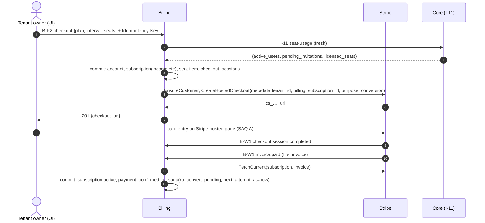

1. **B-P2** validates (§5.4.1) and creates the `incomplete` subscription and hosted session. Seats must cover current users and invitations (fail closed on I-11 `503`).
2. Card entry happens only on the provider page; Billing never sees card data (`BIL-PCI-2`).
3. `checkout.session.completed` links the provider subscription (cross-checked against Billing's customer mapping, `BIL-PAY-3`).
4. `invoice.paid` for the subscription's first invoice, re-read (`BIL-PAY-4`), confirms payment. Commit: subscription `active`, `payment_confirmed_at`, period from the provider, `licensed_seats` = purchased quantity, history row, saga `trial_conversion` created directly in `rp_convert_pending` with `payment_confirmed_at = now()`, `rp_idempotency_key = convert:<tenant_id>:<billing_subscription_id>`, `next_attempt_at = now()`. **No `billing.events`**: the tenant becomes paid in IAM through RP's `TenantConverted`, not through a Billing event; the seat count follows after confirmation (§8.1.2 step 4).

| # | Invariant |
|---|---|
| BIL-SAGA-1 | RP-3 is called only after payment is confirmed server-side — a verified callback re-read from the provider, or a provider API response — never on client submission (HLD §3.1, §4.1). |

**Failure branches.** Payment fails on the hosted page → no `invoice.paid`; the session expires (§8.1.3). Checkout completed but first invoice `open` with action required → the customer completes it on the hosted page; nothing happens in Billing until `invoice.paid`.

#### 8.1.2 Conversion saga

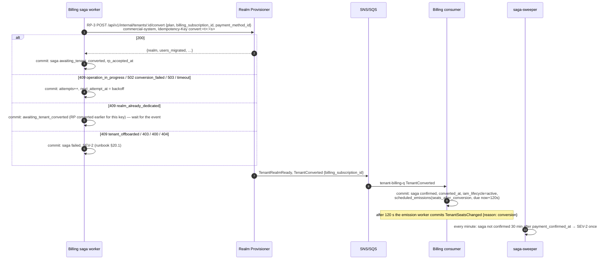

1. The **saga worker** (in-pod, every `SAGA_POLL_INTERVAL` 2 s) claims due sagas with `FOR UPDATE SKIP LOCKED` on `idx_saga_due` and calls **RP-3** with headers `x-user-id: 00000000-0000-0000-0000-0000000000c1`, `x-tenant-roles: commercial-system`, `x-tenant-id: <tenant>`, `Idempotency-Key: convert:<tenant_id>:<billing_subscription_id>`, client timeout `RP_TIMEOUT_MS` (30 s). Body `{plan, billing_subscription_id, payment_method_id}` (`payment_method_id` is the provider default-PM reference, opaque to RP).
2. Response handling per §9.3.2. Backoff: 2 s, 4 s, 8 s … capped at `SAGA_MAX_BACKOFF` (5 min), unlimited attempts until the saga is resolved; RP's conversion runs detached for up to 10 min and a retry with the same key replays its stored result once done.
3. **`TenantConverted`** (§7.1) confirms the saga by `billing_subscription_id`, whether it arrives before or after the RP-3 response.
4. The **delayed seat sync**: 120 s later (`BIL-EVT-6`) the emission worker commits `TenantSeatsChanged {licensed_seats, reason: "conversion"}` built from the current seat item, so Core replaces the trial seat allowance with the paid count. If the tenant bought or reduced seats in between, the snapshot already carries the newest value.
5. **Alert (`BIL-OPS-5`)**: `saga-sweeper` raises `BillingConversionSagaOverdue` (SEV-2) once (`alerted_at`) for any saga in `payment_confirmed`, `rp_convert_pending` or `awaiting_tenant_converted` whose `payment_confirmed_at` is older than `SAGA_ALERT_AFTER` (30 min) (HLD §3.4, §8.2 step 6).
6. Billing never charges twice for one conversion: the charge happened once at checkout; every later step is idempotent (`BIL-SAGA-2`).

#### 8.1.3 Abandoned checkout

`checkout.session.expired` (Billing sets `expires_at = now + CHECKOUT_TTL`, 1 h) or the `purchase-expiry` job for a session past `expires_at` with no callback: session `expired`; its `incomplete` subscription `ended` (`cancel_reason` stays null — never active); history row `incomplete → ended`. Nothing charged, nothing emitted. A new B-P2 starts fresh.

#### 8.1.4 Phase 1 operator conversion stub (B-O1)

1. An operator signed in to the platform realm calls B-O1 with `{plan, interval, licensed_seats, reason}` and an `Idempotency-Key`.
2. Commit: `billing_accounts` (`provider = manual`), subscription `active` (`origin = operator_stub`, `payment_confirmed_at = now()`), seat item, saga `operator_stub` → `rp_convert_pending`, AL-5 `pending_audit_entries` row (actor = operator `sub`, reason).
3. Saga as §8.1.2 (RP-3 as `commercial-system`, `TenantConverted`, delayed `TenantSeatsChanged`). The IAM-side conversion cannot tell the paths apart (HLD §5.1).
4. Invoicing happens outside the product. Moving the tenant to Stripe later: §19.2.

Dependency: the operator path (CD-52, OP-G1 to OP-G3). Until it is live the stub is usable only in dev and test.

### 8.2 Conversion reversal (CD-10)

**Approved by Finance and Security (BL-OQ-7, BIZ-7, 2026-11-23), unchanged.**

- **Finance** approved the trigger, the conversion-payment-only scope, the 7-day window and the refund rule. The aim is to reverse fraudulent conversions, not to unwind ordinary commercial disputes ("product not received", "unsatisfactory", billing complaints), which are customer-service matters. Tying the trigger to the conversion payment means a later renewal dispute can never revert an established tenant. A hard 7-day limit keeps the behaviour deterministic while the tenant is still close to its trial state; after that, the runbook applies. Refunding only when the dispute has not already returned the funds prevents double reimbursement and keeps Stripe the source of truth for chargeback outcomes.
- **Security** approved SEV-2 for `BillingReversalDecisionNeeded` (possible payment fraud and financial loss, but no platform-wide impact and no implied data compromise), operator-only approval through B-O8, and `AUTO_REVERT_ON_EFW=false` in Phase 1. Early fraud warnings can be wrong (cardholder confusion, bank-side signals), and a reversal migrates the realm, cancels the subscription, may refund and writes audit records, so it needs explicit operator approval. Automatic handling of EFW-only cases may be evaluated in a later phase, once fraud and false-positive rates are measured.

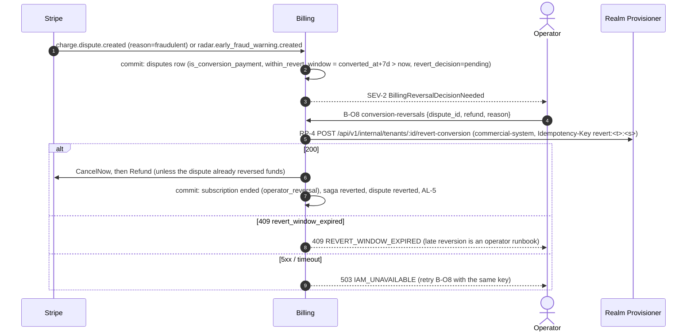

1. **Signals.** A dispute with reason `fraudulent`, or an early fraud warning, **on the conversion payment** (the subscription's first invoice) **within 7 days of `converted_at`**. Other disputes are recorded and handled in the provider dashboard; they do not trigger a reversal.
2. **Decision.** Operator-approved in Phase 1 (B-O8); never automatic. `AUTO_REVERT_ON_EFW` (default `false`) can later allow automatic reversal on early fraud warnings only.
3. **Effect.** RP-4 returns the tenant to the shared trial realm (RP §8.3). Billing then cancels the provider subscription with no proration, refunds the conversion payment unless the dispute already reversed it, sets the subscription `ended` (`cancel_reason = operator_reversal`), the saga `reverted`, the dispute `reverted`. **Billing emits no `billing.events`**: RP-4 is IAM's lifecycle change; Billing has nothing to project (Core's status follows RP's events). The decision `declined` closes the alert; the dispute continues in the provider.
4. Operator decision `declined` → `revert_decision = declined`, alert resolved, AL-5 entry.

### 8.3 Direct paid signup (HLD §8.3, §10.6)

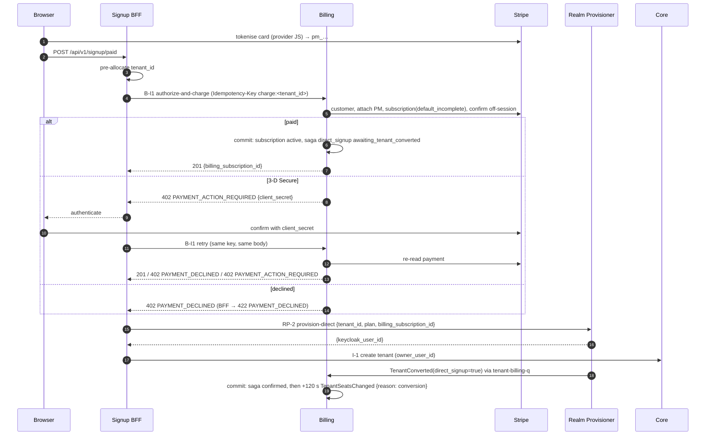

1. **B-I1** as §5.4.2. The saga starts in `awaiting_tenant_converted` with `payment_confirmed_at` set.
2. The BFF calls RP-2 and then Core I-1 (CD-9). RP emits `TenantConverted(direct_signup=true)` with `billing_subscription_id`.
3. Billing confirms the saga and, after the delay, emits `TenantSeatsChanged`. If Core has no row yet, Core parks the event and replays it after I-1 in occurrence order (EVT-18, which covers `billing.events`), so the older `TenantConverted` is applied first.
4. **Failure signals (HLD §8.3):**

| Failure | Signal | Action |
|---|---|---|
| RP-2 never succeeds (BFF gives up) | No `TenantConverted` → `BillingConversionSagaOverdue` at 30 min | Runbook §20.1: coordinate with the BFF team; if the signup cannot complete, B-O9 `refund` (category `signup_failed`; subscription `ended`, `cancel_reason = signup_failed`) |
| RP-2 succeeded, BFF I-1 and Core's backstop both failed | Billing's saga is **confirmed** (silent). Core raises `IAMParkedTenantEventsStale` (parked 10 min, still parked 15 min later), routed to Billing on-call as well as IAM (SRE-6) | IAM's runbook re-drives I-1 / the backstop event; if IAM cannot complete the signup, Billing refunds through B-O3 (category `signup_failed`) and an operator closes the subscription (B-O9 `resolved_manually` after the refund) |
| BFF times out on B-I1 | — | Retry with the same key returns the stored `201` or continues the in-flight request; never a second charge |
| BFF retries with a different key for the same tenant | `409 SUBSCRIPTION_ALREADY_EXISTS {billing_subscription_id}` | BFF handles as built (SGN-2) |
| 3-D Secure abandoned | `410 CHARGE_EXPIRED` after 30 min; `purchase-expiry` cancels the provider subscription and ends the Billing one | BFF restarts the signup |

### 8.4 Plan change between paid tiers (HLD §8.4)

#### 8.4.1 Upgrade

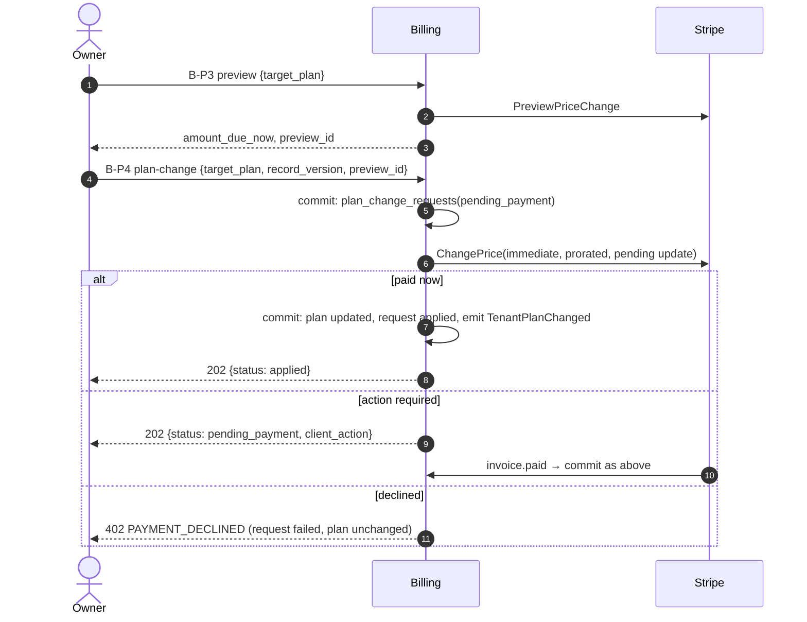

On apply: subscription `plan` and the seat item's `price_id` change; history row; emit `TenantPlanChanged {plan, previous_plan, direction: "upgrade", effective_at, billing_ref: change_id}`. Core updates `tenants.plan`, AuthZ evicts, Entitlements re-reads I-17, Usage & Metering re-renders (HLD §8.4 steps 4–5). Seats never change on a tier change (IAM HLD §8.10.5). A `pending_payment` upgrade whose invoice is not paid within `PURCHASE_ABANDON_AFTER` (30 min) is expired by `purchase-expiry`: the provider pending update lapses, the open invoice is voided, the request `failed`.

#### 8.4.2 Downgrade

1. **B-P4** calls **I-18** (`GET /api/v1/internal/tenants/:id/plan-change-check?target_plan=<plan>`, timeout 3 s). `allowed: false` → `409 PLAN_CHANGE_BLOCKED` with the blockers (`sso_idp_configured`: "remove SSO or move users to local accounts first"); `503 realm_provisioner_unavailable` → `503 IAM_UNAVAILABLE` (fail closed, CD-20). Allowed → `ScheduleAtPeriodEnd(lower price, same quantity, current_period_end)`; request `scheduled`, `i18_checked_at`.
2. **`downgrade-apply` job** (every 15 min) selects `scheduled` requests with `effective_at − now() ≤ DOWNGRADE_RECHECK_LEAD` (2 h) and **re-runs I-18** (HLD §8.4: "a scheduled downgrade re-runs I-18 when it takes effect"):
   - allowed → keep; record `i18_checked_at`;
   - blocked → `ReleaseSchedule` (the subscription renews on the current plan), request `blocked` with `blocker_codes`, B-P1 banner and a notification (BL-OQ-12), metric `commercial_billing_downgrades_blocked_total{blocker}`;
   - `503` → retry on the next run; still unavailable when `now() ≥ effective_at − 15 min` → `ReleaseSchedule`, request `blocked` with `iam_unavailable`. A downgrade never takes effect without a passing check made within the lead window.
3. At the period boundary the provider renews at the lower price. On the cycle `invoice.paid` whose line uses the new price: subscription `plan` updated, request `applied`, emit `TenantPlanChanged {direction: "downgrade"}`.
4. **B-P5** cancels a scheduled downgrade. Cancelling the subscription (B-P12) cancels it too.
5. Upgrades are never blocked (HLD §8.4 step 6).

#### 8.4.3 Effect on model tier and limits (PD-LLM-1, ENT-D6)

Billing does nothing tier-specific. The plan in `TenantPlanChanged` is the only input; Entitlements maps it to limits and `model_tier`, Usage & Metering re-renders the Gateway allow-list:

| Change | When the tier changes | Consequence (owned elsewhere) |
|---|---|---|
| Upgrade (§8.4.1) | On payment confirmation, with `TenantPlanChanged {direction: "upgrade"}` | Higher tier's profiles allowed at once; allow-list is cumulative, so lower profiles stay allowed |
| Downgrade (§8.4.2) | At the period boundary, on the `invoice.paid` that applies the lower price, never earlier | Next calls use the lower tier's profiles; artefacts already generated keep their recorded Model Profile (PD-LLM-1 consideration 4). Embedding (`bge-m3`) is the same on every plan, so no re-index |
| Trial → paid (§8.1) | On `TenantConverted` (RP), not on a Billing event | Trial uses the plan's own tier; conversion replaces trial-profile limits with the paid plan's |

Because a downgrade lowers model quality and token quota, the B-P4 response and the scheduled-downgrade notification state the effective date (`effective_at`) so the tenant knows when the tier drops.

### 8.5 Prepaid seat purchase (HLD §8.5, §8.5.1, §8.5.2)

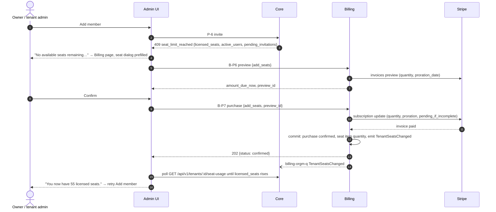

1. **Preview (B-P6).** Stripe: invoice preview for quantity `licensed_seats + add_seats` with `proration_date = now()` and invoice-now prorations; stored as a preview record (10 min). Providers without a preview: §8.5.3.
2. **Purchase (B-P7)**, §5.4.1. Stripe's pending-update semantics apply the new quantity **only when the proration invoice is paid** (CD-54: "seats take effect only after payment is confirmed; a failed payment adds nothing").
3. **Confirmation** — synchronous paid response or `invoice.paid` for the proration invoice, whichever is first; the second is a no-op (`seat_purchases.status` already `confirmed`).
4. **Commit on confirmation**: purchase `confirmed`, `confirmed_at`; seat item `quantity = seats_after`; history row; emit `TenantSeatsChanged {licensed_seats: seats_after, previous_licensed_seats, reason: "purchase", billing_ref: purchase_id}`.
5. **Timing (HLD §3.4 — confirmed).** Billing's share, payment confirmation → event committed, ≤ 5 s p99 (`commercial_billing_confirmation_to_event_seconds{kind="seats"}`); outbox → Core < 5 s; Core applies in < 5 s (IAM-3). End to end ≤ 60 s with alert `CommercialPurchaseNotActive` (§11.5).
6. The UI shows "Payment successful. Seat update in progress..." while Core's seat usage still shows the old count, then "You now have N licensed seats." and re-enables Add Member (HLD §8.5.2 step 5). The purchased seats join the recurring subscription and renew at the full price.

#### 8.5.1 Purchase states

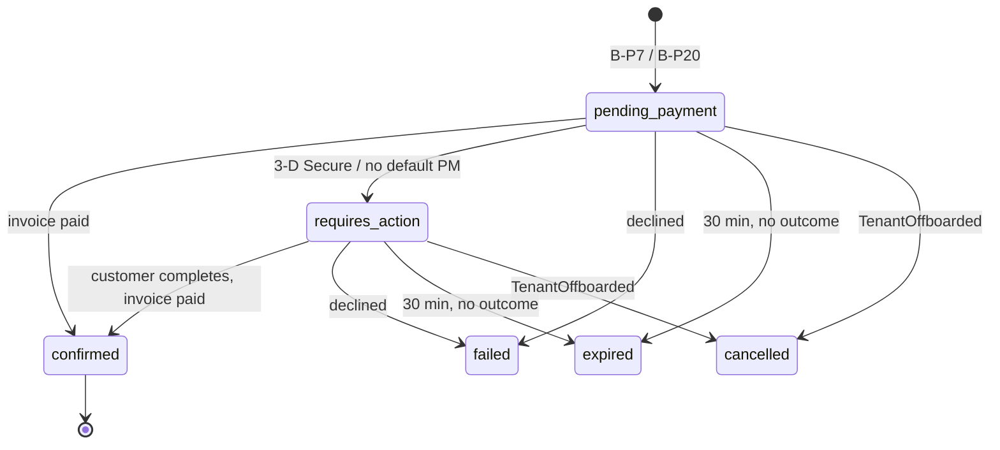

`failed`, `expired`, `cancelled`: the open invoice is voided and the pending update lapses; `licensed_seats` unchanged (`BIL-SUB-5`).

#### 8.5.2 Adding a member when no seat is free

Core refuses with `409 seat_limit_reached` (SEAT-1; all four member-creation paths, IAM-6). Billing's role is steps 3–5 of HLD §8.5.2: the seat dialog (B-P6/B-P7) and `TenantSeatsChanged`. For a **trial** tenant B-P6 answers `409 SUBSCRIPTION_REQUIRED` and the UI shows the upgrade flow (B-P2).

#### 8.5.3 Billing's proration calculator (adapters without a proration engine)

**Finance approved (BL-OQ-6, 2026-11-23), CD-54.** Fallback proration calculations are used only when the selected payment provider is certified with `Proration = fallback` (`BIL-PROV-3`). Providers that implement their own proration engine (for example Stripe) remain the system of record for prorated charges; Billing stores their amount (`amount_source = 'provider_preview'`) and never recalculates it.

```
remaining_seconds = period_end − proration_instant            (UTC, whole seconds)
period_seconds    = period_end − period_start
amount_unrounded  = unit_amount_minor × seats_added × remaining_seconds / period_seconds   (exact rational)
amount_minor      = round_half_up( amount_unrounded )
```

- Exact integer arithmetic (`math/big`) on the whole line at full precision, rounded half-up **once**, at the end, to the currency's minor unit (ISO 4217 exponent; AED fils and USD cents: 2).
- No day-count convention beyond actual seconds, so month lengths, leap years and custom periods need no table; UTC instants make daylight-saving changes irrelevant. Annual subscriptions use the annual price and the annual period.
- `proration_instant` is the preview's; the charge reuses it so preview and charge are identical.
- **Both values are stored** (Finance requirement, for audit and disputes): the inputs (`unit_amount_minor`, `remaining_seconds`, `period_seconds`), the unrounded amount (`amount_unrounded_minor`, 12 decimal places; the inputs reproduce it exactly) and the final rounded `amount_minor` on `seat_purchases` (§4.2.10, `BIL-SEAT-5`).
- **Below the provider's minimum charge** (`amount_minor < MIN_CHARGE_MINOR`): `PRORATION_BELOW_MINIMUM = free_until_renewal` (approved). The seats are added **without a charge** for the rest of the period and are billed from the next renewal as part of the subscription quantity. Billing does not charge the provider minimum. In one transaction:
  1. the purchase is `confirmed` with `amount_minor = 0`, `deferred_amount_minor` = the rounded amount not charged, `deferral_reason = 'below_provider_minimum'`; no provider invoice is created and the provider subscription quantity is updated with proration off;
  2. seat item `quantity = seats_after`, history row, and `TenantSeatsChanged {reason: "purchase", deferred_amount_minor, deferral_reason}` (§7.3.4). Audit stores the payload with the `tenant.seats_changed` entry, so the deferral is in the audit record;
  3. metrics `commercial_billing_proration_deferred_total` and `commercial_billing_proration_deferred_amount_minor_total` (§11.2).

  B-P6 shows `amount_due_now: 0` with `deferral_reason`, and B-P7 answers `202 {status: confirmed}`. `charge_minimum` stays a configuration option but is not used.

Golden test table (§14.1) fixes the expected results, e.g. 5 seats × 6900 minor, 18 days left of a 30-day month → `amount_unrounded = 6900 × 5 × 1555200 / 2592000 = 20700.000000000000`, `amount_minor = 20700`. Below minimum (`MIN_CHARGE_MINOR = 200`): 1 seat × 6900, 12 hours left of a 30-day month → `amount_unrounded = 115.000000000000`, `amount_minor = 0`, `deferred_amount_minor = 115`.

### 8.6 Scheduled seat reduction and renewal (HLD §8.5.1)

#### 8.6.1 Schedule

B-P10 creates `seat_change_schedules` (`scheduled`, `effective_at = current_period_end`). No provider change, no `licensed_seats` change, no event (`BIL-SEAT-4`). Growth stays open: purchases and member additions continue. B-P11 cancels.

#### 8.6.2 Apply ahead of renewal

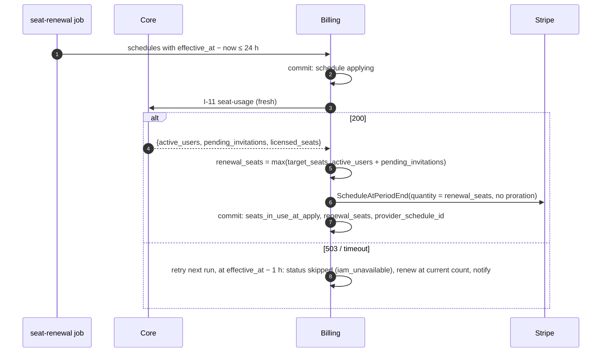

1. `seat-renewal` (every 15 min) picks schedules with `effective_at − now() ≤ SEAT_RENEWAL_LEAD` (24 h).
2. **Fresh I-11** (never the display cache): `seats_in_use = active_users + pending_invitations`.
3. `renewal_seats = max(target_seats, seats_in_use)` (`BIL-SEAT-3`); `ScheduleAtPeriodEnd` with that quantity, `ToPriceRef` = the row effective at renewal (`BIL-SUB-8`, §8.16), and no proration.
4. I-11 unavailable until `effective_at − 1 h` → `skipped` (`iam_unavailable`): the renewal bills the current count; the owner is told; never reduce blind.

#### 8.6.3 At renewal

The cycle `invoice.paid` for the new period rolls the period in its handler's transaction and leaves an `applying` schedule as it is: the steps below make HTTP calls and so run in the next `seat-renewal` run (every 15 min), outside any transaction (`BIL-CONC-2`), under the tenant lock for each commit:

1. Fresh I-11 again. If `seats_in_use_now > renewal_seats` (members added inside the lead window) → **renewal top-up**: a `seat_purchases` row with `reason = renewal_topup`, `seats_added = seats_in_use_now − renewal_seats`, charged as a purchase (prorated over the new period, so almost the full price) through the same flow as §8.5. If the top-up payment fails, the seats are still kept (Core would otherwise be over cap) and the unpaid invoice follows the normal dunning path (§8.8.1) — **Finance approved (BL-OQ-6, 2026-11-23)**. An unpaid renewal is a receivable problem, not an entitlement reduction. Sequence: renewal invoice generated → payment fails → invoice overdue → standard dunning (§8.8.1) → suspension and lockout only by the existing lapse rules (§8.8.2, §8.8.3). Billing never removes seats automatically; the seat count changes only if the tenant schedules a reduction (§8.6.1).
2. Commit: seat item `quantity = final_seats` (`renewal_seats` or top-up result); schedule `applied` with `final_seats`; history row; emit `TenantSeatsChanged {licensed_seats: final_seats, reason: "renewal"}`. If `final_seats > target_seats`, the owner is told (B-P1 banner, NTF-3 message).
3. Example (HLD §8.5.1): 100 seats, target 60, 55 in use → 60. 75 in use → 75.
4. Renewal without a schedule, same plan and quantity: invoice mirror and period update only; no IAM action (HLD §8.7 step 4).

#### 8.6.4 Seat-projection check

`seat-projection-check` (every 30 min) lists active subscriptions (sysPool), and per tenant compares I-11 `licensed_seats` with Billing's seat item. A mismatch older than `SEAT_RESYNC_AFTER` (10 min, so in-flight events are not counted) → `scheduled_emissions (seats_resync, due now)` → `TenantSeatsChanged {reason: "resync"}` with a fresh `time`; `commercial_billing_seat_projection_mismatches_total` +1; a second mismatch for the same tenant within 24 h raises SEV-3. This repairs a seat event that Core skipped under EVT-14 (`BIL-EVT-5`).

### 8.7 Token add-on purchase (HLD §8.6.2, CD-55)

Trial tenants are not eligible (`BIL-ADD-1`, `ineligible_reason: trial`; ENT-D6 consideration 4).

**Three clocks, kept separate (AI team reply, 2026-11-19).** (1) Billing's subscription period (anchored on the conversion date); (2) the quota month, which Usage & Metering sets when it writes the Gateway limit (CD-58). The Gateway's own monthly window is 30 days unless its calendar flag is set and is never anchored on the billing period, so a tenant billed on the 17th is not reset on the 17th; (3) the 12-month add-on expiry from `purchased_at` (Entitlements). Billing prices no usage, so none of these changes an invoice. **Fail-open (CD-57a):** while the Gateway's rate-limit service is down, calls are served and tokens are not metered at the edge; the SEV-2 alert and the usage-feed reconciliation recover the count. An add-on balance can therefore run past zero during an outage; that is Usage & Metering's and Entitlements' concern, and Billing does not refund or charge for it. The tenant admin UI shows the conversion checkout (B-P2) instead of the add-on catalog when the trial token budget is exhausted.

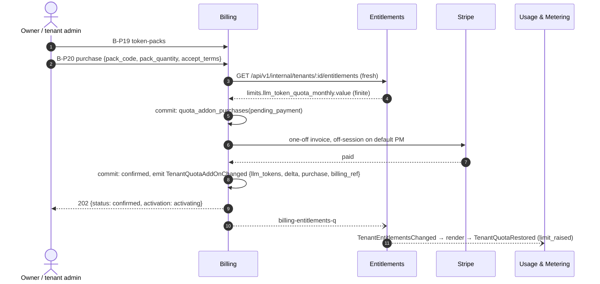

1. **Eligibility** (`BIL-ADD-1`) as §5.4.1 B-P20; Entitlements read is fresh and fails closed.
2. **Charge**: one-off, whole packs, not part of the recurring subscription, no proration (HLD §8.6.2). Stripe invoice item + invoice, `charge_automatically`, off-session on the default PM; `metadata {tenant_id, purpose: token_addon, purchase_id}`.
3. **Confirmation** (synchronous paid or `invoice.paid`): purchase `confirmed`, `confirmed_at`; emit `TenantQuotaAddOnChanged` with `purchased_at = confirmed_at`; `event_id` stored (`BIL-ADD-2`).
4. Entitlements adds the pack (idempotent on `billing_ref`), sets its expiry to `purchased_at + 12 months`, recomputes, emits `TenantEntitlementsChanged`; Usage & Metering renders the higher limit and emits `TenantQuotaRestored` once the Gateway acknowledges.
5. **Activation**: the UI shows "activating" until the usage API shows the higher limit (HLD §8.6.3, FE-10). Billing's share ≤ 5 s p99; the 60 s end-to-end alert is §11.5. During a Usage & Metering outage the purchase stays paid and applies on recovery; the tenant is never asked to pay again.
6. **Rules**: prepaid only; non-refundable to the customer (`BIL-ADD-3`); multiple packs stack and multiple purchases per month are allowed up to the policy cap; the balance survives plan changes and is forfeited at offboarding — those are Entitlements' rules, not Billing's.

### 8.8 Renewal, dunning, cancellation and offboarding (HLD §8.8)

#### 8.8.1 Renewal payment fails → `past_due`

Cycle `invoice.payment_failed`, re-read: provider subscription `past_due`. Commit: `active → past_due`, `past_due_since`, history; emit `TenantPaymentPastDue {invoice_ref, amount_due, past_due_since, next_retry_at}`. Access unchanged (HLD §6.4); Notification emails the owner and billing contact. Later retry failures: no new event (`BIL-EVT-7`). The provider runs Smart Retries for 2–3 weeks; Stripe is configured "on final retry failure: cancel the subscription" (dunning mapping, §12 `DUNNING_FINAL_ACTION`).

#### 8.8.2 → `cancelled`

Triggers: dunning exhausted; a customer cancellation (B-P12) reaching period end; auto-renew off. One path: `customer.subscription.deleted`, re-read. Commit: → `cancelled`, `cancelled_at = now()` (Billing commit clock), `cancel_reason` (`dunning_exhausted` if it was `past_due`, else `customer`/`auto_renew_off`), cancel any scheduled downgrade and reduction; emit `TenantSubscriptionCancelled {cancelled_at, reason}`. Core starts the 90-day clock (cancelled → suspended at 30 days → offboarded at 90, CD-23); AuthZ makes the tenant read-only; Entitlements sets `read_only`.

#### 8.8.3 Suspension (day 30)

`TenantSuspended {source: billing_lapse}` → `iam_lifecycle = suspended`. Nothing to bill. The customer can still settle through B-P14 until offboarded (§8.9).

#### 8.8.4 Offboarding (day 90) — `TenantOffboarded`

1. Commit 1: mark open purchases and checkout sessions `cancelled`; schedules and plan changes `cancelled`.
2. Provider: `CancelNow` on any live provider subscription (no proration credit, no refund); `VoidInvoice` on open invoices where allowed, otherwise they are left `uncollectible`.
3. Commit 2: subscription `ended`, `ended_at`, `cancel_reason = offboarded` if not already set; `billing_accounts.iam_lifecycle = offboarded`, `closed_at`.
4. **No bus event** (IAM already knows). Financial records are kept (§15.3). The add-on balance is forfeited by Entitlements on `TenantMembershipsPurged`, not by Billing.

### 8.9 Reactivation (`source: billing`, HLD §8.9)

| From | How the customer settles | Billing action |
|---|---|---|
| `past_due` | B-P14 returns the provider-hosted page for the open cycle invoice; or the owner updates the card (B-P16) and the provider's next retry succeeds | Cycle `invoice.paid` on a `past_due` subscription → commit `active`, clear `past_due_since`, emit `TenantReactivated {source: "billing", previous_status: "past_due"}` |
| `cancelled` (incl. IAM `suspended`/`billing_lapse`) | B-P14 → hosted checkout for the same plan and interval and seats ≥ seats in use | The provider subscription is gone (Stripe cannot revive a deleted one). Billing creates a **new provider subscription linked to the same `billing_subscription_id`** (old provider id kept in history; `origin` unchanged). On its first `invoice.paid`: commit `active`, clear `cancelled_at`/`cancel_reason`, new period; if seats changed emit `TenantSeatsChanged {reason: "reactivation"}` **first**, then `TenantReactivated {source: "billing", previous_status: "cancelled"}` (`BIL-EVT-5`) |
| `offboarded` | Not possible | `409 ACCOUNT_CLOSED`; a returning customer signs up again (`BIL-SUB-2`) |

Keeping `billing_subscription_id` stable keeps RP's and Core's references valid. Core restores `active` and clears `cancelled_at` and `suspension_source` (no-op if offboarded, PAID-1); AuthZ evicts; RP re-enables a suspended realm from `billing-realm-q`; Entitlements returns to `active`; Workflow resumes (W-1). **Billing never calls RP-10** (`403` by CD-19; HLD §8.9).

### 8.10 Operator suspension observed on `tenant-billing-q` (CD-24)

**Finance approved (BL-OQ-1, 2026-11-23), rules 1 to 4, with `AUTO_PAUSE_ON_OPERATOR_SUSPENSION=true`.** An operator suspension (abuse, security incident, legal hold, sanctions review, regulatory investigation) is an exceptional investigation state, not non-payment. Billing preserves the status quo until an operator decides how the period is billed.

> **Scope of a pause.** Operator suspension pauses collection activity but does not terminate the subscription, alter entitlements, cancel the contract, or waive amounts that were already due before the suspension.

1. **Pause on suspension (rule 1, rule 4).** `TenantSuspended {source: operator}` → `iam_lifecycle = suspended`, `iam_suspension_source = operator`. If `AUTO_PAUSE_ON_OPERATOR_SUSPENSION` (default `true`), `PauseCollection(true)` in the same handler:
   - **New invoices:** Stripe `pause_collection.behavior = keep_as_draft`. Renewal invoices are still created, but as drafts that are never charged. Billing mirrors each one with `held_for_review = true`.
   - **Invoices already open** (for example a `past_due` renewal): stay open and owed, but automatic retries stop (Stripe `auto_advance = false` on each open invoice). The dunning clock is frozen, so a suspension never leads to `cancelled` through dunning.
   - Commit: `collection_paused = true`, `collection_paused_by = auto`; AL-5 `billing.collection.paused`; subscription status unchanged (an `active` subscription stays `active`, a `past_due` one stays `past_due`).
2. **While paused (`BIL-SUB-7`).** No automated charge and no dunning transition. Tenant routes that would create a charge or change what is billed answer `409 COLLECTION_PAUSED`: seat purchase (B-P7), seat reduction schedule and its cancellation (B-P10, B-P11), plan change and its cancellation (B-P4, B-P5), token add-on purchase (B-P20), reactivation (B-P14). Read routes keep working. Entitlements and licensed seats are unchanged.
3. **Reactivation (rule 2).** `TenantReactivated {source: operator}` → `iam_lifecycle = active`. If `collection_paused_by = auto` → `PauseCollection(false)`: new invoices are charged normally again and automatic retries restart on invoices that were open before the suspension (normal dunning resumes from where it stopped). **Drafts held during the pause are not finalised or collected automatically.** Each one waits for an operator decision through **B-O16**: `finalize` (charge it) or `void`, with a mandatory reason. Alert `BillingSuspensionDraftsAwaitingDecision` fires while any held draft has no decision 24 h after reactivation.

   | Suspension outcome | Typical B-O16 decision |
   |---|---|
   | Customer responsible for abuse | `finalize` and collect |
   | False-positive investigation | `void` |
   | Legal hold | Human review; decide case by case |
   | Security compromise | Case by case |

4. **Operator override (rule 3, B-O10).** An operator may pause or continue billing at any time with a mandatory reason, for example a contractual obligation to keep billing, a legal preservation requirement, enterprise terms, or a fraud investigation where service stays reserved. `paused: false` during a suspension means "continue billing" and clears the automatic pause. An operator pause (`collection_paused_by = operator`) is never undone automatically, including by `TenantReactivated`. Every override writes AL-5 `billing.collection.paused` with the reason.
5. A `billing_lapse` suspension needs no pause: the subscription is already `cancelled` (§8.8.3).

### 8.11 Operator adjustments, refunds and manual add-on corrections

| Case | Operator action | Billing effect | Other service |
|---|---|---|---|
| Custom-deal price (HLD §8.10) | B-O11 price row for a custom price, or B-O2 recurring credit | New price on the next renewal / customer balance credit; AL-5 | Numeric overrides are Entitlements' (`PUT /api/v1/operator/tenants/:id/entitlement-overrides/:key`) |
| Service credit, goodwill | B-O2 `credit` | Customer balance credit; AL-5 `billing.adjustment.issued` | — |
| Refund a billing error or duplicate charge | B-O3 | Provider refund; AL-5 `billing.refund.issued` | — |
| Duplicate token add-on charge | B-O3 `duplicate_charge` on the second add-on invoice | Money returned; on `succeeded`, `TenantQuotaAddOnChanged {reason: refund}` (`BIL-ADD-4`) | Entitlements removes the grant's unused tokens (never below zero, never consumed tokens) |
| Fraud on an add-on | B-O3 `fraud` | Money returned; `TenantQuotaAddOnChanged {reason: refund}` | Entitlements removes unused tokens |
| Goodwill tokens, migration credit | — (no money) | none | Entitlements operator route only (`billing.token_addon.granted`) |

**Ownership (TL decision, 2026-11-19).** Billing owns commercial transactions and emits `TenantQuotaAddOnChanged` for the two it performs: `purchase` and `refund`. Entitlements owns quota state: it applies those events, and corrections that involve no money (goodwill, migration credit, manual adjustment) and expiry are Entitlements actions on its own operator route, never `TenantQuotaAddOnChanged`. Billing never calls the Entitlements operator route.

**Audit path (Commercial TL and Entitlements, BL-OQ-23 c, 2026-11-23).** Entitlements does not publish add-on balance change events on `entitlement-events`. Audit visibility for goodwill grants, corrections, expiries and similar balance changes is provided exclusively through AL-5 audit submissions. One business action has one audit record: a bus event would be stored by Audit's catch-all `entitlement-audit-q` as `entitlement.unknown`, raise an alarm and duplicate the AL-5 entry, and no consumer needs it.

### 8.12 Usage period records

`UsagePeriodClosed` (one per tenant per UTC month, HLD §8.7) → `usage_period_records`. Used by operators and Finance for reference (B-O7 adds the last 12 periods); nothing is priced from it.

### 8.13 Reconciliation run (B-O5)

1. B-O5 inserts `reconciliation_runs (queued)`; a server pod claims it (`claimed_by`), status `running`.
2. Using `billing_system`, it pages through the provider (`ListSince` subscriptions, invoices, events, `limit = 100`, rate-limited, §21.2) for the window and compares with Billing:

| Check | Finding kind | Auto-repair (`auto_repair = true`) |
|---|---|---|
| Provider event in window with no ledger row | `missing_ledger_event` | Insert the event into the ledger as `received` (it is then processed normally) |
| Provider subscription status ≠ Billing status (after mapping) | `status_mismatch` | Re-read and apply through the normal processor (`BIL-PAY-4`) |
| Provider quantity ≠ seat item quantity, no pending update | `seats_mismatch` | No (needs a person: money may be involved) |
| Provider price ≠ Billing plan | `plan_mismatch` | No |
| Provider invoice missing in mirror / amounts differ | `invoice_missing` / `invoice_mismatch` | Upsert the mirror |
| Provider object with Billing metadata but no Billing row | `orphan_provider_object` | No |
| Ledger rows `failed:unknown_customer` in window | `unknown_customer` | No |

**Auto-repair (rev 0.37; report-only in the Phase 6 build, rev 0.36).**
- A missing event is ledgered from the provider's event listing, normalised as a delivery would be. The processor then applies it.
- A `status_mismatch` where the provider has ended the subscription is repaired with a ledger row `recon:<run_id>:<provider_object_id>` (`event_type = reconciliation.reread`, kind `subscription_ended`). The processor re-reads that object and applies it (`BIL-PAY-4`). Other status mismatches are reported; the next callback or a replay (B-O13) applies them.
- A missing invoice is fetched and mirrored.

A repair failure is noted on the finding (`repair_note`) and never fails the run. `counts.repaired` is the number of findings repaired.

3. Status `completed` with `counts`; one AL-5 `commercial.cross_tenant_job.ran` entry under `platform_tenant`, committed in the same `billing_system` transaction as the run's completion (`BIL-AUD-1`); findings not repaired → `BillingReconciliationDrift` after 24 h (§11.5). Phase 2 adds a nightly CronJob with the same code.

### 8.14 Subscription state machine

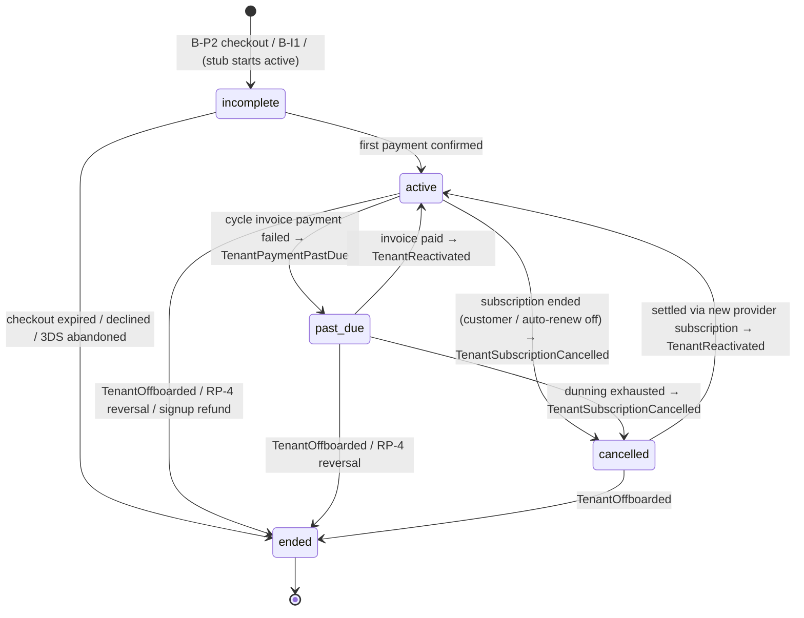

The transition table in `internal/domain/subscription.go` is the single source; every other transition is rejected by the app layer (`500 INTERNAL` for a code path, `ignored` for a callback).

### 8.15 Webhook processing pipeline

1. **Receive (B-W1)** — verify, ledger, `200` (§5.4.3).
2. **Claim** — the in-pod processor (every `WEBHOOK_POLL_INTERVAL` 500 ms) runs on the sysPool:

```sql
WITH next AS (
  SELECT provider, provider_event_id FROM payment_event_ledger l
  WHERE status IN ('received','failed') AND next_attempt_at <= now()
    AND NOT EXISTS (SELECT 1 FROM payment_event_ledger e            -- BIL-PAY-5: per-tenant order
                    WHERE e.tenant_id = l.tenant_id AND e.status = 'processing'
                      AND e.provider_created_at <= l.provider_created_at)
  ORDER BY provider_created_at
  LIMIT 20 FOR UPDATE SKIP LOCKED)
UPDATE payment_event_ledger p SET status = 'processing', claimed_until = now() + interval '60 seconds', attempts = attempts + 1
FROM next WHERE p.provider = next.provider AND p.provider_event_id = next.provider_event_id
RETURNING p.*;
```

3. **Process** — bind the tenant on the app pool, `FetchCurrent` (`BIL-PAY-4`), dispatch per §7.4, commit domain change + outbox + ledger outcome (`processed` with `outcome`). A row whose `claimed_until` passes without completion is reclaimable.
4. **Errors** — transient (provider `5xx`, DB) → `failed`, `next_attempt_at` = backoff (1 s … 5 min); after `WEBHOOK_MAX_ATTEMPTS` (10) stays `failed` with SEV-3 and is replayed by runbook (§20.2, B-O13). `unknown_customer` → `failed` immediately (no retry).
5. **Target** — received → processed < 10 s p95.

### 8.16 Price change for live subscriptions (BL-OQ-16)

**Approved by Product and Finance (BL-OQ-16, 2026-11-23): existing subscribers move to the new price at their next renewal; no grandfathering period in Phase 1.**

| Subscriber | Price applied |
|---|---|
| New subscriber after the change | New price immediately (checkout uses the row effective now) |
| Existing subscriber | Current price until the next renewal on or after the new row's `effective_from` |
| At that renewal | New price |
| Within a paid period | Never repriced. Seat purchases in the period use the item's current price; a customer upgrade (§8.4.1) moves to the target plan's current row, as before |

**Why (Product and Finance).** It respects the price the customer already paid for the current term, takes effect promptly, avoids delaying revenue by up to a year, and avoids permanent price cohorts (support, reporting and reconciliation cost). "Until plan change" was rejected because seat changes, add-ons, cancellation and reactivation, downgrade-then-upgrade and provider migration would each need their own pricing rule.

**Notice (Product requirement).** Customers are told before a renewal uses a higher price: B-P1 shows the current and the scheduled unit price (`scheduled_unit_price`) and the renewal estimate at the new price, and the renewal notice carries the new price (Notification message, BL-OQ-12). **No minimum notice period** (Commercial Team; acknowledged by Product and Finance 2026-11-23): the notice goes out when the change is scheduled, and the change applies at the first renewal on or after the effective date. Decreases follow the same path.

**Mechanism (Commercial Team; acknowledged by Product and Finance 2026-11-23).** A provider subscription stays on its provider Price until Billing changes it, so without a step at renewal every existing customer would be grandfathered indefinitely. No grandfathering field or price override is added; one job moves subscriptions at renewal.

**Phase 6 build (rev 0.36; superseded in Phase 7, rev 0.37).** `renewal-repricing` ships in Phase 7. Until it does, a renewal keeps the committed price: the seat item's current provider price. A new price row affects only new checkouts and upgrades. Before Phase 7 goes live, existing subscriptions are not moved.

1. **`renewal-repricing`** (CronJob, hourly at `:20`) selects live subscriptions (`active`, `past_due`; not `auto_renew = false`) where the seat item's price differs from the **target row**: the `plan_prices` row effective at `R = current_period_end` for the item's plan, interval, currency and provider. Subscriptions with `R − now() < REPRICE_CUTOFF` (1 h) are skipped this period and moved at the following renewal.
2. **Schedule.** `ScheduleAtPeriodEnd {ToPriceRef: target, ToQuantity: current quantity, At: R}`. The Stripe adapter updates the subscription's existing schedule if one exists, so a scheduled seat reduction (§8.6.2) or downgrade (§8.4.2) is kept. Every `ScheduleAtPeriodEnd` call, from any flow, sets `ToPriceRef` to the row effective at `R` for the plan that will be current at `R` (`BIL-SUB-8`). A downgrade therefore already renews at the target plan's new price, and a released schedule (blocked downgrade, §8.4.2) is re-created by the next run.
3. **Record.** Commit `subscription_items.scheduled_price_id`, `scheduled_price_at = R`; history row. The notice message waits for BL-OQ-12 (NTF-3): until an event is agreed none is emitted, and B-P1 shows `scheduled_unit_price` (rev 0.37). The job is idempotent: a subscription already scheduled to the target row is skipped; a newer row added before the cutoff replaces the schedule.
4. **At renewal.** On the cycle `invoice.paid` whose line uses the new price: seat item `price_id = scheduled_price_id`, scheduled columns cleared, history row. **No bus event to IAM**: the plan is unchanged, so there is nothing for Core or Entitlements to project.
5. **`manual` subscriptions** (operator stub) get the same item change at `R`; they are invoiced outside the product.
6. **Metric:** `commercial_billing_repricing_scheduled_total{direction}` (`increase`\|`decrease`).

---
## 9. Concurrency, Consistency, and Failure Handling

### 9.1 Optimistic concurrency and the per-tenant lock

```go
// adapters/postgres/subscription_repository.go — natural key + version; zero rows diagnosed, not assumed
cmd, err := tx.Exec(ctx,
    `UPDATE subscriptions SET auto_renew = false
     WHERE billing_subscription_id = $1 AND tenant_id = $2 AND record_version = $3`,
    subID, tenantID, expectedVersion)
if err != nil { return mapPgErr(err) }
if cmd.RowsAffected() == 0 {
    return r.probeSubscription(ctx, tx, tenantID, subID) // no row → ErrSubscriptionNotFound; version moved → ErrOptimisticLock{Current}
}
```

| # | Invariant |
|---|---|
| BIL-CONC-1 | Every write that changes a subscription, its items, schedules, purchases or saga — from a tenant request, operator request, webhook, consumer, worker or job — first takes `SELECT pg_advisory_xact_lock(hashtextextended('billing:' \|\| $tenant_id, 0))`. This serialises purchases, renewal application and callbacks for one tenant without a global lock. |
| BIL-CONC-2 | No provider, IAM or Entitlements HTTP call is made while a transaction is open. Pattern: commit intent (`pending_payment`, saga step, `applying`) → call outside → commit outcome under the lock, re-checking state. A crash between them leaves a row that the worker, a callback or `purchase-expiry` picks up. |
| BIL-CONC-3 | Mutations a client issues against a version it read carry `record_version` (§5.1); background writers do not use `record_version` but hold the tenant lock and re-read. |
| BIL-CONC-4 | Writes run in `RunInTxWithRetryOpts` (pgcommon retries 40P01 / 40001 up to 3 times); after retries → `409 CONCURRENT_UPDATE`. |

### 9.2 Idempotency

| Operation | Key | Storage | Replay behaviour |
|---|---|---|---|
| Tenant / internal / operator mutation | `Idempotency-Key` header | `idempotency_records (tenant_id, scope, key)` | Same key + same `request_hash` → stored status and body, `Idempotent-Replayed: true` |
| Same key, different body | — | — | `422 IDEMPOTENCY_KEY_REUSED`; **B-I1 only**: `409 SUBSCRIPTION_ALREADY_EXISTS` (HLD §10.6) |
| Key in flight | — | `state = in_flight`, `locked_until` (30 s) | `409 REQUEST_IN_PROGRESS`, `Retry-After: 2`; after `locked_until`, the next request re-runs the operation, which is itself idempotent at the provider |
| Seat / plan / add-on purchase | `purchase_id` / `change_id` | Row PK + `uq_*_key (tenant_id, idempotency_key)` | One row per key |
| Provider call | `bsub:<id>:customer`, `…:pm`, `…:create`, `…:confirm`, `…:checkout`, `seatpur:<purchase_id>`, `planchg:<change_id>`, `addon:<purchase_id>`, `refund:<refund_id>`, `adj:<adjustment_id>`, `sched:<schedule_id>`, `cancel:<billing_subscription_id>:<n>` | Provider (Stripe keys valid 24 h) | After 23 h Billing never retries the same key; it re-reads the provider object instead |
| Provider callback | `(provider, provider_event_id)` | Ledger PK | Duplicate insert → `200`, no work |
| Consumed bus event | envelope `id` × consumer | `processed_events` via `pkg/inbox` | Claim is the first statement of the handler's transaction |
| RP-3 / RP-4 | `convert:<tenant_id>:<billing_subscription_id>` / `revert:<tenant_id>:<billing_subscription_id>` | RP `provisioning_operations` | RP replays its stored result |
| AL-5 | `Enqueuer.NewKeyStrict(<source_event_type>, <natural id>)` = `uuidv5(KeyNamespace("commercial-billing"), …)`; duplicate enqueue is `ON CONFLICT DO NOTHING` | Audit `processed_events` | `200` replay |
| Emitted events | `billing_ref` in `data`; snapshot payloads | Consumers | `TenantQuotaAddOnChanged` idempotent on `billing_ref` at Entitlements |

| # | Invariant |
|---|---|
| BIL-IDEM-1 | A route that can charge stores its outcome before returning; a retry never charges twice (`BIL-API-3`). |
| BIL-IDEM-2 | Provider idempotency keys are derived from Billing ids only, never from request input. |
| BIL-IDEM-3 | Idempotency records live 72 h (`IDEMPOTENCY_TTL_HOURS`); a key reused after that is a new request (the BFF's `charge:<tenant_id>` cannot recur after 72 h because the tenant then has a subscription → `409 SUBSCRIPTION_ALREADY_EXISTS`). |

### 9.3 Saga state machine

#### 9.3.1 States and transitions

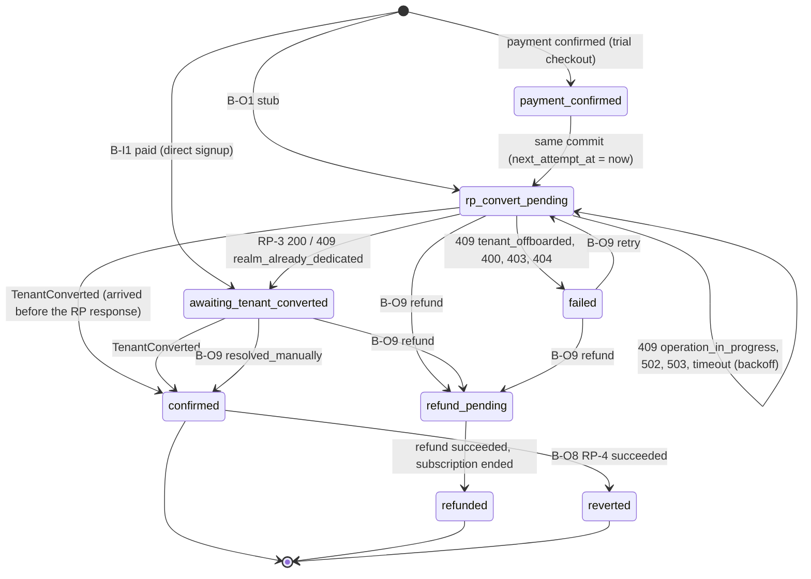

| State | Meaning | Who moves it | Alert |
|---|---|---|---|
| `payment_confirmed` | Transitional (same commit as payment) | Payment handler | Counted for the 30-min alert |
| `rp_convert_pending` | RP-3 to call or retry | Saga worker | 30 min |
| `awaiting_tenant_converted` | RP accepted; waiting for the event (always the state for direct signup) | Consumer | 30 min |
| `confirmed` | `TenantConverted` matched; seat sync scheduled | — | — |
| `failed` | Non-retryable RP answer | Operator (B-O9) | SEV-2 immediately |
| `refund_pending` / `refunded` | Operator chose refund | Operator, refund callback | — |
| `reverted` | RP-4 reversal done (§8.2) | Operator | — |

#### 9.3.2 RP-3 response handling

| RP answer (RP LLD §5.5, §17) | Meaning | Saga action |
|---|---|---|
| `200` | Converted (or replay of a finished conversion for this key) | → `awaiting_tenant_converted` |
| `409 operation_in_progress` | Conversion still running detached (≤ `CONVERT_TIMEOUT` 10 min) or a concurrent duplicate | Stay; backoff; same key |
| `502 conversion_failed` / `502 keycloak_unavailable` | Compensated; shared realm still authoritative; retryable | Stay; backoff |
| `503 db_unavailable` / `request_timeout`, transport error, client timeout | Retryable | Stay; backoff |
| `409 realm_already_dedicated` | The tenant is already on a dedicated realm (an earlier attempt converted; a lost response) | → `awaiting_tenant_converted`; if no `TenantConverted` with this `billing_subscription_id` arrives in 30 min the alert fires and the operator checks RP |
| `409 tenant_offboarded` | Terminal | → `failed`; SEV-2; operator refunds |
| `400` (incl. `missing_idempotency_key`), `403` (`tenant_mismatch`, CD-19 refusal), `404 tenant_realm_not_found` | Billing bug, admission or data problem | → `failed`; SEV-2 |

### 9.4 Provider-webhook ordering and replay

- **Ordering.** Providers do not guarantee order. `BIL-PAY-5` processes one tenant's callbacks in `provider_created_at` order, and `BIL-PAY-4` applies the re-read provider object, so even out-of-order processing converges on the provider's current state.
- **Duplicates.** Ledger PK; a duplicate is acknowledged and not processed.
- **Replay.** Provider-side "resend" or B-O13 puts a row back to `received`; processing is idempotent because each handler checks Billing's current state and re-reads the provider object.
- **Missed callbacks.** Synchronous paths (B-I1, B-P7, B-P20, B-P4) apply outcomes from the API response; reconciliation (§8.13) inserts any provider event missing from the ledger.

### 9.5 Failure scenarios

| Scenario | Detection | Behaviour / recovery |
|---|---|---|
| **Billing down** | Readiness, availability SLO | Provider queues and retries webhooks (≤ 3 days); tenant purchase routes unavailable; IAM, Entitlements, enforcement points unaffected (no hot-path dependency) |
| **Provider down** | Adapter `ErrProviderUnavailable`, `platform_dependency_request_seconds{dependency="stripe",outcome="error"}` | New checkouts and purchases `503 PROVIDER_UNAVAILABLE` with retry guidance; existing subscriptions and access unaffected; callbacks drain on recovery; runbook §20.4 |
| **Core down (I-11, I-18)** | `503` from the client | Downgrade `503 IAM_UNAVAILABLE` (fail closed); B-P2/B-P14 `503` (seat floor); renewal reduction retried then skipped (renew at current count); display fields `null` |
| **RP down (RP-3)** | Saga errors | Backoff with the same key; 30-min alert; no second charge |
| **Entitlements down** | Client error | Add-on purchase `503 ENTITLEMENTS_UNAVAILABLE`; pack list shows `eligible: false` |
| **Audit down** | AL-5 `5xx` / timeout | Entries wait in `pending_audit_entries` (runner backoff, 50-attempt budget then parked); business writes unaffected (AUDIT-CALLER-1); `PlatformAudit*` alerts (§11.5) |
| **Bus down (SNS)** | Outbox publish errors | Outbox retries; after 5 attempts → dead letters + page; ordered rows for that tenant wait; state is committed, publication catches up |
| **SQS consumer errors** | `platform_messages_failed_total` | Redelivery; DLQ at receive 4; `BillingDLQNotEmpty` |
| **Duplicate webhook** | Ledger PK | `200`, no work |
| **Partial saga** (paid, RP not done) | Saga state | Resumes from the persisted step; 30-min alert; operator `retry` / `refund` |
| **Payment confirmed, Billing commit fails** | Error after a provider success | Callback retried by the provider; synchronous caller gets `503` and retries with the same key; the stored provider ids let the retry apply the outcome |
| **Signature failures spike** | Counter | SEV-2 (possible spoofing); nothing stored |
| **`TenantOffboarded` with a purchase pending** | Lock + state check | Purchase `cancelled`, open invoice voided |
| **Core skipped a Billing seat event (EVT-14)** | `seat-projection-check` | Re-emit with a fresh `time` (§8.6.4) |
| **Clock skew** | Core EVT-15 rejects events > 300 s in the future | Billing nodes use the platform NTP; `time` is the DB server clock (`clock_timestamp()` read in the transaction) to keep one clock per database |
| **Price book missing a row** | `422 PRICE_NOT_AVAILABLE` | Operator adds the row (B-O11) |

**DB error mapping** (pgcommon SQLSTATE helpers, as IAM): connection / resource classes 08, 53, 57, 58 → `503 DB_UNAVAILABLE`; `57014` statement timeout and `55P03` lock timeout → `503 REQUEST_TIMEOUT`; `40P01` / `40001` after retries → `409 CONCURRENT_UPDATE`; unique violation on `uq_sub_one_live` → `409 SUBSCRIPTION_ALREADY_EXISTS`, on `uq_sp_one_open` → `409 SEAT_PURCHASE_IN_PROGRESS`, on `uq_pcr_one_open` → `409 PLAN_CHANGE_PENDING`, on `excl_pp_overlap` → `409 PRICE_OVERLAP`.

### 9.6 Consistency guarantees

- **Billing ↔ provider**: eventually consistent through synchronous responses, callbacks and reconciliation. The provider is the record of money movement; Billing is the record of the subscription as the platform sees it (CD-56).
- **Billing → IAM**: at-least-once events, snapshot payloads, recency by `time`, per-tenant publish order; `licensed_seats` converges within 60 s, and `seat-projection-check` repairs any skipped seat event within 40 min.
- **Seats never exceed what was paid** (`BIL-SUB-5`) except a renewal top-up whose payment later fails (kept, then dunning — §8.6.3), and **renewals never go below seats in use** (`BIL-SEAT-3`). Both are applied under `BIL-CONC-1`.
- **No double charge** for one idempotency key (`BIL-IDEM-1`) or one conversion (`BIL-SAGA-2`).

### 9.7 Operational invariants

| # | Invariant |
|---|---|
| BIL-OPS-5 | A saga not `confirmed` 30 minutes after payment confirmation always pages, once. |
| BIL-OPS-6 | Every `failed` ledger row is retried to success, set `ignored` by an operator replay with a reason, or listed by the next reconciliation run. |
| BIL-OPS-7 | Live and test provider keys never coexist in one environment (`livemode` check, startup check of the key prefix `rk_live_` vs `rk_test_` against `APP_ENV`). |
| BIL-OPS-8 | A purchase confirmed by payment always produces its event (outbox in the same commit), so "paid but nothing happened" can only be downstream lag, which the 60 s alert covers. |
| BIL-OPS-9 | No job deletes or minimises a financial record (CD-14, §15.3). The only scheduled data changes are the operational prunes (outbox, processed events, idempotency keys) and `pii-minimisation`, which nulls contact fields on `billing_accounts` and never deletes a row. |
| BIL-AUD-1 | A global change under `platform_tenant` and its AL-5 entry are written in one `billing_system` transaction: a `plan_prices` or `token_packs` row (B-O11, B-O12), a certification submission, review or revocation (B-O14, B-O17, B-O15), and a reconciliation run's completion (§8.13). A refused change writes no entry, and an entry never exists without its change (rev 0.36; migration `000006` grants `billing_system` `SELECT, INSERT` on `pending_audit_entries`). |

---

## 10. Security

### 10.1 PCI-DSS scope (SAQ A)

- Card entry only on provider-hosted pages (Checkout, setup, hosted invoice) or the provider's JS in the browser for 3-D Secure and the direct-signup token. Billing receives provider tokens (`pm_…`) and ids only (HLD §11.1).
- Billing runs alone in namespace `billing`, with its own NetworkPolicy, database, deploy role (`github-actions-billing-deploy`) and the PCI owner group as a required second reviewer on production deploys (HLD §15.4).
- `BIL-PCI-1` (SDK confined), `BIL-PCI-2` (no card data stored), `BIL-PCI-3` (ledger allow-list).
- Logs and traces redact: provider secrets, `Stripe-Signature`, `client_secret`, payment-method ids beyond the last 4 characters, billing contact email (SHA-256 hashed with a per-environment salt), `TenantOffboarded.export_s3_key`, `TenantReactivated.reason`. A `slog` handler applies the redaction list; a CI test asserts it on golden log lines.

### 10.2 Network isolation and admission

| Direction | Allowed |
|---|---|
| **Ingress** | Ingress Envoy (`envoy-gateway-system`) → tenant routes, operator routes, `/api/v1/webhooks/stripe` on 8080; `bff` namespace pods with `app.kubernetes.io/name: bff-signup` → `/api/v1/internal/subscriptions/authorize-and-charge` on 8080 (NetworkPolicy + Istio AuthorizationPolicy on `cluster.local/ns/bff/sa/bff-signup`, method `POST`, exact path); `monitoring` → 9090 |
| **Egress** | Provider API via the NAT allowlist (`api.stripe.com:443`); SNS, SQS, Glue endpoints; RDS `billing` (PgBouncer); Core and RP in `iam` (API port, five routes); Entitlements in `commercial` (`GET /api/v1/internal/tenants/*/entitlements`); `iam-audit-log` in `iam` on 8080 (AL-5 `POST /api/v1/internal/audit-entries[:batch]`, `platform-audit` runner); OpenBao via ESO; OTLP collector; DNS |

**Billing into IAM as `commercial-system` (CD-19)** — exactly these routes; anything else is `403`:

| IAM service | Route | Billing use |
|---|---|---|
| Core | `GET /api/v1/internal/tenants/:id/seat-usage` (I-11) | Seat floor, renewal count, projection check |
| Core | `GET /api/v1/internal/tenants/:id/plan-change-check` (I-18) | Downgrades |
| RP | `POST /api/v1/internal/tenants/:id/convert` (RP-3) | Saga |
| RP | `POST /api/v1/internal/tenants/:id/revert-conversion` (RP-4) | Reversal |
| RP | `GET /api/v1/internal/tenants/:id/realm` (RP-11) | Operator saga view only |

Identity on every call: mTLS from `billing` / `commercial-billing`; headers `x-user-id: 00000000-0000-0000-0000-0000000000c1`, `x-tenant-roles: commercial-system`, `x-tenant-id: <target>`; `Idempotency-Key` on RP-3/RP-4. Core's Istio rule admits `cluster.local/ns/billing/sa/commercial-billing` on `GET */seat-usage` and `*/plan-change-check` only; RP's on RP-3/RP-4/RP-11; enforced by IAM CI (`TestCD19_CommercialSystem_RouteMatrix`). Istio `PeerAuthentication STRICT` in staging is SRE-1.

**Billing into Entitlements** (LLD addition, BL-OQ-3): mTLS `cluster.local/ns/billing/sa/commercial-billing` on `GET /api/v1/internal/tenants/:id/entitlements`.

**Billing into Audit Log** (AL-5): **admitted** (Audit Log rev 0.34): `cluster.local/ns/billing/sa/commercial-billing` in Audit Log's `internalCallerPrincipals`, and namespace `billing` with pod label `app.kubernetes.io/name: commercial-billing` in its `networkPolicy.internalCallers`. Billing's chart sets `serviceAccount.name: commercial-billing` explicitly and adds the egress rule above. Before go-live, `Client.Probe` from a Billing pod must return `ProbeAdmitted` in every environment (library LLD §19.2).

### 10.3 Webhook security

| Control | Value |
|---|---|
| Signature | Stripe `Stripe-Signature` (`t=…,v1=…`), HMAC-SHA256 over `t.payload`, constant-time compare, any configured secret |
| Replay window | `WEBHOOK_TOLERANCE` 300 s from `t`; older → `400` |
| Replay of a valid event | Ledger PK makes it a no-op |
| Mode | `livemode` must match the environment |
| Rate limit | Gateway `SecurityPolicy` 50 rps on the route; body ≤ 256 KiB |
| Source | Provider-published source ranges enforced at the edge where available (defence in depth; signature is the control) |
| Metadata | Never trusted alone (`BIL-PAY-3`) |

### 10.4 Input validation

UUIDs (v4/v7); enums (`plan`, `interval`, `reason`, `category`, `kind`); seats 1–1000 per request and ≤ 100000 total; `pack_quantity` 1–100; currency ISO 4217 equal to the account's; country ISO 3166-1 alpha-2; email RFC 5322 ≤ 254; `reason` 10–1000 chars on operator mutations; `description` 3–500; `Idempotency-Key` 8–200 `[A-Za-z0-9:_\-.]`; JSON body ≤ 64 KiB; unknown fields rejected (`400`) on tenant and operator routes, tolerated on B-I1. Free text is stored as given, never interpolated into provider calls except `description` (length-bounded, control characters stripped).

### 10.5 Secrets

OpenBao via External Secrets Operator, never env literals or images (HLD §11.3):

| Secret | Holder | Rotation |
|---|---|---|
| Stripe **restricted** API key (permissions: Customers, Checkout Sessions, Subscriptions, Subscription Schedules, Invoices, Invoice Items, PaymentIntents read, Refunds, Disputes read, Events read, Prices read) | Billing only | 90 days, overlap window (§20.5) |
| Stripe webhook signing secret(s) | Billing only | With endpoint rotation; two accepted during overlap |
| RDS credentials (`billing_app`, `billing_system`, `billing_migrator`) | Billing | Quarterly |
| Log hashing salt | Billing | Yearly |

### 10.6 Audit

- Every `billing.events` type reaches Audit Log on `billing-audit-q` (entry types `tenant.plan_changed`, `tenant.seats_changed`, `tenant.payment_past_due`, `tenant.subscription_cancelled`, `tenant.reactivated`, `billing.token_addon.purchased`; tier `security_3y`).
- AL-5 direct-write through `platform-audit` v0.1.2 is used **only** for what the bus cannot carry: operator actions and the cross-tenant job entry. Entries are enqueued with `Enqueuer.Enqueue` in the same transaction as the change (outbox mode) and drained by `auditoutbox.Runner`: `actor {type: "user", id: <operator sub>}`, `target {type: "subscription" | "invoice" | "saga", id}`, `source_service: "commercial-billing"`, `source_event_type` (e.g. `RefundIssued`), `occurred_at`, bounded `metadata` (amounts, category, reason). Existing types: `billing.adjustment.issued`, `billing.refund.issued`, `commercial.cross_tenant_job.ran` (one per reconciliation run, `tenant_id = platform_tenant`). Added in Audit Log rev 0.34 (BL-OQ-10, closed): `billing.conversion.stub`, `billing.conversion.reverted`, `billing.saga.resolved`, `billing.collection.paused`, `billing.price_book.changed`, `billing.provider.certified`, `billing.provider.certification_revoked` (direct-write, `security_3y`, no producer restriction). `billing.price_book.changed` and both provider-certification types use `platform_tenant`; the others use the entry's tenant. In an environment where Audit Log is older, the runner holds those rows as `skew` (`422 UNKNOWN_ENTRY_TYPE`, attempts not spent) and they deliver after Audit Log is upgraded. Automated entries (reconciliation run) use `CommercialSystemActor()`.
- HLD §11.6 review triggers owned by Billing: signature failures above threshold; a refund or adjustment above `REVIEW_THRESHOLD_MINOR`; any RP-4 request.

---

## 11. Observability

### 11.1 SLOs

| SLO | Target | Source |
|---|---|---|
| Availability (tenant, internal, operator routes) | 99.9% monthly | HLD §3.4 |
| Webhook acknowledgement | < 2 s p99 | LLD |
| Webhook processing (received → processed) | < 10 s p95 | LLD |
| Seat purchase: payment confirmation → `licensed_seats` at Core | **≤ 60 s — confirmed**; Billing share ≤ 5 s p99 | HLD §3.4 |
| Token add-on: payment confirmation → limit enforced | ≤ 60 s; Billing share ≤ 5 s p99 | HLD §8.6.2 |
| Payment confirmation → `TenantConverted` | Alert at 30 min | HLD §3.4 |
| Event propagation (commit → consumer) | 5 s p99 | HLD §3.4 |
| B-I1 latency | p95 6 s, p99 12 s | LLD |
| Tenant read routes (B-P1, B-P17) | p99 < 150 ms (excluding B-P15, provider-bound) | LLD |
| Reconciliation drift | No unrepaired finding older than 24 h | LLD |
| RTO / RPO | 30 min / 5 min | HLD §13.1 |

### 11.2 Prometheus metrics

Three tiers (IAM Platform Observability Standard, HLD §12.2); const labels `domain="commercial"`, `service="commercial-billing"`, `environment`. Never `tenant_id`, `billing_subscription_id` or provider ids as labels; `plan` and `provider` are safe. Registry generated to `docs/observability/metric-registry.md` (`make metrics-inventory`).

**Tier 2 — `commercial_*`** (domain-shared concepts; registry status `proposed`, built with `gincommon.NewShared*Vec`):

| Metric | Type | Labels | Meaning |
|---|---|---|---|
| `commercial_purchase_confirmation_to_event_seconds` | Histogram | `kind` (`seats`\|`token_addon`\|`plan`\|`conversion_seats`) | Payment confirmed → event committed (Billing's share of the 60 s targets) |
| `commercial_events_emitted_total` | Counter | `event_type` | `billing.events` enqueued |
| `commercial_operator_actions_total` | Counter | `action`, `outcome` | Operator routes |
| `commercial_cross_tenant_job_runs_total` | Counter | `job`, `outcome` | Reconciliation and other cross-tenant jobs |

**Tier 3 — `commercial_billing_*`:**

| Metric | Type | Labels | Meaning |
|---|---|---|---|
| `commercial_billing_webhooks_total` | Counter | `provider`, `type`, `result` (`processed`\|`ignored`\|`failed`\|`duplicate`) | Callbacks |
| `commercial_billing_webhook_signature_failures_total` | Counter | `provider` | `BIL-PAY-2` rejections |
| `commercial_billing_webhook_processing_seconds` | Histogram | `provider`, `kind` | Received → processed |
| `commercial_billing_webhook_backlog` | Gauge | `status` (`received`\|`failed`) | Ledger rows waiting (exporter, 30 s) |
| `commercial_billing_conversion_saga_duration_seconds` | Histogram | `kind` | Payment confirmed → `TenantConverted` |
| `commercial_billing_sagas_in_flight` | Gauge | `saga_state` | Open sagas |
| `commercial_billing_sagas_overdue` | Gauge | — | Past 30 min (alert source) |
| `commercial_billing_rp_convert_attempts_total` | Counter | `result` (`ok`\|`in_progress`\|`retryable`\|`terminal`) | RP-3 calls |
| `commercial_billing_subscriptions` | Gauge | `status`, `plan`, `provider` | Exporter, 60 s |
| `commercial_billing_downgrades_blocked_total` | Counter | `blocker` | I-18 blockers |
| `commercial_billing_repricing_scheduled_total` | Counter | `direction` (`increase`\|`decrease`) | §8.16 |
| `commercial_billing_seat_changes_total` | Counter | `direction` (`purchase`\|`reduction`\|`renewal_topup`), `result` | Seats |
| `commercial_billing_seat_projection_mismatches_total` | Counter | — | §8.6.4 |
| `commercial_billing_proration_deferred_total` | Counter | `currency`, `reason` (`below_provider_minimum`) | Seat purchases added free until renewal (§8.5.3, BL-OQ-6) |
| `commercial_billing_proration_deferred_amount_minor_total` | Counter | `currency` | Sum of `deferred_amount_minor` not charged (§8.5.3) |
| `commercial_billing_addon_purchases_total` | Counter | `pack_code`, `result` | Token packs |
| `commercial_billing_payment_failures_total` | Counter | `reason` (mapped decline) | Declines |
| `commercial_billing_dunning_transitions_total` | Counter | `to` (`past_due`\|`cancelled`\|`active`) | Lapse flow |
| `commercial_billing_unmatched_conversions_total` | Counter | — | `TenantConverted` with no saga |
| `commercial_billing_reconciliation_findings` | Gauge | `kind`, `repaired` | Last run |
| `commercial_billing_collection_paused` | Gauge | `by` | CD-24 |
| `commercial_billing_invoices_held_for_review` | Gauge | `currency` | Drafts held during a collection pause with no B-O16 decision yet (§8.10) |
| `commercial_billing_invoice_dispositions_total` | Counter | `action` (`finalize`\|`void`) | B-O16 decisions |
| `commercial_billing_scheduled_emissions_pending` | Gauge | `builder` | `BIL-EVT-6` queue |
| `commercial_billing_provider_certified` | Gauge | `provider`, `adapter_version` | 1 if the loaded adapter version has a valid record (`BIL-PROV-1`), 0 otherwise; refreshed with the registry |

**`platform-audit` (library, `service="commercial-billing"`):** `platform_audit_deliveries_total`, `platform_audit_pending_entries`, `platform_audit_failed_entries`, `platform_audit_waiting_entries`, `platform_audit_oldest_pending_age_seconds`, `platform_audit_oldest_failed_age_seconds`, `platform_audit_invalid_entries_total`, `platform_audit_delivery_lag_seconds`, `platform_audit_runner_up` and the rest of the library registry (library LLD §11.2). Alerts from `monitoring/prometheus/platform-audit.rules.yml`, routed to Billing on-call; dashboard `monitoring/grafana/platform-audit.json`. No HPA references a `platform_audit_*` metric.

**Tier 1 (libraries):** `platform_http_requests_total`, `platform_http_request_duration_seconds`, `platform_dependency_request_seconds{dependency=stripe|core|realm_provisioner|entitlements|audit, operation, outcome}`, `platform_outbox_pending_events`, `platform_outbox_dead_letters`, `platform_messages_{received,processed,failed}_total{queue}`, `platform_queue_depth`, `platform_dlq_depth`, `platform_dlq_messages_total`, `platform_event_propagation_seconds`, `platform_build_info`.

### 11.3 Tracing

OTel Go SDK, W3C Trace Context, async hops linked through the envelope (HLD §12.1). Span names:

```
billing.http B-P7
  billing.seats.purchase
    db.tx seat_purchases.insert
    stripe.subscription.update           (platform_dependency span)
    db.tx billing.seats.confirm
      outbox.enqueue TenantSeatsChanged

billing.webhook.receive                  (B-W1)
  billing.ledger.insert
billing.webhook.process invoice_paid     (linked to receive)
  stripe.invoice.retrieve
  billing.saga.start

billing.saga.step
  realm_provisioner.convert              (commercial-system)
billing.consume TenantConverted          (linked to RP's span)
  billing.saga.confirm
billing.emission seats_after_conversion
  outbox.enqueue TenantSeatsChanged

billing.http B-P4 (downgrade)
  org_membership.plan_change_check       (I-18; Core calls RP-11 inside)
  stripe.subscription_schedule.create
```

Attributes: `tenant.id`, `billing.subscription_id`, `billing.provider`, `billing.saga_state`; never amounts with card data, never `client_secret`.

**Links across async hops (rev 0.38).** A consumed event's span (`billing.consume <type>`) links to the producer's trace by the envelope's `trace_id`; the envelope has no span id, so the link names the trace only. The ledger keeps no trace context, so `billing.webhook.process` is tied to `billing.webhook.receive` by `billing.provider_event_id`, not by a span link.

### 11.4 Structured logs

`slog` JSON to Loki with `trace_id`, `span_id`, `tenant_id`, `request_id`, `route_id`, `actor_id` (operator actions), `provider_event_id` (webhook path). Redaction per §10.1. Levels: `INFO` for state transitions (one line per transition with from/to), `WARN` for retryable dependency failures, `ERROR` for terminal failures and invariant breaches.

### 11.5 Alerts and dashboards

Rules in `deploy/monitoring/app-alerts.yml`, routed by Grafana OnCall to **Billing on-call** (Commercial Team):

| Alert | Condition | Severity |
|---|---|---|
| `BillingConversionSagaOverdue` | `commercial_billing_sagas_overdue > 0` | SEV-2 (HLD §12.4) |
| `BillingSagaFailed` | saga entered `failed` | SEV-2 |
| `CommercialPurchaseNotActive` | Composed rule: for a confirmed seat or add-on purchase, Billing confirmation-to-event p99 + `platform_event_propagation_seconds` on `billing-orgm-q` / `billing-entitlements-q` + Usage & Metering `commercial_usage_metering_limit_render_latency_seconds` > 60 s over 10 min | SEV-2 (HLD §8.6.3, §12.4) |
| `IAMParkedTenantEventsStale` | Core's alert; **also routed to Billing on-call** (SRE-6) | SEV-2 |
| `BillingWebhookSignatureFailures` | rate > 5/min for 5 min | SEV-2 (HLD §12.4) |
| `BillingWebhookBacklog` | `commercial_billing_webhook_backlog{status="received"}` > 0 for 5 min (the gauge has no age), or `failed` > 0 for 30 min | SEV-3 |
| `BillingOutboxDeadLetter` | `platform_outbox_dead_letters > 0` | SEV-2 |
| `BillingDLQNotEmpty` | `platform_dlq_depth{queue=~"tenant-billing-q-dlq\|usage-billing-q-dlq"} > 0` | SEV-3 (HLD §12.4) |
| `BillingI18Unavailable` | I-18 `503` for > 10 min | SEV-3 (HLD §12.4) |
| `BillingReversalDecisionNeeded` | dispute / EFW within the revert window | SEV-2 |
| `BillingSuspensionDraftsAwaitingDecision` | held drafts (`held_for_review`, no `disposition`) remain for 24 h with no subscription still paused (the gauges carry no tenant) | SEV-3 (Finance / operator queue, §8.10) |
| `BillingReconciliationDrift` | unrepaired findings > 0 for 24 h | SEV-3 |
| `BillingSeatProjectionDrift` | two mismatches in 24 h (no tenant label; the SEV-3 log line names the tenant that repeats) | SEV-3 |
| `BillingProviderUnavailable` | `platform_dependency_request_seconds{dependency="stripe",outcome="error"}` ratio > 50% for 5 min | SEV-2 |
| `BillingProviderNotCertified` | `commercial_billing_provider_certified == 0` for any provider in `ENABLED_PAYMENT_PROVIDERS` for 5 min (`BIL-PROV-1` / `BIL-PROV-2`); runbook §20.9 | SEV-2 |
| `BillingReviewTrigger` | refund / adjustment above threshold, RP-4 request | Review (no page) |

Rules are `deploy/monitoring/app-alerts.yml`, rendered by the chart; each carries a `runbook_url` into `docs/runbooks/`. `BillingReviewTrigger` and `BillingReversalDecisionNeeded` are raised from their log lines (`alert=…`) as Loki rules (rev 0.38).

Dashboards (Grafana "Commercial / Billing"): conversion funnel (sessions → paid → RP accepted → confirmed); purchases (count, confirmation latency, failures); dunning (past-due, cancellations, reactivations); webhooks (rate, lag, backlog, signature failures); events (emitted, outbox lag, scheduled emissions); dependencies (Stripe, Core, RP, Entitlements, Audit).

---
## 12. Configuration

Values from `deploy/helm/values.yaml` (`env:`) and OpenBao (`secretValues:` via ESO). Startup validates every value against its range and refuses to start on a missing required value, an out-of-range value or a live/test key mismatch with `APP_ENV` (`BIL-OPS-7`).

| Variable | Default | Range / values | Purpose |
|---|---|---|---|
| `APP_NAME` | `commercial-billing` | fixed | Service name on metrics, spans, logs |
| `APP_ENV` | `dev` (Helm `prod`) | `local`\|`dev`\|`test`\|`staging`\|`prod` | One resolved environment |
| `BUILD_VERSION` | ldflag | — | `platform_build_info`, spans |
| `APP_PORT` / `METRICS_PORT` | `8080` / `9090` | 1024–65535 | API / metrics listeners |
| `REQUEST_TIMEOUT` | `30s` | 5–60 s | gincommon request deadline |
| `PG_HOST` / `PG_PORT` / `PG_DBNAME` / `PG_SSLMODE` | — / `5432` / `billing` / `require` | — | DSN (pgcommon `ConfigFromEnv`) |
| `PG_USER` / `PG_PASSWORD` | `billing_app` / secret | — | App pool |
| `PG_SYSTEM_USER` / `PG_SYSTEM_PASSWORD` | `billing_system` / secret | password required outside dev (rev 0.40) | sysPool: pgcommon's environment config with this role |
| `PG_AUDIT_DRAINER_USER` / `PG_AUDIT_DRAINER_PASSWORD` | `billing_audit_drainer` / secret | password required outside dev (rev 0.40) | Audit drainer pool (`auditoutbox.Runner`, §3.3); `NOBYPASSRLS` role with policy `audit_drainer_all` |
| `PG_AUDIT_DRAINER_MAX_CONNS` | `2` | 1–5 | Audit drainer pool |
| `MIGRATION_DATABASE_URL` | secret | **direct RDS endpoint, not PgBouncer** | `cmd/migrate` (`billing_migrator`), incl. `auditoutbox.ApplySchema` (session-scoped advisory lock) |
| `PG_MAX_CONNS` / `PG_MIN_CONNS` / `PG_SYSTEM_MAX_CONNS` | `10` / `0` / `4` | 2–50 / 0–10 / 1–10 | Pools (HLD §7.1) |
| `PG_STATEMENT_TIMEOUT` / `PG_LOCK_TIMEOUT` | `5s` / `2s` | 1–30 s / 0.5–10 s | Per statement / lock wait, applied by `pgcommon.ConfigFromEnv` to every pool (rev 0.40 corrects rev 0.38) |
| `PG_BOUNCER_MODE` | `true` | bool | PgBouncer transaction pooling |
| `RUN_MIGRATIONS` / `MIGRATE_TIMEOUT` | `false` (Helm) / `10m` | bool / 1–30 m | Hook Job owns migrations |
| `SNS_BILLING_EVENTS_TOPIC_ARN` | — (required) | ARN | Publish target |
| `GLUE_REGISTRY_NAME` | `billing-events` | — | Producer registry |
| `SQS_TENANT_BILLING_QUEUE_URL` / `SQS_USAGE_BILLING_QUEUE_URL` | — (required) | URL | Consumers |
| `SQS_MAX_RECEIVE_COUNT` | `4` | 1–4 (below redrive 5) | DLQ forwarding |
| `SQS_WAIT_TIME_SECONDS` / `SQS_VISIBILITY_TIMEOUT` | `20` / `60s` | 0–20 / 30–300 s | Long polling |
| `MAX_LIFECYCLE_EVENT_SKEW_SECONDS` | `300` | 60–900 | Future-time clamp (`BIL-EVT-3`) |
| `OUTBOX_POLL_INTERVAL` / `OUTBOX_BATCH_SIZE` / `OUTBOX_MAX_ATTEMPTS` / `OUTBOX_RETENTION_DAYS` | `500ms` / `50` / `5` / `8` | 100 ms–5 s / 1–500 / 1–10 / 7–30 | HLD §9.3 |
| `PUSHGATEWAY_URL` | empty | URL | CronJob run metric target (§13.2); empty → logged only (rev 0.37) |
| `PROCESSED_EVENTS_TTL_DAYS` | `8` | > SQS retention (4 d) | PE-1 |
| `PII_MINIMISE_OFFBOARDED_DAYS` / `PII_MINIMISE_ABANDONED_DAYS` | `90` / `30` | 30–365 / 7–90 | §15.3 (`pii-minimisation`) |
| `DEFAULT_PAYMENT_PROVIDER` | `stripe` | must be in `ENABLED_PAYMENT_PROVIDERS` | New accounts (§3.4); if not certified, account creation answers `503 PROVIDER_NOT_ENABLED` |
| `ENABLED_PAYMENT_PROVIDERS` | `stripe,manual` | comma list of compiled adapters | Providers the service loads. At startup each must satisfy `BIL-PROV-1` to take new accounts; one that does not is loaded for existing accounts only, logged at ERROR and alerted (§3.5). Startup fails only if a listed name has no compiled adapter |
| `PROVIDER_CERT_SUITE_VERSION` | `cert-1.0` | suite tag (§14.7) | The suite version a certification record must match |
| `PROVIDER_REGISTRY_REFRESH` | `60s` | 10 s–10 m | How often the registry re-reads `provider_certifications` |
| `DEFAULT_CURRENCY` | `USD` (Finance, BL-OQ-5) | ISO 4217 with a price row | New accounts |
| `STRIPE_API_KEY` | secret | `rk_live_…` only in `prod`, `rk_test_…` elsewhere | Restricted key |
| `STRIPE_WEBHOOK_SECRETS` | secret | 1–2 comma-separated `whsec_…` | Signature (rotation overlap) |
| `STRIPE_API_VERSION` | pinned at build | Stripe version string | Fixed per release |
| `STRIPE_TIMEOUT_MS` | `8000` | 1000–20000 | Per provider call |
| `STRIPE_MAX_RPS` | `25` | 1–80 | Client-side token bucket per pod (§21.2) |
| (adapter `Config.TestClock`) | — | not an environment key | Certification only (`cmd/certify`, §14.7): new customers on a Stripe Test Clock; refused with livemode; the server never sets it (rev 0.39) |
| `STRIPE_MAX_RETRIES` | `2` | 0–3 | SDK retries on network errors (idempotent keys) |
| `WEBHOOK_TOLERANCE` | `300s` | 60–600 s | Replay window |
| `WEBHOOK_MAX_BODY_BYTES` | `262144` | — | B-W1 |
| `WEBHOOK_POLL_INTERVAL` / `WEBHOOK_MAX_ATTEMPTS` | `500ms` / `10` | 100 ms–5 s / 3–20 | Processor |
| `DUNNING_FINAL_ACTION` | `cancel` | `cancel` (only supported value) | Provider setting asserted at startup through the adapter: final retry failure cancels the subscription (§8.8) |
| `CHECKOUT_TTL` | `1h` | 30 m–24 h | Hosted sessions |
| `TENANT_APP_BASE_URL` | — (required) | https URL | Success / cancel URLs (`BIL-API-5`) |
| `SEAT_PREVIEW_TTL` | `10m` | 5–30 m | B-P6, B-P3 previews |
| `PURCHASE_ABANDON_AFTER` / `SCA_ABANDON_AFTER` | `30m` / `30m` | 10 m–24 h | Purchases, B-I1 3-D Secure |
| `MAX_SEATS_PER_PURCHASE` | `1000` | 1–10000 | Validation |
| `SEAT_RENEWAL_LEAD` | `24h` | 1–72 h | §8.6.2 |
| `SEAT_RESYNC_AFTER` | `10m` | 5–60 m | §8.6.4 |
| `DOWNGRADE_RECHECK_LEAD` | `2h` | 30 m–24 h | §8.4.2 |
| `REPRICE_CUTOFF` | `1h` | 15 m–24 h | §8.16: a price change found later than this before renewal moves at the following renewal |
| `SAGA_POLL_INTERVAL` / `SAGA_ALERT_AFTER` / `SAGA_MAX_BACKOFF` | `2s` / `30m` / `5m` | 1–10 s / fixed 30 m / 1–15 m | §8.1.2 |
| `SEATS_AFTER_CONVERSION_DELAY` | `120s` | 30–600 s | `BIL-EVT-6` |
| `EMISSION_POLL_INTERVAL` | `5s` | 1–30 s | `scheduled_emissions` worker |
| `PRORATION_BELOW_MINIMUM` | `free_until_renewal` | `free_until_renewal`\|`charge_minimum` | §8.5.3 (BL-OQ-6, Finance approved `free_until_renewal`; change only with Finance) |
| `MIN_CHARGE_MINOR` | `200` (per currency map) | ≥ 0 | Provider minimum |
| `AUTO_PAUSE_ON_OPERATOR_SUSPENSION` | `true` | bool | CD-24 (§8.10); Finance approved `true` (BL-OQ-1); change only with Finance |
| `AUTO_REVERT_ON_EFW` | `false` | bool | CD-10 (§8.2); Security approved `false` for Phase 1 (BL-OQ-7) |
| `REVIEW_THRESHOLD_MINOR` | `100000` | ≥ 0 | HLD §11.6 review trigger |
| `IDEMPOTENCY_TTL_HOURS` | `72` | 24–168 | §9.2 |
| `CORE_BASE_URL` / `CORE_TIMEOUT_MS` | — / `3000` | — / 1000–10000 | I-11, I-18 (I-18 waits up to 2 s on RP-11 inside Core) |
| `RP_BASE_URL` / `RP_TIMEOUT_MS` | — / `30000` | — / 5000–60000 | RP-3, RP-4, RP-11 (conversion continues detached past this) |
| `ENTITLEMENTS_BASE_URL` / `ENTITLEMENTS_TIMEOUT_MS` | — / `1000` | — / 300–5000 | B-P19 / B-P20 |
| `AUDIT_SOURCE_SERVICE` | `commercial-billing` | fixed (CD-17) | `platform-audit`: `source_service`, key namespace |
| `AUDIT_LOG_BASE_URL` | `http://iam-audit-log.iam.svc.cluster.local:8080` | URL; empty disables delivery (rows still queue, `PlatformAuditDeliveryStalled` fires) | `platform-audit` client |
| `AUDIT_CALLER_DOMAIN` | `commercial` | `commercial` (fixed for Billing) | Caller role `commercial-system`, user id `…00c1`, purge actor `CommercialSystemActor()` |
| `AUDIT_DELIVERY_INTERVAL` | `5s` | 1–60 s | `auditoutbox.Runner` tick |
| Other `AUDIT_*` (`AUDIT_LOG_TIMEOUT`, `AUDIT_DELIVERY_BATCH_SIZE`, `AUDIT_DELIVERY_MAX_ATTEMPTS`, `AUDIT_DELIVERY_BACKOFF_MAX`, `AUDIT_DISPOSED_RETENTION`, `AUDIT_REQUIRE_CROSS_TENANT_ACCESS`, …) | library defaults | library LLD §12 | Malformed values fail startup |
| `COMMERCIAL_SYSTEM_PRINCIPAL` | `00000000-0000-0000-0000-0000000000c1` | fixed | Outbound identity |
| `BFF_CALLER_PRINCIPAL` | `cluster.local/ns/bff/sa/bff-signup` | SPIFFE path | `BIL-AUTH-3`; compared with the SPIFFE URI in `X-Forwarded-Client-Cert` (§13.1) |
| `OPERATOR_PATH_LIVE` | `false` | bool | `BIL-AUTH-6`: models the availability of IAM's operator path (CD-52, OP-G1 to OP-G4). `false` → every operator route `403 INSUFFICIENT_ROLE` outside dev and test. Set `true` per environment only after OP-G4 passes there |
| `LOG_LEVEL` / `LOG_HASH_SALT` | `info` / secret | — | Logs |
| `OTEL_EXPORTER_OTLP_ENDPOINT` / `OTEL_TRACES_SAMPLER_ARG` | — / `0.2` | — / 0–1 | Tracing (errors always sampled) |

**Feature flags** (env, per environment): `FEATURE_DIRECT_SIGNUP` (B-I1; `false` until SGN-2 go-live order §18.7), `FEATURE_TOKEN_ADDONS` (B-P19–B-P23; `false` until the Gateway hot-reload spike passes on a cluster, HLD §17.2), `FEATURE_SEAT_PURCHASE` (default `true`). A disabled feature answers `404` (route not registered), as the BFF does for `/paid`.

---

## 13. Deployment and Scaling

### 13.1 Kubernetes resources

Namespace `billing`; ServiceAccount and `app.kubernetes.io/name` `commercial-billing` (CD-19). Chart follows the IAM service charts (HLD §15.1):

| Resource | Spec |
|---|---|
| `Deployment` `commercial-billing` | 2 replicas minimum; `topologySpreadConstraints` across 3 AZs; readiness `/readyz` (DB, sysPool, Glue registry resolution, SNS topic reachable); liveness `/healthz`; `terminationGracePeriodSeconds: 45` (drains workers, outbox, in-flight requests) |
| In-pod workers | Outbox runner, webhook processor, saga worker, emission worker, `platform-audit` `auditoutbox.Runner` (on the `billing_audit_drainer` pool; not in `/readyz`, `Runner.Alive()` in liveness), `tenant-billing-q` and `usage-billing-q` consumers, reconciliation run executor, metric exporter. All claim rows with `SKIP LOCKED`, so every replica runs them safely without leader election |
| `HorizontalPodAutoscaler` | min 2, max 4; CPU 70%; external metric `commercial_billing_webhook_backlog{status="received"}` > 200 |
| `PodDisruptionBudget` | `minAvailable: 1` |
| `Job` `<release>-migrate` | Helm pre-install / pre-upgrade hook, `cmd/migrate`, `activeDeadlineSeconds: 900` |
| `HTTPRoute` (tenant) | `PathPrefix /api/v1/tenants/` with path match `…/subscription*`, `…/payment-methods*`, `…/invoices*`, `…/token-packs`, `…/token-addons*`, `…/billing-contact` → 8080; `SecurityPolicy` JWT + `ext_authz`, CORS for `TENANT_APP_BASE_URL`, rate limit 20 rps per tenant |
| `HTTPRoute` (operator) | `PathPrefix /api/v1/operator/` scoped to Billing's paths; platform-realm `jwt_authn` provider (platform-edge, AuthZ LLD OP-G2). Path matches list every Billing operator route, B-O1 to B-O17 (§5.3); a route missing here is not reachable through the gateway (BL-OQ-9) |
| `HTTPRoute` (webhook) | Exact `/api/v1/webhooks/stripe`; no JWT; `ext_authz` disabled; 50 rps |
| `NetworkPolicy` | §10.2 |
| Istio `AuthorizationPolicy` | B-I1 from `bff/bff-signup` only; tenant and operator routes from the gateway only |
| Istio sidecar client-certificate forwarding | **Deployment requirement (`BIL-AUTH-3`).** The pod's sidecar must forward the verified client certificate as `X-Forwarded-Client-Cert` with `forwardClientCertDetails: SANITIZE_SET` (pod annotation `proxy.istio.io/config`, or the mesh default if it already is). Billing obtains B-I1's caller identity only from that header; disabling forwarding makes every B-I1 call `403`. The chart sets the annotation explicitly and `helm-check` asserts it |
| `ServiceMonitor`, `PrometheusRule` | Metrics on 9090 from `monitoring` only; rules of §11.5 |
| `ExternalSecret` | §10.5 |

| Container resources | Request | Limit |
|---|---|---|
| CPU | 100m | 500m |
| Memory | 256Mi | 512Mi |

Node class `t3.small` share (HLD §14.2).

### 13.2 CronJobs

| CronJob | Schedule (UTC) | Purpose |
|---|---|---|
| `saga-sweeper` | `* * * * *` | Re-queue due sagas the worker missed; raise the 30-min alert once (`BIL-OPS-5`) |
| `seat-renewal` | `*/15 * * * *` | Apply scheduled reductions within `SEAT_RENEWAL_LEAD` (§8.6.2) |
| `downgrade-apply` | `*/15 * * * *` | Re-run I-18 for downgrades within `DOWNGRADE_RECHECK_LEAD` (§8.4.2) |
| `purchase-expiry` | `*/5 * * * *` | Expire abandoned purchases, previews, checkout sessions, upgrades; void their open invoices |
| `seat-projection-check` | `7,37 * * * *` | Compare Core's `licensed_seats` with Billing's; resync (§8.6.4) |
| `pii-minimisation` | `0 5 * * *` | Null the billing-contact name and email (and clear the provider customer email) 90 days after `closed_at`, and 30 days after an abandoned checkout's subscription ended; set `pii_minimised_at`. Never deletes a row and never touches a financial record (`BIL-OPS-9`, §15.3) |
| `outbox-prune` | `0 3 * * *` | `outbox.Runner.PrunePublished` (8 days) |
| `processed-events-prune` | `0 4 * * *` | `inbox.Store.Prune` (8 days) |
| `renewal-repricing` | `20 * * * *` | Schedule the move to a new price at the first renewal on or after its effective date (§8.16, `BIL-SUB-8`) |
| `idempotency-prune` | `30 4 * * *` | `idempotency_records` past `expires_at`, stored previews included (scope `preview`) |

`concurrencyPolicy: Forbid`, `startingDeadlineSeconds: 120`; each job pushes `commercial_cross_tenant_job_runs_total{job, outcome}` (`success`, `partial` or `failure`) to the Pushgateway at `PUSHGATEWAY_URL`, or logs it when the key is empty (rev 0.37). A job selects its work across tenants as `billing_system` (read-only on tenant tables, §4.3) and writes in tenant transactions on the app pool under the tenant lock. Reconciliation is operator-triggered in Phase 1 (B-O5) and runs in the server pods; Phase 2 adds a nightly `reconciliation` CronJob calling the same code.

### 13.3 CI/CD, deploy role and PCI review

- `helm-check` runs as its own CI job: lint and kubeconform on base, dev, staging and prod values; promtool on the rules; chart contract tests (rev 0.38).
- Four-workflow pipeline as IAM (HLD §15.4): validate (lint, `go-arch-lint`, unit, `schema-check`, Swagger drift, `helm-check`, metric names), integration (testcontainers), image build and scan, deploy.
- **AWS OIDC deploy role** `github-actions-billing-deploy`, trusting only `repo:BCBP-SOLUTIONS-FZC-LLC/commercial-billing:*`; separate from `github-actions-commercial-deploy` (Entitlements, Usage & Metering).
- **Production deploys require a second reviewer from the PCI owner group** (GitHub environment protection on `production`, HLD §15.4).
- Canary on webhook success rate, saga duration and 5xx rate (HLD §15.4); automatic rollback on breach.

### 13.4 Migration safety

Backward-compatible two-release migrations (HLD §15.5); the hook Job runs before new replicas; `production-data-migrations` approval for prod; no migration rewrites `payment_event_ledger` payloads.

### 13.5 Environments

Dev and staging use Stripe **test mode** keys and their own webhook endpoints; only production holds live keys (HLD §15.6). Staging uses Stripe **Test Clocks** for renewal and dunning rehearsal (§14.4). Staging data is PII-scrubbed and has no live provider ids.

---

## 14. Testing Strategy

### 14.1 Unit tests

| Area | Cases |
|---|---|
| Subscription transitions (§8.14) | Every allowed and disallowed pair; callback in a disallowed state → `ignored` |
| Saga (§9.3) | Every RP-3 answer of §9.3.2; `TenantConverted` before / after the RP response; backoff schedule with a fake clock; alert once at 30 min |
| Seats | `max(target, in_use)`; top-up; one open purchase; preview stale / expired |
| Proration calculator (§8.5.3) | Golden table: monthly and annual, 28/29/30/31-day months, leap year, `.5` minor-unit rounding, below-minimum both modes. Each row asserts the stored unrounded amount and inputs as well as `amount_minor`; below-minimum rows assert `amount_minor = 0`, `deferred_amount_minor`, `deferral_reason`, the event fields and the deferral metrics |
| Permissions (§5.2) | Every route × role |
| Add-on eligibility (`BIL-ADD-1`) | Each `ineligible_reason`; cap boundary |
| I-18 outcomes | `allowed`, blocked, `400`, `404`, `503` → expected Billing answer |
| Events | Payload builders validated against the produced JSON Schemas; `BIL-EVT-5` enqueue order; distinct increasing `time` within one transaction; no duplicate past-due / cancelled / reactivated (`BIL-EVT-7`) |
| Redaction | Golden log lines contain no secret, `client_secret`, email or `export_s3_key` |
| Error mapping | Every domain error → `errorCode` and status of §17 |

### 14.2 Integration tests (testcontainers-go)

Postgres 17 (the version the IAM services use, `postgres:17-alpine`) with the real migrations and RLS; **stripe-mock** for the adapter; **floci** for SNS/SQS/Glue (publish framed, consume with dedup and DLQ); `httptest` servers for Core, RP and Entitlements returning recorded responses; `platform-audit` `audittest` fake AL-5 server for Audit (one test per audited action asserts enqueue-on-commit and no entry on rollback; `audittest.RequireKnownTypes` covers every type Billing emits).

| Scenario | Asserts |
|---|---|
| Conversion: `checkout.session.completed` and `invoice.paid` out of order, duplicated | One saga; RP-3 called with the same key; `TenantSeatsChanged` after the delay |
| RP-3 `409 operation_in_progress` then `200` | Saga advances; one conversion |
| `TenantConverted` before RP-3 returns | Saga `confirmed`; late `200` is a no-op |
| B-I1 paid; replay; different body | `201`, `200` replay, `409 SUBSCRIPTION_ALREADY_EXISTS` |
| B-I1 3-D Secure | `402 PAYMENT_ACTION_REQUIRED`; retry after mock confirmation → `201` |
| Seat purchase `requires_action` → paid | Confirmed once; event once |
| Renewal with reduction and top-up | Final seats = in use; event `renewal` |
| Downgrade blocked at recheck | Schedule released; request `blocked` |
| Offboarding with an open purchase | Purchase `cancelled`; invoice voided; account closed |
| Operator suspension | Collection paused automatically (new invoices held as drafts, retries on open invoices stopped, nothing waived); resumed on operator reactivation; held drafts wait for B-O16; operator override persists |
| Seat projection drift | Resync event emitted with fresh `time` |

### 14.3 Contract tests

| Contract | Method |
|---|---|
| B-I1 with the Signup BFF | Consumer-driven contract (Pact) from the BFF adapter: `201`, `200` replay, `402 PAYMENT_DECLINED`, `402 PAYMENT_ACTION_REQUIRED`, `409 SUBSCRIPTION_ALREADY_EXISTS`, `503` |
| Produced events | Each produced payload validated against the **consumers'** schemas fetched in CI: Core `api/asyncapi.yaml` (`TenantPlanChangedPayload`, `TenantSeatsChangedPayload`, envelope base requiring `id`, `type`, `subject`, `source`, `tenant_id`, `time`), RP `BillingTenantReactivatedPayload` (`tenant_id` required), Audit `billingAudit*` messages; `schema-gov diff` against the registry |
| Consumed events | RP's published `TenantConvertedPayload`, `TenantSuspendedPayload`, `TenantReactivatedPayload`, `TenantOffboardedPayload`; Usage & Metering's `UsagePeriodClosed` once published |
| IAM routes | I-11, I-18, RP-3, RP-4, RP-11 request and response shapes and error codes from IAM's Swagger |
| AL-5 | Covered by `platform-audit`'s own contract suite against the pinned Audit Log release; Billing runs `audittypecheck ./...` in CI (warning) |

### 14.4 E2E (staging)

Stripe test mode with **Test Clocks**: monthly and annual renewal; failed renewal → `past_due` → retries → `cancelled`; operator suspension across a renewal (draft held, no charge, open `past_due` invoice stops retrying and never cancels) → reactivation (retries resume, held draft not finalised) → B-O16 `finalize` and `void`; reactivation from `past_due` and from `cancelled`; scheduled downgrade with I-18 re-check; reduction across a renewal; token add-on with 3-D Secure test cards. CD-19 smoke: Billing calls each admitted route as `commercial-system` and expects `403` on RP-10 and RP-14. **Go-live evidence (rev 0.36):** in Phase 7 these Test Clock scenarios run as scripts against Stripe test mode, and their run records (clock ids, event ids, final states) are kept as go-live evidence (§20). **Method (rev 0.38):** `scripts/testclock/run.sh` (`make testclock`). Stripe advances only customers created on a clock, so each scenario converts a trial tenant with a stub (B-O1), creates its Stripe customer on a new clock and a subscription with `trial_end` = the stub's period end, and links them with the §19.3 stub → Stripe switch. The script refuses a live key; runbook `docs/runbooks/test-clock-rehearsal.md`. Operator paths once OP-G1 to OP-G3 are done: the joint end-to-end test OP-G4 (IAM + Commercial) covers B-O1 to B-O15.

### 14.5 RLS test cases

For every tenant-scoped table: insert under tenant A, read under tenant B → 0 rows; update under B → `WITH CHECK` failure and a `rls_violation_log` sample; no GUC → 0 rows; `billing_app` cannot read `payment_event_ledger` or `reconciliation_*`; a CI query fails if any table with a `tenant_id` column lacks `FORCE ROW LEVEL SECURITY` (`BIL-RLS-1`).

### 14.6 Coverage and gates

Merged statement coverage ≥ 90% at first release (raised to 95% after Phase 1, as IAM); 100% of the transition tables, the proration calculator and the permission map; `go-arch-lint`, `forbidigo`, `check-outbox-access.sh`, `govulncheck`, metric-name validation, `schema-check`, Swagger drift, `helm-check`.

**Certification gate in CI.** A change under `internal/adapters/provider/<name>/` or a change of the pinned provider API version bumps `AdapterVersion()` and **fails the `release` workflow** until a certification record for the new version is present in staging (`certify check <provider> "$(certify adapter-version)"` reads `provider_certifications` with a read-only DSN, `CERTIFY_CHECK_DSN`, rev 0.39). Pull requests still merge; the image cannot be promoted to production without the record (`BIL-PROV-2`).

### 14.7 Provider certification suite

`cmd/certify` runs against the provider's **test mode** for every new adapter, adapter version or pinned provider API version, writes the record file of §19.6 and evidence (request ids, event ids, amounts) to the evidence bucket, and is submitted by an operator through B-O14, then approved by a different PCI owner group member through B-O17 (BL-OQ-21). The suite is versioned (`PROVIDER_CERT_SUITE_VERSION`, first version `cert-1.0`); it runs the adapter through the real Billing app layer against a throwaway database and a test tenant, so it certifies the adapter **and** Billing's mapping of it.

| Capability group | Cases (all must pass) | Required |
|---|---|---|
| Recurring subscriptions | Create; increase quantity (paid before applied); change plan immediately and at period end; schedule a lower renewal quantity; renew (provider test clock or equivalent); cancel at period end; cancel now | Yes |
| Webhook delivery | Signature verified; tolerance window enforced (stale timestamp → `400`); a failed delivery (B-W1 forced `503`) is redelivered; out-of-order delivery converges (`BIL-PAY-4`) | Yes |
| Stable event identifiers | The same event redelivered has the same id; dedupe in `payment_event_ledger` on (`provider`, `provider_event_id`) | Yes |
| Proration | `native`: preview equals the charged amount for a mid-cycle seat purchase. `fallback`: declared, and Billing's calculator amount (§8.5.3) is the amount charged | Yes (either mode) |
| Invoice retrieval | Invoice by reference; PDF link; reconciliation listing paginates over a period | Yes |
| Payment-method update | Provider-hosted update page; the new method is used for the next renewal; no card data reaches Billing (ledger and logs scanned for PAN patterns) | Yes |
| Refunds | Full and partial refund; refund event received and recorded | Yes |
| Retry semantics | Failed renewal retried by the provider; retries exhausted maps to `past_due` then `cancelled` (HLD §8.8); a later success maps back to `active` | Yes |
| One-off charges | Token add-on charge off-session, including 3-D Secure (`PAYMENT_ACTION_REQUIRED`) and decline (`PAYMENT_DECLINED`) | Yes |
| Disputes and fraud signals | Dispute and early fraud warning test events normalise to `dispute_opened` / `fraud_warning` | No (recorded) |
| Collection pause | Pause and resume collection | No (recorded; without it, CD-24 handling is manual) |

**`cert-1.0` case ids (rev 0.36).** `results` entries are `{capability, case, passed}`. The required ids are fixed in `domain.CertSuite`. A run missing any of them is `CERTIFICATION_INCOMPLETE`:

| Capability id | Case ids |
|---|---|
| `recurring_subscriptions` | `create`, `increase_quantity`, `change_plan_now`, `change_plan_period_end`, `schedule_lower_quantity`, `renew`, `cancel_at_period_end`, `cancel_now` |
| `webhook_delivery` | `signature_verified`, `tolerance_enforced`, `redelivered`, `out_of_order_converges` |
| `stable_event_ids` | `same_id_on_redelivery`, `ledger_dedupe` |
| `proration` | `preview_equals_charge` (declared `native`) or `calculator_charged` (declared `fallback`); the declared mode must match (`BIL-PROV-3`) |
| `invoice_retrieval` | `by_reference`, `pdf_link`, `listing_paginates` |
| `payment_method_update` | `hosted_page`, `used_for_renewal`, `no_card_data` |
| `refunds` | `full`, `partial`, `event_recorded` |
| `retry_semantics` | `retried`, `exhausted_past_due_cancelled`, `later_success_active` |
| `one_off_charges` | `off_session`, `three_d_secure`, `decline` |

Results for the optional groups are recorded when present and never fail a run. `cert-1.0` records `collection_pause/pause_and_resume`, and has no disputes case yet. A run passes with **30 required cases**: the 29 above and the proration case of the declared mode (rev 0.39). A new suite version adds a `domain.CertSuite` entry.

Results and evidence references go in `results`; a run with any required case failing is recorded `failed`.

**How a run works (rev 0.39).**

| Aspect | Rule |
|---|---|
| App layer | The adapter runs under Billing's use cases, B-W1, the callback processor and the CronJob use cases. Core, Realm Provisioner and Entitlements are stubbed (not under certification) |
| Database | `certify_<run>` on a scratch Postgres server (`CERTIFY_SERVER_DSN`, superuser of that server only), migrated, used through the five roles, dropped at the end |
| Time | Test mode: every customer is on a Stripe Test Clock (adapter `TestClock`), advanced for renewals and dunning, and deleted at the end |
| Events | Read raw from the account's event list, signed with the run's own secret, posted to B-W1 in process; no public endpoint. `webhook_delivery` cases prove Billing's side (signature, tolerance, `503` then one ledger row, dedupe, reordering) |
| stripe-mock | `make certify-rehearsal`: the real adapter's requests go to stripe-mock. The provider state Billing needs is substituted and listed per case (`mock_substitutions`). `provider_account_ref = "stripe-mock"`; never submittable |
| Evidence | Written to a local directory as `<provider>/<adapter_version>/<capability>-<case>.json`; `evidence_ref` is the evidence bucket path; uploaded with `aws s3 sync` before submission |
| Commands | `certify run` → `certify submit` (B-O14) → `certify review` by another PCI owner group member (B-O17). The release gate is `certify check <provider> <adapter_version>`; `certify adapter-version` prints the build's version |

---

## 15. GDPR, Data Lifecycle, and Compliance

### 15.1 Scenario → workflow reference

| Scenario | Workflow |
|---|---|
| Trial never converts | No account unless a checkout was started; an abandoned checkout leaves an `ended` subscription and an account with contact data → contact data nulled by `pii-minimisation` after 30 days; the rows are kept (§15.3) |
| Paid tenant lapses | §8.8; records kept as financial records |
| Tenant offboarded | §8.8.4; account closed; PII minimised after 90 days |
| Customer returns after offboarding | New tenant, new account (`BIL-SUB-2`) |
| Billing contact asks for erasure while the tenant is live | Owner replaces the contact (B-P26); history keeps invoice numbers; the provider customer email is updated |
| Conversion reversed (RP-4) | Subscription `ended`; records kept |

### 15.2 PII inventory

| Data | Where | Basis | Retention |
|---|---|---|---|
| Billing contact name and email | `billing_accounts`, provider customer | Contract (invoicing, dunning) | Account life; then minimised |
| Company, country, tax id | `billing_accounts` | Contract / tax law | Indefinite (financial record, CD-14) |
| Actor ids (users, operators) | History, sagas, adjustments, refunds | Legitimate interest (audit) | Indefinite (financial record, CD-14) |
| IP address, user agent | Event envelopes (API-driven changes) | Legitimate interest | Outbox 8 days; Audit tier |
| Card data | **Never** (`BIL-PCI-2`) | — | — |

### 15.3 Retention

| Record | Retention | Basis |
|---|---|---|
| Invoices, refunds, adjustments, disputes, subscriptions, items, history, sagas, purchases, usage period records | **Indefinite.** No deletion or minimisation job. `FINANCIAL_RECORD_RETENTION_YEARS` is reserved for a future jurisdiction-specific requirement; it is not defined in §12 and nothing reads it in Phase 1 | HLD §13.3; CD-14 (Finance and Legal approved, BL-OQ-11) |
| Workflow history supporting financial actions: `conversion_sagas`, `subscription_status_history`, `plan_change_requests`, `reconciliation_runs` and `reconciliation_findings`, and the decision columns on `refunds`, `disputes`, `adjustments` and `invoices`, covering conversion, cancellation, refund, dispute, reversal, operator-override and reconciliation flows | **Indefinite** | CD-14: without it, operators keep the outcome but lose the evidence of how it happened |
| `payment_event_ledger` | **Indefinite, payload included** (the 18-month payload emptying was removed in rev 0.19) | CD-14: payment events are financial evidence for disputes, chargebacks, fraud investigations and reconciliation |
| Billing contact name and email after offboarding | Nulled by `pii-minimisation` `PII_MINIMISE_OFFBOARDED_DAYS` (90) after `closed_at` (`pii_minimised_at`); company and tax id kept indefinitely; provider customer email cleared | GDPR minimisation of personal data (not a financial record) |
| Contact data on accounts with no paid invoice (abandoned checkout) | Name and email nulled by `pii-minimisation` `PII_MINIMISE_ABANDONED_DAYS` (30) after the subscription ended, unless the tenant has started a new checkout; the account, subscription and history rows are **kept** (until rev 0.19 the account was deleted) | GDPR minimisation of personal data |
| `idempotency_records` / `processed_events` / published outbox rows | 72 h / 8 days / 8 days | Operational |

**Decision (CD-14, Finance and Legal, 2026-11-23).** Financial records, and the workflow history that supports financial actions, are kept indefinitely by default. No automatic deletion or minimisation runs at the end of any period. Legal's position: for UAE-first operation, statutory retention periods are a minimum, not a maximum; the question is whether Billing can still produce the record when required, not whether it can delete it after N years. Finance's position: records may be needed years later for audits, tax reviews, regulatory inquiries, customer disputes, chargebacks, fraud investigations, revenue reconciliation and restatements, while billing volume is small.

**Tenant purge.** Billing does **not** consume `TenantMembershipsPurged`: its data are financial records that outlive tenant purge (HLD §8.8, §13.3). The tenant account may close, but invoices, refunds, disputes, adjustments, subscription history, payment events and the audit evidence of financial decisions stay intact.

**Personal data (Commercial Team interpretation, acknowledged by Finance and Legal 2026-11-23).** The ruling covers financial records. Billing-contact name and email are personal data, not ledger entries, so GDPR minimisation of them continues through `pii-minimisation` (§13.2). It only nulls contact fields and never deletes a row (`BIL-OPS-9`).

**Governance note (Finance and Legal).** If a future jurisdiction imposes a mandatory destruction or anonymisation requirement after a specific period, Billing will introduce a dedicated retention/minimisation workflow at that time. Until such a jurisdiction-specific requirement exists, Billing remains a permanent financial ledger and no financial-record retention job shall run.

### 15.4 Compliance

- **PCI-DSS SAQ A** (§10.1).
- **Audit**: every billing event in `security_3y`; operator actions via AL-5 with actor and reason (§10.6).
- **Data residency**: commercial data in the active region (Mumbai, later UAE); the provider is an external processor whose data location is contractual (HLD §13.3). The Stripe UAE account's data-location and processor terms were reviewed and accepted by Legal without amendments (BL-OQ-17, closed 2026-11-23).
- **Tax**: prices tax-exclusive in Phase 1; UAE VAT tax invoices and tax automation are Phase 2 (CD-56 follow-up).

---
## 16. Open Questions and Sign-off Register

### 16.1 Billing register

Each item names the default the design runs with until it closes.

| # | Question / decision | HLD ref | Owner | Default until closed | Status |
|---|---|---|---|---|---|
| BL-OQ-1 | **CD-24 — invoicing during an operator suspension.** Proposal §8.10: pause collection automatically (`keep_as_draft`), resume on operator reactivation, drafts decided by an operator; B-O10 override | CD-24 | Finance + Billing | Proposal on (`AUTO_PAUSE_ON_OPERATOR_SUSPENSION=true`) | **Closed** (Finance, 2026-11-23): rules 1 to 4 approved, default `true`. Added: scope sentence (no termination, entitlement change or waiver); retries on already-open invoices stopped while paused; mandatory reason on B-O10; new B-O16 for the operator's finalise/void decision on held drafts (`BIL-SUB-7`). IAM follow-up BL-OQ-25 |
| BL-OQ-25 | **IAM for B-O16** (from BL-OQ-1): (a) AuthZ Enrichment adds B-O16 `POST /api/v1/operator/tenants/:id/invoices/:invoice_id/disposition` to the OP-G4 test list (tenant in path); (b) Audit Log adds AL-5 entry type `billing.invoice.suspension_disposition` (`security_3y`). Billing's operator `HTTPRoute` lists B-O16 | §11.4, §11.6 | IAM (AuthZ Enrichment, Audit Log), requested as action A-9 in `billing-iam-actions.md`; Billing (`HTTPRoute`) | Until (b) ships, AL-5 entries stay in `pending_audit_entries` (as BL-OQ-10); B-O16 reachable only once the operator path is live (BL-OQ-14) | Open (go-live gate, not a design blocker) |
| BL-OQ-26 | **IAM for B-O17** (from BL-OQ-21): (a) a platform-realm role `pci_owner_reviewer`, assigned only to PCI owner group members, passed by AuthZ Enrichment in `x-tenant-roles` on the operator path; (b) OP-G4 covers B-O17 (allow with both roles, deny without `pci_owner_reviewer`); (c) Audit Log adds AL-5 entry type `billing.provider.certification_reviewed` (`security_3y`). Billing's operator `HTTPRoute` lists B-O17 | §10.7.1, §11.4 | IAM (Realm Provisioner / Keycloak, AuthZ Enrichment, Audit Log), requested as action A-10 in `billing-iam-actions.md`; PCI owner group names the role holders | Until (a), B-O17 answers `403`, so no provider can be certified; until (c), AL-5 entries wait in `pending_audit_entries` | Open (go-live gate for the first provider certification, not a design blocker) |
| BL-OQ-2 | **EVT-14 and Billing's events (blocking for direct-signup and conversion go-live).** Core's recency guard runs on `TenantSeatsChanged` too, so a newer Billing seat event applied before an in-flight `TenantConverted` makes Core skip the conversion. Ask: give `licensed_seats` its own recency mark, or do not let `TenantSeatsChanged` advance `tenants.last_event_at`. Also confirm Core's tie rule (`time ==` → skip?) | §9.3, §7.5 | IAM (Core) | `BIL-EVT-5`, `BIL-EVT-6` (120 s delay), `seat-projection-check` | **Closed** (Core, 2026-11-19): `TenantSeatsChanged` has its own watermark `tenants.seats_last_event_at` (migration `000010_seats_last_event_at`); EVT-14 split by event type, so a seat event no longer advances `last_event_at`; tie rule `time ==` → skip confirmed; regression test `TestConsumerEVT14_SeatsChangedDoesNotBlockLifecycle`. `BIL-EVT-5/6` and `seat-projection-check` stay as defence in depth |
| BL-OQ-3 | **Billing as an Entitlements caller** for `BIL-ADD-1` (finite token quota). Entitlements admits `billing` / `commercial-billing` on `GET /api/v1/internal/tenants/:id/entitlements` (NetworkPolicy + mTLS). Alternative: an `addon_eligible` field in the effective set | §5.2, §8.6.2 | Entitlements LLD | Purchase fails closed (`503`) if not admitted | **Decided** (TL, 2026-11-19): generic `addon_eligible` rejected; Entitlements exposes resource-level eligibility (`llm_tokens`, `api_requests`) on the effective set; Billing → Entitlements **read-only** access approved (`GET /api/v1/internal/tenants/:id/entitlements` only, NetworkPolicy + mTLS for `cluster.local/ns/billing/sa/commercial-billing`). Entitlements to implement |
| BL-OQ-4 | **`purchased_at` on `TenantQuotaAddOnChanged`** (additive) as the 12-month expiry basis | §8.6.2, §9.4 | Entitlements LLD, Audit | Field emitted; envelope `time` equals it | **Decided** (TL, 2026-11-19): Billing is the only publisher of `TenantQuotaAddOnChanged` on `billing.events`; `purchased_at` stays Billing's (payment confirmation). Entitlements withdraws its `tenant_quota_add_on_changed` |
| BL-OQ-5 | **Launch currency.** HLD §6.3 lists USD amounts; the capability bar requires AED pricing. Which currency per market; AED and USD both in Phase 1? | §6.3, §10.7.1, CD-56 | Finance | `DEFAULT_CURRENCY=USD`, AED rows added by B-O11 | **Closed** (Finance, 2026-11-23): USD remains the default currency. Market-specific currencies are configured through `plan_prices`; AED pricing can be introduced via B-O11 without application changes. No further design or implementation work is required. |
| BL-OQ-6 | **Proration rule without a provider engine** (§8.5.3); behaviour below the minimum charge; renewal top-up kept on payment failure (§8.6.3) | CD-54 | Finance | Seconds-based, half-up; `free_until_renewal`; top-up kept | **Closed** (Finance, 2026-11-23): rules 1 to 3 approved unchanged. Added on Finance's request: unrounded amount and inputs stored (`BIL-SEAT-5`); below-minimum deferral recorded with `deferral_reason = below_provider_minimum` in the purchase row, `TenantSeatsChanged` (audit) and metrics; fallback calculator never overrides a provider's own proration |
| BL-OQ-7 | **CD-10 — conversion-reversal trigger.** Proposal §8.2: fraud dispute or early fraud warning on the conversion payment within 7 days → SEV-2 → operator-approved B-O8 → RP-4 | CD-10, BIZ-7 | Billing + Finance + Security | Operator-approved; `AUTO_REVERT_ON_EFW=false` | **Closed** (Finance and Security, 2026-11-23): approved unchanged. Finance: trigger, conversion-payment scope, 7-day window, refund rule. Security: SEV-2, operator-only B-O8, `AUTO_REVERT_ON_EFW=false` |
| BL-OQ-8 | **BFF alignment (SGN-2).** Contract published in §5.4.2. BFF: `BILLING_TIMEOUT_MS ≥ 15000`; field mapping `PaymentToken → payment_method_ref`, `Plan → plan_code`, `Seats → licensed_seats`; 3-D Secure (`402 PAYMENT_ACTION_REQUIRED` → browser → same-key retry). Go-live order §18.7 | §10.6 | Web / growth (BFF) | `FEATURE_DIRECT_SIGNUP=false` | Open — contract published |
| BL-OQ-9 | **Operator routes B-O6 to B-O15.** (a) Billing's operator `HTTPRoute` lists every operator path, B-O1 to B-O17 (Billing's own chart, §13.1; B-O16 and B-O17 added in rev 0.16 and rev 0.21). (b) IAM extends the end-to-end operator test (AuthZ Enrichment LLD §8.9.1 OP-G4), whose list covers only B-O1 to B-O5, to B-O6 to B-O15. No IAM gateway route list exists: Envoy Gateway is the only ingress, and the platform-realm `jwt_authn` provider and AuthZ Enrichment admit the whole `/api/v1/operator/` prefix | §11.4 | Billing (a); IAM + Commercial (b) | Today's `403` is the operator path being off (OP-G1 to OP-G3, `BIL-AUTH-6`), not a missing route | **Approved; IAM part merged** ([iam-authz-enrichment#43](https://github.com/BCBP-SOLUTIONS-FZC-LLC/iam-authz-enrichment/pull/43), `f4af854`, 2026-11-19): AuthZ unit and e2e tests cover B-O1–B-O15. **Closed** (2026-11-23): (a) Billing's operator `HTTPRoute` now lists the complete operator surface, B-O1 to B-O17, as specified in §13.1 (Commercial Team, 2026-11-23). Gateway reachability is proven by the OP-G4 joint run once OP-G2 and OP-G3 are live (BL-OQ-14). IAM's OP-G4 coverage of B-O16 and B-O17 is tracked separately (BL-OQ-25, BL-OQ-26) |
| BL-OQ-10 | **Audit Log:** admit `cluster.local/ns/billing/sa/commercial-billing` to AL-5; add entry types `billing.conversion.stub`, `billing.conversion.reverted`, `billing.saga.resolved`, `billing.collection.paused`, `billing.price_book.changed`, `billing.provider.certified`, `billing.provider.certification_revoked` (tier `security_3y`) | §11.6, CD-21 | Audit Log | Entries held in `pending_audit_entries` | **Closed** (Audit Log rev 0.34: admitted; all seven types added) |
| BL-OQ-11 | **CD-14 — financial-record retention** per jurisdiction (BIZ-5); also decides Workflow history retention | CD-14 | Finance + Legal + Billing | No financial deletion job; operational prunes only | **Closed** (Finance and Legal, 2026-11-23): financial records and financial workflow history kept indefinitely; no deletion or minimisation job; tenant purge keeps them; `FINANCIAL_RECORD_RETENTION_YEARS` reserved. Added: governance note, `pii-minimisation` for contact data only, `BIL-OPS-9` |
| BL-OQ-12 | **Notification messages (NTF-3):** seats added; reduction applied (incl. renewal above target); add-on purchased; downgrade blocked at renewal; renewal top-up charged; **renewal price change scheduled** (current and new unit price, effective date; required by Product before a higher price applies, BL-OQ-16). Add-on expiry reminder is Entitlements-driven | §10.5 | Notification + Commercial | Only past-due and cancelled emails (existing filter) | Open |
| BL-OQ-13 | **Permission list (BIZ-6)** — six permissions in §5.2, two added here | §6.6, CD-54 | Finance + Billing | §5.2 as written | **Closed** (Finance, 2026-11-23): six permissions and role mapping approved unchanged. Added: Finance's overlap rule in §5.2 and invariant `BIL-AUTH-7` |
| BL-OQ-14 | **CD-52 dependency** — operator path needs OP-G1 (Keycloak platform realm, IAM), **OP-G2** (gateway `jwt_authn` provider, platform-edge), OP-G3 (`OPERATOR_REALM_ISSUER` set and deployed, IAM), then the OP-G4 joint end-to-end test (numbering per AuthZ Enrichment LLD §8.9.1; HLD numbers differ, D-9) | CD-52 | Platform-edge (OP-G2); IAM (OP-G1, OP-G3) | Operator routes `403` outside dev/test | Open (external). **OP-G1 merged** ([iam-realm-provisioner#60](https://github.com/BCBP-SOLUTIONS-FZC-LLC/iam-realm-provisioner/pull/60), `9e8fcab`): realm `bcbp-platform`, issuer `https://auth.bcbpsolutions.com/realms/bcbp-platform`, created on Realm Provisioner's next deploy; operator users still to be created by hand. **OP-G2** requested from platform edge (`op-g2-platform-edge-request.md`), not started, sole external blocker. OP-G3 after OP-G2. OP-G6 date not set |
| BL-OQ-15 | **CD-56 follow-ups** — per-tenant provider selection once a second provider exists; moving saved payment methods and live subscriptions when a provider is removed (design in §19.3) | CD-56 | Billing + Finance | One provider; `billing_accounts.provider` fixed while live | Deferred (Phase 3) |
| BL-OQ-16 | **Price changes for live subscriptions** — keep until next renewal (default) or grandfather longer | §6.3 | Product + Finance | Next renewal | **Closed** (Product and Finance, 2026-11-23): new price at the first renewal on or after the effective date; no grandfathering; customers notified before a higher price applies. Added: §8.16, `renewal-repricing`, `BIL-SUB-8`, B-P1 `scheduled_unit_price`, BL-OQ-12 message |
| BL-OQ-17 | **Stripe data location and processor terms** for the UAE account | §13.3 | Finance + Legal | — | **Closed** (Legal, 2026-11-23): Legal reviewed the Stripe UAE data-location and processor terms and accepted them without required amendments. Billing may proceed with the planned Stripe UAE account configuration. No additional design, legal or implementation work remains. |
| BL-OQ-18 | **CD-55 commercial policy (BIZ-1)** — pack sizes, prices, any monthly cap | §8.6.2 | Product | `token_packs` empty → `ADDON_NOT_AVAILABLE` | **Closed** (Product + Finance, 2026-11-23): Product and Finance finalised the Phase 1 token-pack catalogue (pack sizes, prices and any caps); the pack records are loaded into the commercial catalogue (`token_packs`, B-O12). Billing's existing add-on purchase design supports it without code or design change. |
| BL-OQ-23 | **Audit Log:** (a) `billing-audit-q` filter adds Billing's `TenantQuotaAddOnChanged` (SRE-8, decided); (b) map `reason: refund` to a new entry type `billing.token_addon.refunded` (`security_3y`); (c) do not subscribe to any Entitlements add-on event, since Entitlements' corrections already arrive by AL-5 (`billing.token_addon.granted` / `.adjusted` / `.revoked` / `.expired`) | §11.6, CD-55 | IAM (Audit Log) | Until Audit ships it, refund events are stored as `billing.token_addon.purchased` (Audit's existing mapping ignores `reason`): mislabelled as a purchase, not lost; the payload (`reason`, negative `delta`) is kept in metadata | (a) **Closed**: `billing-audit-q` is catch-all (AL-EVT-2). (b) **Merged** ([iam-audit-log#24](https://github.com/BCBP-SOLUTIONS-FZC-LLC/iam-audit-log/pull/24), `0e12f2c`): `billing.token_addon.refunded`, classified by `reason`; effective in each environment once Audit Log at or after this commit is deployed (release v0.3.0 suggested). (c) **Closed** (Commercial TL and Entitlements, 2026-11-23): option 1, no add-on balance event on `entitlement-events`; AL-5 is the only audit path (§7.3.6, §8.11) |
| BL-OQ-22 | **Final prices wait on Finance's token-budget validation.** PD-LLM-1 R-3 validates the Starter / Pro / Enterprise token quotas (500K / 5M / 25M) against tier model cost; ENT-D6 validates trial token budgets. Plan prices (`plan_prices`, B-O11 / `price-book-sync`) and token-pack prices (`token_packs`, BL-OQ-18) are set after that validation. Data only; no schema or code change | §6.3, §8.6.2 | Finance + Product | Phase 1 seed (§4.2.2); `token_packs` empty → `ADDON_NOT_AVAILABLE` | **Closed** (Product, 2026-11-23): Product completed the token-budget validation against PD-LLM-1 R-3 and ENT-D6 and finalised the Phase 1 commercial pricing; prices are loaded into `plan_prices`. Resolved through configuration/data only; no code or design change. Token-pack prices (`token_packs`) are not part of this closure and stay with BL-OQ-18. |
| BL-OQ-19 | **Token add-on go-live gate** — Model Gateway per-tenant limit hot reload end to end on a cluster (CD-55 dependency, CD-58) | §10.2, §17.2 | AI team | `FEATURE_TOKEN_ADDONS=false` | **Open — not proven** (AI team, 2026-11-19, draft): limit reload in 0.3 s and Envoy fail-open shown without a cluster only; nothing run through Gateway v1.2.0. Needs a cluster with Gateway, rate-limit service and Valkey (SRE / platform), then AI-1, AI-3, AI-4, AI-5. **Go-live evidence (Billing decision, 2026-11-19):** AI-1, AI-3 and AI-5 each passing on the pinned Gateway v1.2.0 image on a named cluster. AI-1 shows an entitlement change propagates within the required 60 s; AI-3 shows calls continue and the SEV-2 alert fires when the rate-limit service fails; AI-5 shows the business outcome, that a purchased add-on raises the effective allowance (plan entitlement plus add-on). AI-1 and AI-3 alone would leave the commercial add-on path unproven, so AI-5 is required before `FEATURE_TOKEN_ADDONS` is turned on |
| BL-OQ-21 | **Who signs a certification run.** A Commercial Team (Billing) engineer submits (B-O14) and a different PCI owner group member approves (B-O17), matching the production deploy rule (HLD §15.4) | §10.7.1, §15.4 | Commercial Team + PCI owner group | As proposed | **Closed** (PCI owner group, 2026-11-23): rule approved; PCI review of §4, §5.4.4 and §10 complete, no blocking findings. Added for PCI's recommendations: B-O17 with role `pci_owner_reviewer`, `trg_pc_guard`, `BIL-PROV-4`; follow-up BL-OQ-26 |
| BL-OQ-20 | **Operator manual add-on corrections** stay an Entitlements-only action; Billing does not emit the reserved `TenantQuotaAddOnChanged` reasons in v1 (§8.11). Confirm with the Entitlements LLD | §8.6.2, §9.4 | Entitlements LLD | As written | **Decided** (TL, 2026-11-19): Billing owns `purchase` and `refund`; Entitlements owns correction and expiry, as its own operator actions audited through AL-5 with no bus event (BL-OQ-23 c). Refund emission specified (`BIL-ADD-4`) |
| BL-OQ-24 | **`UsagePeriodClosed` contract unverified.** The Usage & Metering LLD is not written, so the consumed fields (`period_start`, `period_end`, `tokens_total`, `api_requests_total`, `addon_consumed`, `limits`, §7.1) are taken from the HLD only. Ask: Usage & Metering confirms the payload and registers the schema in Glue before Billing's `usage-billing-q` consumer is enabled | §8.7, §9.4 | Usage & Metering | Records are reference-only and nothing is priced from them (§8.12), so a mismatch affects operator / Finance views, not charges | Open (known risk; not a design sign-off blocker) |

**Platform / SRE items Billing depends on:** SRE-1 (Istio `STRICT` in staging), SRE-3 (Core migration `000004` + `parked-events-replay`, deployed before direct signup is enabled in each environment; both confirmed in Core's repo and chart by IAM 2026-11-19; code is in Core's repo, and no service is beyond dev yet), SRE-6 (**done**: `notify_billing: "true"` on `IAMParkedTenantEventsStale`), SRE-7 (remove any `membership-billing-q`), SRE-8 (**closed**: `billing-audit-q` is catch-all, already receives `TenantQuotaAddOnChanged`), and Commercial IaC for `billing-events`, `tenant-billing-q`, `usage-billing-q` (HLD §16 action 2).

### 16.2 Discrepancies found while verifying contracts

| # | Between | Discrepancy | Resolution in this LLD |
|---|---|---|---|
| D-1 | HLD §9.4 vs RP `billing-realm-q` schema | HLD: `tenant_id` rides the envelope, not `data`. RP's consumed `BillingTenantReactivatedPayload` **requires** `data.tenant_id` | Every Billing payload carries `tenant_id` in `data` as well (§7.3.1). **Closed**: accepted by the Commercial HLD owner (2026-11-23, sign-off item S-9); HLD v0.65 corrected and §17.8 records it |
| D-2 | Core LLD §5.4 vs §6.1 | P-27 / I-11 text says cached 30 s under `om:seat_usage`; §6.1 says the key is declared but never populated (I-11 reads Postgres) | Billing treats I-11 as fresh; its own 30 s display cache is the only cache (§6) |
| D-3 | Core LLD I-18 row vs CD-19 | Row still says "Auth: `RequireSystemRole` (CD-19 TODO: admit `billing` namespace)"; CD-19 is built and CI-enforced | Billing follows CD-19 (§10.2); Core row is stale text. **Resolved** (Core, 2026-11-19): Core LLD I-18 row now documents `RequireInternalCaller()`; stale TODO removed |
| D-4 | Core LLD I-11 response vs IAM-1 | Core LLD still shows `over_cap`; IAM-1 says I-11 returns three fields | Billing reads `active_users`, `pending_invitations`, `licensed_seats` and ignores any other field. **Resolved** (Core, 2026-11-19): `over_cap` removed from Core LLD I-11 / P-27 |
| D-5 | HLD §3.3 vs this LLD | HLD lists `platform-gincommon` v1.6.0; this LLD uses `platform-gincommon/v2` (RFC 9457 members `errorCode`, `validationErrors`, `traceId`) | Same wire format as IAM's RFC 9457 bodies; aligned with CD-31's target. **Closed**: accepted by the Commercial HLD owner (2026-11-23, sign-off item S-9); HLD v0.65 corrected and §17.8 records it |
| D-6 | HLD §9.1 table vs this LLD | `BillingPeriodRolled` listed on `billing.events` | Not emitted (§7.3.2); HLD §9.4 already says "kept or dropped by the Billing LLD" |
| D-9 | HLD v0.64 CD-52 status row vs AuthZ Enrichment LLD §8.9.1 | HLD numbers the gateway `jwt_authn` provider OP-G3 and the end-to-end test OP-G5. AuthZ LLD (source): OP-G1 platform realm, OP-G2 gateway provider (platform-edge), OP-G3 set `OPERATOR_REALM_ISSUER` (IAM), OP-G4 end-to-end test, OP-G5 staff role `commercial_trial_manager` | This LLD uses the AuthZ LLD numbering from rev 0.11. **Closed**: accepted by the Commercial HLD owner (2026-11-23, sign-off item S-9); HLD v0.65 corrected and §17.8 records it |
| D-8 | HLD §9.4 `TenantQuotaAddOnChanged.reason` vs TL decision BL-OQ-20 | HLD lists `purchase` plus reserved `promotional_grant`, `operator_correction`, `migration_credit`, `contract_entitlement` on Billing's event | Billing's enum is `purchase` \| `refund`; the correction reasons move to Entitlements' own operator actions, audited through AL-5 with no bus event (BL-OQ-23 c). **Closed**: accepted by the Commercial HLD owner (2026-11-23, sign-off item S-9); HLD v0.65 corrected and §17.8 records it |
| D-7 | HLD §3.3 vs as-built IAM (rev 0.4) | Rev 0.4 found no `platform-audit` repository and planned an in-repo adapter | **Resolved, rev 0.5:** `platform-audit` v0.1.2 is released and HLD v0.64 makes it the AL-5 path for all Commercial services; Billing adopts it |

### 16.3 Disposition of the superseded draft (`hld-billing-service.md` B-1 to B-13)

| # | Item | Disposition |
|---|---|---|
| B-1 | Checkout vs Elements | **Closed:** provider-hosted Checkout and setup pages; provider JS only for tokenising the direct-signup card and for 3-D Secure (SAQ A) |
| B-2 | Downgrade timing | **Closed (LLD decision):** period end, I-18 at request and within 2 h of effect (§8.4.2) |
| B-3 | SSO-downgrade pre-check | **Closed:** I-18 built (CD-20) |
| B-4 | "Payment success" for direct signup | **Closed:** server-side provider confirmation (§5.4.2); never client-side |
| B-5 | Seat-reduction policy | **Closed:** CD-54 — scheduled, advisory, `max(target, in use)` (§8.6) |
| B-6 | `TenantSeatsChanged` | **Closed:** built in Core; Billing emits it per §7.3.4 |
| B-7 | Tax and retention | Tax → Phase 2; retention → CD-14 (BL-OQ-11) |
| B-8 | PCI scope of stored webhook payloads | **Closed:** `BIL-PCI-3` allow-list |
| B-9 | Billing contact | **Closed:** `billing_accounts` + B-P25/B-P26 |
| B-10 | Namespace | **Closed:** `billing` (CD-3) |
| B-11 | Stripe account and markets | Stripe UAE (CD-56); currency: USD default, others as `plan_prices` rows (BL-OQ-5, closed) |
| B-12 | Owning team | **Closed:** Commercial Team (CD-4) |
| B-13 | IAM HLD overage wording | **Closed:** IAM HLD v1.53 |

### 16.4 HLD items this LLD closes or narrows

| HLD item | Result |
|---|---|
| §3.4 seat-purchase SLO "confirmed in the Billing LLD" | Confirmed ≤ 60 s; Billing share ≤ 5 s p99 (§11.1) |
| §3.4 webhook-to-conversion 30-minute threshold "Billing LLD" | `BIL-OPS-5`, §8.1.2 |
| §5.1 / §9.4 `BillingPeriodRolled` | Not emitted |
| §5.1 invoicing during operator suspension (CD-24) | Decided: §8.10, B-O10, B-O16 (Finance approved, BL-OQ-1) |
| §6.6 permission mapping | §5.2 (Finance approved, BIZ-6 / BL-OQ-13) |
| §8.4 downgrade timing | Period end |
| §8.5.1 adapter rounding and day-count | §8.5.3 (Finance approved, BL-OQ-6) |
| §10.6 authorize-and-charge incl. 3-D Secure | Published (§5.4.2) |
| §10.7.1 adapter interface | §3.4 |
| §11.4 Billing operator paths "finalised in the Billing LLD" | §5.3 (B-O1–B-O5 as HLD; B-O6–B-O17 added; B-O14 and B-O15 in rev 0.3, B-O16 in rev 0.16, B-O17 in rev 0.21) |
| §13.1 RTO/RPO "confirm in each service LLD" | 30 min / 5 min confirmed (§11.1, §20.6) |
| CD-10 | §8.2 (Finance and Security approved, BL-OQ-7) |
| CD-14 | §15.3: indefinite retention (Finance and Legal approved, BL-OQ-11) |
| CD-56 per-tenant selection, payment-method migration | Designed (§19.3), deferred (BL-OQ-15) |
| CD-56 (5) provider capability certification | **Closed by this LLD:** §3.4, §3.5, §4.2.24 (`BIL-PROV-1` to `BIL-PROV-3`), §12, §14.7, §19.3, §19.6 |

---

## 17. Appendix — Error Taxonomy

RFC 9457 problems via `gincommon/v2` (`application/problem+json`). Example:

```json
{
  "type": "https://errors.bcbpsolutions.com/commercial/seat-purchase-in-progress",
  "title": "Conflict", "status": 409,
  "detail": "A seat purchase is already in progress for this subscription.",
  "instance": "/api/v1/tenants/3fa85f64-5717-4562-b3fc-2c963f66afa6/subscription/seats/purchases",
  "errorCode": "SEAT_PURCHASE_IN_PROGRESS",
  "purchase_id": "0193a8f0-1c2d-7e3f-9a4b-5c6d7e8f9a0b",
  "traceId": "4bf92f3577b34da6a3ce929d0e0e4736",
  "tenantId": "3fa85f64-5717-4562-b3fc-2c963f66afa6",
  "timestamp": "2026-11-20T09:14:03Z"
}
```

The `type` base comes from the platform type registry. Extension members are listed per code.

| HTTP | `errorCode` | Meaning | Client action | Routes |
|---|---|---|---|---|
| 400 | `VALIDATION_ERROR` | Field errors in `validationErrors[]` | Fix input | all |
| 400 | `TENANT_MISMATCH` | Body `tenant_id` ≠ `x-tenant-id` | Fix caller | B-I1 |
| 400 | `INVALID_SIGNATURE` | Webhook signature, tolerance or mode failure | Provider retries / investigate spoofing | B-W1 |
| 402 | `PAYMENT_DECLINED` | Provider declined; ext. `decline_reason` | Ask for another card (BFF → `422 PAYMENT_DECLINED`) | B-I1, B-P4, B-P7, B-P20 |
| 402 | `PAYMENT_ACTION_REQUIRED` | Customer authentication needed; ext. `action {type, client_secret}`, `expires_at` | Complete 3-D Secure, retry with the same key (B-I1) or poll status (tenant routes) | B-I1, B-P4, B-P7, B-P20 |
| 403 | `INSUFFICIENT_PERMISSION` | Missing commercial permission; ext. `required_permission` | Hide the action | tenant routes |
| 403 | `INSUFFICIENT_ROLE` | Path tenant mismatch; operator route without `platform_operator`; B-O17 without `pci_owner_reviewer`; wrong B-I1 caller | None (configuration) | all |
| 404 | `SUBSCRIPTION_NOT_FOUND` · `PURCHASE_NOT_FOUND` · `INVOICE_NOT_FOUND` · `SAGA_NOT_FOUND` · `SCHEDULE_NOT_FOUND` · `PLAN_CHANGE_NOT_FOUND` · `RUN_NOT_FOUND` · `LEDGER_EVENT_NOT_FOUND` | Unknown resource | Refresh | various |
| 409 | `SUBSCRIPTION_ALREADY_EXISTS` | Tenant already has a live subscription, or B-I1 same tenant with different key/body; ext. `billing_subscription_id` | Use the existing subscription | B-P2, B-I1, B-O1 |
| 409 | `SUBSCRIPTION_REQUIRED` | Trial tenant on a paid-only action | Show upgrade (B-P2) | B-P6, B-P7, B-P10, B-P20 |
| 409 | `SUBSCRIPTION_NOT_ACTIVE` | `past_due` / `cancelled` / `ended` | Offer reactivation (B-P14) | purchases, plan change, cancel |
| 409 | `SUBSCRIPTION_NOT_LAPSED` | Reactivate on an `active` subscription | None | B-P14 |
| 409 | `SUBSCRIPTION_ENDING` | Reduction requested while auto-renew is off | Resume first (B-P13) | B-P10 |
| 409 | `ACCOUNT_CLOSED` | Offboarded tenant | New signup | all mutations |
| 409 | `COLLECTION_PAUSED` | Collection paused (CD-24) | Contact support | B-P4, B-P5, B-P7, B-P10, B-P11, B-P14, B-P20; B-O16 `finalize` |
| 409 | `INVOICE_NOT_HELD` | Invoice not held for review, or already decided | Refresh | B-O16 |
| 409 | `PLAN_CHANGE_BLOCKED` | I-18 blockers; ext. `blockers[]` | Remove SSO / move users to local accounts | B-P4 |
| 409 | `PLAN_CHANGE_PENDING` | Another change open | Wait or cancel it (B-P5) | B-P4 |
| 409 | `SAME_PLAN` | Target equals current | None | B-P3, B-P4 |
| 409 | `TENANT_NOT_KNOWN_TO_IAM` | I-18 `404` | Support (SEV-3 raised) | B-P4 |
| 409 | `SEAT_PURCHASE_IN_PROGRESS` | `BIL-SEAT-1`; ext. `purchase_id` | Poll B-P8 | B-P7 |
| 409 | `PREVIEW_STALE` | Preview for another count or base quantity | Re-preview | B-P4, B-P7 |
| 409 | `SCHEDULE_BEING_APPLIED` · `SCHEDULE_ALREADY_APPLIED` | Reduction in or past application | None | B-P10, B-P11 |
| 409 | `ADDON_NOT_ELIGIBLE` | `BIL-ADD-1`; ext. `ineligible_reason` | Explain / upgrade | B-P20 |
| 409 | `ADDON_NOT_AVAILABLE` | No active pack | Hide purchase | B-P20 |
| 409 | `ADDON_CAP_REACHED` | Monthly cap; ext. `cap_remaining_tokens` | Smaller pack or next month | B-P20 |
| 409 | `PURCHASE_NOT_AWAITING_PAYMENT` | Payment session for a purchase not awaiting payment | Refresh | B-P23 |
| 409 | `PROVIDER_OPERATION_UNSUPPORTED` | `manual` provider | Operator handles | various |
| 409 | `INVOICE_NOT_FINALISED` | Draft invoice download | Wait | B-P18 |
| 409 | `OPTIMISTIC_LOCK_CONFLICT` | `record_version` mismatch; ext. `record_version` | Re-read and retry | B-P4, B-P12, B-P13, B-P26 |
| 409 | `CONCURRENT_UPDATE` | Serialization / deadlock after retries | Retry | all mutations |
| 409 | `REQUEST_IN_PROGRESS` | Idempotency key in flight; `Retry-After: 2` | Retry same key | keyed routes |
| 409 | `REVERT_WINDOW_EXPIRED` | Reversal after 7 days | Operator runbook | B-O8 |
| 409 | `SAGA_ALREADY_CONFIRMED` | Refund on a confirmed saga | Use B-O8 / B-O3 | B-O9 |
| 409 | `RECONCILIATION_RUNNING` | One run at a time | Wait | B-O5 |
| 409 | `PRICE_OVERLAP` | Overlapping price ranges | Fix dates | B-O11, B-O12 |
| 410 | `CHARGE_EXPIRED` | 3-D Secure abandoned | New signup | B-I1 |
| 410 | `PREVIEW_EXPIRED` | Preview older than 10 min | Re-preview | B-P4, B-P7 |
| 413 | `PAYLOAD_TOO_LARGE` | Webhook body > 256 KiB | — | B-W1 |
| 415 | `UNSUPPORTED_MEDIA_TYPE` | Not JSON | Fix caller | all |
| 422 | `IDEMPOTENCY_KEY_REUSED` | Same key, different body | New key | keyed routes (not B-I1) |
| 422 | `PRICE_NOT_AVAILABLE` | No current price | Operator adds a price | B-P2, B-I1 |
| 422 | `SEATS_BELOW_IN_USE` | Seats < users + invitations; ext. `seats_in_use` | Raise seats | B-P2, B-P14 |
| 422 | `TARGET_NOT_BELOW_CURRENT` | Reduction target ≥ current | Fix | B-P10 |
| 422 | `TERMS_NOT_ACCEPTED` | Add-on terms not accepted | Tick the box | B-P20 |
| 422 | `CURRENCY_MISMATCH` | Currency ≠ account currency | Fix | B-O2, B-O3 |
| 422 | `REFUND_EXCEEDS_PAID` | Refund > refundable | Fix amount | B-O3 |
| 422 | `ADDON_REFUND_CATEGORY` | Add-on refund outside allowed categories (`BIL-ADD-3`) | Use an allowed category | B-O3 |
| 422 | `PROVIDER_PRICE_MISMATCH` | Provider price differs from the row | Fix the provider price | B-O11, B-O12 |
| 422 | `SUITE_VERSION_MISMATCH` | Record made with another suite version | Re-run with the current suite | B-O14 |
| 422 | `CERTIFICATION_INCOMPLETE` | Required cases missing; ext. `missing_cases[]` | Re-run the full suite | B-O14 |
| 409 | `CERTIFICATION_EXISTS` · `CERTIFICATION_NOT_ACTIVE` | Duplicate record / revoking a non-`passed` record | Revoke first / none | B-O14, B-O15 |
| 409 | `CERTIFICATION_NOT_PENDING` | Reviewing a record that is not `pending_review` | None | B-O17 |
| 422 | `SELF_REVIEW_NOT_ALLOWED` | The reviewer submitted the run | Another PCI owner group member reviews | B-O17 |
| 404 | `CERTIFICATION_NOT_FOUND` | Unknown record | Refresh | B-O15 |
| 500 | `INTERNAL` | Bug; paged | Retry later | all |
| 503 | `PROVIDER_UNAVAILABLE` | Provider down or timing out | Retry (same key) | provider-bound routes |
| 503 | `PROVIDER_NOT_ENABLED` | The default provider has no valid certification (`BIL-PROV-1`); no new account can be created | Retry later; operators see `BillingProviderNotCertified` | B-P2, B-I1, B-O1 |
| 503 | `IAM_UNAVAILABLE` | I-11 / I-18 / RP unavailable | Retry later | B-P2, B-P3, B-P4, B-P14, B-O8 |
| 503 | `ENTITLEMENTS_UNAVAILABLE` | Entitlements unreachable (fail closed) | Retry later | B-P20 |
| 503 | `DB_UNAVAILABLE` · `REQUEST_TIMEOUT` | Postgres | Retry | all |

The tenant UI's upgrade prompt recognises `SUBSCRIPTION_REQUIRED`, `PLAN_CHANGE_BLOCKED` and `ADDON_NOT_ELIGIBLE` in addition to the enforcement-point codes of HLD §6.5.

---

## 18. Integration Details

### 18.1 Realm Provisioner

| Direction | Route / event | Contract (RP LLD) | Billing use |
|---|---|---|---|
| Billing → RP | **RP-3** `POST /api/v1/internal/tenants/:id/convert` | Body `{plan, billing_subscription_id, payment_method_id}`; `200 {tenant_id, realm, strategy, keycloak_shard, oidc_clients, users_migrated, webauthn_reenroll_required, shared_sessions_terminated}`; conversion detached up to 10 min; errors §9.3.2 | Saga (§8.1.2) |
| Billing → RP | **RP-4** `POST /api/v1/internal/tenants/:id/revert-conversion` | Within 7 days of `converted_at` for every caller; `409 revert_window_expired` after; key required | Reversal (§8.2) |
| Billing → RP | **RP-11** `GET /api/v1/internal/tenants/:id/realm` | `{strategy, status, keycloak_shard, realm_name, record_version, idp_count}`; `503` on IdP repo failure, never a silent 0 | Operator saga view (B-O7) only; the downgrade guard is I-18 |
| RP → Billing | `TenantConverted`, `TenantSuspended`, `TenantReactivated {source: operator}`, `TenantOffboarded` on `tenant-billing-q` | Payloads §7.1; `export_s3_key` sensitive | §7.1 |
| Billing → RP | `TenantReactivated {source: billing}` on `billing-realm-q` | RP requires `data.tenant_id` (D-1); re-enables a suspended realm | §8.9 |
| Never | RP-2 (BFF's), RP-10 (refused by CD-19), RP-14 (operator) | — | — |

### 18.2 Org & Membership (Core)

| Direction | Route / event | Contract (Core LLD 2.49) | Billing use |
|---|---|---|---|
| Billing → Core | **I-11** `GET /api/v1/internal/tenants/:id/seat-usage` | `200 {active_users, pending_invitations, licensed_seats}` (ignore other fields, D-4); reads Postgres | Seat floor (B-P2, B-P14), renewal (§8.6), projection check (§8.6.4), display (§6) |
| Billing → Core | **I-18** `GET /api/v1/internal/tenants/:id/plan-change-check?target_plan=` | `200 {allowed, blockers[{code, detail}]}`; `400 invalid_target_plan`; `404 tenant_not_found`; `503 realm_provisioner_unavailable` (fail closed); Core waits ≤ 2 s on RP-11 | Every downgrade, at request and at effect (§8.4.2) |
| Billing → Core | `billing.events` on `billing-orgm-q` | `TenantPlanChanged` (reads `plan`), `TenantSeatsChanged` (reads `licensed_seats`, unconditional SEAT-2), `TenantPaymentPastDue`, `TenantSubscriptionCancelled` (`cancelled_at = COALESCE(…, now())`), `TenantReactivated`; EVT-14 recency on `time`, EVT-15 clamp, EVT-18 parking | §7.3, §7.5 |
| Core → Billing on-call | `IAMParkedTenantEventsStale` alert | SRE-6 routing | §8.3, §20.1 |
| Core → Billing (indirect) | `409 seat_limit_reached` to the UI | Body `{licensed_seats, active_users, pending_invitations}`; UI redirects to Billing | §8.5.2 |

### 18.3 Audit Log

| Direction | Mechanism | Detail |
|---|---|---|
| Billing → Audit | `billing-audit-q` | All six event types; mapping `tenant.plan_changed`, `tenant.seats_changed`, `tenant.payment_past_due`, `tenant.subscription_cancelled`, `tenant.reactivated`, `billing.token_addon.purchased` (`security_3y`) |
| Billing → Audit | AL-5 `POST /api/v1/internal/audit-entries` | Required: `tenant_id`, `entry_type`, `action`, `actor`, `occurred_at`, `source_service = "commercial-billing"`, `source_event_type`; `Idempotency-Key` required; `201` / `200` replay / `422 unknown_entry_type` / `403 forbidden_peer` / `503`; `metadata` ≤ 8 KiB. Written by `platform-audit` `Enqueuer` in the business transaction and delivered by `auditoutbox.Runner` from `pending_audit_entries`; caller role `commercial-system` |

### 18.4 Entitlements

| Direction | Mechanism | Detail |
|---|---|---|
| Billing → Entitlements | `billing-entitlements-q` | `TenantPlanChanged`, `TenantSubscriptionCancelled`, `TenantReactivated`, `TenantQuotaAddOnChanged`; Entitlements re-reads I-17 and never reads Billing (HLD §5.2) |
| Billing → Entitlements | `GET /api/v1/internal/tenants/:id/entitlements` | `limits.llm_token_quota_monthly.value` (`null` = unlimited) for `BIL-ADD-1` (BL-OQ-3) |
| Operator → Entitlements | `POST /api/v1/operator/tenants/:id/quota-addons` | Manual balance corrections (§8.11); not called by Billing |

### 18.5 Usage & Metering

`UsagePeriodClosed` on `usage-billing-q` → `usage_period_records` (§8.12). Billing prices nothing from it. Purchase activation is shown from the usage API, not Billing (§8.7).

### 18.6 Notification

`billing-notification-q`: `TenantPaymentPastDue` → "Payment failed — update your card" (link to the Billing page, B-P16 / B-P14); `TenantSubscriptionCancelled` → "Subscription cancelled — reactivation link" (B-P14). Recipients: tenant owner and billing contact (Notification resolves the contact through its own design, `hld-notification-service.md`; Billing puts no PII on the bus). Additions by BL-OQ-12. Invoices and receipts come from the provider.

### 18.7 Signup BFF

B-I1 only (§5.4.2). **Go-live order** (HLD §10.6, SGN-2): (1) SRE-3 deploys Core migration `000004` and `parked-events-replay`; (2) this LLD's contract is merged and the BFF aligns (BL-OQ-8); (3) Billing deployed with `FEATURE_DIRECT_SIGNUP=true` in staging, Pact contract green, Test-Clock E2E green; (4) BFF Helm `PAID_SIGNUP_ENABLED=true`, `BILLING_BASE_URL`, `BILLING_TIMEOUT_MS=15000`; (5) BL-OQ-2 closed or accepted with the `BIL-EVT-6` mitigation.

### 18.8 Payment provider (Stripe adapter)

| Billing concept | Stripe object / call |
|---|---|
| `billing_accounts` | Customer (`metadata.tenant_id`); currency fixed on first subscription |
| `plan_prices` row | Price on one Product per plan (`lookup_key = <plan>_<interval>_<currency>`) |
| `token_packs` row | Price on one Product per pack |
| Subscription + seat item | Subscription with one item; quantity = seats; `metadata {tenant_id, billing_subscription_id}` |
| Conversion / reactivation checkout | Checkout Session `mode=subscription` |
| Payment-method setup | Checkout Session `mode=setup` |
| Direct signup | Customer → attach PM → Subscription `payment_behavior=default_incomplete` → confirm the first invoice's PaymentIntent off-session |
| Seat purchase / upgrade | `subscriptions.update` with `proration_behavior=always_invoice`, `payment_behavior=pending_if_incomplete`, `proration_date` from the preview |
| Previews | `invoices.createPreview` with `subscription_details` (quantity or price, `proration_date`) |
| Downgrade / renewal quantity | Subscription Schedule from the subscription, phase starting at `current_period_end` |
| Cancel at period end / resume | `cancel_at_period_end` |
| Offboarding / reversal | `subscriptions.cancel` (`prorate=false`, `invoice_now=false`) |
| Operator suspension | `pause_collection {behavior: keep_as_draft}`; `auto_advance = false` on each already-open invoice (restored on resume) |
| Held-draft decision (B-O16) | `invoices.finalize_invoice` (then `auto_advance = true`) or `invoices.void_invoice` |
| Token add-on | Invoice item + Invoice (`collection_method=charge_automatically`, `auto_advance=true`), pay off-session |
| Adjustment | Customer balance transaction |
| Refund | Refund on the invoice's charge |
| Dunning | Smart Retries; subscription setting "cancel subscription" after the final retry |
| Disputes / fraud | `charge.dispute.*`, `radar.early_fraud_warning.created` |
| Reconciliation | List Subscriptions, Invoices, Events (`created[gte]`, `limit=100`) |
| Certification | Stripe adapter certified with `Proration = native` before Phase 1 go-live; re-certified on any pinned Stripe API version change (`BIL-PROV-2`); suite uses Stripe test mode and Test Clocks |

API version pinned per release; an upgrade is a deliberate change validated with stripe-mock and Test Clocks. Error mapping: `card_error` → `ErrDeclined` (decline code mapped to §5.4.2's `decline_reason`); `authentication_required` / `requires_action` → `ErrActionRequired`; `rate_limit_error`, `api_connection_error`, `5xx` → `ErrProviderUnavailable`; `idempotency_error` → `ErrIdempotencyMismatch` (bug, paged); `invalid_request_error` → `INTERNAL` with the Stripe request id logged.

### 18.9 Tenant admin UI

Calls B-P* through the ingress. Contract notes: show `actions_available`; on `409 seat_limit_reached` from Core open the seat dialog (FE-1); show "activating" after a paid purchase until the seat count or limit rises (FE-10); add-on screen states non-refundable and 12-month expiry and requires `accept_terms` (FE-4); upgrade screen warns about the workspace URL change.

### 18.10 Cross-service dependency table

| Contract | Caller → callee | Budget (p99) | Posture on failure | Ref |
|---|---|---|---|---|
| Provider API | Billing → Stripe | `STRIPE_TIMEOUT_MS` 8 s | Fail closed for new purchases (`503`); existing access unaffected | §9.5 |
| RP-3 | Billing → RP | 30 s (detached beyond) | Retry same key; 30-min alert | §8.1.2 |
| RP-4 | Billing → RP | 30 s | Operator retries | §8.2 |
| RP-11 | Billing → RP | 2 s | Operator view shows "unavailable" | §18.1 |
| I-18 | Billing → Core | 3 s | Fail closed | §8.4.2 |
| I-11 | Billing → Core | 3 s | Seat floor fail closed; renewal reduction skipped; display `null` | §8.6 |
| Entitlements read | Billing → Entitlements | 1 s | Add-on purchase fail closed | §8.7 |
| AL-5 | Billing → Audit | async | Waits in `pending_audit_entries` | §10.6 |
| B-I1 | BFF → Billing | 12 s | BFF retries with the same key | §5.4.2 |
| Webhooks | Stripe → Billing | ack 2 s | Stripe retries ≤ 3 days | §8.15 |
| `billing.events` | Billing → SNS | outbox | Retries; dead letter pages | §7.3.8 |

**No synchronous dependency touches the authentication or request hot path** (HLD §4.1): every edge above is on a purchase, admin, operator or background path.

---
## 19. Migration Strategy

### 19.1 Initial deployment

1. **Commercial IaC**: SNS topic `billing-events` and Glue registry `billing-events`; SQS `tenant-billing-q` (+ `-dlq`, filter `TenantConverted`, `TenantSuspended`, `TenantReactivated`, `TenantOffboarded` on `iam-tenant-events`) and `usage-billing-q` (+ `-dlq`, filter `UsagePeriodClosed` on `usage-events`), queue policies on the topic ARNs. Subscriptions of the consumer-owned queues to `billing-events` are created by their owners (Core, AuthZ, RP, Audit, Entitlements, Notification) with the filters of §7.3.9.
2. **Database**: `billing` logical database and the five roles (platform bootstrap); `cmd/migrate` applies `000001`–`000006` (rev 0.39).
3. **Price book**: `price-book-sync.sh` creates Stripe Products and Prices per environment and posts the rows through B-O11 (operator), so `provider_price_id` is set; `manual` rows come from the seed.
4. **Stripe**: webhook endpoint per environment with the types of §7.4; Smart Retries and "cancel subscription after final retry"; Radar on; secrets in OpenBao.
5. **Deploy** Billing to staging (test mode); CD-19 smoke (§14.4); Test-Clock E2E.
6. **Operator routes** usable once CD-52 OP-G1 to OP-G3 are is live; the Phase 1 stub becomes available then.
7. **Feature flags**: seat purchase on; direct signup per §18.7; token add-ons after BL-OQ-19 and the Entitlements items BL-OQ-3, 4 and 20 (pack catalogue final, BL-OQ-18 closed).

### 19.2 Rolling upgrades

- Two-release migrations: add nullable column / new table → deploy code that writes both → backfill → deploy code that reads new → drop old in a later release.
- Event schemas change additively only; a breaking change ships as a new event type (`schema-gov diff` gate).
- In-pod workers claim rows with `SKIP LOCKED` and leases (`claimed_until`, `locked_until`), so old and new replicas run side by side during a rollout.
- Stripe API version changes ship alone in a release with Test-Clock regression.

**Phase 1 stub → Stripe (per tenant, operator runbook).** A stub tenant has a `manual` subscription. (1) Owner completes B-P16 (allowed for `manual` accounts: it creates the Stripe customer); (2) operator creates the Stripe subscription with `trial_end` = the end of the period already invoiced offline, so nothing is charged twice; (3) one transaction switches `billing_accounts.provider`, `provider_customer_id`, `subscriptions.provider`, `provider_subscription_id` and the seat item's `price_id`, keeping `billing_subscription_id`; (4) no IAM event unless seats change.

### 19.3 Adding or replacing a payment provider (CD-56)

**Adding a provider** (Phase 3):

1. Build the adapter under `internal/adapters/provider/<name>/` against `PaymentProvider` (§3.4); declare its `ProviderCapabilities` and `AdapterVersion()`; meet the capability bar (HLD §10.7.1).
2. Add a webhook route instance `/api/v1/webhooks/<name>`, verifier and normaliser to the domain `PaymentEvent` kinds of §7.4.
3. If the provider has no proration engine, declare `Proration = fallback`: Billing's calculator applies (§8.5.3, `BIL-PROV-3`). If `PendingUpdates = false`, quantity and price changes run "charge first, change after": `ChargeOneOff` for the prorated amount, then `ChangeQuantity` with no proration once paid.
4. Price rows for the new provider in `plan_prices` / `token_packs`.
5. **Run the certification suite** (§14.7) in the provider's test mode; record the result through B-O14 (§19.6); a PCI owner group member approves it through B-O17.
6. If `passed`, add the provider to `ENABLED_PAYMENT_PROVIDERS`. New billing accounts may use it once per-tenant selection exists (CD-56 (2), BL-OQ-15, deferred) or when it becomes `DEFAULT_PAYMENT_PROVIDER`. **A provider stays disabled for new accounts until certified** (`BIL-PROV-1`). The domain model, events and consumers do not change.
7. Re-certify on every adapter version or pinned provider API version change (`BIL-PROV-2`).

Removing a provider or moving tenants between providers stays deferred under CD-56 (3); the procedure below is the design for when it is needed, and the target provider must be certified first.

**Replacing a provider for existing tenants (moving saved payment methods and live subscriptions):**

1. **Card data migration** is provider-to-provider under PCI: the old provider exports tokenised card data directly to the new provider (both are PCI Level 1; Billing never touches the data). The new provider returns a mapping `old_pm_id → new_pm_id` and `old_customer_id → new_customer_id`, delivered as a file to an operator-run import tool.
2. **Import**: for each account, create the new customer (mapped id), attach the mapped payment method as default; store the new ids in a staging table `provider_migration_map` (added by the migration release).
3. **Cut over at renewal**, per tenant: in the last 24 h of the current period, create the new provider subscription with the same price (new provider's price id), quantity and `billing_cycle_anchor = current_period_end`, `trial_end = current_period_end` (no charge before then); cancel the old subscription at period end without proration; one transaction switches `provider`, `provider_customer_id`, `provider_subscription_id`, `price_id`, keeping `billing_subscription_id`.
4. **During the migration window** both adapters stay registered; webhooks from both providers are verified and ledgered under their own `provider` value; reconciliation runs per provider.
5. **Tenants without a migratable payment method** get a B-P16 setup link before their renewal; if they do nothing, the renewal falls into normal dunning on the new provider.
6. **Rollback**: before step 3, nothing changed for the tenant; after step 3, the old subscription remains cancelled at period end and the tenant can be moved back by the same procedure.
7. No `billing.events` are emitted by a provider move (plan, seats and status are unchanged).

### 19.4 Schema governance

Produced schemas registered in `billing-events` before the first publish; changes additive only; consumers' schemas are checked in CI (§14.3).

### 19.5 Rollback

App rollbacks leave the schema in place (backward compatible for one release). Ledger rows received during a rollback are processed by whichever version runs (processing re-reads the provider object). Outbox rows written by a newer version contain only additive fields, so an older runner publishes them unchanged.

### 19.6 Certification record format

`cmd/certify` writes one JSON file per run; B-O14 stores it in `provider_certifications`. Format (suite `cert-1.0`):

```jsonc
{
  "provider": "stripe",
  "adapter_version": "1.0.0+stripeapi.2026-10-28.acacia",   // AdapterVersion()
  "provider_api_version": "2026-10-28.acacia",
  "suite_version": "cert-1.0",
  "proration_mode": "native",                                 // native | fallback (n/a only for manual)
  "capabilities": { /* ProviderCapabilities as declared */ },
  "provider_account_ref": "acct_test_…",
  "run_started_at": "2026-11-14T08:02:11Z",
  "run_finished_at": "2026-11-14T08:41:57Z",
  "results": [
    { "capability": "recurring_subscriptions", "case": "create",                   "passed": true,  "evidence_ref": "s3://commercial-cert-evidence/stripe/1.0.0/rs-create.json" },
    { "capability": "recurring_subscriptions", "case": "increase_quantity",              "passed": true, "evidence_ref": "…" },
    { "capability": "webhook_delivery",        "case": "redelivered",              "passed": true,  "evidence_ref": "…" },
    { "capability": "stable_event_ids",        "case": "same_id_on_redelivery",    "passed": true,  "evidence_ref": "…" },
    { "capability": "proration",               "case": "preview_equals_charge",    "passed": true,  "evidence_ref": "…" },
    { "capability": "retry_semantics",         "case": "exhausted_past_due_cancelled", "passed": true,  "evidence_ref": "…" }
    // … one entry per case of §14.7
  ]
}
```

| Field | Rule |
|---|---|
| `capability` | snake_case group name from §14.7 (`recurring_subscriptions`, `webhook_delivery`, `stable_event_ids`, `proration`, `invoice_retrieval`, `payment_method_update`, `refunds`, `retry_semantics`, `one_off_charges`, `disputes`, `collection_pause`) |
| `case` | Case id fixed by the suite version |
| `evidence_ref` | Location of the captured provider request ids, event ids and amounts (test mode only; no secrets, no card data) |
| Record life | Valid while `status = passed` for the deployed `adapter_version` and the current suite version; superseded, never edited |

---

## 20. Operational Considerations

### 20.1 Runbook — stuck conversion saga (`BillingConversionSagaOverdue`, `BillingSagaFailed`)

1. B-O7 for the tenant: saga `state`, `attempts`, `last_error_code`, `payment_confirmed_at`.
2. **`rp_convert_pending`** with `operation_in_progress` / `502` / `503`: check RP health and its `provisioning_operations` row for key `convert:<tenant_id>:<billing_subscription_id>`. When RP is healthy, B-O9 `retry` (safe: same key).
3. **`awaiting_tenant_converted`**: ask IAM whether RP emitted `TenantConverted` (RP outbox); if emitted, check `tenant-billing-q-dlq` and redrive; when matched the saga confirms itself. If RP shows the conversion done but no event will come, B-O9 `resolved_manually` after IAM re-emits or confirms.
4. **`failed`** (`tenant_offboarded`, `403`, `404`): fix admission or data with IAM, then `retry`; if the tenant cannot be converted, B-O9 `refund`.
5. **Direct signup with RP-2 never succeeding**: coordinate with the BFF team; if the signup cannot complete, B-O9 `refund` (`signup_failed`).
6. **`IAMParkedTenantEventsStale` for a direct signup** (Billing's saga already confirmed): IAM re-drives I-1 / the backstop event; if IAM cannot complete it, refund through B-O3 (`signup_failed`) and record B-O9 `resolved_manually`.

### 20.2 Runbook — webhook backlog (`BillingWebhookBacklog`)

1. `commercial_billing_webhook_backlog` by status; `commercial_billing_webhook_processing_seconds`; dependency errors.
2. `received` growing → processor stuck or DB slow: check pods, `claimed_until` leases, DB locks; scale (HPA reacts to backlog).
3. `failed` growing → read `outcome` codes: `provider_unavailable` (wait / §20.4), `metadata_mismatch` (investigate, possible misuse), `unknown_customer` (objects created outside Billing — reconcile), DB errors.
4. After fixing, B-O13 replays individual rows; for bulk replay an operator SQL script sets `status='received', attempts=0` on the selected rows (same effect, audited in the change ticket).
5. Provider "resend" for events Billing never received (e.g. endpoint misconfigured) — reconciliation inserts them too.

### 20.3 Runbook — reconciliation deltas (`BillingReconciliationDrift`)

| Finding | Action |
|---|---|
| `missing_ledger_event` (not auto-repaired) | Re-run with `auto_repair=true` or replay via provider resend |
| `status_mismatch` | Re-read applies the provider state; if Billing is right (e.g. provider dashboard edit), correct the provider and re-run |
| `seats_mismatch` / `plan_mismatch` | Check for unpaid pending updates or manual dashboard edits; align the provider to Billing's record (Billing is the record of the subscription, CD-56); re-run |
| `invoice_mismatch` | Mirror repaired; if amounts truly differ, Finance review |
| `orphan_provider_object` | Cancel or link after review; never auto-delete |
| `unknown_customer` | Objects created outside Billing; close them in the provider |

### 20.4 Runbook — provider outage (`BillingProviderUnavailable`)

1. Confirm on the provider status page; tenant purchase routes already answer `503 PROVIDER_UNAVAILABLE` with retry guidance.
2. Nothing to fail over in Phase 1 (one provider). Access is unaffected (Billing is off the hot path).
3. Sagas wait (no provider dependency after payment); webhooks queue at the provider and drain on recovery.
4. After recovery: watch backlog drain; run a reconciliation for the outage window.

### 20.5 Runbook — Stripe key and webhook secret rotation

Create the new restricted key and webhook secret; add both to OpenBao (`STRIPE_WEBHOOK_SECRETS` = old,new); roll pods; switch the Stripe endpoint to the new secret; wait for Stripe's overlap window; remove the old values; roll again; revoke the old key.

### 20.6 Disaster recovery

RTO 30 min, RPO 5 min (HLD §13.1). After a restore to time T: (1) start Billing with webhooks paused (`503` on B-W1 — Stripe retries); (2) run a reconciliation from T − 1 h with `auto_repair=true` (inserts provider events missed since T into the ledger); (3) resume B-W1; (4) the saga sweeper and seat-projection check repair downstream drift; (5) compare Core's `licensed_seats` for all tenants (projection check run on demand).

### 20.7 Dependency degradation matrix

| Operation | Sync dependency | Posture | On failure |
|---|---|---|---|
| Conversion checkout (B-P2) | Core I-11, Stripe | fail closed | `503`; retry later |
| Saga RP step | RP-3 | retry | Backoff; alert at 30 min |
| Downgrade (B-P4) | Core I-18, Stripe | fail closed | `503 IAM_UNAVAILABLE` / `PROVIDER_UNAVAILABLE` |
| Scheduled downgrade at effect | Core I-18 | fail closed | Schedule released; renews on current plan |
| Seat purchase (B-P7) | Stripe | fail closed | `503`; no seats added |
| Seat renewal reduction | Core I-11, Stripe | skip reduction | Renew at current count; notify |
| Token add-on (B-P20) | Entitlements, Stripe | fail closed | `503` |
| Reactivation (B-P14) | Core I-11 (cancelled), Stripe | fail closed | `503` |
| Webhook intake (B-W1) | Postgres | — | `503` → Stripe retries |
| New account on a provider (B-P2, B-I1, B-O1) | Valid certification (`BIL-PROV-1`) | fail closed for new accounts | `503 PROVIDER_NOT_ENABLED`; existing accounts unaffected |
| Event publish | SNS | outbox retry | Dead letter → page |
| Audit | AL-5 | async | Buffered |
| Reads (B-P1, B-P17) | Postgres | — | Unaffected by IAM / provider; B-P15 `503` if provider down |

### 20.8 Business signals that are not incidents

`402 PAYMENT_DECLINED` rates, `PLAN_CHANGE_BLOCKED`, `ADDON_NOT_ELIGIBLE` and `SEATS_BELOW_IN_USE` counts are dashboard signals, not alerts (as Core treats seat-limit refusals, Core §20.4).

### 20.9 Runbook — certification lapsed (`BillingProviderNotCertified`)

**Trigger:** a provider in `ENABLED_PAYMENT_PROVIDERS` has no valid record for the deployed `adapter_version` (`BIL-PROV-1` / `BIL-PROV-2`).
**Cause:** an adapter or pinned provider API version change deployed without a certification record, a suite version bump, or a record revoked (B-O15).
**Effect:** the provider takes no new billing accounts (`503 PROVIDER_NOT_ENABLED` on B-P2, B-I1, B-O1 if it is the default); existing subscriptions, renewals, purchases and webhooks keep working.
**Action:** (1) confirm the deployed `adapter_version` (`platform_build_info`, metric labels); (2) run `cmd/certify` for that version in test mode; (3) submit through B-O14, and a PCI owner group member approves it through B-O17; (4) the registry enables the provider within `PROVIDER_REGISTRY_REFRESH`; (5) if the run fails, roll back to the last certified adapter version.

---

## 21. Performance Considerations

### 21.1 Expected volumes (HLD §14.1)

| Metric | MVP (50 tenants) | Design point (1,000 tenants) |
|---|---|---|
| Provider callbacks / day | Low hundreds | ~3,000 (renewal day peaks ~3 per renewing tenant in an hour) |
| Tenant API calls / day | Hundreds | Low thousands |
| Purchases / day | Tens | Hundreds |
| Events emitted / day | Tens | Low thousands |
| `UsagePeriodClosed` / month | 50 | 1,000 (all at 00:00 UTC on the 1st) |
| Saga starts / day | < 10 | < 100 |

One replica handles the design point; two run for availability (HLD §14.2).

### 21.2 Hot spots

| Hot spot | Mitigation |
|---|---|
| Renewal bursts (many tenants share a billing anchor) | Callback intake is one insert per event (< 2 s ack); processing is asynchronous and per-tenant ordered; HPA on backlog |
| Provider rate limits (Stripe live ≈ 100 read + 100 write rps per account) | Client token bucket `STRIPE_MAX_RPS` 25 per pod (≤ 4 pods); honours `429` / `Retry-After`; `BIL-PAY-4` re-reads only for state-changing kinds; reconciliation pages at `limit=100` with pauses |
| `usage-billing-q` burst on the 1st | Single upsert per event; consumer concurrency 5 |
| `seat-projection-check` I-11 calls | One call per active subscription every 30 min (≈ 0.6 rps at 1,000 tenants) |
| Provider latency on synchronous purchases (2–4 calls) | No DB transaction spans them (`BIL-CONC-2`); client timeouts; idempotent retries |

### 21.3 Database

All tenant queries are `tenant_id`-leading and indexed; B-P17 uses keyset pagination on `idx_inv_tenant_issued`; worker claims use partial indexes (`idx_saga_due`, `idx_pel_work`, `idx_scs_due`, `idx_pcr_due`, `idx_se_due`) with `SKIP LOCKED`, so idle polling is index-only. `payment_event_ledger` is the only growing table; monthly partitioning on `received_at` is introduced when it passes 10 M rows.

### 21.4 Latency budget

Tenant reads: one or two indexed Postgres queries, p99 < 150 ms. B-P15: one provider read, ~300 ms. B-I1 and purchases: dominated by provider round trips (p95 6 s for B-I1, 2–3 s for purchases).

---

## Appendix A — HLD coverage check

Every Billing item in HLD §5.1, §8, §9, §10.6, §10.7, §11.4, §12 and §17, and where it is implemented.

| HLD item | LLD |
|---|---|
| §5.1 Checkout sessions for conversion and direct signup; verify webhooks; event ledger | §5.4.1 B-P2, §5.4.2, §5.4.3, §4.2.15 |
| §5.1 Conversion saga: RP-3 with `{plan, billing_subscription_id, payment_method_id}`, key, `commercial-system`; confirm on `TenantConverted` | §8.1.2, §9.3 |
| §5.1 Direct signup: authorize and charge, return id; confirm on `TenantConverted(direct_signup=true)` | §5.4.2, §8.3 |
| §5.1 RP-4 within 7 days; trigger is Billing's (CD-10) | §8.2, B-O8 |
| §5.1 Plan and seat changes with I-11 / I-18; `TenantPlanChanged` / `TenantSeatsChanged` | §8.4, §8.5, §8.6 |
| §5.1 Prepaid seat model, provider proration, scheduled advisory reduction, `max` rule | §8.5, §8.6 |
| §5.1 Token add-ons: price book, one-off charge, `TenantQuotaAddOnChanged (purchase)`, non-refundable | §4.2.3, §8.7, §7.3.6 |
| §5.1 Status transitions and `TenantPaymentPastDue` / `TenantSubscriptionCancelled` / `TenantReactivated` | §8.8, §8.9, §8.14 |
| §5.1 Observe `TenantSuspended` / `TenantReactivated` both sources; invoicing during operator suspension | §7.1, §8.10 |
| §5.1 Keep `UsagePeriodClosed` totals; `BillingPeriodRolled` decision | §8.12, §7.3.2 |
| §5.1 On `TenantOffboarded`, cancel and close | §8.8.4 |
| §5.1 Auto-renewal ownership | §4.2.4 `auto_renew`, B-P12/B-P13 |
| §5.1 Operator endpoints audited with reason via AL-5; Phase 1 stub | §5.4.4, §10.6, §8.1.4 |
| §8.1 entry points | §8.1, §8.3 |
| §8.2 steps 1–6 incl. 30-min alert; reversal | §8.1, §8.2 |
| §8.3 steps 1–5 and the failure signals; `IAMParkedTenantEventsStale` to Billing on-call | §8.3, §11.5, §20.1 |
| §8.4 steps 1–6 incl. I-18 outcomes and period-end re-check | §8.4 |
| §8.5 increase steps 1–4; decrease scheduled | §8.5, §8.6 |
| §8.5.1 proration, adapter, scheduled reduction, `max` formula, example, no overage | §8.5.3, §8.6 |
| §8.5.2 steps 1–6, UI messages, ≤ 60 s | §8.5, §8.5.2, §11.1 |
| §8.6.2 purchase steps 1–6, rules (prepaid, eligibility, non-refundable, overrides, expiry, departure, scope, phase) | §8.7, §5.4.1 B-P20, §8.11 |
| §8.6.3 purchase "activating"; 60 s alert | §8.7, §11.5 |
| §8.7 rollover: `UsagePeriodClosed` for Billing's records; renewal does not reset quotas | §8.12, §8.6.3 |
| §8.8 lapse table rows for Billing; grace settings are IAM's | §8.8 |
| §8.9 reactivation both sources; never RP-10; `time` stamping | §8.9, `BIL-EVT-1` |
| §8.10 price adjustment for a custom deal | §8.11, B-O2, B-O11 |
| §9.1 `billing.events` topic and its six (seven) types; topic names | §7.3 |
| §9.1.1 per-event consumer mapping | §7.3.9 |
| §9.2 Billing-owned queues `tenant-billing-q`, `usage-billing-q` with filters | §7.1, §19.1 |
| §9.3 envelope, SNS attributes, `source`, Glue, `time`, snapshots, outbox, inbox, re-read, provider webhooks not bus events, AsyncAPI | §7.2–§7.6, §7.4 |
| §9.4 payloads incl. `resource` enum (v0.50); reserved reasons moved to Entitlements' own operator actions, AL-5 only (BL-OQ-20, BL-OQ-23 c, D-8) | §7.3.3–§7.3.6 |
| §9.5 consumed external events and fields; sensitive fields | §7.1, §10.1 |
| §10.6 Signup BFF flow, keys, activation steps, authorize-and-charge contract (all rows incl. 3-D Secure) | §5.4.2, §8.3, §18.7 |
| §10.7.1 decision, responsibility split, adapter contract, capability bar, ledger | §3.4, §2.2, §4.2.15, §19.3 |
| §10.7.1 provider capability certification (every listed capability, declared fallback named in the record, failing blocks enablement, suite and record format in the Billing LLD) | §3.5, §4.2.24, §14.7, §19.6, `BIL-PROV-1`–`BIL-PROV-3` |
| §10.7.2 Stripe adapter rows (owner, card entry, confirmation, dunning, disputes, reconciliation, proration, further providers) | §18.8, §8.8, §8.2, §8.13, §19.3 |
| §11.4 Billing operator routes (conversions, adjustments, refunds, invoices, reconciliation-runs); header contract; nil UUID rule; jobs never use operator identity | §5.3, §5.4.4, §4.3, §8.13 |
| §12.1 traces (conversion saga, downgrade) | §11.3 |
| §12.2 Billing metrics (webhooks, signature failures, saga duration, in flight, subscriptions, downgrades blocked, seat changes) | §11.2 (all present under the same names) |
| §12.3 logging and redaction | §11.4, §10.1 |
| §12.4 dashboards and alerts owned by Billing (webhook-to-conversion, I-18 503, DLQ, purchase not active in 60 s, signature failures) | §11.5 |
| §17.1 CD-54, CD-55, CD-56 decisions as they bind Billing | §8.5–§8.7, §3.4 |
| §17.2 CD-10, CD-14, CD-56 follow-ups (1)–(5), CD-54 Billing items, SGN-2, `IAMParkedTenantEventsStale` routing, SRE-8, CD-55 policy | §16.1 |

**Items that could not be placed in this LLD:** none of Billing's own. Three HLD statements are recorded as discrepancies rather than implemented as written: `tenant_id` only in the envelope (D-1, both are sent), `platform-gincommon` v1.6.0 (D-5, v2 used), and `BillingPeriodRolled` on the topic list (D-6, not emitted). D-7 (`platform-audit`) is resolved: the library is adopted. One HLD assumption does not hold against the as-built IAM code and needs IAM: that Billing's events can be applied in any order relative to `TenantConverted` (BL-OQ-2).

*End of document.*
